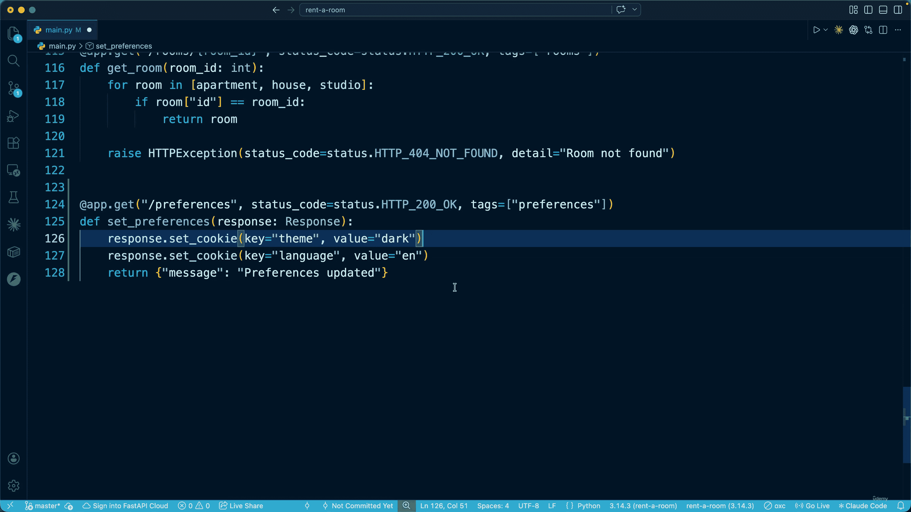
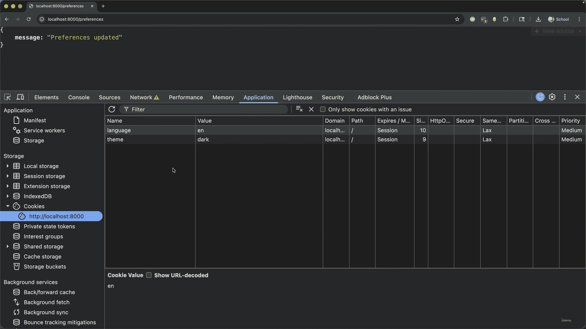

# 🍪 FastAPI Masterclass：第45课：设置Cookies

在本节课中，我们将学习如何在 FastAPI 服务器中创建一个新端点，这个端点会指示浏览器存储一些 Cookie，并要求浏览器在之后的所有请求中自动发送这些 Cookie。整个流程可以这样理解：客户端先访问一个端点，服务器在响应中附带上“请存储这些 Cookie”的指令，浏览器收到后把 Cookie 保存下来，然后在后续的请求中自动携带这些 Cookie。这是一个非常有趣且实用的循环，我们会从本节课开始一步步拆解它。

## 📥 导入 Response 类

我们首先要做的，是在 `main.py` 中增加一个导入：从 `fastapi` 中导入 `Response` 类。实际上，`Response` 类并不是 FastAPI 自己的类，而是来自 Starlette——Starlette 是 FastAPI 底层的依赖库。`Response` 对象代表服务器将要发送给客户端的完整 HTTP 响应，它提供了很多方法和属性，我们可以通过它们来定制响应中的各种细节，例如设置 Cookie。

也许你会问：响应的主体内容不是由路由函数的返回值决定的吗？没错，最终返回给客户端的 payload（也就是你屏幕上看到的 JSON 数据）确实是由路由处理函数的返回值决定的。但是，`Response` 对象负责的是“附加信息”，比如向响应头中添加 `Set-Cookie` 字段。简单来说，返回值决定了“身体”，而 `Response` 对象决定了“头”。两者分工明确，互不冲突。

## 🏷️ 创建 `/preferences` 端点

导入完成之后，我们接着来定义一个新的路由。在 `main.py` 中，所有已有路由的下方（也就是文件最底部），添加一个新的端点。我们使用 `@app.get` 装饰器，定义路径为 `/preferences`。路由名称并不是很重要，这里取 `preferences` 是因为这个端点用来让用户设置偏好，比如颜色主题、语言等。当然，在真实项目中，偏好设置通常是在用户登录时一并完成的，客户端不会专门为了设置 Cookie 而访问一个端点；更常见的做法是，客户端访问一个有实际用途的端点，服务器在处理请求的过程中顺便要求浏览器存储这些 Cookie 以供后续使用。不过现在我们先使用这个稍显“刻意”的简单示例。

在这个路由上，我们像之前一样加入 `status_code` 参数，值设为 `status.HTTP_200_OK`。同时，还要提供 `tags` 参数，它接收一个列表。`tags` 的作用是让 Swagger 文档能够把相关的路由归类到同一个分组中。这里我们将这个路由归入一个新的标签 `preferences`，这样在接口文档中查找起来会更清晰。

接下来，在路由下面定义对应的处理函数，函数名为 `set_preferences`。有人可能会说，如果我们要创建的是一种资源（比如“偏好”），使用 POST 请求会更合适。不过目前我们先放宽要求，继续使用 GET；在本课程后面的内容中，你会看到如何创建 POST 端点。

## ⚙️ 使用 Response 参数

定义好函数之后，我们要利用刚才导入的 `Response` 类。具体做法是：在函数中定义一个名为 `response` 的参数，并把它的类型注解设为 `Response`。这是 FastAPI 的一个非常强大的特殊功能：当服务器启动时，FastAPI 会分析每一个函数的签名。这里的“签名”指的就是函数定义中参数的集合。FastAPI 会检测这些参数以及它们的类型注解，然后自动执行额外的运行时逻辑，把对应的依赖或需求提供给你。

这种模式我们其实已经见过了，比如之前的 `Query` 函数：FastAPI 能够自动从查询参数中解析内容，并在执行我们自己的路由处理函数之前对它们进行额外验证。现在也一样，因为函数参数的类型是 `Response`（注意，重要的是类型，不是参数名），FastAPI 看到这个类型后，就会自动实例化一个 `Response` 对象并传入函数。这正是 FastAPI 强大之处：它利用了“运行时反射”的能力，检查代码自身，理解函数期望的类型，然后自动创建出对应的对象，作为参数传递给路由处理函数。虽然背后有不少“魔法”，但我们现在确实可以在函数里直接使用这个 `response` 对象了。

## 🍪 调用 set_cookie 方法

拿到 `response` 对象后，我们就可以在把响应发送给客户端之前，对响应进行自定义。具体做法是调用 `response.set_cookie()` 方法，这个方法需要传入两个参数：`key` 和 `value`，分别代表 Cookie 的名称和对应的值。下面我们设置两个 Cookie：

- 第一个 Cookie：`key` 为 `"theme"`，`value` 为 `"dark"`，可以理解为开启了“深色模式”。
- 第二个 Cookie：`key` 为 `"language"`，`value` 为 `"en"`，表示语言偏好为英语。

对应的代码示例如下：

```python
from fastapi import FastAPI, Response, status

app = FastAPI()

@app.get("/preferences", status_code=status.HTTP_200_OK, tags=["preferences"])
def set_preferences(response: Response):
    response.set_cookie(key="theme", value="dark")
    response.set_cookie(key="language", value="en")
    return {"message": "preferences updated"}
```

注意，这段代码是运行在服务端的，位于路由处理函数的内部。当客户端向 `/preferences` 发起请求时，服务器的响应中就会携带这两个 `Set-Cookie` 头，从而要求浏览器（也就是客户端）把这些 Cookie 保存起来，供未来请求使用。换句话说，服务器是在要求客户端在后续所有操作中自动携带这些信息。

但这里有一个关键点：客户端必须首先访问一次这个端点，上面的代码才会被触发，服务器才会要求浏览器存储 Cookie。如果从不访问，那么 Cookie 自然就不会被设置。

在设置完 Cookie 之后，我们返回一个普通的 Python 字典：`{"message": "preferences updated"}`。这里再次强调：返回的这个字典就是实际 payload，也就是你在屏幕上看到的 JSON 数据。额外的元数据（例如 `Set-Cookie` 响应头）是在后台处理的；在屏幕上，除了返回的 payload 你看不到其他任何东西。但是浏览器会在后台收到这些指令，并真的去执行设置 Cookie 的操作。

## 🖥️ 在浏览器中验证

代码写完并保存后，我们切换到浏览器，打开开发者工具中的 Network（网络）标签页，然后访问 `/preferences`。首先，你会看到屏幕上确实显示了由 `return` 返回的 payload，也就是 Python 字典被转换成的 JSON 数据。



接下来，在网络标签页中刷新页面，你会看到刚才的 `preferences` 请求出现在请求列表中。这里展示了很多常规信息。有趣的是，如果你查看 Response Headers（响应头），也就是服务器发回的头部信息，向下滚动就能看到两个名为 `set-cookie` 的响应头。这两个响应头正好对应我们在端点中调用的两次 `set_cookie` 方法。通过这两个响应头，服务器正在向浏览器下达指令，要求设置如下 Cookie：

- `theme=dark`
- `language=en`

当 Chrome 收到这个响应后，它会在屏幕上渲染 payload，同时也会看到来自服务器的这些响应头，并在后台自动做出反应。第一步，它会在本地设置这些 Cookie，把它们保存到浏览器中。这一点我们马上会再验证。第二步，浏览器（客户端）会在之后所有指向同一域名的请求中自动附加这些 Cookie。

这意味着，当我们访问 `localhost:8000` 上的任何其他路由时，无论路径是什么，浏览器都会自动把当前存储的 Cookie 作为请求头发送给服务器。整个流程可以概括为：服务器指示浏览器保存一些数据供以后使用，浏览器保存后，就会自动把这些数据附加到后续所有请求中。这个过程完全自动化，不需要我们手动干预。这也是 Cookie 与普通 Header 最大的区别：Cookie 在技术上也是一种 Header，是附加在请求上的键值对，但浏览器会自动替我们处理发送逻辑，比如把 `theme` 和 `language` 这两个 Cookie 随后续请求一并发送给服务器。

你可能会注意到响应头中还有 `SameSite=Lax` 这样的字段。这只是一个安全设置，以后可能会详细讲解，现在完全不必担心它。

接下来，我们证明浏览器确实已经保存了这些 Cookie。在开发者工具的顶部菜单中找到 Application（应用程序），然后在左侧面板的 Storage（存储）下方找到 Cookies。这里会列出所有保存过 Cookie 的域名，也就是所有在你浏览器中留下过 Cookie 的网站。点击 `localhost`（这里具体是 `localhost:8000`），你就能看到浏览器中已经保存的两个 Cookie：

- `language` 的值为 `en`
- `theme` 的值为 `dark`

这直观地说明，这些数据现在已经持久化了：它们被保存在浏览器中，也就是保存在你的电脑上。另外，Cookie 是有过期时间的；到了某个时间点，它们会失效，届时用户需要重新访问一次 `/preferences` 这样的路由，才能再次设置这些 Cookie。

现在，由于这些 Cookie 已经持久化，浏览器在之后任何对 `localhost` 的请求中，都会自动将这些 Cookie 作为请求头发送给该域名的服务器。服务器收到后，就能读取并使用这些信息，从而识别用户的状态或偏好。

## 🧠 为什么需要这个循环？

最后，我们来思考一下为什么需要这个“请求-存储-再携带”的循环。根本原因在于 HTTP 协议是无状态的（stateless）。每个请求都是独立的，服务器并不知道当前请求与之前的请求有何关联。如果用公式表达，就是：

```text
请求_n 不包含 请求_{n-1} 的任何信息 → 需要在每次请求中补充上下文
```

因此，我们必须在每一个请求上提供额外的信息，作为上下文传递给服务器。Cookie 恰好提供了一个自动化的解决方案：浏览器知道要自动发送这些 Cookie，也就是把这些键值对和补充信息作为元数据，附加到所有后续的同一域名请求中。这样一来，服务器就能通过 Cookie 跨请求记住用户的状态了。

## 📌 总结



本节课中，我们一起学习了如何在 FastAPI 中通过 `Response` 对象在响应里设置 Cookie。具体流程是：定义一个 `/preferences` 端点，在路由函数中声明 `response: Response` 参数，然后调用 `response.set_cookie()` 方法设置各个键值对，最后返回一个普通的 JSON payload。我们还验证了浏览器会保存这些 Cookie，并真正理解了 HTTP 无状态以及 Cookie 的自动发送机制。在下一节课中，我们将具体演示浏览器在后续请求中携带这些 Cookie 后，服务器是如何读取它们的。
