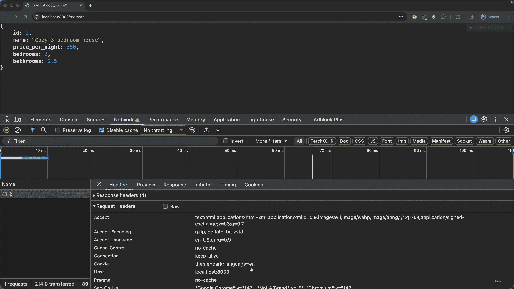
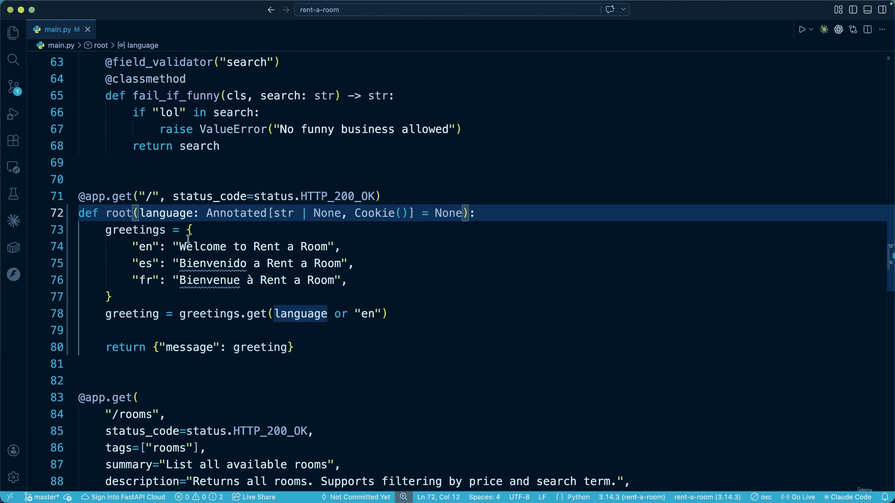
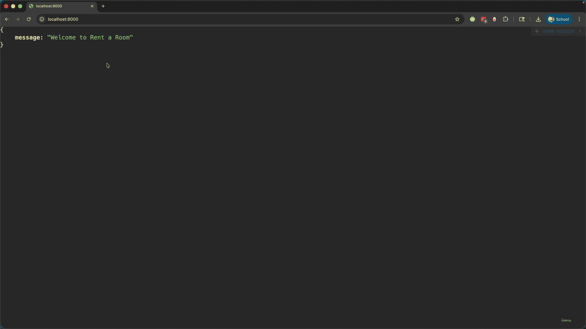
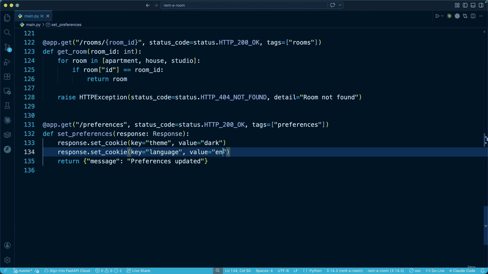
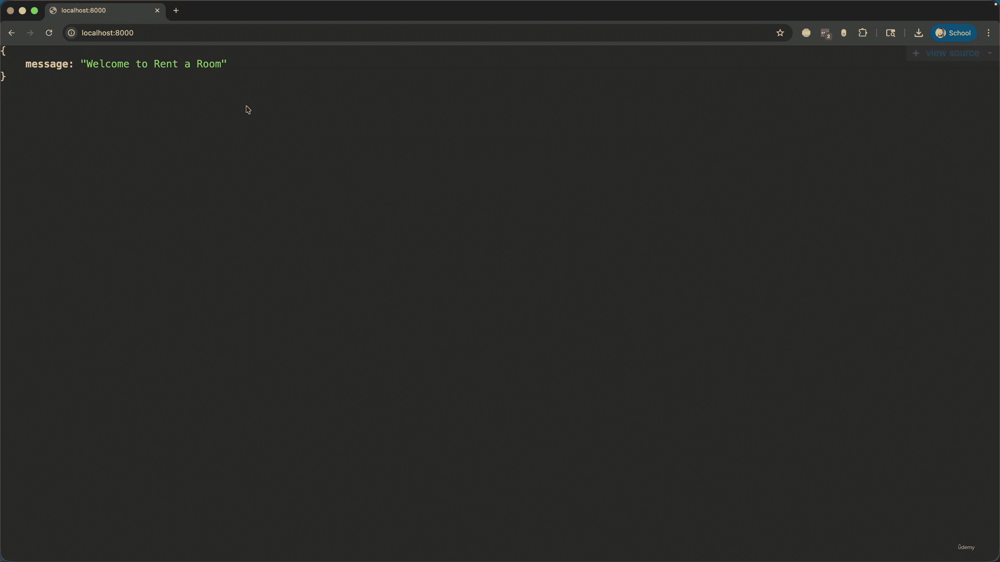

# FastAPI 大师课：第46-47课：🍪 在服务端读取 Cookie

在本节课中，我们将要学习如何在 FastAPI 服务端读取浏览器发回来的 Cookie，并用这些 Cookie 定制返回给客户端的响应。上一课中，我们定义了一个新的 preferences 端点，服务器在这个端点中指示浏览器保存两个 Cookie；因为它们就是 Cookie，所以浏览器会在之后访问同一域名时自动包含它们。本课先在网络面板中验证浏览器确实会自动携带 Cookie，再动手编写根路由来读取 `language` Cookie，最后演示 Cookie 不存在时的回退处理。下面按步骤展开，每一步都会尽量用直白的话解释清楚。

## FastAPI 大师课：第46-47课-1：🌐 观察浏览器自动发送 Cookie

上一课我们定义了 preferences 端点，并让服务器指示浏览器保存 Cookie。本节中我们来看看浏览器是否真的会在后续请求中自动携带这些 Cookie。为了直接证明这一点，可以在 Network 面板中观察：访问 preferences 之后，再导航到另一个页面，例如进入 rooms 页面，像这样。这样就能看到对 `/rooms` 端点的请求。记住，Cookie 就像自动添加的请求头，因此可以在 Request Headers 下面看到发送给服务器的 Cookie 负载；向下滚动，这里的请求头就是来自请求、也就是来自客户端或浏览器的头。

以下是观察请求头时可按顺序查看的几个位置。

- 先访问 preferences 端点，让服务器指示浏览器保存 Cookie。

- 打开浏览器的 Network 面板，再导航到 rooms 页面。

- 找到对 `/rooms` 端点的请求，展开它的请求头信息。

- 在 Request Headers 下面找到名称为 `Cookie` 的请求头。

- 查看 `theme` 和 `language` 两个 Cookie 以及它们对应的值。



在这个 `Cookie` 请求头里，可以看到两个字面名称为 `theme` 和 `language` 的 Cookie。它们会用分号分隔，但基本上都被打包进同一个 Cookie 请求头，值就是一个包含这些数据的字符串。可以用下面的代码来理解这个请求头的形态。

```text
Cookie: theme=dark; language=EN
```

如果以后有超过两个 Cookie，它们也会在这里拼接在一起。再次说明，这个 Cookie 负载会继续包含在我们访问的任意单一路由中。再举一个例子：去 `/rooms2`，这次请求仍然会在 Request Headers 下面看到 Cookie 请求头，里面附着完全相同的数据。通过这个观察可以确认，浏览器会自动把 Cookie 加到同一域名下的后续请求里。既然浏览器会自动发送 Cookie，接下来我们来看一个实际用途：在根路由中读取 Cookie，并返回不同语言的问候。

## FastAPI 大师课：第46-47课-2：🎯 用 Cookie 定制根路由问候

上一节我们确认了浏览器会自动携带 Cookie。本节中我们来看看 Cookie 的一个实际用例：更新 `/` 根路由，用用户偏好的语言来问候用户。用户访问 preferences 页面之后，浏览器里会有一个名为 `language` 的 Cookie，默认值会设为 `EN`，也就是 English。服务器可以在后续请求中读取这个 Cookie，然后用它定制返回给客户端的响应。这个思路很直白：同一个根路由，不再永远返回同一句话，而是根据浏览器带来的语言偏好返回不同问候。

以下是这个实际用例的主要步骤。

- 更新根路由 `/`，让它读取 `language` Cookie。

- 如果浏览器带有 `language` Cookie，就按这个值选择问候语。

- 如果浏览器没有这个 Cookie，就使用默认的英文问候。

- 把选出的问候语放进响应，返回给客户端。

这里需要回到 VS Code 继续修改代码。完成代码后，浏览器下次访问根路由时，就会把之前保存的 Cookie 一并带上。要让 FastAPI 知道某个参数来自 Cookie，需要先导入专门的 `Cookie` 函数，下一节我们就来看具体写法。

## FastAPI 大师课：第46-47课-3：🧩 导入 Cookie 并用 Annotated 声明来源

上一节我们确定了要在根路由中读取语言 Cookie。本节中我们来看看 FastAPI 如何知道一个参数应该从 Cookie 中解析，而不是从查询参数中解析。先滚动到文件最上方，从 FastAPI 库中再导入一个 `Cookie`，注意这里的 `Cookie` 首字母大写。可以这样理解 `Cookie`：它同样是一个校验函数，和 `Query` 非常相似，区别在于它表示某个端点应该从 Cookie 中解析一段数据，而不是从查询参数中解析。这也说明同一个端点可以用多种方式接收数据，它可能接收路径参数、查询参数、Cookie 或请求头。

以下是这个端点参数声明中需要同时注意的几个点。

- `language` 这个参数可能不存在，取决于用户是否访问过 preferences 页面。

- 参数类型可以先写成 `str | None`，表示它可能是字符串，也可能为空。

- 参数名 `language` 来自我们设置 Cookie 时使用的实际名称。

- 默认情况下，FastAPI 会把 `language` 当成查询参数，因此必须显式声明它来自 Cookie。

- 使用 `Annotated` 配合 `Cookie()` 告诉 FastAPI 数据来源，并提供默认值 `None`。

导入 `Cookie` 后，滚动到根路由的定义位置；它位于 identity 相关类的后面，位置有点隐蔽。这里提供一个名为 `language` 的参数。它可能不存在，取决于用户是否访问过 preferences 页面，因此一开始可以把注解写成 `str | None`。另外，`language` 这个名称来自我们设置 Cookie 时使用的实际名称；向下滚动可以看到设置时把它叫作 `language`，因此当 Cookie 被发送到任意端点时，包括根端点，我们都期望 Cookie 的键名正好是 `language`。当前语法的问题是，默认情况下 FastAPI 会推断 `language` 是一个查询参数。这里需要使用 `Annotated` 配合已经导入的 `Cookie` 函数，明确告诉 FastAPI 这是一个 Cookie。类型会放在方括号的第一项，第二项是 `Cookie()` 的调用，语法和 `Query` 一样，但这里的 `Cookie` 很关键，因为它再次说明数据来自哪里。同时提供默认值 `None`，保持写法一致。这样要么 Cookie 存在，FastAPI 能解析 `language` Cookie 的值；要么回退到 `None`。

```python
from typing import Annotated

from fastapi import Cookie, FastAPI

app = FastAPI()


@app.get("/")
async def root(
    language: Annotated[str | None, Cookie()] = None,
):
    ...
```

现在 FastAPI 已经能从 Cookie 中取得 `language` 的值，下一步就可以返回自定义响应。接下来定义多语言问候字典，并根据读取到的语言值选择对应问候。

## FastAPI 大师课：第46-47课-4：🗂️ 定义多语言问候字典并读取 Cookie

上一节我们让 FastAPI 从 Cookie 中读取 `language`。本节中我们来构造实际返回的问候内容。这里定义一个 `greetings` 字典，里面放三个键值对，三个键分别对应不同语言。例如 `EN` 对应英文问候，值可以写成 `Welcome to rent a room`。再加两个：`E` 对应西班牙语，值可以写成类似 `Bienvenido a rentar` 的问候；如果发音不标准，请见谅。再加一个 `fr` 对应法语，值可以写成类似 `Bienvenue à louer une chambre` 的问候。法语字符串可以从另一个字符串复制过来，因为它包含特殊字符。这里的关键不是确切的字符串内容，读者可以按需要替换成自己的问候语；关键是三个不同语言选项对应不同问候。

以下是这段逻辑中的关键点。

- 使用 `greetings` 字典保存语言键和问候语的对应关系。

- 调用字典的 `get` 方法，把 `language` 作为键传进去，取出对应值。

- 使用 Python 的 `or` 关键字做回退：如果 `language` 是 `None`，就回退到 `EN`。

- 把取出的值赋给变量 `greeting`，再放进响应消息中。



- 最后的 `message` 不再使用固定硬编码字符串，而是返回根据用户语言偏好生成的动态问候。

可以直接用下面的代码表示这个字典查找和回退逻辑。

```python
greetings = {
    "EN": "Welcome to rent a room",
    "E": "Bienvenido a rentar",
    "fr": "Bienvenue à louer une chambre",
}

greeting = greetings.get(language or "EN")

return {"message": greeting}
```





调用 `greetings.get(language or "EN")` 时，如果 `language` 为 `None`，这个表达式会计算为假值，于是回退到 `EN`。也可以直接在别处回退到 `EN`，这只是完成同一结果的另一种方式。把字典键传给 `get` 方法后，它会返回对应值，并赋值给 `greeting`。然后响应里的 `message` 不再使用固定硬编码字符串，而是返回根据用户在 preferences 页面设置的语言偏好计算出的动态问候。需要说明，这个例子有点人为，因为 preferences 路由目前总是把语言固定设置成英文。但在真实世界中，这个值会是动态的：例如用户注册账号时提供语言数据，我们把它存储起来，并在用户登录时把 Cookie 设置到浏览器，以便在客户端持久化用户偏好，同时确保每个无状态 HTTP 请求都能持续把用户数据提供给各个端点使用。之前已经提到，浏览器会自动把 Cookie 发送到同一域名下的每个端点，因此完全可以在其他端点中写同样的代码。代码保存后，回到浏览器进行验证，下一节演示有 Cookie 和没有 Cookie 时的不同结果。

## FastAPI 大师课：第46-47课-5：🧪 在浏览器中验证 Cookie 读取与回退

上一节完成了读取 Cookie 并生成动态问候的代码。本节中我们回到浏览器，看看响应如何随 Cookie 变化。前面已经访问过 preferences，因此现在访问根路由时，浏览器应该已经设置了 Cookie。此时会看到 `Welcome to rent a room`。接下来换一个例子：回到 VS Code，在 preferences 路由中设置不同的语言偏好，例如把它切换成类似 `ES` 的值并保存。注意浏览器里仍然保留旧 Cookie；可能需要清除旧 Cookie，但访问 preferences 时应该会自动重置。导航到 preferences 后，偏好会更新。再回到根路由，会看到类似 `Bienvenido a rentar` 的问候，因为我们为 `language` Cookie 设置了新的值，现在把它设为 `E`。浏览器随后把 `language` Cookie 发送到每个路由，包括根路由；FastAPI 解析现有值，并用它定制动态字符串或问候消息，然后把消息放进返回给客户端的负载中。

以下是验证过程中要观察的几个场景。

- 已访问 preferences 后访问根路由，应看到默认英文问候。

- 修改 preferences 中的语言偏好并保存，再访问 preferences 更新 Cookie。

- 回到根路由，应看到与新语言 Cookie 对应的问候。

- 删除浏览器中的 Cookie 后再刷新根路由，应回退到英文问候。

- 打开开发者工具的 Application 面板，可以在 localhost 下删除 `theme` 和 `language` Cookie。

还需要演示没有设置 Cookie 时会发生什么。没有 Cookie 也完全没问题，因为参数列表中把默认值设成了 `None`，随后字典查找会回退到 `EN`，也就是英文。为了展示这一点，打开开发者工具，进入 Application 面板，在 localhost 下右键选择 Delete，把 `theme` 也删除。这样在再次访问 preferences 路由之前，就没有任何 Cookie。此时回到根路由或刷新页面，会回退到 `EN` 语言，因此回到 `Welcome to rent a room`。这也是一个好的设计：端点不依赖 Cookie。这个做法和查询参数类似，我们把查询参数设为可选，让端点尽可能灵活。某个端点可能在某些操作中需要 Cookie，但 Cookie 主要包含用户数据和用户偏好，因此依赖它们（如果可用）是合理的，同时也不必强依赖它们，这里的写法正是这样。到这里，代码和浏览器验证都完成了，下一节对整节课做总结。

## FastAPI 大师课：第46-47课-6：✅ 本课总结

上一节我们验证了 Cookie 存在和不存在时的行为。本节中我们对整节课做总结。本课覆盖了如何在服务端读取浏览器发回来的 Cookie，这是一个有趣的共生关系：服务器指示浏览器设置并保存 Cookie，之后浏览器在每一次后续请求中把这些 Cookie 作为请求头自动附加到服务器。可以用一个简单流程表示这个过程。

```text
Server 指示浏览器保存 Cookie
        ↓
Browser 在后续同域请求中自动添加 Cookie 请求头
        ↓
FastAPI 使用 Cookie() 和 Annotated 读取 Cookie
        ↓
Endpoint 根据 Cookie 值定制响应
```



本节课中我们一起学习了浏览器如何自动发送 Cookie、FastAPI 如何用 `Cookie` 和 `Annotated` 声明 Cookie 参数、如何根据 `language` Cookie 返回多语言问候，以及 Cookie 缺失时如何回退到默认语言。核心做法是把 Cookie 当作一种可选的数据来源，在可用时使用它定制响应，在不可用时仍然让端点正常工作。

