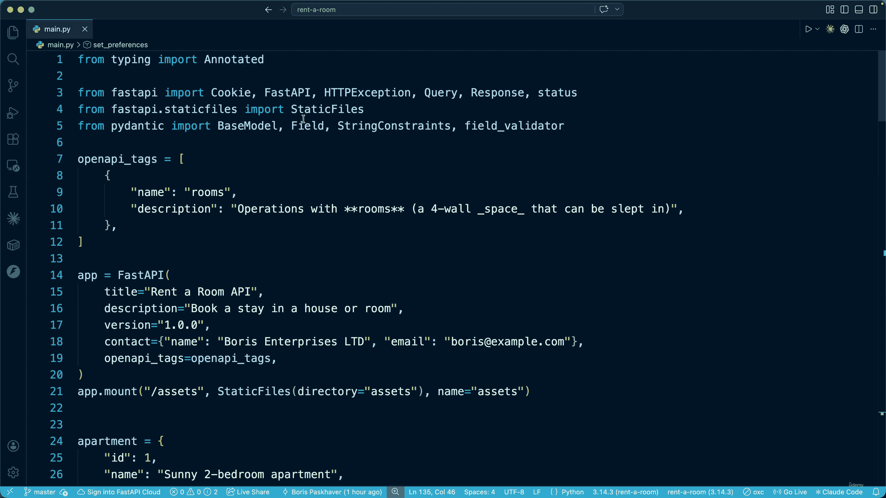
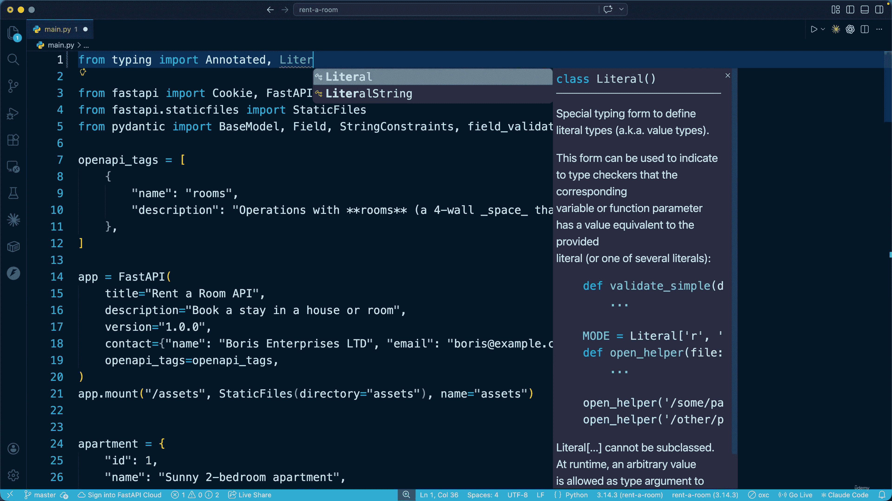
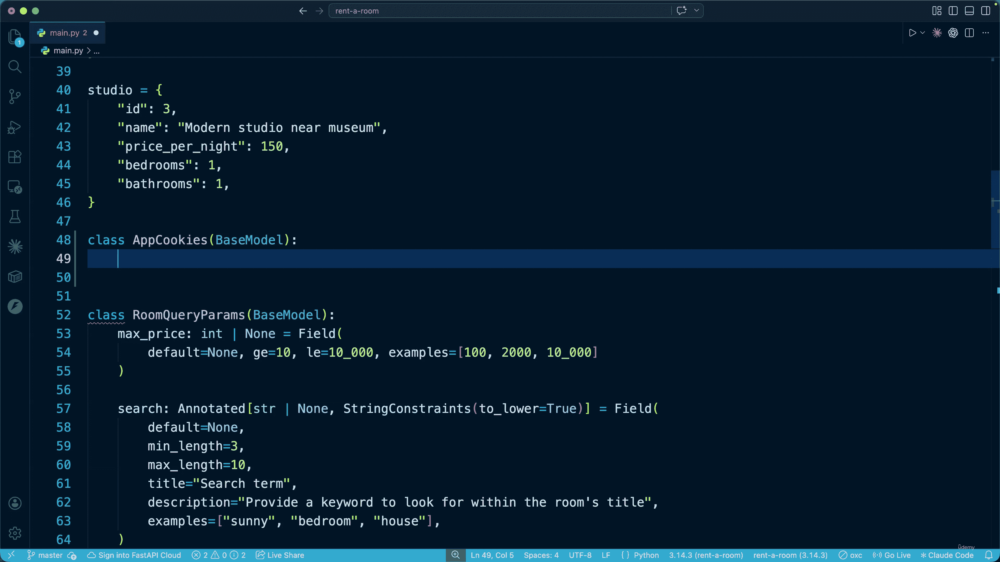
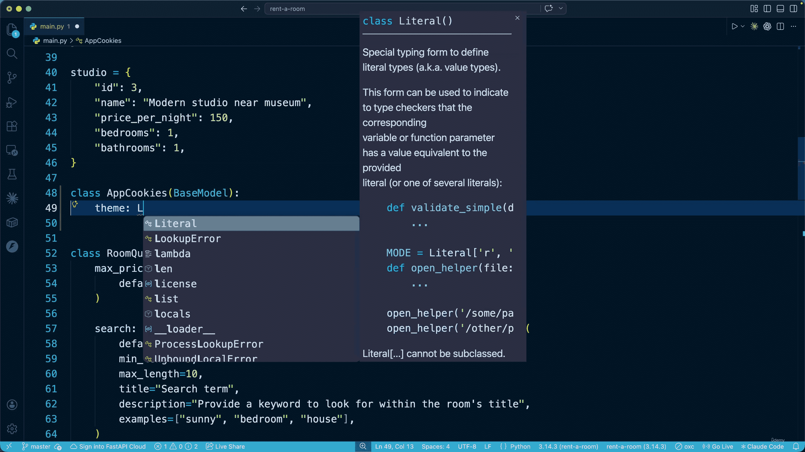
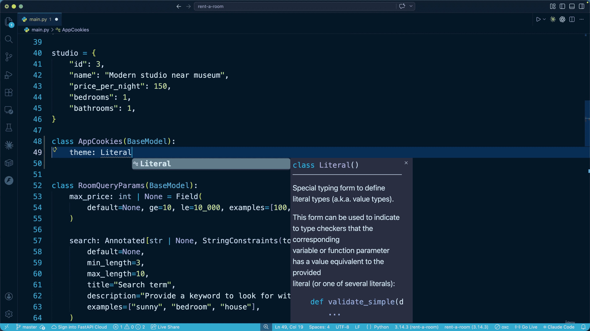
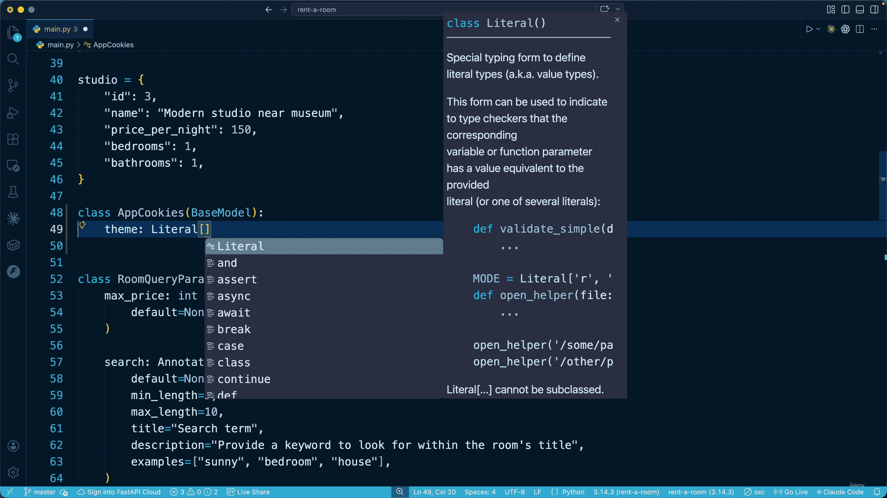
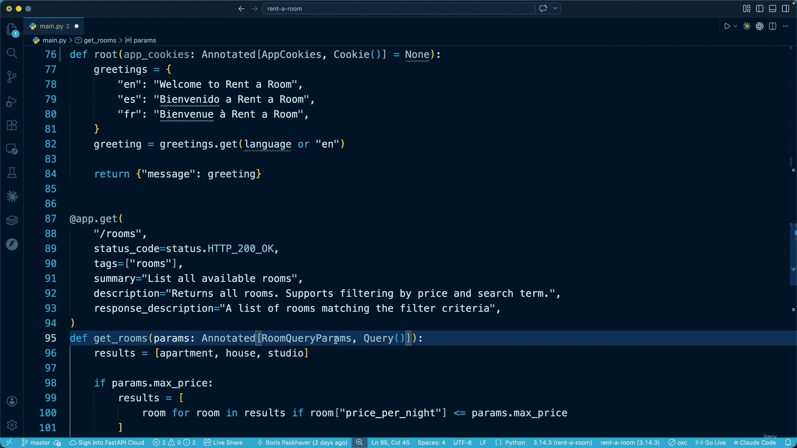
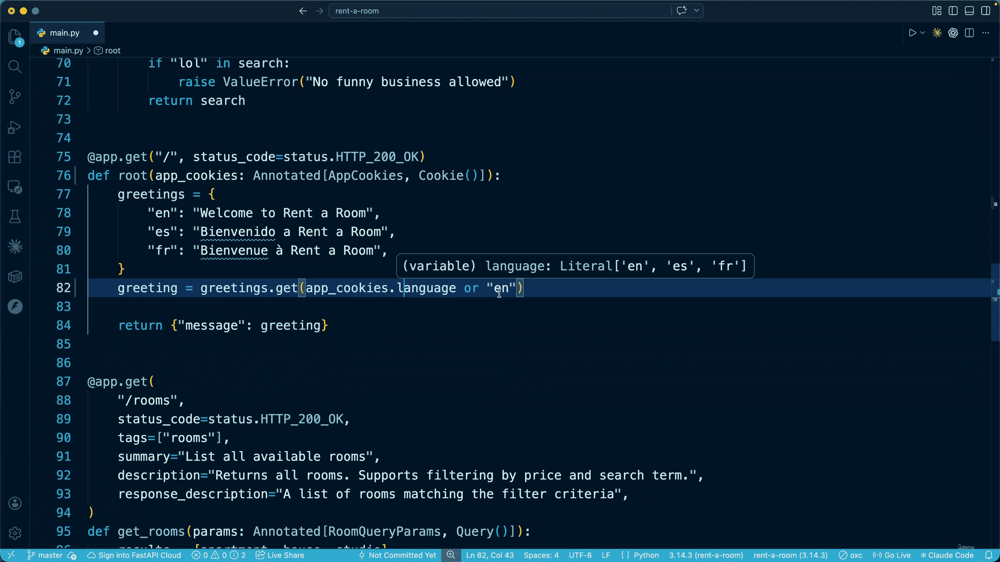
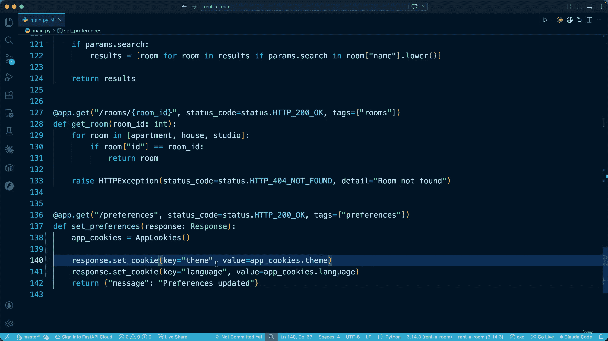
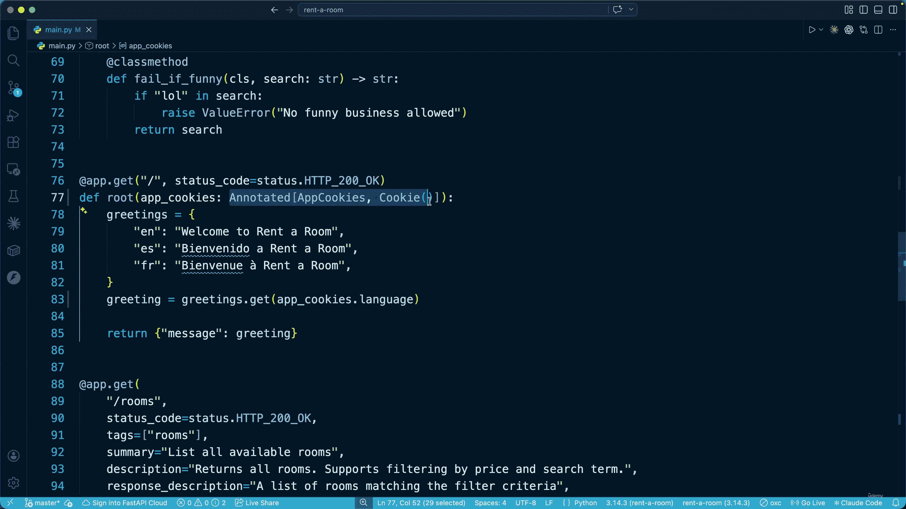

🚀 FastAPI Masterclass：Part 1 P47-48：使用 Pydantic 模型处理 Cookies 🍪

在本节课中，我们将继续使用 Pydantic 模型来优化 FastAPI 应用。上一节我们演示了如何把查询参数的声明和校验逻辑迁移到 Pydantic 模型中；本节我们将对 cookies 做一次完全相似的重构。通过这种方式，我们可以把数据验证从路由中抽离出来，让代码更加整洁、复用性更强。



首先，我们来回顾一下 Pydantic 是什么。Pydantic 是一个数据验证和转换库，它并不和 FastAPI 耦合在一起。也就是说，你可以把它用在任何 Python 项目中，不只是 FastAPI。我们完全可以用它来建模任何一组相关的属性或信息片段，例如，这个网站所支持的所有 cookies。

在动手之前，我们需要在 Python 内置的 `typing` 模块中再导入一个类型：`Literal`。等下你就会看到它的作用。这个类型可以帮助我们把字段的取值范围限制得更精确。



接下来，让我们在代码文件的下方、紧挨着上一节定义的 query params 模型的地方，放置一个新的类。这个类和 query params 模型的语法几乎完全一样。我们把它命名为 `AppCookies`，关键点在于，这个类要继承自 Pydantic 的 `BaseModel`。下面是这个类的骨架：

```python
from typing import Literal
from pydantic import BaseModel

class AppCookies(BaseModel):
    pass  # 字段稍后填充
```



这个类本身对数据的来源一无所知：它不知道数据是来自查询参数、cookies 还是 headers。这并不是缺点，反而是一种优势。因为我们已经把数据验证从端点的实际使用中抽取出来，所以这个模型可以在任何场景下复用。

对于 cookies 来说，更准确地说，对于我们要表示的两条数据，我们将把每一条都声明为类中的一个字段。下面是我们将在 `AppCookies` 模型中声明的两个属性：

- `theme`：网站的配色主题。
- `language`：网站的语言设置。







我们先来看第一个字段 `theme`。我们可以把它声明为普通的 `str` 类型。但更好的选择是使用我们刚刚导入的 `Literal` 类型。`Literal` 允许我们指定一个更小的字符串集合。这样，`theme` 就不再是全世界任意一个字符串，而是被限定在两个可能值之一：`"light"` 或 `"dark"`。这比普通字符串更精确。

声明方式是在方括号中提供逗号分隔的所有可能值。例如，列出 `"light"` 和 `"dark"`。这两个值本身是任意的，但在这里它们就代表了网站配色主题的两种可能取值。在等号右边，我们还可以像普通 Python 变量一样提供默认值。例如，让默认值为 `"dark"`：

```python
theme: Literal["light", "dark"] = "dark"
```

你可能会问，为什么不用之前查询参数中使用的 `Field` 函数？当然你也可以这么写：

```python
from pydantic import Field

theme: Literal["light", "dark"] = Field(default="dark")
```

这个写法和直接赋值 `"dark"` 的效果完全相同。不过，很多人认为 `Field` 的语法更冗长。通常，只有在需要额外验证时，我们才会考虑使用 `Field`。比如，你可以声明某个 cookie 的值必须达到一定长度，或者必须大于/小于某个数值。在这个例子中，我们并不需要这些高级特性，所以直接赋值 `"dark"` 就足够了。这算是更简单的版本。

类似地，我们要处理第二个 cookie，也就是第二条数据：语言设置。我们在 `AppCookies` 类中声明一个名为 `language` 的属性。类型同样使用 `Literal`，在方括号中提供可能的取值：`"en"`、`"es"` 和 `"fr"`。这正好对应上一节课中我们在根路由里看到的例子。同样，给它一个默认值 `"en"`：

```python
language: Literal["en", "es", "fr"] = "en"
```

现在，我们的 `AppCookies` 类看起来像这样：

```python
from typing import Literal
from pydantic import BaseModel

class AppCookies(BaseModel):
    theme: Literal["light", "dark"] = "dark"
    language: Literal["en", "es", "fr"] = "en"
```

当我们的代码或 FastAPI 创建 `AppCookies` 的实例时，需要提供一个数据源。如果因为某种原因，cookies 中没有 `theme`，我们就回退到 `"dark"`；如果没有 `language`，我们就回退到 `"en"`。这和之前 query params 的做法非常相似。

现在这个模型本身只是一个基于 Pydantic 的数据验证类，我们还需要真正在路由中使用它。以下是本次需要更新的两个路由：

1. 根路由（root route）
2. preferences 路由



第一个是根路由。之前，我们为单个 `language` 参数使用了 `str | None` 这样的类型；如果还要把 `theme` 也加进来，参数列表就会变得越来越大，最终会碰到我们上一节在查询参数中看到的同样问题。现在，我们把所有 cookies 都收集到单个对象中，所以只需要声明一个参数 `app_cookies`。这个参数的类型不再是 `str | None`，而是上面定义的 `AppCookies` 模型实例。

注意，这和查询参数的做法几乎一样，主要区别在于 `Annotated` 的第二个值。这里必须提供 `Cookie()`。这个标记非常重要，因为它告诉 FastAPI：请从 cookies 中解析这个 `AppCookies` 实例的值，而不是从查询参数中解析。同理，当我们使用 `Query()` 时，就表示从查询参数中构造这个 Pydantic 类的值。所以一定要仔细告诉 FastAPI 数据来自哪里。

而 Pydantic 数据模型本身是可复用的，这正是整个重构的核心：把路由逻辑和实际的数据验证分离开来。代码可以这样写：

```python
from typing import Annotated
from fastapi import Cookie

@app.get("/")
def root(app_cookies: Annotated[AppCookies, Cookie()]):
    return {
        "theme": app_cookies.theme,
        "language": app_cookies.language,
    }
```



现在，我们不再需要为 `language` 提供 `None` 默认值。因为无论如何，我们都会得到一个 `AppCookies` 实例。可能的情况是，cookies 中的某些字段没有值，这时模型会回退到我们之前声明的默认赋值。我们唯一需要更新的地方是：`language` 不再是端点函数的一个顶层参数，而是 `app_cookies` 模型上的一个属性。我们可以通过 `app_cookies.language` 访问它。这个属性会被填充为 `"en"`、`"es"` 或 `"fr"` 之一；如果 cookies 中没有 `language`，Pydantic 模型就会回退到 `"en"`。原来的默认参数已经不再需要了，因为无论从 cookie 中读取，还是由模型回退，`language` 属性始终会被填充。移除它之后，代码依然可以正常工作。

另一个需要更新的路由是下面的 `preferences`。严格来说，我们并不是非改它不可，但为了保持一致性，最好也更新一下。在这个路由中，我们原来是手动设置这些值的。其实，我们可以直接在函数内部创建一个上面定义的 `AppCookies` 实例。默认情况下，根路由中的实例化是由 FastAPI 自动完成的，因为我们提供了 `Cookie()` 函数，并把类型指定为 `AppCookies`。但 `AppCookies` 只是一个普通的 Python 类，所以我们当然也可以在代码中手动内联使用。

这里我们创建一个普通实例，不传入任何额外数据。当然，你也可以通过构造参数传入数据，但如果不传任何参数，就会回退到默认值 `"en"` 和 `"dark"`。然后，把实例赋值给一个变量，比如 `app_cookies`，再访问它的属性：

```python
@app.get("/preferences")
def preferences():
    app_cookies = AppCookies()
    return {
        "theme": app_cookies.theme,
        "language": app_cookies.language,
    }
```

这样，默认值就会在实例化或验证的时候被提供出来。

到这里，整个重构就完成了。现在，这个模型成了这些属性以及它们可能取值的“唯一真相来源”。业务逻辑仍然和原来一样：用户仍然需要先访问某个端点，才能把这些值写入 cookies。不过，即使 cookies 缺失，我们也可以在 Pydantic 模型中回退到默认值。浏览器会在后续的每一个请求中自动携带 cookies，任意端点都可以用同样的语法来解析 cookies。你还可以把解析结果赋值给专门的变量和类型，以便在多个路由间复用。现在，任何路由都可以读取这些 cookies，并用它们来定制用户响应，或者在服务器逻辑中创建分支，完全取决于你的需求。





本节课我们一起学习了如何用 Pydantic 模型来处理 cookies：首先导入 `Literal` 来限制字段取值，然后定义 `AppCookies` 模型，接着在路由中通过 `Annotated[AppCookies, Cookie()]` 让 FastAPI 从 cookies 自动解析数据，最后在手动实例化时使用默认值。这样，我们就实现了数据校验与路由逻辑的分离，让代码更整洁、更容易复用。
