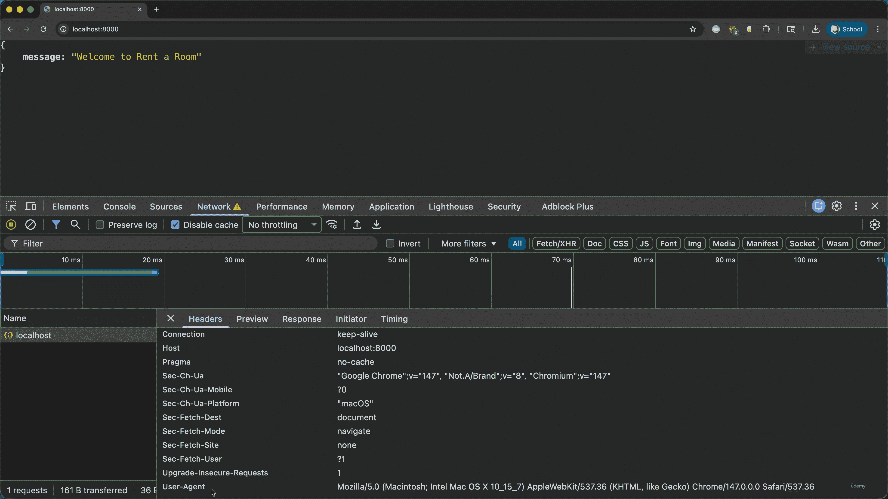
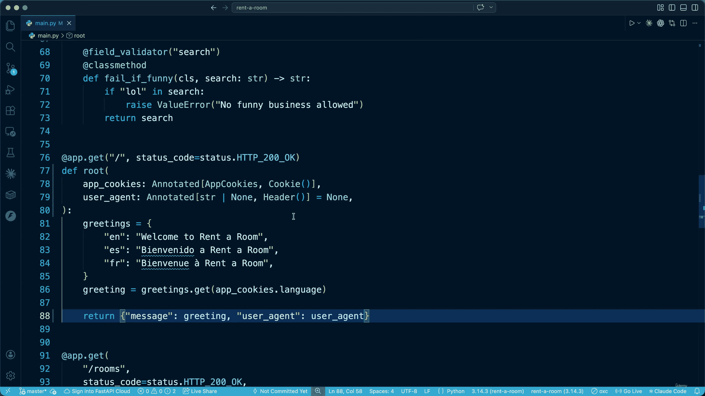
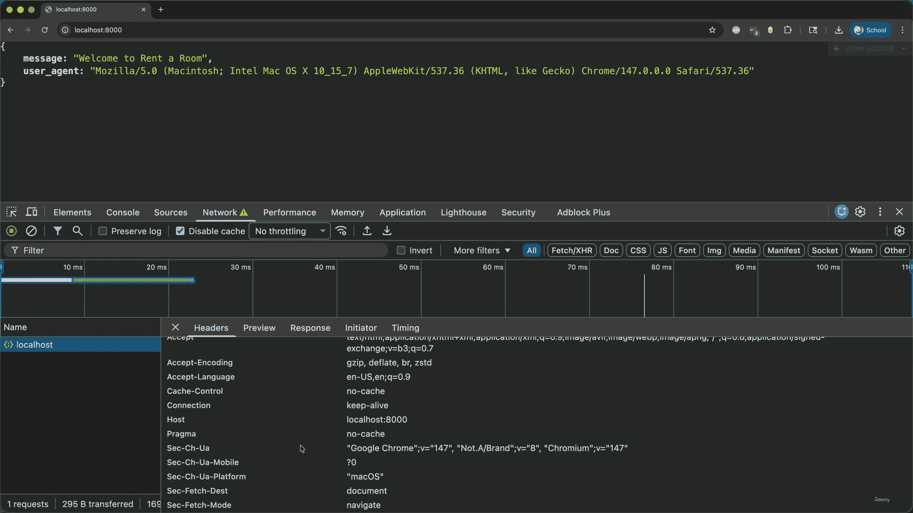

# 🚀 FastAPI 大师课：第48节：请求头参数

在本节课中，我们将学习 FastAPI 中如何读取和解析 HTTP 请求头。请求头是客户端和服务器之间传递的键值对，浏览器会把很多元数据放在请求头里，例如 User-Agent。我们会先理解请求头的基本概念，再在路由中声明请求头参数，最后验证 FastAPI 如何把请求头键名映射到 Python 参数，并把值传给函数体。整节内容围绕一个目标展开：让服务器能够拿到客户端发来的请求头数据，并在接口逻辑中使用这些数据。

在上一节课程中，我们处理了 Cookie 参数，而 Cookie 在底层正是通过请求头传输的。本节中我们来看看请求头的完整概念，以及如何在 FastAPI 路由中提取请求头值。理解这个关系之后，后面的代码会更容易看懂。

## 🧩 请求头的基本概念

请求头，英文是 Header，是客户端和服务器之间发送的键值对。客户端可以在请求中发送请求头，服务器也可以在响应中发送响应头。换句话说，Header 不是某一方专用的数据，而是请求和响应都可以携带的一种元数据容器。打开浏览器开发者工具的 Network 面板，查看任意一个请求，都能看到两个区域：一个是服务器返回的响应头，另一个是浏览器发出的请求头。响应头里会列出键和对应的值，这些值是 FastAPI 服务器希望返回给浏览器的信息；请求头里同样是一组键值对，只不过方向反过来，是客户端在请求中发送给服务器的信息。

请求头的核心结构可以用下面的公式表示：

\[
\text{Header} = (\text{key}, \text{value})
\]

需要特别说明的是，Cookie 在幕后也是作为请求头发送的，请求头是 Cookie 的传输机制。在上一节课中，我们已经在发往服务器端点的请求头里看到了实际的 Cookie 名称。Cookie 和普通请求头的区别在于自动化：只要访问同一个域名，浏览器就会在每次请求中自动把 Cookie 作为请求头附加进去，不需要开发者手动处理。理解这一点后，就能明白 Cookie 参数和 Header 参数在底层属于同一套传输体系。

以下是请求头在客户端和服务器之间传输时的几个关键点：

- 请求头是键值对，格式可以理解为 `(key, value)`。

- 客户端可以在请求中发送请求头。

- 服务器可以在响应中发送响应头。

- Cookie 会作为请求头自动附加到同域请求中。

上一节我们理解了 Cookie 的自动传输机制，本节中我们来看看如何在 FastAPI 路由中读取一个普通的请求头。读取请求头的语法与读取查询参数、Cookie 参数非常相似，核心变化只是 `Annotated` 的第二个值要换成 `Header`。



## 🛠️ 在 FastAPI 路由中提取请求头

在路由中提取请求头的语法，与提取查询参数或 Cookie 参数很相似。我们需要把 `Annotated` 类型里的第二个值改成对应的来源函数；对于请求头，这个函数就是首字母大写的 `Header`。为了演示，我们回到 VS Code，把读取请求头的逻辑加到根路由中，这样代码最简单，也方便观察结果。首先在文件顶部补充导入：`Header` 从 FastAPI 导入。此前我们已经导入过 `Query` 和 `Cookie`，现在导入请求头对应的函数即可。

以下是根路由中声明请求头参数的示例代码：

```python
from typing import Annotated

from fastapi import FastAPI, Header

app = FastAPI()


@app.get("/")
def root(
    user_agent: Annotated[str | None, Header()] = None,
):
    return {"user_agent": user_agent}
```

在根路由函数的参数列表中，我们新增一个参数，参数名写成请求头键名的 Python 蛇形命名版本。浏览器里的请求头键名通常使用短横线连接单词，每个单词首字母大写，例如 `User-Agent`，这种格式可以看作 kebab-case。FastAPI 会自动处理这种键名到 Python 参数名的转换，把 `User-Agent` 对应到 `user_agent` 这样的参数。

这个映射关系可以用下面的公式表示：

\[
\text{User-Agent} \longrightarrow \text{user\_agent} \longrightarrow \text{函数参数}
\]

这里有一条必须遵守的规则：参数名中的实际字符要与请求头键名对应，不能随意多写字符。如果参数名里多写一个 `z`，FastAPI 就无法理解两者之间的对应关系。还需要明确告诉 FastAPI：`user_agent` 来自请求头，而不是 Cookie 或查询参数。声明 `Annotated[str | None, Header()]` 就是在表达这个来源信息。

这个声明表达的数据来源关系可以概括为：

\[
\text{Annotated[类型, Header()]} \Rightarrow \text{从请求头取值}
\]

FastAPI 收到这个声明后，会查看请求头名称，按照命名规则匹配字符，把请求头键名转换成对应的函数参数，并把请求头里的值作为该参数的实参传入函数体。这个参数的类型标注为 `str | None`，原因是：浏览器通常会提供 User-Agent，但并不是所有客户端都一定提供这个请求头，所以允许它是 `None`，同时把默认值设为 `None`。这两行代码正好展示了 `Annotated` 与 FastAPI 额外函数配合的意义：我们不仅告诉 FastAPI 数据类型，还告诉它每个数据应该从哪里读取。对比来看，Cookie 参数使用 `Cookie()`，FastAPI 就会从特定的 Cookie 请求头中取值并填充 Pydantic 模型；User-Agent 参数使用 `Header()`，FastAPI 就会从请求头中查找 `User-Agent`。这样同一个路由就能同时获得 Cookie 信息和请求头信息。

为了保持示例简单，这里只把读取到的 User-Agent 直接放进响应。函数体里返回一个字典，键名可以叫 `user_agent`，这个键名由开发者决定，没有强制要求。这样做的目的是把客户端的 User-Agent 返回给调用方，让调用方看到自己的浏览器、操作系统等客户端信息。这个值本身不是业务数据，但它是验证请求头读取流程的最直观方式。这是本示例最重要的细节：响应里的值来自请求头解析，而不是硬编码。

上一节代码已经完成了请求头参数声明，本节中我们来看看它在浏览器里如何工作。验证时重点观察请求头里的 `User-Agent` 和响应 JSON 中的 `user_agent` 是否对应，这样就能把声明、匹配、传值三个环节串起来。

## 🔍 运行验证请求头读取结果

回到浏览器中的应用页面，刷新根路由。响应中会出现 `user_agent` 字段，它的值就是从请求头解析出来的 User-Agent。这个结果说明 FastAPI 已经完成了请求头读取，并把值传入了路由函数。为了更清楚地走一遍流程，可以打开 Network 面板查看请求头：浏览器发送的请求头里有一个正常拼写的 `User-Agent`，它的值通常以 `Mozilla/5.0` 开头。我们在路由处理函数中声明了请求头参数，FastAPI 就会在请求头中查找名为 `User-Agent` 的条目，匹配字符后，把 `Mozilla/5.0 ...` 这个值转换成 `user_agent` 参数的实参，函数体再把这个参数作为字典的值返回。

以下是完整的数据流步骤：

1. 浏览器在请求头中发送 `User-Agent`。

2. FastAPI 根据 `Header()` 声明到请求头中查找对应键名。

3. FastAPI 把请求头键名映射到 Python 参数 `user_agent`。

4. 路由函数拿到参数值，并把值放入响应字典。

这个流程说明，服务器端能够读取客户端发来的请求头。实际项目中最常见的用途并不是把请求头原样返回给用户，而是在服务器内部根据请求头的值做逻辑处理，例如根据 User-Agent 做条件判断、根据自定义请求头选择不同处理分支，或者读取认证相关请求头。请求头本质上是从客户端发送过来的元数据，本课示例只是把读取到的值展示出来，用来证明 FastAPI 可以像读取 Cookie、读取查询参数一样读取请求头，并且使用的是同一套 `Annotated` 语法，只是需要明确指定数据来源。

以下是本课需要记住的关键点：



- 请求头是客户端和服务器之间传递的键值对。

- 请求可以携带请求头，响应可以携带响应头。

- Cookie 在底层通过请求头传输，并且浏览器会自动附加同域 Cookie。

- 在 FastAPI 中读取请求头使用 `Annotated[类型, Header()]`。

- 请求头键名 `User-Agent` 会映射到 Python 参数 `user_agent`。

- 参数名必须与请求头键名保持可匹配的字符关系。

- `Header()` 明确告诉 FastAPI 数据来源是请求头。

以上就是请求头参数从声明到验证的完整过程。理解了这个过程后，后续处理自定义请求头、认证头或条件逻辑时，就可以沿用同样的声明方式，把重点放在业务逻辑上。

## ✅ 总结



本节课中我们一起学习了 FastAPI 的请求头参数。我们首先理解了请求头是客户端和服务器之间传输的键值对，请求和响应都可以携带请求头，Cookie 在底层也通过请求头传输。随后我们在根路由中使用 `Annotated[str | None, Header()]` 声明了 `user_agent` 参数，学习了 `User-Agent` 到 `user_agent` 的键名映射规则，以及必须明确指定数据来源的原因。最后我们通过浏览器刷新验证了请求头读取结果，并梳理了完整的数据流。掌握这些内容后，就可以在 FastAPI 路由中读取请求头，并基于请求头值编写服务器端逻辑。

