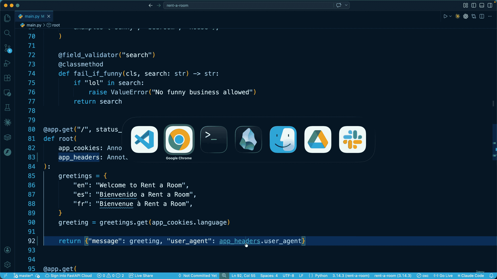
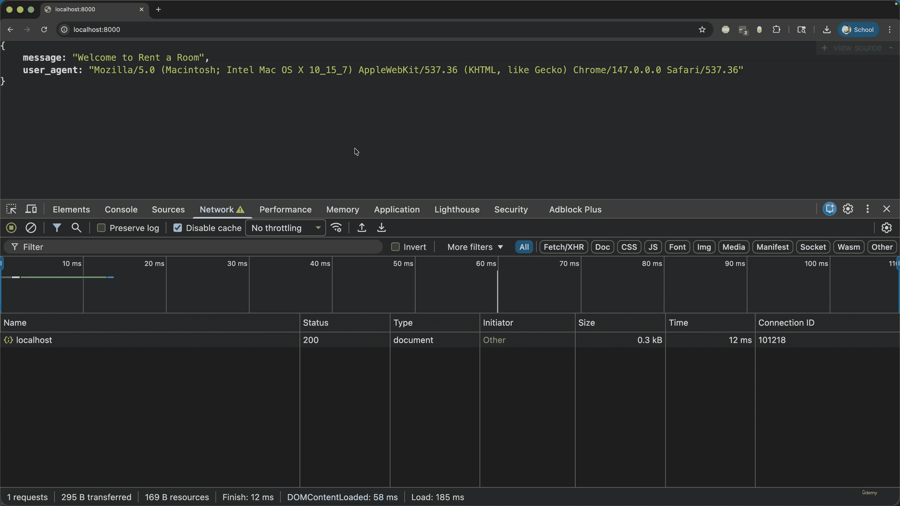

# 🚀 FastAPI 大师课：p49：使用 Pydantic 模型处理请求头

在本节课中我们将要学习如何在 FastAPI 中使用 Pydantic 模型来统一处理请求头。你会看到 FastAPI 的统一写法模式，也会看到把请求头抽取成可复用模型的方式。这个模型负责字段和校验，路由只负责说明数据从哪里来。为了便于初学者理解，下面会先回顾思路，再定义模型，然后接入根路由，最后验证效果。

## 🧭 FastAPI 大师课：p49.1：回顾统一模式与本节目标

在概述之后，本节中我们来看看 FastAPI 的统一模式，以及为什么可以把请求头交给 Pydantic 模型。你很可能已经开始看到 FastAPI 使用的统一模式。你完全可以使用 Pydantic 的 BaseModel，也就是一种数据校验模型，来为应用请求头建模；你并不是必须这样做。你可以在某个路由处理函数里逐个写出每个参数，并用 `Header` 函数声明注解类型；你也可以把所有请求头抽取到一个可复用的 Pydantic BaseModel 中，并按需应用常见校验，例如最小长度、最大值等。下面列出这个等价示例中要完成的关键动作：

- 声明一个独立的 Pydantic 类，用它承载应用请求头。

- 让这个类继承 `BaseModel`，并保持它与 FastAPI 解耦。

- 在类中声明字段和类型，必要时再添加校验。

- 在根路由中使用这个模型，并告诉 FastAPI 数据来自请求头。

为了展示与上一课等价的示例，我再次声明一个单独的 Pydantic 类。它是一个普通 Python 类，名称叫作 `AppHeaders`，并且再次继承 `BaseModel`。这个类完全与 FastAPI 解耦，它不知道数据会从哪里填充进来；它只知道字段或属性，以及在你需要添加校验时如何校验它们。这里我同样添加一个 `user_agent` 字段，并把类型设置为 `str | None`。对于基本的类型声明和类型转换来说，这些已经足够。下面给出这个类的基本结构：

```python
from pydantic import BaseModel

class AppHeaders(BaseModel):
    user_agent: str | None = None
```

如果你希望执行额外校验，可以把 `Field` 函数的返回值赋给字段，并添加你想要的校验，例如 `min_length` 或其他约束；这里我保持简单，只声明类型。这样浏览器发来的所有请求头就可以被捕获在这个类中。之后你也许可以为响应头创建一个互补的 Pydantic 类。理解这些目标后，下面进入模型定义。

## 🛠️ FastAPI 大师课：p49.2：定义请求头模型

上一节我们回顾了统一模式与本节目标，本节中我们来看看如何定义 `AppHeaders` 模型。这个模型本身就是一个普通 Python 类，它继承 `BaseModel`，只关心字段和校验，不关心数据来自哪里。下面的代码展示了模型定义与可选校验的写法：

```python
from pydantic import BaseModel, Field

class AppHeaders(BaseModel):
    user_agent: str | None = Field(default=None, min_length=1)
```

这段代码的含义很直接：`user_agent` 是请求头中的一个字段，类型可以是字符串或空值，并且可以通过 `Field` 增加长度等约束。模型定义完成后，下面把它接入根路由。

## 🔌 FastAPI 大师课：p49.3：在根路由中使用请求头模型

上一节我们定义好了 `AppHeaders` 模型，本节中我们来看看如何在根路由中使用它。现在在下方可以在根路由中使用这个模型。在这里，不是为某一个请求头单独设置参数，而是为所有请求头声明一个参数，可以把这个参数命名为 `headers` 之类。再次说明，在 `Annotated` 中为实际类型提供上面定义的 `AppHeaders` 类，并且非常关键的一点是，必须告诉 FastAPI：用于填充 `AppHeaders` 类的数据来自请求头。下面列出路由参数声明中的核心要点：

- 参数名可以叫 `headers`，也可以按需要改名。

- `Annotated` 的实际类型使用 `AppHeaders`。

- 使用 `Header()` 指明模型字段从请求头填充。

- 路由函数中通过模型属性访问具体请求头。

对应的核心写法和数据流可以用下面的代码与公式表示：

```python
from typing import Annotated
from fastapi import FastAPI, Header

app = FastAPI()

@app.get("/")
def root(headers: Annotated[AppHeaders, Header()]):
    return {"user_agent": headers.user_agent}
```

```text
请求头数据 → AppHeaders 模型 → 路由参数 headers → 访问字段
```

这样就把所有请求头和所有 cookie 捕获在这些互补的 Pydantic 模型中。你始终可以扩展这些模型，例如增加更多请求头字段或校验规则。这里需要修改的地方是把访问对象改成 `headers`，实际上为了和上面的参数保持一致，可以把参数重命名为 `app_headers`。这样我们就可以访问 `app_headers.user_agent`，因为它是对象上的可访问属性。路由接入完成后，下面访问字段并验证结果。

## ✅ FastAPI 大师课：p49.4：访问字段并验证结果

上一节我们把模型接入了路由参数，本节中我们来看看如何访问字段并确认结果。现在可以把参数改名为 `app_headers`，然后通过 `app_headers.user_agent` 读取用户代理。下面是调整后的完整示例：

```python
from typing import Annotated
from fastapi import FastAPI, Header
from pydantic import BaseModel

class AppHeaders(BaseModel):
    user_agent: str | None = None

app = FastAPI()

@app.get("/")
def root(app_headers: Annotated[AppHeaders, Header()]):
    return {"user_agent": app_headers.user_agent}
```

保存代码并回到浏览器刷新，会得到完全相同的结果。这里再次体现 FastAPI 的一致做法：使用 Pydantic 做数据校验，然后在路由处理函数层级指定某个模型的属性要从哪里填充。也就是说，模型负责字段和校验，路由负责声明数据来源，两者职责分开。验证完成后，下面做总结。

## 📌 FastAPI 大师课：p49.5：本节总结





上一节我们完成了代码验证，本节中我们对本节课内容做总结。本节课中我们一起学习了如何使用 Pydantic 模型处理 FastAPI 请求头。我们回顾了 FastAPI 的统一模式，定义了继承 `BaseModel` 的 `AppHeaders` 类，在根路由中用 `Annotated[AppHeaders, Header()]` 告诉 FastAPI 数据来自请求头，并通过 `app_headers.user_agent` 访问字段。这个写法的核心是：`请求头数据 → Pydantic 模型 → 路由参数`。模型只关心字段和校验，路由只关心数据来源。你可以继续扩展这个模型，也可以为响应头创建互补的 Pydantic 类，从而保持代码清晰和可复用。

