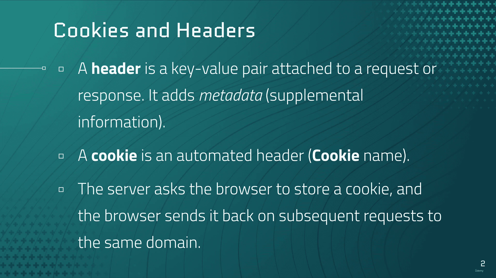
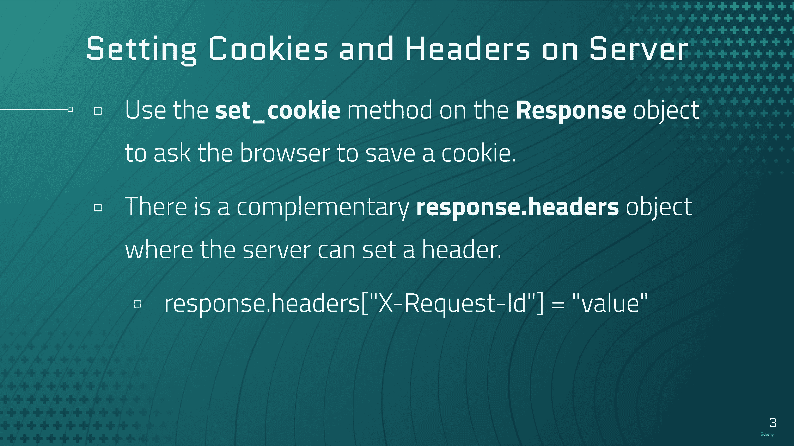
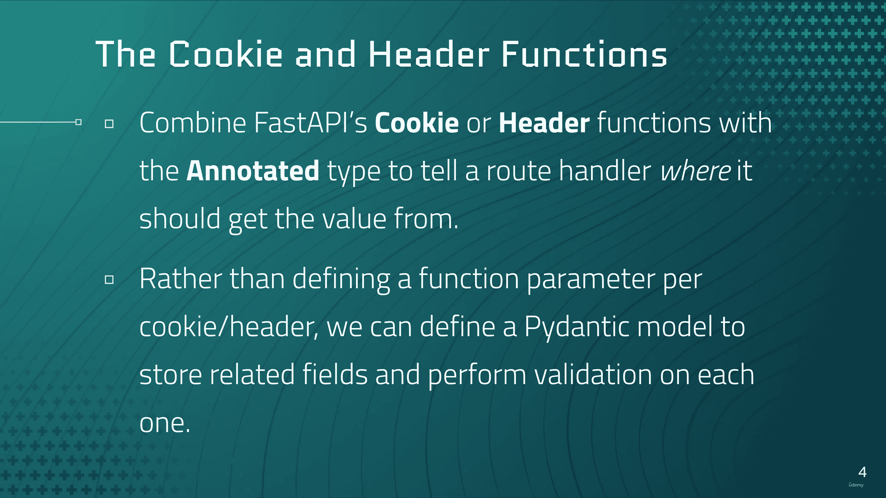

# FastAPI Masterclass：p50：🍪 Cookies 与 Headers 章节复习

在本节课中我们将要学习 Cookies 与 Headers 的章节复习内容。首先，恭喜你完成另一个课程章节。和往常一样，我们花一点时间回顾本节学到的全部内容。本节重点是 Cookies 和 Headers，这两者非常相似。接下来的内容会从基本概念讲起，再说明 Cookie 的工作流程，然后看 FastAPI 中如何设置和解析 Cookie 与 Header，最后看如何用 Pydantic 模型组织相关参数，让代码更适合真实项目。

## FastAPI Masterclass：p50.1：📚 本节概述与复习目标

上一节内容已经结束，本节中我们来看看这次复习的目标和范围。本节聚焦 Cookies 和 Headers，这两类内容在 FastAPI 中经常一起出现，也容易让初学者混淆。原文强调它们是相似的，并且从技术角度说，Cookie 就像 Header 的一个子类别。理解这一点以后，后面的设置、解析和模型组织都会更容易。下面的公式可以帮助先建立基本印象。

```text
Header = Key: Value
Cookie = 一种由浏览器自动管理的特殊 Header
```

上面的公式说明 Header 是键值对，而 Cookie 可以理解为自动化的 Header。本节复习会围绕这个核心关系展开，先讲概念，再讲流程，再讲 FastAPI 代码写法，最后讲项目结构上的建议。

## FastAPI Masterclass：p50.2：🧱 Header 与 Cookie 的基本概念

上一节我们梳理了复习目标，本节中我们来看看 Header 与 Cookie 的基本概念和主要差异。Header 是键值对，这意味着它有一个标识或标签，同时有一个对应的值。Header 既可以附加在客户端发来的请求上，也可以附加在服务器返回的响应上。所以 Header 不是主要的 payload，也就是不是请求或响应的主体数据。它通常是元数据，或者说是额外的补充信息。客户端或服务器通过 Header 互相通信，向对方提供额外数据，从而提升请求或响应的质量。下面的代码展示了 Header 的基本形态。

```http
X-Data-Type: application/json
```

接下来需要看 Cookie 与 Header 的关系。Cookie 只是一个自动化的 Header。我们打开浏览器的网络标签页，并导航到请求头时，实际的 Header 名称就是 `cookie`，然后可以看到所有 Cookie 用分号分隔。下面的代码展示了请求中的 Cookie 形态。

```http
Cookie: session=abc; theme=dark
```



为了更清楚地理解两者的区别，下面用列表把关键点拆开说明。这些点也是本节复习中最重要的概念差异。

- Header 是通用键值对，可以出现在请求和响应中。
- Cookie 是自动化 Header，通常由浏览器保存和携带。
- 浏览器会自动处理 Cookie，而普通 Header 往往需要手动配置。
- 客户端可以解析服务器 Header，并在代码中做相应处理。
- 服务器端点也可以解析请求 Header，并根据内容做事情。
- Cookie 由浏览器自动管理，不需要每个请求都手动拼接。

上面的列表说明了 Cookie 和 Header 的联系与区别。理解这些差异以后，就能明白为什么 Cookie 适合保存需要在后续请求中持续发送的数据，而普通 Header 更像一次请求或响应中的补充说明。

## FastAPI Masterclass：p50.3：🔄 Cookie 工作流程与 HTTP 无状态

上一节我们介绍了 Header 和 Cookie 的基本关系与主要差异，本节中我们来看看 Cookie 的具体工作流程，以及 HTTP 无状态协议为什么需要它。首先，客户端会命中服务器上的一个端点，服务器要求浏览器存储一个 Cookie。这个 Cookie 由名称和对应的值组成。然后，对同一域名的所有后续请求，也就是对同一个网站的后续请求，浏览器会自动通过请求中的 `cookie` Header 把这个 Cookie 附加到请求里，再发送给服务器。下面的流程可以概括这个过程。

```text
1. 客户端请求服务器端点
2. 服务器返回响应，并要求浏览器保存 Cookie
3. 浏览器保存 Cookie：name=value
4. 后续同域名请求自动携带：Cookie: name=value
```

这里的关键背景是 HTTP 是无状态协议。每个请求都不知道之前的请求发生过什么，所以服务器默认无法仅靠请求本身记住上一次交互。Cookie 提供了一种持久化信息的方式，它通过在每个后续请求中发送相同且一致的数据，让服务器能够识别连续请求之间的关系。下面的公式可以帮助理解。

```text
HTTP 请求 = 请求行 + Headers + Body
无状态：当前请求不自动记得上一次请求
Cookie：让后续请求重复携带同一份数据
```

理解这个流程以后，就能明白 Cookie 不是服务器凭空记住客户端，而是浏览器在后续请求中自动把同一份数据带回去。接下来我们看看在 FastAPI 中如何主动设置 Cookie 和 Header。

## FastAPI Masterclass：p50.4：🛠️ 在 FastAPI 中设置 Cookie 和 Header

上一节我们弄清了 Cookie 的自动携带流程，本节中我们来看看在 FastAPI 里如何设置 Cookie 和 Header。从 FastAPI 侧设置 Cookie 时，可以使用 `set_cookie` 方法，这个方法在 `Response` 对象上可用。作为提醒，必须先从 FastAPI 导入 `Response` 类，并在路由处理函数的参数中把它标注为参数类型。这是 FastAPI 中常见的运行时反射例子：服务器在运行时可以根据类型注解，理解自己需要向路由处理函数注入什么样的对象或依赖。只要提供 `Response` 类型，服务器就知道要让你在路由处理函数中访问这个响应对象，然后就可以调用 `set_cookie` 方法，指定一个键值对，让浏览器保存，并在后续请求中发回。下面的代码展示了基本写法。

```python
from fastapi import FastAPI, Response

app = FastAPI()

@app.get("/set-cookie")
def set_cookie(response: Response):
    response.set_cookie(key="session_id", value="abc123")
    return {"message": "cookie set"}
```

上面讲的是设置 Cookie，原文还补充了一个设置 Header 的方法。从服务器返回客户端时，可以通过同一个 `Response` 对象的 `headers` 属性来设置 Header。`headers` 对象支持方括号语法，在方括号中指定 Header 名称，也就是键，然后用等号指定对应的值。下面的代码展示了这种写法。

```python
from fastapi import FastAPI, Response

app = FastAPI()

@app.get("/set-header")
def set_header(response: Response):
    response.headers["X-Data-Type"] = "application/json"
    return {"message": "header set"}
```



在服务器端，我们可以设置这些 Cookie，让客户端之后再把它们发回来，也可以直接指定一个 Header，而 Header 就是一份额外的补充信息，会随响应返回给客户端。服务器 Header 的一个例子是指定数据类型，也就是告诉客户端“我会返回 JSON”，或者告诉客户端“我会返回一个 CSS 文件”，然后客户端或浏览器就可以根据这个 Header 知道收到的数据类型并作出反应。正如你可能已经猜到的那样，很多这类 Header 都由浏览器自动管理，所以不需要额外做什么，但补充数据在幕后就是通过这种方式在请求和响应两个方向上传递的。下面用列表总结这一节的代码要点。

- 使用 `Response` 对象上的 `set_cookie` 设置 Cookie。
- 使用 `response.headers["Header名"] = "值"` 设置响应 Header。
- 路由处理函数参数标注为 `Response` 后，FastAPI 会在运行时注入响应对象。
- 很多常见 Header 由浏览器自动管理，开发者不需要手动处理全部细节。

这些写法是后续参数解析的基础。接下来我们看看如何从请求中读取 Cookie 和 Header，并明确告诉 FastAPI 数据来源。

## FastAPI Masterclass：p50.5：🧩 Cookie 与 Header 参数解析

上一节我们学习了在 FastAPI 中设置 Cookie 和 Header 的方法，本节中我们来看看如何从请求中解析 Cookie 和 Header 参数。最后复习到的是关键的 `Cookie` 和 `Header` 函数，这两个函数从 FastAPI 导入。使用它们的位置是在 `Annotated` 类型后面方括号中的第二个值。这一点很关键，因为它告诉 FastAPI 到底从哪里解析数据。必须明确告诉 FastAPI：这个数据点来自 Header，还是来自 Cookie，还是来自查询参数。FastAPI 会做一些推断，例如根据路由装饰器中的大括号来匹配路径参数，但服务器接收数据的方式有很多种，所以必须把这些函数和 `Annotated` 结合使用，准确告诉 FastAPI 数据源在哪里。下面的代码展示了基本写法。

```python
from typing import Annotated
from fastapi import FastAPI, Cookie, Header

app = FastAPI()

@app.get("/items")
def read_items(
    session: Annotated[str | None, Cookie()] = None,
    user_agent: Annotated[str | None, Header()] = None,
):
    return {
        "session": session,
        "user_agent": user_agent,
    }
```

因为这些辅助函数都构建在 Pydantic 之上，所以它们也支持各种用于验证和数据转换的参数。也就是说，不仅能声明数据来自哪里，还能顺便约束数据格式。下面用列表概括解析时的重点。

- `Cookie()` 用来声明参数来自 Cookie。
- `Header()` 用来声明参数来自请求 Header。
- 这些函数要放在 `Annotated` 的方括号中作为第二个值。
- 必须显式声明数据来源，不能只靠 FastAPI 自动猜测。
- 辅助函数基于 Pydantic，因此支持验证和数据转换参数。

到这里，单个 Cookie 和 Header 的解析方式已经清楚了。但当接口变多、参数变多时，每个 Cookie 和 Header 都在路由处理函数中写一个参数，会逐渐变得不好维护。下一节就来看如何用 Pydantic 模型组织这些内容。

## FastAPI Masterclass：p50.6：📦 用 Pydantic 模型组织 Cookie 与 Header

上一节我们介绍了 Cookie 与 Header 的解析方式，本节中我们来看看当参数变多时如何用 Pydantic 模型组织它们。这里有一个可扩展性问题：每个 Cookie 和 Header 都必须在路由处理函数中定义一个函数参数。如果只有一个端点接收一个 Cookie 或 Header，而网站其他地方不关心这些内容，那当然没有问题。但如果开始出现一种趋势：多个端点可能依赖同一个 Cookie，或者依赖同一组多个 Cookie、多个 Header，那么最好重构设计，引入一个 Pydantic 模型，把这些属性统一存储在一起。下面的代码展示了一个简单模型。

```python
from pydantic import BaseModel, Field

class CommonCookies(BaseModel):
    session_id: str = Field(..., min_length=3)
    theme: str = "light"
```

Pydantic 模型的好处是，我们可以用一个对象收集所有相关属性，同时还能为每个字段指定不同的验证规则。在原文的具体示例中，Cookie 和 Header 数量很少，所以可以把它们全部放进一个类里。但在真实世界中，会看到各种不同的组织模式。例如，有些开发者会把查询参数拆分成多个 Pydantic 模型，按功能或按相关领域分组。一个网站可能在许多不同路由上共有 10 个不同的查询参数，因此如何组织和分类，取决于开发者自己的设计。理想情况下，Pydantic 数据模型也不应该过于庞大。即使我们把一部分复杂度从函数参数列表移动到 Pydantic 模型中，到了某个时刻也必须拆分这些模型，确保代码可读、可理解。下面用列表总结模型组织时的考虑点。

- 多个端点依赖相同 Cookie 或 Header 时，考虑抽取 Pydantic 模型。
- 一个模型可以集中收集相关字段，并给每个字段设置验证规则。
- 可以按功能、领域或业务关系拆分多个模型。
- 模型不应无限膨胀，字段太多时要继续拆分。
- 如何划分模型带有架构设计性质，需要开发者自行判断合适的字段数量。

因此，开发者有一定责任去判断：一个 Pydantic 模型里放多少代码、放多少字段才是合适的。这会进入架构设计领域，但希望 Pydantic 模型的好处已经清楚，也希望它们如何与 FastAPI 路由处理函数无缝集成已经清楚。这就是 Cookies 与 Headers 的内容，下面做最后总结。

## FastAPI Masterclass：p50.7：✅ 本节总结



前面几个小节我们分别复习了 Header 与 Cookie 的基本概念、Cookie 的工作流程、FastAPI 中设置 Cookie 和 Header 的方法、参数解析方式，以及用 Pydantic 模型组织参数的建议。本节课中我们一起学习了 Cookies 与 Headers 的核心知识：Header 是键值对，Cookie 是自动化的 Header；浏览器会自动管理 Cookie，并在同一域名的后续请求中自动携带；FastAPI 中可以用 `set_cookie` 设置 Cookie，用 `response.headers` 设置响应 Header，用 `Cookie()` 和 `Header()` 配合 `Annotated` 声明请求数据来源；当多个端点共享相同 Cookie 或 Header 时，可以用 Pydantic 模型集中管理字段和验证规则。这就是 Cookies 与 Headers 的复习内容，下一节见。

