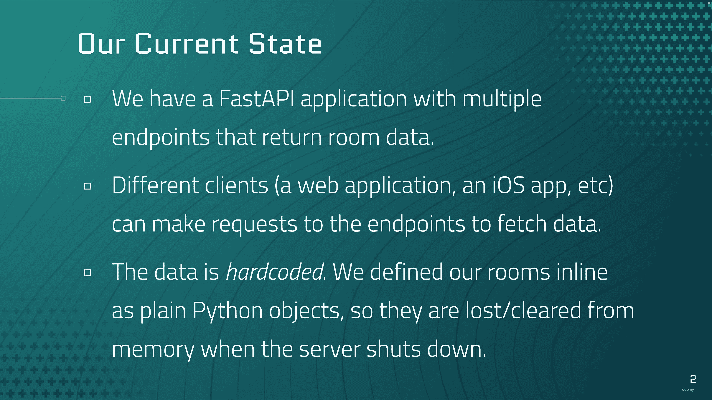
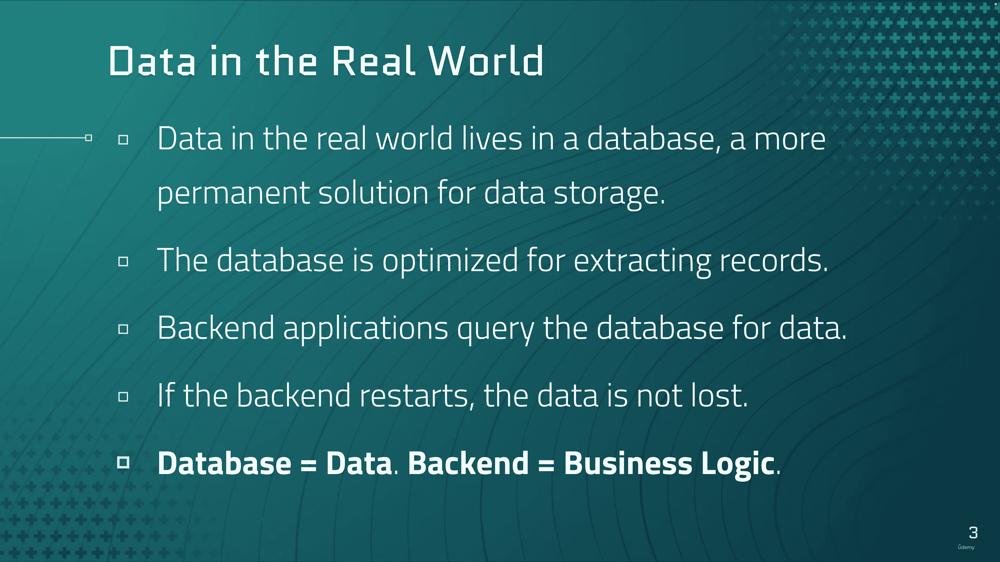
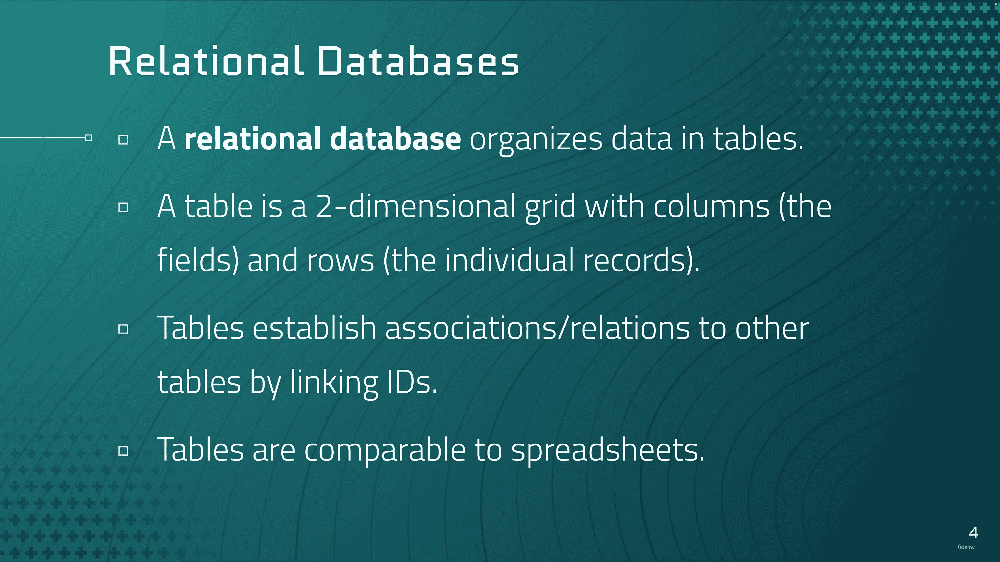
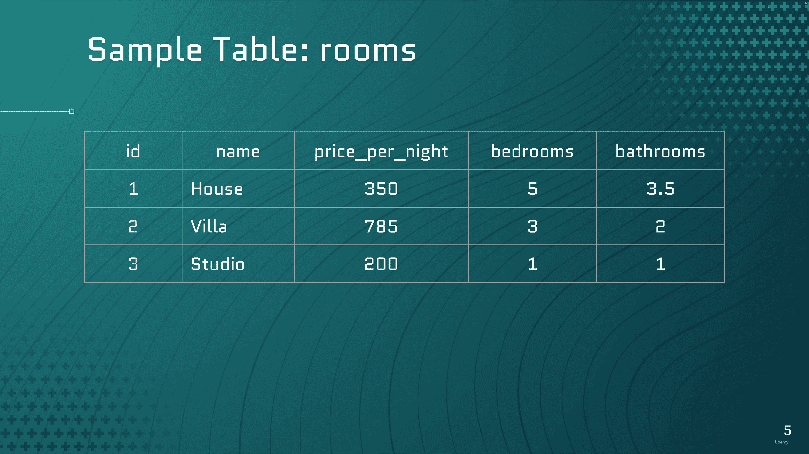
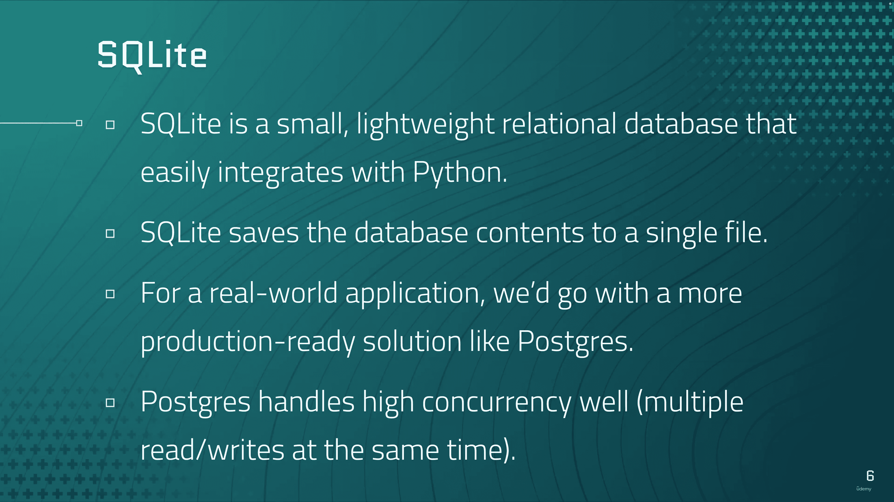
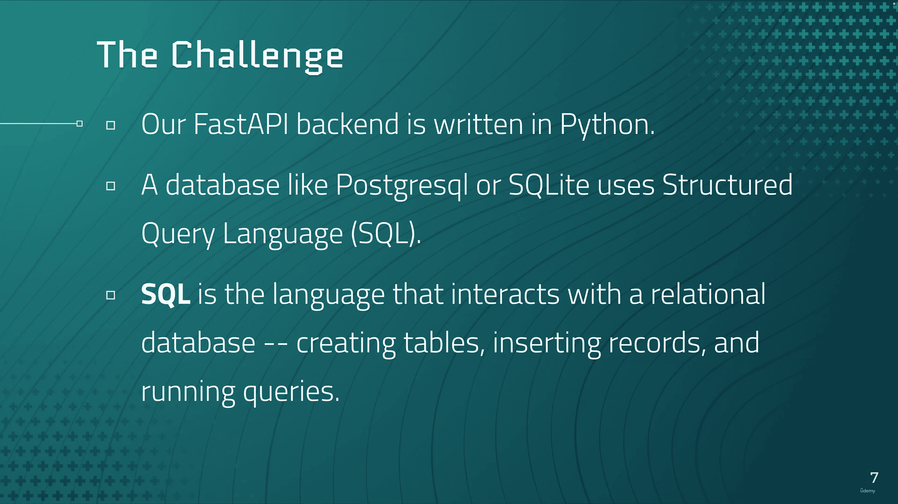
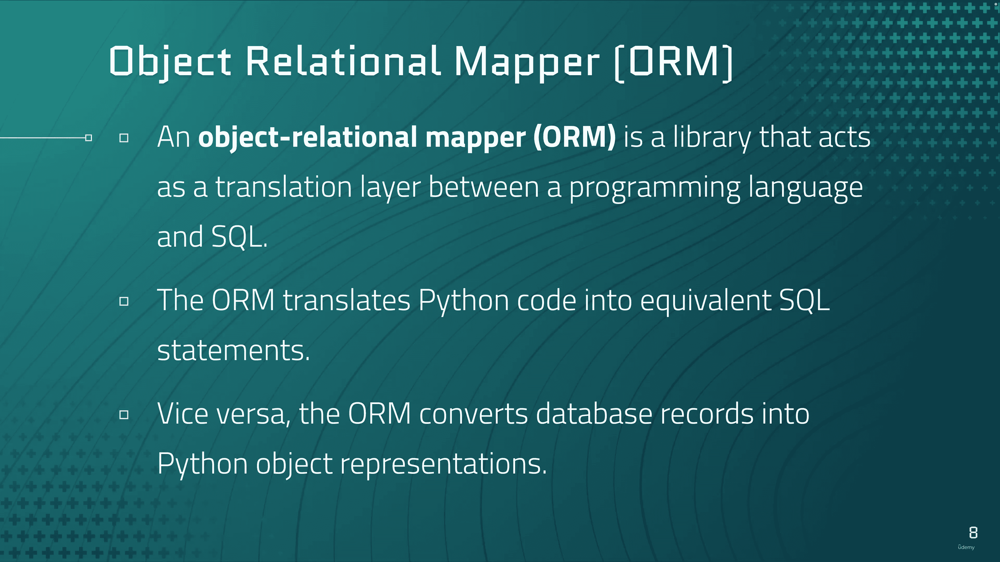
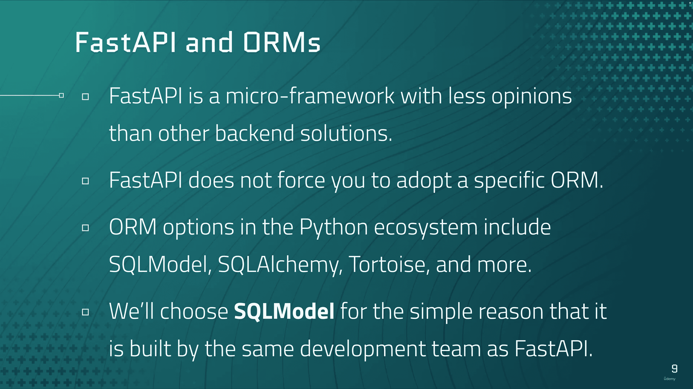
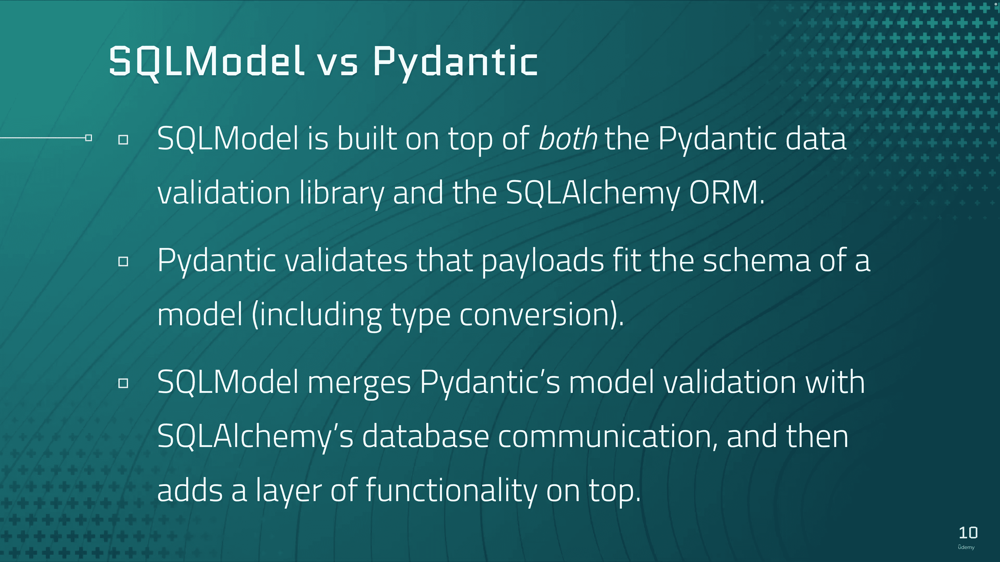

# 🎓 FastAPI Masterclass Part 1：第 51-52 节：什么是 ORM？

欢迎进入本课程的新章节。在本节课中，我们将要学习什么是 ORM（对象关系映射），以及为什么在 FastAPI 项目中需要它。ORM 的全称是 Object Relational Mapper，也就是对象关系映射器。简单来说，ORM 是一个库，它充当着编程语言和 SQL 之间的翻译层，让我们可以用 Python 代码去操作数据库。接下来会有不少进阶概念，所以和以往一样，我们先在高层次上把这些想法过一遍。我们首先看看当前应用的状态，然后引出数据库和关系数据库的概念，接着分析 Python 与 SQL 之间的语言障碍，最后理解 ORM 的原理，并说明本课程为什么选择 SQLModel。现在，我们进入正题。

## 🧱 1. 当前应用的状态与硬编码问题

在讨论 ORM 之前，我们先来看一看当前应用的状态。目前，我们有一个 FastAPI 服务端应用，它是一个带有多个端点的后端，这些端点会返回房间数据。不同的客户端，例如 Web 浏览器、iOS 应用、Android 应用、手表，甚至冰箱，都可以向这些端点发起请求来获取房间数据。这本身看起来不错，但问题在于，这些数据是硬编码的，它们存在于我们的代码内部。我们为三个房间定义了三个变量，它们只是普通的 Python 对象，具体来说就是字典。

以下是当前数据存储方式的核心问题：

- 数据被硬编码在代码中，无法灵活扩展。
- 一旦服务器关闭，内存被清空，这些对象就会丢失。
- 服务器再次启动时，这些对象虽然会被重新创建，但本质上仍然只存在于内存中。

你看，这种方式的局限性非常明显。在真实世界中，像 Airbnb 这样的应用会有数百万个房间、数百万个用户和数百万张信用卡。我们不可能把所有这类对象或者记录数据都写在代码里。所以，我们需要一个更好的方案来实现永久数据存储，这就引出了数据库。



## 🗄️ 2. 为什么需要数据库？

明白了问题根源之后，我们来看看数据库是如何解决永久存储问题的。现实世界中的数据会存储在所谓的数据库中。数据库是一个独立的应用程序，从技术上讲它也是一个服务器，因为它的设计意图是始终保持运行，以便 24/7 响应数据请求。数据库的全部目标和优化方向就是存储和检索记录。换句话说，数据库天生就是为了处理记录而构建的。

数据库擅长处理的操作包括：

- 插入记录
- 删除记录
- 更新记录
- 排序记录
- 查询记录

这些操作是数据库的核心功能。相比之下，像 FastAPI 这样的后端应用在需要数据时，会去查询数据库。整个流程可以用下面这段流程示意来表示：

```text
客户端 → 特定端点 → 数据库 → 获取记录 → 返回给用户
```

也就是说，客户端向某个端点发起请求，端点再与数据库通信，获取一些记录，最后把结果返回给用户。这样做的好处是，即使后端重启，或者我们上传了新版本的代码，代码与数据库及其存储的数据仍然是完全分离的。另外，多个不同的应用可以依赖同一个数据库。例如，一个 Python FastAPI 应用可以向数据库写入记录，而另一个用 Ruby 或 Java 编写的应用也可以查询同一个数据库，获得它操作所需的记录。最终，数据库成为一个独立实体，它的全部职责就是保存数据。如果你要记住一个结论，那就是：

```text
数据库 → 负责存储数据
后端 → 负责通过代码定义业务逻辑
```



## 📊 3. 关系数据库与表的基本概念

既然数据库如此重要，我们自然要了解它的类型。我们将要使用的数据库类型叫作关系数据库，这也是更传统的一种数据库形态。现代世界中还有很多其他数据库，比如你也许听说过 MongoDB，还有图数据库，它们都是数据存储方式的不同变体。但关系数据库是久经考验的经典数据库。理解关系数据库的最好方式就是：它把数据存储在表中，而表就是由行和列组成的二维网格。你可以直接把它想象成 Excel 或 Google Sheets 里的电子表格。

这样的表结构非常直观。列定义一条记录的属性或字段，每一行则是一条记录，或者说一个条目，保存着这条记录对应字段的值。更进一步，为了在不同表之间建立连接或关联，我们会使用列中的 ID。下面是一些常见的关联示例：

- 一个支付 ID 可能链接到某个用户。
- 一个具体的房间预订可能链接到一个用户和一种支付方式。



所以，本质上就是表与表之间通过列中存储的各种值连接起来。如果你想在更深层次理解这些内容，课程后面会有一个专门讨论关系数据库、表、SQL 等的附录。如果你第一次接触这个主题，可以先去那个附录，再回来继续学习本节内容。我们来看一个基本的表长什么样。这里是一个 rooms 表，它很可能存在于我们的关系数据库中：

```python
# rooms 表结构（概念示意）
# id | name      | price_per_night | bedrooms | bathrooms
# 1  | Room A    | 100             | 1        | 1
# 2  | Room B    | 250             | 2        | 2
```

在这个表中，ID 列是每一行的唯一数字标识符。计数从 1 开始，每增加一条新记录，ID 就会递增。除了 ID，表中还有为该表定义的自定义列，比如 name、price_per_night、bedrooms 和 bathrooms。每一行存储的就是一个房间的信息。换句话说，这个表中的每一行都代表一个房间。

## 🧪 4. 选择 SQLite 作为学习数据库



认识了关系数据库，我们还需要选一个具体的数据库来实践。接下来要使用的数据库叫做 SQLite。它是一个相对小巧、轻量级的关系数据库，并且非常容易与 Python 集成。事实上，只要你安装了 Python，基本上就自动获得了 SQLite 的访问能力。我们选择它，纯粹是因为它上手极其简单。SQLite 会把数据库内容保存到单个文件中，这对学习来说非常方便。

你可能会好奇，真实世界的项目是否也会用 SQLite。答案是不一定。在更接近真实世界的应用中，我们很可能会转向更经受过实战检验、更适合生产环境的解决方案，比如 Postgres 或 MySQL。这些数据库在后台的处理方式要复杂得多。它们会把内容保存到许多不同的文件中，会使用二进制编码来缩小数据总大小，还会针对真实工作流进行优化。例如，它们能处理高并发场景，也就是同一时间有大量不同的读请求或写请求。换句话说，就是有许多不同的请求同时要往表里添加记录或更新记录。SQLite 和真实生产数据库之间的差异可以概括如下：

- SQLite：单文件，轻量，极其容易上手，适合本地开发。
- Postgres/MySQL：多文件、二进制编码、支持高并发，适合生产环境。

不过，为了学习的目的，即使使用 SQLite 这样非常轻量级的数据库，我们也能够覆盖 FastAPI 后端开发中 95% 的重要概念。你大概不会在真实世界中的 Airbnb 应用里使用 SQLite，但它对于本地开发来说绝对是一个绝佳选择。在课程后面介绍全栈 FastAPI 模板时，我们就会看到一个更接近生产环境的解决方案，其中涉及 Postgres 和 Docker 的组合。



## 🔄 5. 核心挑战：Python 与 SQL 的语言鸿沟



现在我们已经有了数据库，但使用数据库并不是没有挑战。我们先来谈谈使用数据库时的首要挑战。我们的 FastAPI 后端是用 Python 写的，但像 Postgres 或 SQLite 这样的数据库使用的却是另一种语言，叫做结构化查询语言，也就是 SQL。SQL 是与数据库交互的语言，我们用它来创建表、插入记录、更新记录、删除记录，以及运行查询来获取数据。于是，我们面临两种语言需要互相通信的问题。

你可以这样理解这种割裂。例如，Python 侧可能是这样：

```python
room_data = {"name": "Ocean View", "price_per_night": 250}
```

而 SQL 侧则是这样：

```sql
INSERT INTO rooms (name, price_per_night) VALUES ('Ocean View', 250);
```

要让这两种语言协作，显然不能只靠手写 SQL。为了优雅地解决这个问题，我们将会使用一个叫 ORM 的东西。

## 🔗 6. 什么是 ORM？

ORM，全称 Object Relational Mapper，也就是对象关系映射器。它是一个库，充当着编程语言和 SQL 之间的翻译层。我要强调一点：这不是 FastAPI 特有的概念，甚至不是 Python 特有的概念。这类 ORM 存在于任何编程语言的生态系统中。无论你是用 Python、Ruby 还是 Java 构建后端，都会有一个 ORM 来为你解决同样的问题。举个例子，在我们的 FastAPI 场景中，ORM 会把我们在路由处理函数中编写的 Python 代码，翻译成等效的 SQL 语句或 SQL 命令，然后把这些命令发送给 SQLite 数据库。



这样做最大的好处是，我们不需要对 SQL 非常精通。当然，理解 ORM 将要生成的代码仍然有帮助，但这并不是必须的。ORM 的核心目标可以概括为：根据我们写的 Python 代码，翻译成要在数据库上执行的正确 SQL 查询。反过来，每当我们查询数据库时，ORM 又会把实际的数据库记录转换成等效的 Python 对象表示。这个原则同样适用于其他语言生态，比如在 Ruby 中，ORM 会把 Ruby 代码翻译成 SQL 语句；在 Java 中，ORM 会把 Java 代码翻译成等效的 SQL 语句。

下面的代码块展示了 ORM 这种翻译层的概念：

```python
# 概念示例：ORM 在中间充当翻译层
# Python 代码（端点内部）
room = Room(name="Ocean View", price_per_night=250)
session.add(room)
session.commit()

# ORM 自动翻译成的 SQL 语句：
# INSERT INTO rooms (name, price_per_night) VALUES ('Ocean View', 250);
```

你还可以用下面这个更简单的公式来记住它：

```text
Python  ⇄ ORM ⇄ SQL ⇄ 数据库
```

这个双向箭头意味着 ORM 不只是把 Python 转成 SQL，它也能把数据库结果转回 Python 对象。

## ⚖️ 7. FastAPI 的 ORM 选择：为什么用 SQLModel？

理解了 ORM 的作用，我们再来看看 FastAPI 这个框架对待 ORM 的态度。FastAPI 经常被称为微框架，这是相对于 Django 这样功能齐全的框架而言的，原因是它不那么“强势”，也就是说，它不会替你做太多决定。比如，它不会规定你的代码应该如何组织，也不会指定你必须选择哪个 ORM。如果你选择 Django 这样的全功能框架，它基本上会在工具箱里带齐所有东西，并迫使你使用它提供的工具。有时候，这甚至会强制规定你的应用应该采用的文件夹结构和文件结构。相比之下，FastAPI 要轻量得多，它不会强迫你使用某个特定的 ORM，甚至不会强迫你使用任何 ORM。用哪个 ORM 由我们开发者或项目团队自行决定。



Python 生态中其实有不少 ORM 选项，以下是常见的选择：

- SQLModel
- SQLAlchemy
- Tortoise ORM
- 以及更多

在本课程中，我们选择 SQLModel，原因很简单：它和 FastAPI 是同一个开发团队构建的，所以它与 FastAPI 的集成非常自然顺畅，并且能够满足本课程的大部分需求。不过，有一个值得注意的点：SQLModel 相对较新，而 SQLAlchemy 已经开发了十多年，是如今更多代码库里最可能见到的选择。与此同时，我给你们的建议是，不要太担心我们具体选择的这个 ORM。成为更好的后端开发者，重点并不是记住更多的细节，也不是理解某个特定库的所有细微差别，而是理解各个部分是如何组合在一起的。只要你理解了 ORM 是做什么的，以及它如何与端点集成，那么就算你明天加入另一个使用 Tortoise ORM 的团队，你也能相对轻松地适应。

这就像理解房子是怎么建起来的一样：如果你懂了房子的结构，那么你用什么牌子的锤子和钉子其实并不重要。重要的是理解后端的整体构造、服务器的角色，以及所有这些运动部件如何相互作用。所以，我建议你不要过度纠结具体工具，只需要理解它的好处，并能够向其他开发者解释清楚就可以了。

还有另一个好消息：SQLModel 实际上构建在 SQLAlchemy ORM 之上，所以我们会介绍很多概念，这些概念同时也会帮助你学习 SQLAlchemy ORM。另外，SQLModel 还构建在 Pydantic 验证库之上，而 Pydantic 是我们整个课程中已经反复见到过的。仔细想想，你就会明白 SQLModel 团队为什么会做出这个设计决策。我们处理数据库时遇到的问题，和我们编写端点时遇到的问题非常相似，那就是数据必须被验证。比如，当我们向数据库表保存记录时，假设向 rooms 表插入一行，这里会有特定的列，也就是说，只有某些数据库字段是有效的，并且它们必须是特定的数据类型；其他不存在的字段都是无效的。Pydantic 正是专门为数据验证而构建的，所以它与 ORM 结合使用非常合适。它会在 ORM 把数据翻译成 SQL 语句并发送到数据库之前，先验证数据的形状。因此，SQLModel 实际上合并了这两个库的功能：我们从 Pydantic 获得数据验证，从 SQLAlchemy 获得真正的数据库通信，然后在它们之上再添加一层额外功能。

最棒的是，通过 SQLModel，我们还能够学到更多关于 Pydantic 和底层 SQLAlchemy ORM 的知识。SQLAlchemy 可能是当今 Python 后端生态中使用最广泛的 ORM。所以，即使你不需要过度担心具体工具，而是要关注它的用途，我们仍然会获得大量关于这些工具在现代 Python 后端 Web 开发中如何整合和工作的实用知识。

## 📝 总结



刚才我们涉及了不少技术术语。到这里，本节课的主要内容就讲完了。我们一起学习了什么是 ORM，以及它在 FastAPI 后端开发中的重要性。我们从当前应用中的硬编码数据问题出发，理解了为什么需要数据库；接着认识了关系数据库和表的基本结构，以及为什么选择 SQLite 作为学习工具；然后分析了 Python 和 SQL 之间的语言鸿沟，引出了 ORM 这个翻译层；最后讨论了 FastAPI 中 ORM 的选择，特别是 SQLModel 与 SQLAlchemy、Pydantic 之间的关系。下一节课，我们会开始动手配置模型、数据库以及与数据库的通信，包括从路由处理程序中访问数据库，其中会有很多有趣又有用的内容。我们下节课再见。
