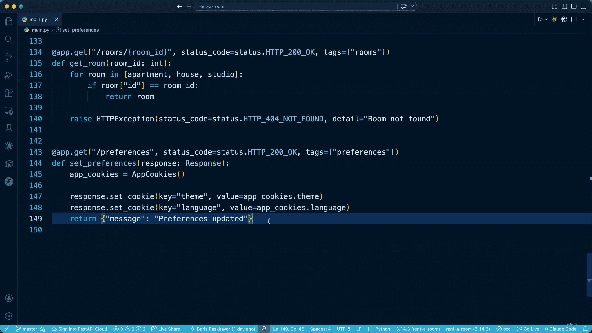
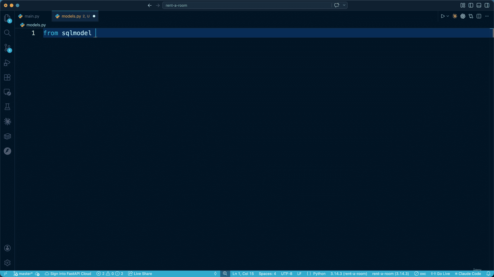
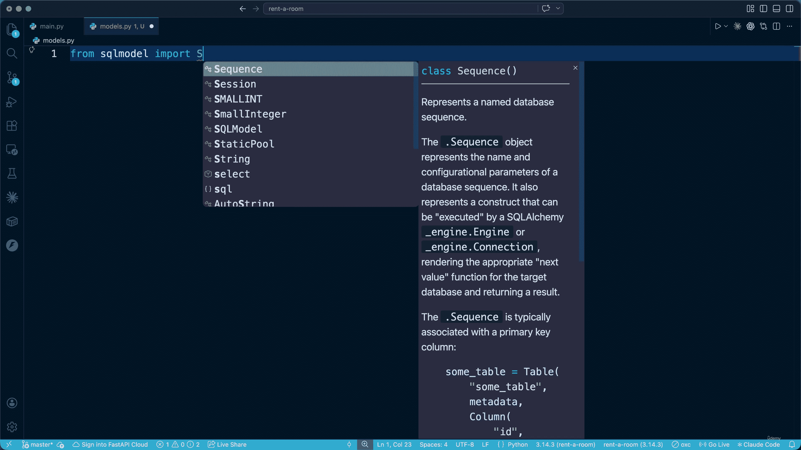
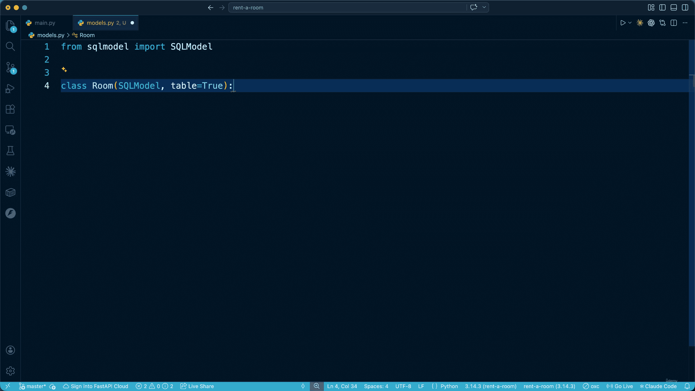
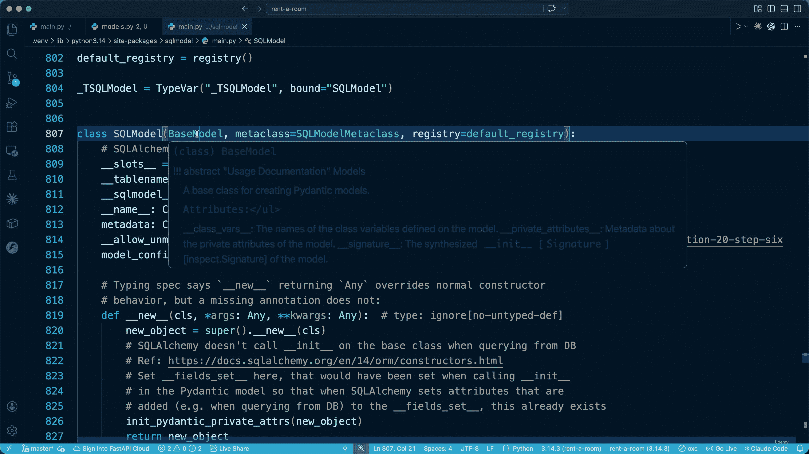
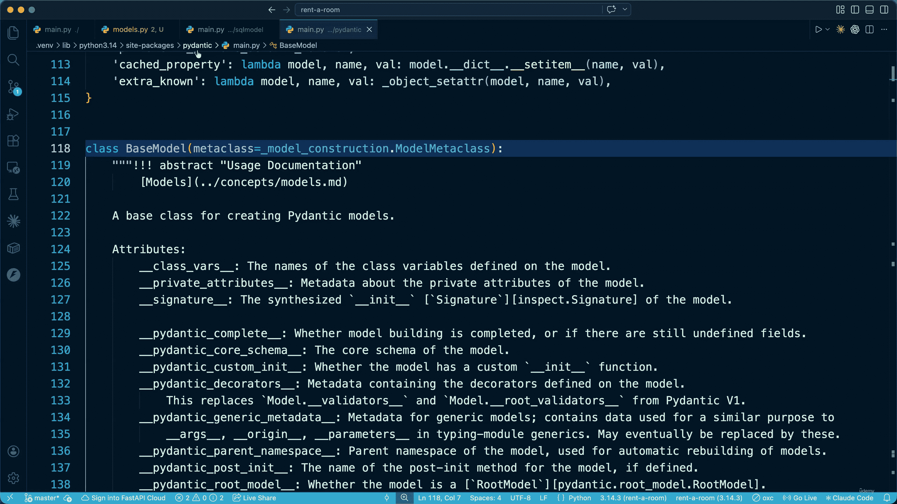
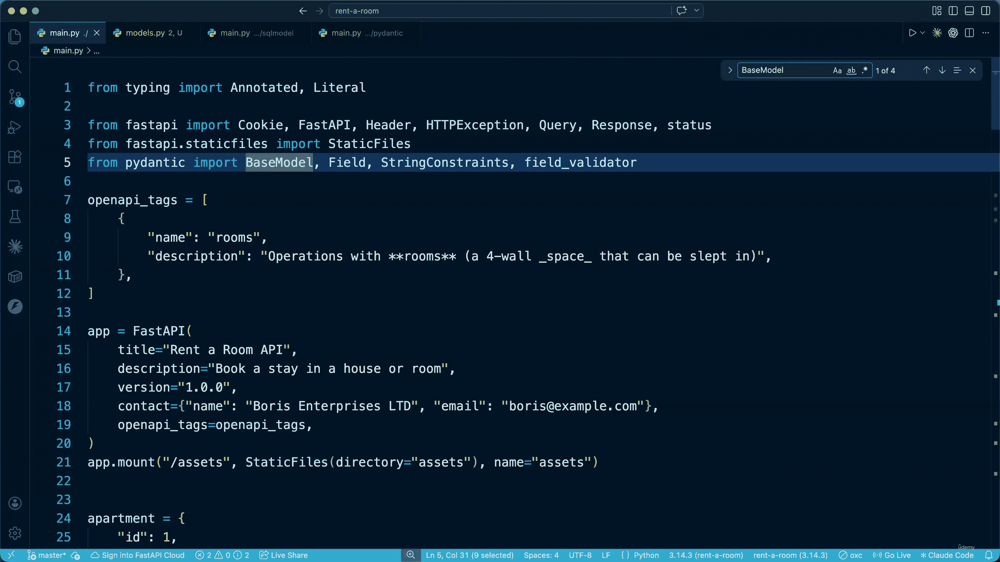
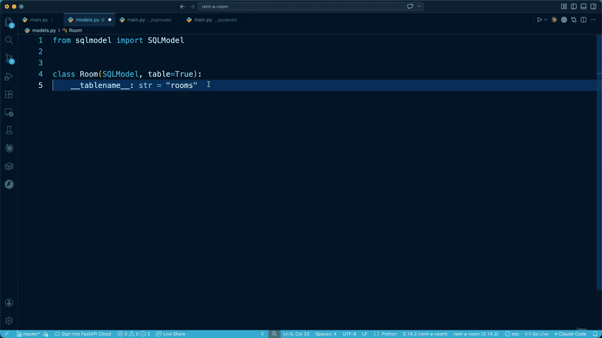

## 🚪 FastAPI大师课：第52-53节：创建 Room 模型

在本节课中我们将要学习如何定义一个数据库模型，也就是创建一个 Python 类，让这个类专门负责和数据库里对应的表打交道。这个模型类不是数据库本身，而是代码里的“操作入口”：后面我们要往表里新增数据、查询数据、删除数据，都会通过这个类来完成。现在数据库和表还没有真正创建出来，所以本节的重点是先把模型层的代码结构搭好，后面再把它和数据库接起来。

上一段说明了模型类的职责，接下来我们看看为什么要单独新建文件。现在 `main.py` 文件已经变得比较大，如果把所有逻辑都继续堆在里面，后面维护起来会越来越吃力。因此，现在适合把应用里的不同职责拆分到不同文件中，先从模型开始拆。这样做不是马上改变功能，而是先把代码组织好，让后续添加数据库表、查询逻辑时更清楚。

**把模型拆到独立文件**

在项目顶层目录中，我们新建一个文件，名字叫 `models.py`。文件名完全由我们自己决定，但这个文件的作用很明确：它会存放所有模型，也就是那些负责与数据库交互的 Python 类。后面每增加一张数据库表，通常就会在这个文件里增加一个对应的模型类。这样 `main.py` 可以继续处理应用入口和路由等事情，模型则集中放在 `models.py` 中。

**导入 SQLModel**

上一节我们确定了模型文件的位置，本节中我们来看看模型类需要依赖什么。在 `models.py` 文件里，我们需要从 `sqlmodel` 库中导入 `SQLModel` 类，这个库已经作为项目依赖安装在环境中。`SQLModel` 是 ORM 的一个例子，ORM 是对象关系映射器，它的作用是用 Python 类和对象来表示数据库表和记录。下面这行代码负责把 `SQLModel` 类导入进来：





```python
from sqlmodel import SQLModel
```

**定义 Room 模型并开启 table=True**

导入 `SQLModel` 之后，我们就可以定义模型类了。这里新建一个类，名字叫 `Room`，并让它继承 `SQLModel`。关键地方在于类定义头部：在 `SQLModel` 后面加一个逗号，再写 `table=True`，最后加上冒号。这个写法看起来有点特别，但它实际上是在为 `Room` 这个子类指定配置细节，其中 `table` 参数被设置为布尔值 `True`。核心代码可以写成下面这样：

```python
class Room(SQLModel, table=True):
    ...
```

这里信息量比较大，先停下来拆开理解。`table=True` 不是一个普通的方法参数，而是在告诉 `SQLModel`：这个类不只是数据模型，还要映射到数据库中的一张表。没有这个配置时，它更接近一个普通的数据验证模型；加上这个配置后，它才具备和数据库表对应的能力。

**SQLModel 与 Pydantic BaseModel 的关系**

上一段提到了 `table=True` 的作用，这里需要补充 `SQLModel` 的背景。查看 `SQLModel` 的源码可以看到，它继承自一个叫 `BaseModel` 的类，这个类名应该比较熟悉。`BaseModel` 来自 Pydantic，它正是我们在 `main.py` 中给 app cookies 和 app headers 使用的同一个 `BaseModel` 类。换句话说，`SQLModel` 本身也继承自 Pydantic 的 `BaseModel`，概念上可以表示为：

```python
# 概念示意
class SQLModel(BaseModel):
    ...
```

因此，如果省略 `table=True` 这一部分，`Room` 类基本上就是一个普通的 Pydantic 数据验证模型。它仍然可以验证数据，这一点和普通 Pydantic 模型是同一个概念。但是，一旦加上 `table=True`，这个模型就能够自动映射到数据库里对应的表。也就是说，它既保留数据验证能力，又承担数据库表模型的职责。







**当前阶段只是搭建基础设施**



需要强调的是，在现在这个时间点，数据库还不存在，表也不存在。我们并没有立刻创建真实数据库表，而是在搭建基础设施，让模型类先准备好。后面课程中会把数据库、表以及模型这些部分连接起来，让它们共同工作。现在先把模型文件、模型类和表名规则确定下来，后续接线时就不会混乱。

**默认表名与复数表名**

另一个重要细节是表名规则。默认情况下，`SQLModel` 分配给数据库表的名称，是类名的小写版本。因此，`Room` 类默认对应的表名会是单数形式的 `room`。这个规则可以先记住：

> 默认表名规则：类名小写，因此 `Room` 默认对应 `room`。

不过，一般更推荐使用复数形式的表名，因为一张表的重点就是存储多条记录、多个条目。表里不会只有一条数据，所以用复数更符合实际含义。自定义对应数据库表名的方式，是给模型类添加一个双下划线属性 `__tablename__`。这个语法看起来特别，但写法就是两个下划线、`tablename`、再两个下划线。还可以给它加上类型注解 `str`，等号后面的字符串就是数据库中的实际表名。这里我们把表名设为 `rooms`，代码如下：

```python
class Room(SQLModel, table=True):
    __tablename__: str = "rooms"
```

**Room 类与 rooms 表的关系**

现在可能还看不到所有部分如何配合，但可以先理解 `Room` 和 `rooms` 的关系。`Room` 是 Python 代码中的类，它负责与数据库里的 `rooms` 表交互。换句话说，`Room` 是我们创建 `rooms` 表记录的入口，也是查询 `rooms` 表行的入口，还可以用来删除行，等等。下面列出 `Room` 模型在后续代码中要承担的主要职责：

- 与数据库中的 `rooms` 表进行交互。
- 在 `rooms` 表中创建新的条目。
- 查询 `rooms` 表中的行。
- 删除 `rooms` 表中的行。
- 为后续其他数据库表提供同样的模型类写法。

同样地，数据库里每一张表都会有一个对应的模型类，这个类继承 `SQLModel`，并且设置 `table=True`。这样模型层就能统一管理所有表，每个类负责一张表，职责清晰，后续扩展也方便。

**总结**



本节课中我们一起学习了如何创建 Room 模型：先把模型职责从 `main.py` 拆到 `models.py`，再从 `sqlmodel` 导入 `SQLModel`，定义 `Room` 类并继承 `SQLModel`，通过 `table=True` 让它映射到数据库表。我们还理解了 `SQLModel` 与 Pydantic `BaseModel` 的关系，知道省略 `table=True` 时它更接近普通数据验证模型，加上后才会自动映射数据库表。最后我们掌握了默认表名规则，并用 `__tablename__: str = "rooms"` 把表名改成复数形式，明确 `Room` 类负责与 `rooms` 表交互。

