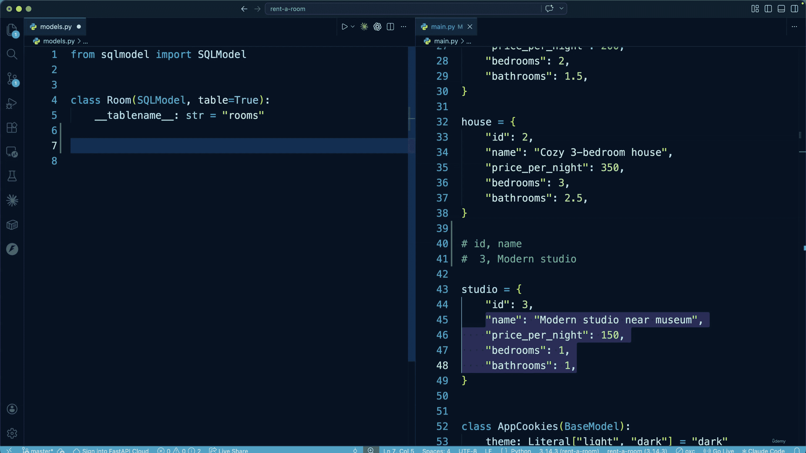
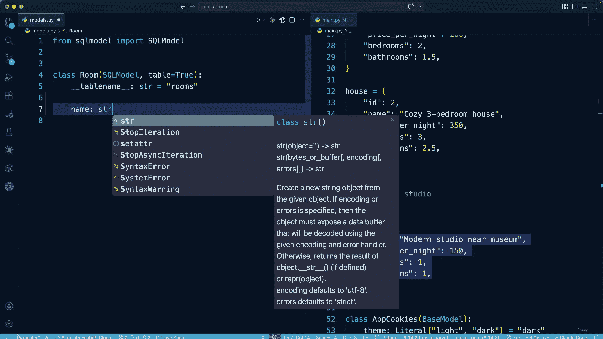
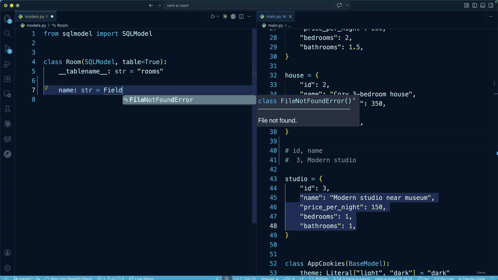
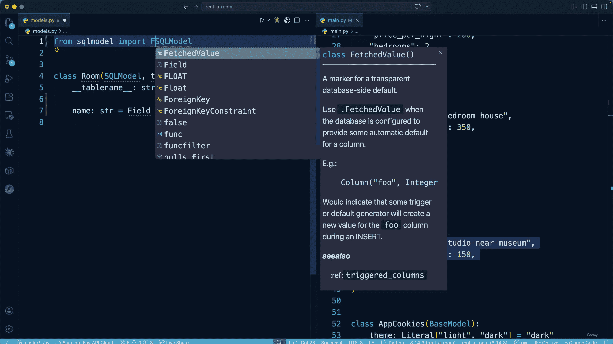
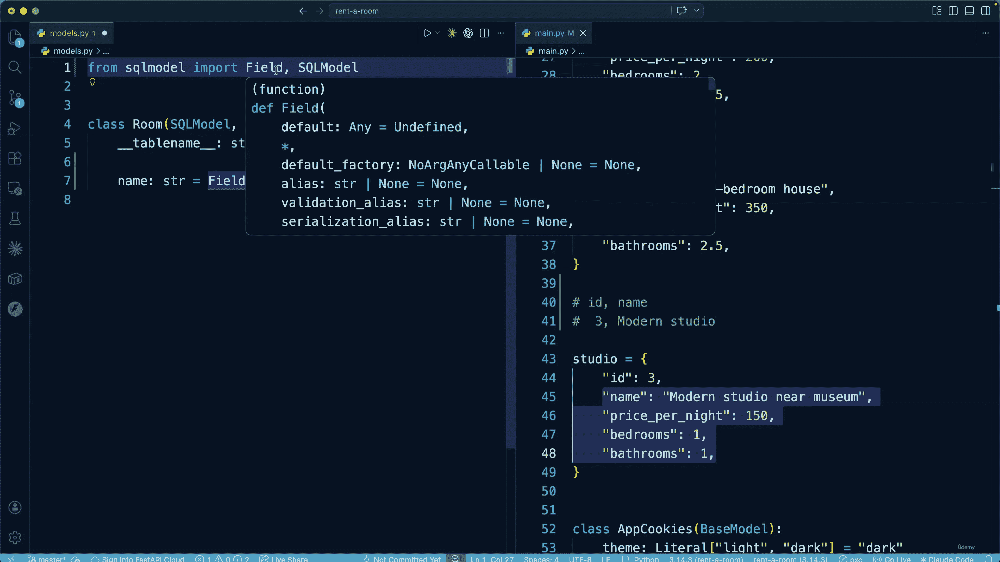
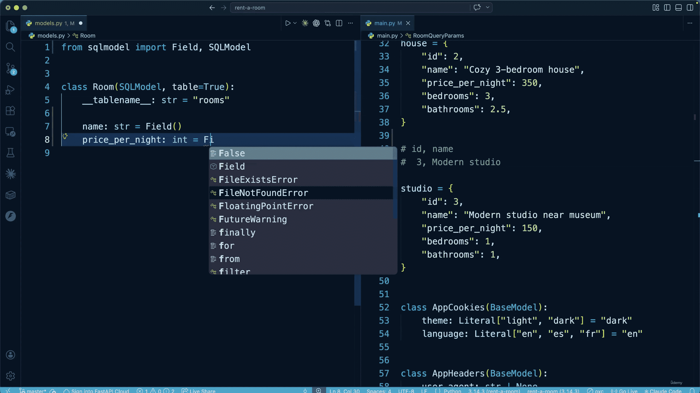
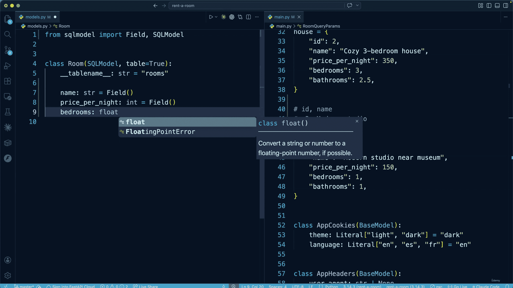
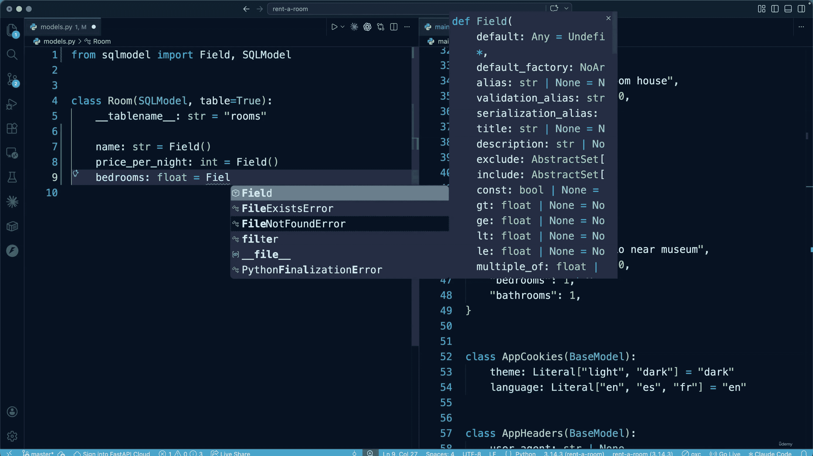
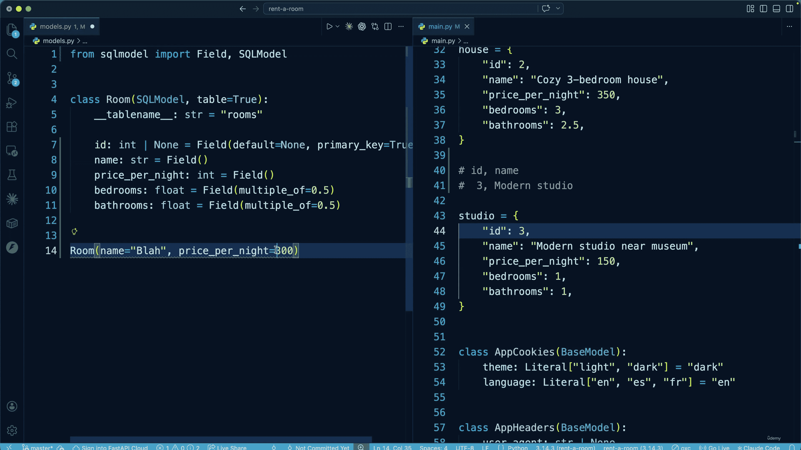

# FastAPI 大师课：第53-54节：定义房间模型字段

在本节课中，我们将学习如何为 FastAPI 项目中的房间模型定义字段。之前我们已经打开了 main.py 文件和新的 models.py 文件，现在要做的事情是，把字典里的那些键转换成房间模型上的对应属性或字段。这些字段会和数据库表中的列一一对应，也就是说，最终这些记录会以行（row）的形式存在数据库的 room 表里面。例如，数据库里会有一行数据，它的 `id` 是 3，`name` 是 "modern studio"，还有其他各种属性值。

为了达到这个目的，我们需要定义所谓数据库表的 schema（模式）。  
简单来说，schema 就是描述这张表有哪些列，以及每一列对应什么数据类型。  
这和我们之前在代码里做数据验证的思路非常相似，不过现在我们在定义目标表的结构。  
之后，SQLModel 这个 ORM（对象关系映射）会自动帮我们把请求转换成对应的 SQL 代码，从而生成一张具有这个结构、这个 schema 的表。

也就是说，我们现在做的事情，相当于把 Python 里的数据模型翻译成数据库能懂的 DDL（数据定义语言）。  
这样后续我们操作数据的时候，就不用手写 SQL 语句了，ORM 会替我们完成翻译工作。

---

## 从字典到模型字段

我们来看一下，原来在 main.py 里可能有一些字典，每个字典代表一个房间的数据。我们要做的是，把这些字典的键（比如 `name`、`price_per_night` 这些）变成 Room 模型的属性。  
为什么这么做呢？因为字典是临时的、存在于内存里的数据，而模型类可以结合数据库表，让这些数据能够被持久化保存。





举个例子，在数据库的 room 表里，我们会有一行数据，这一行数据有 id、name、price_per_night 等列。  
而我们写的 Room 模型，其实就是这张表的 Python 映射。  
所以模型里的每个字段，都会对应表里的一个列。





## 定义最简单的字段

让我们从最简单的字段开始。  
这里我们先把 `name` 和 `price_per_night` 给定义出来，因为 `id` 比较特殊，我们放到最后处理。

先说 `name`，它是字符串类型。  
定义的时候，我们基本上使用和 Pydantic 一样的语法：写一个属性名，指定类型，然后赋值一个 `Field`。  
不过要注意，这里的 `Field` 并不是从 Pydantic 导入的，而是从 SQLModel 导入的。  
我们来看一下代码：

```python
from sqlmodel import SQLModel, Field

class Room(SQLModel):
    name: str = Field()
    price_per_night: int = Field()
```



这里有一个非常关键的点：SQLModel 里的 `Field` 其实是 Pydantic 的 `Field` 的增强版。  
它底层仍然使用 Pydantic 的那套构造，但 SQLModel ORM 在这个基础上额外增加了一个功能：把这个字段连接到对应的数据库列。  
还记得吗，Pydantic 是一个数据验证库，它完全不知道数据库、表、行这些概念。  
而 ORM 做的事情，就是把 Pydantic 的基本功能进行增强，让一个字段不仅代表需要验证类型和要求的属性，还能映射到 rooms 表里的某一列。

所以这两个概念是相辅相成的：  
- 我们关心数据验证，所以必须用 SQLModel 的 `Field`，因为它知道如何连接数据库列。  
- 单纯用 Pydantic 的 `Field` 的话，它只知道验证，不知道怎么连数据库。

不过好消息是，Pydantic 的 `Field` 能接受的所有验证参数，在这里也都能用。  
也就是说，我们既能享受到 Pydantic 的验证能力，又有额外连接数据库的功能。  
所以，即使某些字段不需要额外验证，我也建议你养成写 `Field()` 的习惯，这样以后想加验证就非常方便。

## 定义 price_per_night 字段

接下来我们定义 `price_per_night`，也就是每晚住宿价格。  
这个字段对应你愿意花多少钱住在房间里，它是一个整数类型。  
写法很简单：



```python
price_per_night: int = Field()
```

这样定义之后，这个字段就能和数据库里的 `price_per_night` 列对应起来了。  
以后这个房间的价格数据，就会存储在这一列里。

## 定义 bedrooms 和 bathrooms 字段

再接下来是 `bedrooms`，也就是卧室数量。  
这个字段有点意思，因为我们要支持类似 3.5 间卧室这种可能性，所以它的类型是浮点数 `float`。  
而且在这里，我要给你介绍一个之前没有见过的、非常酷的验证参数：`multiple_of`。  
这个参数可以用来指定字段的值必须是一个给定值的倍数。





举个例子，如果我们写 `multiple_of=0.5`，那就意味着 bedrooms 的值必须是 0.5 的倍数。  
也就是说，它可以等于 0.5、1、1.5、2、2.5 等等，但不能是 2.3 这种数。  
这样我们就给 bedrooms 的数值范围加上了合理的约束。  
毕竟，一个真实的房子里不可能有 2.3 间卧室，但可以有 2.5 间卧室或者 3.5 间浴室。

所以，代码是这样的：

```python
bedrooms: float = Field(multiple_of=0.5)
```

类似地，下一个字段是 `bathrooms`，也就是浴室数量。  
它也是浮点数类型，也要用 `Field` 来连接对应的数据库列。  
同时我们也给它加上同样的验证规则，要求值必须是 0.5 的倍数：

```python
bathrooms: float = Field(multiple_of=0.5)
```

这样一来，房间的浴室数量也只能是这类合理的数值，比如 1、1.5、2、2.5 等等。  
这些约束在实际业务中非常有用，因为它们能防止一些不合理的脏数据进入数据库。

## 定义 id 字段和主键

现在我们来处理最棘手的 `id` 字段。  
在数据库里，id 通常是由数据库自动分配的一个数字。  
当我们往表里添加一条记录时，其他字段的值通常是从客户端发送过来的请求数据（也就是 payload）里获取的。  
例如，某个浏览器或者某个用户发出一个创建房间的请求，FastAPI 服务会接收到这个请求，然后从请求体中取出这些值，再把它们传递给 SQLModel。  
SQLModel 会把这些值转换成对应的 SQL 语句，插入一条新记录到 rooms 表里。

但是 `id` 不一样，因为客户端和 FastAPI 服务都不会提供它。  
相反，我们希望数据库自动为我们生成这个字段。  
所以，我们必须在模型定义里把这个行为描述清楚。

有趣的是，在我们真正把数据写入数据库之前，一个 Room 对象是没有 id 的。  
因为在刚开始实例化这个模型的时候，id 的值是 `None`。  
只有当数据库把数据保存下来，并且把保存后的结果返回给我们时，我们把这个数据库响应转换成对应的 Python ORM 对象，这个对象才会有有效的整数 id。

为了同时支持这两种情况，我们需要把 `id` 声明为 `int | None`，也就是它既可以是一个整数，也可以是 `None`。  
这样，这个模型既能表示进入服务器的、即将发送到数据库的请求数据（此时 id 为 None），也能表示数据库返回的响应数据（此时 id 是有效的整数）。

我们看一下代码：

```python
id: int | None = Field(default=None)
```

这里我们使用了 `default` 参数，这个参数在 main.py 里也见过。  
它的作用是：当我们创建一个 Room 实例时，如果没有手动指定 id，就会默认赋值为 `None`。  
所以，如果你像下面这样创建一个 Room 对象：

```python
room = Room(name="Modern Studio", price_per_night=100, bedrooms=1.5, bathrooms=1.5)
```

那么这个对象的 `id` 就会自动是 `None`，而其他四个字段是必须提供的。  
为什么它们是必需的？因为它们没有设默认值，而且类型是具体的 int 或 float，所以当我们缺少这些参数时，你会看到类似这样的报错：

```text
Missing parameter: name, price_per_night, bedrooms, bathrooms
```

注意，我们并不会因为缺少 id 而报错，因为我们已经给它设置了默认值 `None`。  
你也可以看到，它还可以是 `None` 这个值。  
其实真正让字段变成可选的原因，是默认值的分配。  
当然，把类型写对也是非常重要的。

现在，仅仅把 id 声明成一个普通的字段还不够。  
上面这个语法所做的事情，只是指定了表中要有一个 id 列。  
更重要的是，我们要告诉 ORM，告诉数据库：这个 id 列将来要作为这个表的主键（primary key）。

如果你第一次接触关系型数据库，那你需要知道：主键就是表中用来存储每一行唯一标识符的那一列。  
它是所有记录的主要引用点，因为我们可以通过主键快速定位到任意一行数据。  
比如，可能存在多个房间的卧室数量、浴室数量、每晚价格完全相同的情况。  
甚至，如果不加任何唯一性约束，多个房间还可能拥有完全相同的名字。  
你想一想，如果一百万用户在 Airbnb 上创建房间，里面有几个房间重名是很正常的事情。  
所以我们需要一个唯一的主标识符，而这个标识符就是主键。

而且，这个主键的值是在数据库端自动生成的。  
对于第一条房间记录，SQL 会给我们一个 id 为 1；  
第二条房间记录，id 就是 2；  
然后是 3、4、5，一直递增到几百万行。  
所以 id 就是我们的唯一主标识符，我们也必须把这个列标记为“主键列”。

在 SQLModel 中，我们可以通过 `primary_key=True` 这个参数来指定。  
代码是这样：

```python
id: int | None = Field(default=None, primary_key=True)
```

`primary_key` 这个参数是 Pydantic 本身没有的，因为 Pydantic 根本不了解数据库。  
但这是 SQLModel 额外提供给我们的能力。  
正是这个参数，让 ORM 能够生成正确的 SQL 查询，并发送给 SQLite。  
现在 SQLite 就知道了：id 列是主键，而且是自动递增的数字整数。  
当我们从数据库查询数据的时候，返回的对象里，id 就会被设置为实际的整数值。  
但当我们创建一个即将发送到数据库、用来插入新行的 Room 对象时，这个 id 仍然是 `None`。

最后，你可能会发现一个有意思的现象：我们模型中定义的这些键，一方面作为数据库列名，另一方面也是我们实例化 Room 时要传入的参数名。  
例如，在代码里面是这样创建一个 Room 的 Python 对象表示的：

```python
room = Room(name="Modern Studio", price_per_night=100, bedrooms=1.5, bathrooms=1.5)
```

但是这个对象只是一个内存中的对象，它存在于服务器后端的运行内存里。  
ORM 会把这个对象翻译成对应的 SQL 查询，然后在数据库中创建一个对应的行。  
所以 ORM 本质上就是一个翻译层，它负责在 Python 对象和数据库之间进行双向转换。  
反过来，当我们从数据库里取出数据时，它也会把数据库返回的结果转换成等价的 Room 模型对象或 Room 类实例，用来表示这一行数据。

现在，我们已经有了第一个 SQLModel 模型的定义。

---

## 总结



在本节课中，我们一起学习了如何为房间模型定义字段。  
我们从最简单的 `name` 和 `price_per_night` 开始，了解了 SQLModel 的 `Field` 与 Pydantic 的 `Field` 之间的关系：SQLModel 的 Field 是 Pydantic 的增强版，既能做数据验证，又能连接数据库列。  
然后我们定义了两个浮点数字段 `bedrooms` 和 `bathrooms`，并使用了 `multiple_of=0.5` 来约束它们的值必须符合现实世界中的合理数值。  
最后，我们重点学习了 `id` 字段的定义方式，了解了主键的概念，以及为什么要把 `id` 标记为 `primary_key=True`。  
这样一来，我们的数据库表结构就已经被模型定义好了，接下来就可以在这个基础上进行更多的 CRUD 操作了。
