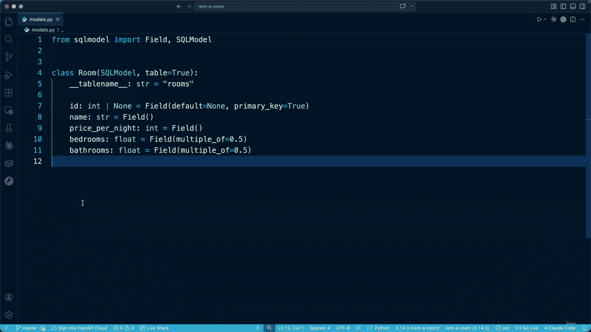
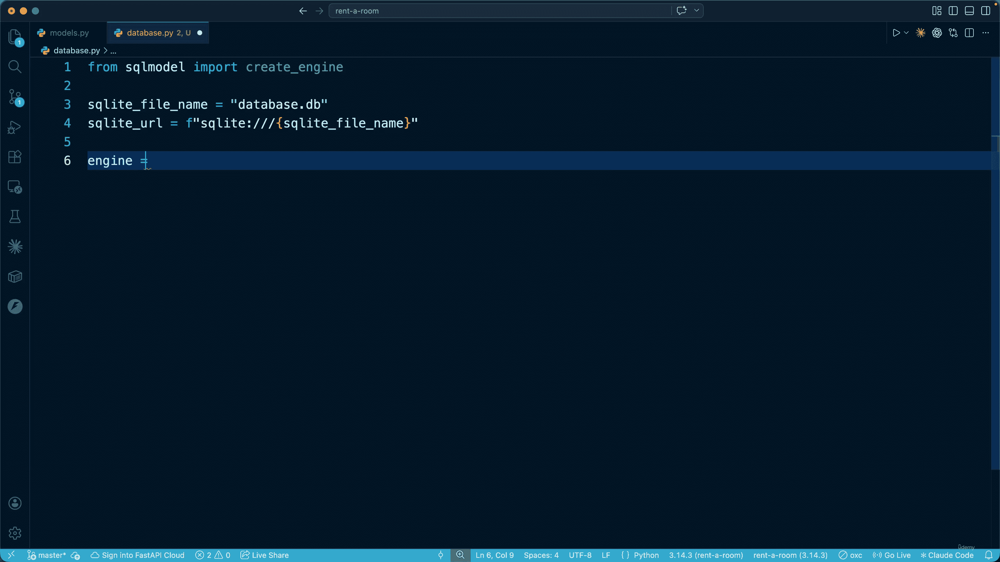
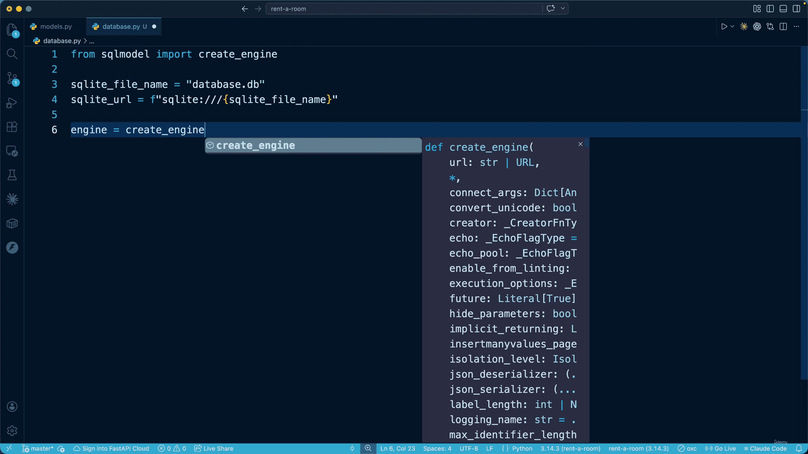
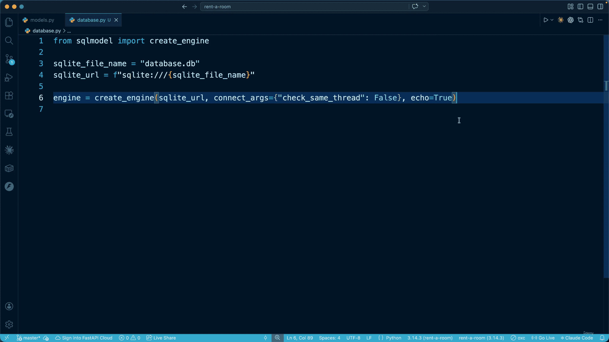

# 🚀 FastAPI 大师课：第54-55节：创建数据库引擎

**本节概述**



在本节课中，我们将要学习如何为 FastAPI 项目创建数据库引擎，也就是创建负责管理数据库连接的核心对象。上一节我们已经有了一个模型，也就是一个能够和特定数据库表交互的类，本节我们继续往前走，真正创建数据库本身，并创建与之配套的引擎。我们会重点理解 engine 是什么、SQLite 的数据库 URL 如何配置、为什么 URL 中要写三个斜杠，以及 `connect_args` 和 `echo` 这两个常用参数分别有什么作用。下面先从模型和引擎的关系讲起，再逐步写到实际代码。

**从模型到数据库引擎**

上一节我们介绍了模型，也就是一个可以和特定数据库表交互的类。接下来要做的事情有两个：创建数据库本身，以及创建对应的数据库引擎。可以把这层关系先记成一个简单的公式：`模型类 -> 数据库表；engine -> 数据库连接管理器`。也就是说，模型负责表达表结构，而引擎负责在后台管理程序与数据库之间的连接。本节的重点就是后者，我们会用代码把数据库连接建立起来。

**引擎到底是什么**

引擎在 Python 中就是一个对象，它负责管理到数据库的连接。它之所以叫 engine，是因为它在后台驱动所有数据库通信，相当于数据库访问的动力来源。这个 engine 会从 SQLModel 中导入，但它实际上来自 SQLAlchemy；SQLModel 是建立在 SQLAlchemy 这个 ORM 之上的，而我们的 FastAPI 应用会使用一个单独的引擎来连接数据库。对于这类偏底层的技术细节，通常按照教程或指南写出对应代码即可，不必在底层细节上过度纠结。关键点是：接下来写的代码会优雅地连接数据库，并且在 SQLite 的情况下，如果数据库还不存在，还会顺手把它创建出来。

**SQLite 与 Postgres 的对比**

需要注意的是，像 Postgres 这样的数据库是一套独立的复杂软件，需要单独安装、管理，或者托管在云端。相比之下，SQLite 简单很多，因为整个数据库都保存在一个文件里，这个文件会放在项目的顶层目录中。我们仍然能接触到同样的真实数据库概念，但需要管理的数据库更简单。理解这一点之后，我们就可以在代码库中新建一个文件，继续写数据库配置。以下是本节会涉及的核心对象，它们各自负责一件很单纯的事情，先列出来方便建立整体印象。

- 数据库文件：SQLite 用来保存数据的实际文件。
- 数据库 URL：告诉引擎连接哪种数据库、数据库文件在哪里。
- 引擎对象：负责管理数据库连接，并在需要时创建 SQLite 数据库文件。

把这些对象串起来之后，代码就不会显得零散。接下来我们进入实际文件，先定义数据库文件的名字。

**创建 database.py 并定义数据库文件**

现在在代码库中新建一个文件，命名为 `database.py`。在这个文件里，先定义一些数据库信息。我们的数据库会保存在一个文本文件中，因此需要给它起一个名字。这里定义一个变量 `sqlite_file_name`，变量名可以自己决定，数据库文件名为 `database.db`。这个文件名可以随意修改，例如 `airbnb.db`、`production.db`、`db.db` 都可以，完全由你决定。这个名称就是应用启动后，引擎最终为实际数据库生成的文件名。可以把这部分先写成如下代码，方便后面继续拼接 URL。

```python
sqlite_file_name = "database.db"
```

定义好文件名之后，下一步就是定义数据库 URL。这个 URL 会在创建数据库引擎时作为参数传进去，因此它是连接配置中的关键一环。

**配置 SQLite URL**

接下来定义另一个变量，命名为 `sqlite_url`。稍后创建数据库引擎时，我们会把这个 URL 作为参数传给引擎。这里使用 Python 的格式化字符串，在字符串前面加一个 `f`，这样就可以把 `sqlite_file_name` 变量的内容直接注入到字符串中。这个字符串之所以重要，是因为它最前面的部分表示要连接哪种 SQL 数据库；对我们来说就是 SQLite。这个设计的好处是，如果以后要连接 Postgres，可以把开头改成 `postgres`，再继续配置其他选项。也就是说，一段文本就能配置大量设置，包括数据库类型、凭据、端口等。现在仍然使用 SQLite，所以写成 `sqlite`，然后加上一个冒号和三个斜杠。代码如下。

```python
sqlite_file_name = "database.db"
sqlite_url = f"sqlite:///{sqlite_file_name}"
```

这段代码看起来有点绕，但设计很优雅：这个 URL 同时指定了数据库类型、要把数据库写入文件，以及数据库文件名。下面我们重点解释三个斜杠的含义，因为这里的每个字符都很重要。

**三斜杠与内存数据库**

三个斜杠非常重要，因为这是字符串语法中表示“把 SQLite 数据库写入文件”的部分，而这里写入的文件就是前面定义的 `sqlite_file_name`。如果只写两个斜杠，则表示要使用内存数据库；内存 SQLite 数据库不会把任何内容写入文件。它很像普通 Python 程序或服务器，关闭时数据会被清空或丢失，这违背了常规数据库要较永久保存数据行的目的。不过，内存数据库非常适合测试。例如，你有多个测试，想验证某个端点是否返回数据库中的数据，但又不想为测试启动一个完整数据库，因为那会带来不必要的文件；这时就可以配置内存数据库，它只在测试运行期间存在。关键点是每个字符都有意义，因此这里一定要写三个斜杠，然后用花括号注入上面的文件名变量。最终 URL 会同时指定数据库类型、写入文件这一事实以及文件名。接下来就可以创建真正的数据库引擎了。





**创建数据库引擎**

在文件下方创建实际的数据库引擎，它将成为我们与数据库之间的连接。先从 SQLModel 中导入 `create_engine` 函数，这个函数名很直观，作用就是创建到某个数据库的连接。然后创建一个变量 `engine`，调用 `create_engine` 函数，并把前面的 `sqlite_url` 作为第一个参数传进去。可以写成下面这样。

```python
from sqlmodel import create_engine

engine = create_engine(sqlite_url)
```

这段代码一方面包含很多复杂性，另一方面又相当简单，也体现了 Python 生态的优势：大部分 SQLite 数据库连接配置都已经由这段代码处理好了。四行代码就能完成入门所需的大部分设置。下面再补充一个 FastAPI 指南文档推荐的配置项，用来处理多线程连接问题。

**多线程连接参数**

`create_engine` 函数接受多种关键字参数，其中一个叫 `connect_args`，它是 connection arguments 的缩写，也就是连接参数。这个参数接受一个字典，用来配置引擎如何管理数据库连接。SQLite 默认是轻量级方案，只允许一个线程同时访问数据库。线程可以理解成计算机中独立的执行单元；多个线程同时运行时，可以同时处理多个任务，从而提高某些工作的速度，但线程需要小心管理，避免彼此冲突。因此这里添加一个字典键 `check_same_thread`，并把值设置为 `False`。这个设置会告诉 SQLite 允许多个线程共享同一个数据库连接。原因是一个发往 FastAPI 端点的请求，在后台可能确实会使用多个线程，即使只是一个客户端访问一个端点。这个设置能让这些线程同时访问同一个 SQLite 数据库，而不是排队等待，从而有望加快数据库响应速度，也加快整个响应的完成速度。对应代码如下。

```python
from sqlmodel import create_engine

connect_args = {"check_same_thread": False}
engine = create_engine(sqlite_url, connect_args=connect_args)
```

处理完连接参数之后，还有一个参数值得加上，它就是 `echo`。下面我们看看它如何帮助我们观察 ORM 生成的 SQL。

**打开 echo 查看 SQL**

在 `connect_args` 之后，再添加一个参数 `echo`，并将它设置为 `True`。这个参数很酷，作用也很直接。SQLModel 是 ORM，也就是一个 Python 库，它会把我们写的 Python 代码翻译成对应的 SQL 代码，例如把创建 Room 模型的操作翻译成向数据库添加记录或删除记录的请求。当 `echo=True` 时，在运行中的服务器终端里，也就是 FastAPI 服务器运行的终端中，会输出 SQLModel ORM 实际生成的 SQL 命令。这样就能在终端输出中看到 Python 代码对应的合法 SQL 语句。这个功能对调试非常有帮助，可以尽早发现性能问题；它也很适合学习，因为你能开始理解 Python 代码究竟如何翻译成 SQL。这个设置也提醒我们，了解 SQL 的工作原理是有必要的，这样才能理解 Python 代码在背后帮你做了什么。例如，后面创建数据库并创建 rooms 表时，我们会看到生成 rooms 表的准确 SQL 查询，其中包含上一节在 Room 模型上定义的五个属性。最终代码可以整理成下面这样。

```python
from sqlmodel import create_engine

sqlite_file_name = "database.db"
sqlite_url = f"sqlite:///{sqlite_file_name}"

engine = create_engine(
    sqlite_url,
    connect_args={"check_same_thread": False},
    echo=True,
)
```

这些参数在本地开发中很好用，但部署到生产环境时还需要考虑日志输出的问题，下面给出建议。

**生产环境建议**

当应用部署到生产环境时，通常建议关闭 `echo`，因为服务器日志中不需要这些内容来扰乱输出。此外，生产环境中可能同时有数百甚至数千个查询，把每条 SQL 都打印出来并不理想。不过在本地开发和学习的场景中，这是一个非常好的选项。到这里，本节课的内容就讲完了。我们创建了一个 SQL 引擎，它本质上是一个 Python 对象，负责管理到数据库的连接。下一步需要设置数据库的创建过程，并把它连接到 FastAPI 应用的启动流程中，这将是下一节课要讲的内容。

**本节总结**



本节课中我们一起学习了如何创建数据库引擎。我们先理解了 engine 是管理数据库连接的 Python 对象，接着使用 SQLite 文件数据库和 `sqlite_url` 配置连接，并解释了三个斜杠表示写入文件、两个斜杠表示内存数据库。随后我们使用 `create_engine` 创建引擎，添加了 `check_same_thread=False` 来允许多线程共享连接，还打开 `echo=True` 来观察 ORM 生成的 SQL。最后我们说明了生产环境通常应关闭 `echo`，并明确下一节会继续设置数据库创建以及 FastAPI 应用启动时的连接流程。

