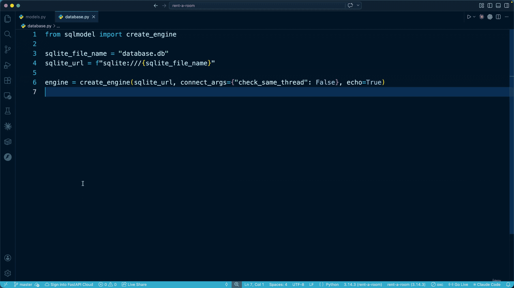
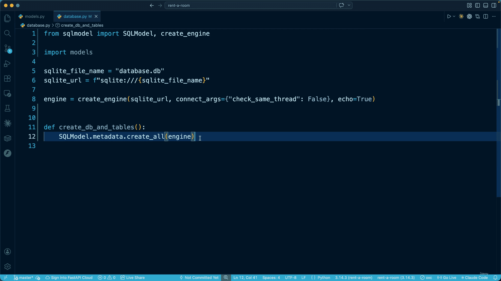

# 🗄️ FastAPI 大师课：第56节：创建数据库

在本节课中我们将要学习如何让 SQLModel 真正创建数据库和数据库表。上一节已经有了一个 `engine`，它负责描述如何连接数据库；本节要在这个基础上，写一个函数，读取模型定义，并用这些模型作为建表依据，创建出一个包含对应表的数据库，做到一个模型对应一张表。下面先梳理整体目标，再处理一个容易忽略的导入问题，最后写出建库函数并说明为什么不能直接调用它。

## 🧱 FastAPI 大师课：第56节：从引擎到建表目标

上一节我们介绍了 `engine`，本节中我们来看看它在创建数据库时扮演什么角色。`engine` 知道如何连接数据库，但此时数据库里还没有任何表被创建出来，所以还需要进一步告诉 SQLModel 去建库和建表。可以把这里的关系先理解成下面的式子：



```text
engine -> 负责连接数据库
模型类 -> 负责提供表结构
SQLModel.metadata.create_all(engine) -> 根据模型创建表
```

也就是说，模型定义了数据库表应该有哪些字段、字段是什么类型，而 `engine` 提供连接目标。接下来的任务就是写一个函数，读取模型定义，并据此创建一个配套数据库，这个数据库里会有模型对应的表，并且每个模型对应一张表。这个目标本身不复杂，但有一个关键前提需要先解决，否则建出来的数据库可能是空的。

## ⚠️ FastAPI 大师课：第56节：先导入模型，再创建表

这里有一个很重要的注意点：SQLModel 在创建表之前，必须知道所有模型。原因是模型提供了 schema，也就是字段和属性定义，这些定义会映射到数据库里的表；而模型会在 Python 执行类定义时自动注册到 SQLModel，通常这个时机就是模型文件被导入的时候。问题在于，当前代码并没有真正导入 `models.py`，所以如果这时候直接创建数据库，数据库虽然会被创建出来，但 SQLModel 不知道 `Room` 模型和对应的 `rooms` 表，最终数据库里会是空的。

因此，在编写真正的建库逻辑之前，必须确保先导入 `models.py`，或者导入任何定义了 SQLModel 模型并且连接到数据库表的文件。以下是在 `database.py` 中需要补充的导入语句：

```python
import models
```

这里的 `models` 指的就是同一目录下的 `models.py`，所以这个导入是合法的。比较特别的一点是，后面的代码并不会直接使用 `models` 这个导入，也不会使用这个模块里的某个名字，但为了让下面的建库代码正常工作，这一行必须存在。也正因为如此，代码检查工具或格式化工具可能会给出类似“导入了未使用的模块”的提示，看起来有点别扭，但这里仍然需要保留这一行。保留这一行的目的，是让这个文件先被读取，让 `Room` 在真正创建数据库之前完成注册。

更直白地说，这个导入语句承担的是“触发注册”的作用，而不是“马上使用某个变量”的作用。原文提到，表信息能够进入 metadata，关键就在于第3行导入模型；当导入任何 SQLModel 子类模型时，这些模型信息就会完成注册。以下两点可以帮助初学者记住这个顺序：

- 先导入定义了模型的模块，让 SQLModel 知道有哪些模型。

- 再执行创建数据库和表的逻辑，这样表结构才会被带上。

如果没有这一行导入，SQLModel 就不会注册那些对应的模型，创建出来的数据库就不会包含这些表。理解这一点之后，就可以继续写创建数据库的函数了。

## 🛠️ FastAPI 大师课：第56节：编写创建数据库和表的函数

现在准备工作已经完成，可以开始定义真正创建数据库的函数了。这里暂时不调用这个函数，而是希望把它直接关联到 FastAPI 服务器的应用启动流程上，这样每次 FastAPI 启动时就会自动调用这个函数，再由这个函数去创建数据库。先从 `sqlmodel` 中导入 `SQLModel`，它和 `Room` 模型中继承的父类是同一个；然后在下面定义一个函数，函数名可以自己决定，这里命名为 `create_db_and_tables`。

```python
from sqlmodel import SQLModel

def create_db_and_tables():
    SQLModel.metadata.create_all(engine)
```

在这个函数里，先引用 `SQLModel` 类，再访问它的 `metadata` 属性；`metadata` 是一个对象，在这个对象上有一个 `create_all` 方法，调用这个方法即可。按照方法说明，它的作用是创建存储在这个 metadata 中的所有表。表之所以会进入 metadata，或者说表的信息之所以会被记录进去，关键就在于前面导入模型的那一行；当导入任何 SQLModel 子类模型时，这些模型信息就会完成注册。再次强调，如果没有那行导入，SQLModel 就不会注册所有对应模型，数据库虽然会被创建，但里面没有表。

调用 `create_all` 时，需要把上面的 `engine` 传进去。函数内部可以访问外部作用域中声明的变量，所以可以直接使用这个 `engine`。以下这个代码片段展示了函数定义与 `engine` 的关系：

```python
def create_db_and_tables():
    SQLModel.metadata.create_all(engine)
```

要注意，这里只是定义函数，函数还没有被调用，因此这段逻辑暂时不会运行。之所以采用这种写法，是因为如果把 `create_all` 直接放在顶层，那么每次有文件从 `database.py` 导入内容时，这一行都会重新执行，数据库可能被反复创建，甚至可能破坏之前的数据库和其中的数据。把逻辑包在函数里之后，只有函数被调用时才会执行；下一节会看到如何配置 FastAPI 应用的启动过程，让它在应用启动时自动调用这个函数，从而保证只在应用启动时运行一次。

另外，`create_all` 的逻辑比较智能：如果项目里已经存在对应的数据库文件，它不会再从头重建，所以关闭并重启服务器时不会丢失之前的工作；只有 SQLModel 发现这个文件名对应的数据库不存在时，才会创建相应的数据库和关联表。到这里，基础管线和基础设施已经搭好，下一节就可以看看如何让 FastAPI 在服务器启动时运行这个函数。

## ✅ FastAPI 大师课：第56节：本节总结



本节课中我们一起学习了如何让 SQLModel 创建数据库和表。我们明确了 `engine` 负责连接数据库，模型负责提供表结构，`SQLModel.metadata.create_all(engine)` 负责根据已注册模型建表；也理解了必须在建库逻辑之前导入 `models.py`，让模型完成注册；最后把建库逻辑封装进 `create_db_and_tables` 函数，避免在导入时反复执行，并说明 `create_all` 不会在已有数据库文件时重复重建。下一节将把这个函数接到 FastAPI 的启动流程中。
