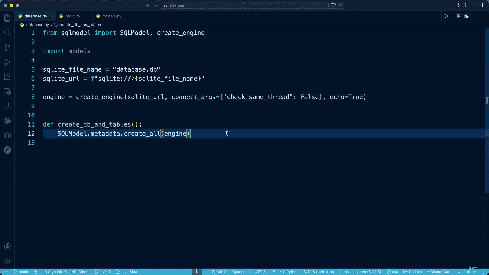
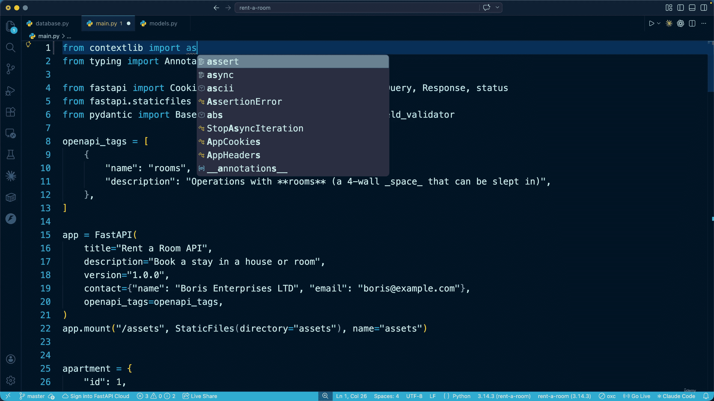
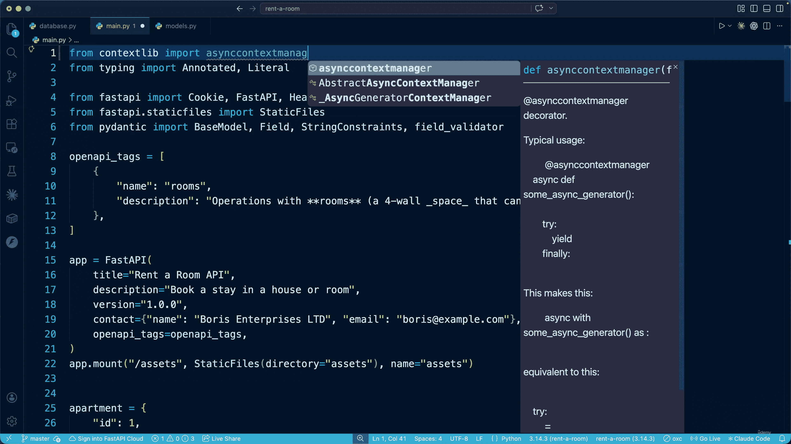
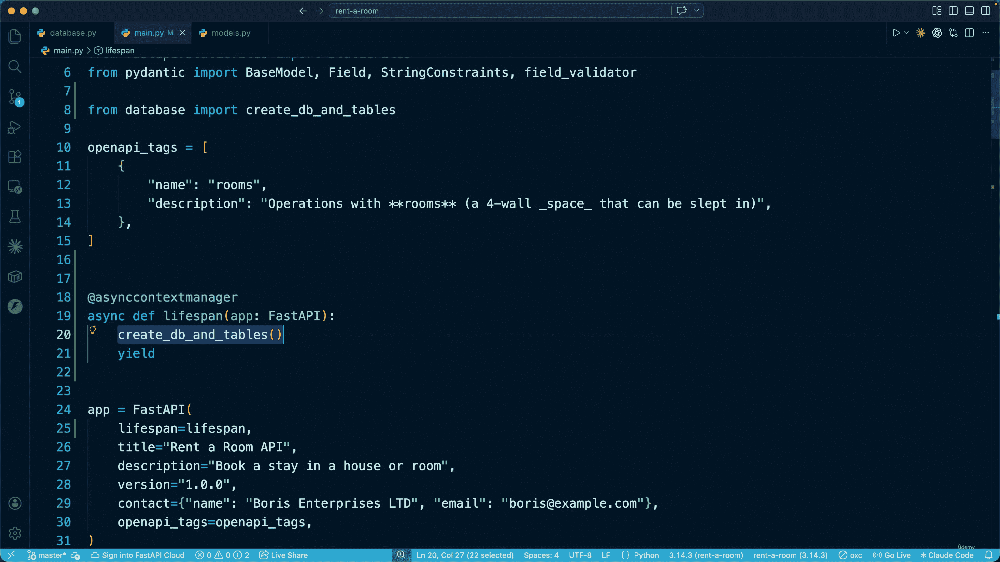

# 🚀 FastAPI 大师课：P56-P57：在应用启动时初始化数据库

在本节课中，我们将学习如何让 FastAPI 在应用启动时自动执行数据库和表的创建函数。上一节课里，我们已经在数据库模块中写好了一个创建数据库和表的函数，但它还只是一个普通函数，没有任何地方调用它。本节的核心目标，就是借助 FastAPI 的 lifespan（生命周期）机制，在服务器真正启动之前执行这个函数，从而保证数据库和表已经准备好。我们会从回顾现有代码开始，然后解释 lifespan 的含义，接着导入 `asynccontextmanager`，编写 `lifespan` 函数，理解 `yield` 在启动和关闭过程中的作用，最后说明类型检查为什么要求函数必须是异步函数并且接收一个应用实例参数。对于初学者来说，这一节既是在补上“函数写好了但没人调用”的缺口，也是在理解 FastAPI 应用从启动到关闭的完整生命周期。



## 🗄️ 回顾：数据库创建函数与数据表模型

在正式进入启动逻辑之前，我们需要先回顾上一节课留下的基础。上一节课中，我们在数据库模块（原文提到的 `database5`）里定义了一个 `create_db_and_tables` 函数，这个函数的职责是创建数据库以及所有数据表，并且它假定这些数据库和表还不存在。当前我们有一个 `Room` 模型，它对应 `models` 文件里定义的 `rooms` 表；由于这个模型被导入到了当前文件中，SQLModel 能够感知到这个模型，因此也就能知道需要创建哪些配套的数据表。问题在于，这个 `create_db_and_tables` 函数只是一个普通的、尚未被调用的 Python 函数，它更像是一段带有指令的过程说明，当前没有任何代码去调用它，所以它还不会真正运行。下一步要做的就是配置 FastAPI，让应用启动时自动运行这个函数，而实现方式就是使用 FastAPI 提供的一个特性，叫作 lifespans。





为了把当前状态理清楚，下面把与数据库初始化有关的关键点列出来。

- 数据库模块中已经定义了 `create_db_and_tables` 函数，它负责创建数据库和所有表，并假定这些对象尚不存在。

- 当前有一个 `Room` 模型，对应 `models` 文件中的 `rooms` 表。

- 因为模型被导入到当前文件，SQLModel 能够感知该模型，以及它需要创建的配套数据表。

- `create_db_and_tables` 目前只是一个普通 Python 函数，没有被调用，因此还不会执行。

- 下一步是让 FastAPI 在应用启动时自动运行这个函数，使用的机制是 lifespan。

## ⏳ 什么是 FastAPI 的 lifespan

在回顾了数据库创建函数只是未被调用的普通函数之后，本节我们来看看 FastAPI 提供的 lifespan 机制。一个 FastAPI 应用拥有所谓的 lifespan，这个词的含义与人类寿命的含义相同，表示某个对象存在的时间段；对于 FastAPI 应用来说，lifespan 表示服务器运行的时间段。利用 lifespan，我们可以拦截 FastAPI 的启动过程，在服务器真正开始运行之前执行一个函数，从而确保服务器启动并运行时数据库已经可用。这个能力非常适合数据库初始化，因为数据库创建本质上是应用启动前需要完成的准备工作。理解了这个概念后，我们就可以回到 `main.py`，开始把 lifespan 接入应用。

## 📥 导入 Async context manager

理解了 lifespan 的用途之后，接下来需要把它写进代码。为了使用 lifespan，我们首先需要从 Python 标准库中导入一个功能，叫作 `Async context manager`，它来自 `contextlib` 模块，属于 Python 标准库，而不是 FastAPI 本身。具体来说，我们将从 `contextlib` 中导入 `asynccontextmanager`。`asynccontextmanager` 是一个装饰器，它和下面路由处理函数上常见的 `get` 方法装饰器非常相似。作为提醒，装饰器看起来就是在实际装饰器名称前加一个 `@` 符号；从本质上讲，装饰器是一个接受函数作为输入、再返回被装饰函数的函数，也就是把原函数包装起来并增强额外功能。`asynccontextmanager` 这个装饰器的特殊作用，是创建一个异步执行上下文；我们还没有大量讨论异步，但这就是 FastAPI 在应用启动时底层会使用的机制。下面先看一下导入写法。

```python
from contextlib import asynccontextmanager
```

## ✍️ 编写 lifespan 函数

导入装饰器之后，本节我们回到 `main.py` 中实际编写 `lifespan` 函数。在创建 FastAPI 应用实例的代码上方，我们先把不再需要的注释删除，然后使用 `asynccontextmanager` 装饰器，并且这个装饰器需要以 `@` 符号开头。这个装饰器要放在一个普通 Python 函数定义的上方，函数名可以叫 `lifespan`，具体名称由我们自己决定。这里有一个重要细节：`asynccontextmanager` 装饰器以及它的类型检查会要求我们声明一个异步函数。异步函数是一种能够在执行过程中的某些时刻暂停的函数，这样 Python 就可以在同一时间运行其他配套的异步函数。异步函数的好处在于，它不是单纯停下来等待某个操作完成，尤其是我们所说的 I/O 密集型操作，也就是需要等待一段时间的动作，比如向另一台服务器发起请求，或者等待数据库响应。这类异步操作通常不是计算量很大的操作，只是需要暂停或等待；异步机制允许我们把等待时间利用起来，把控制权转移给其他可以运行的任务，从而尽可能充分利用可用的计算时间。后续课程还会更详细地讲解异步函数，目前只需要在 Python 函数定义前加上小写的 `async` 关键字。除了 `async` 关键字，为了让这个函数正常工作并让类型检查器满意，这个函数还需要接收一个参数，这个参数代表实际的 FastAPI 应用实例，也就是 FastAPI 构造函数返回并赋值给 `app` 的那个对象；在 `lifespan` 函数内部，我们同样可以访问这个对象。下面定义一个 `app` 变量，并把它的类型标注为 `FastAPI` 类。

```python
from fastapi import FastAPI
from contextlib import asynccontextmanager

@asynccontextmanager
async def lifespan(app: FastAPI):
    ...
```

这个函数可以直接传给下面的 FastAPI 构造函数，这样就能看清各个部分是如何连接起来的。FastAPI 构造函数接受一个 `lifespan` 参数，我们把上面定义的函数传进去即可。它的工作方式是：FastAPI 会运行这个函数，并期待我们在某个时刻告诉它应该继续启动常规的 FastAPI 服务器，而这个信号通过关键字 `yield` 发出。`yield` 的意思是交出控制权，在这里就是告诉 FastAPI：“现在可以启动服务器了。”`yield` 的好处是，我们可以把它放在与服务器启动和关闭相对应的事件之间。比如，`yield` 关键字代表启动 FastAPI 服务器，那么在 `yield` 之前，我们可以执行服务器启动前的额外操作；同理，把逻辑放在 `yield` 之后，就可以在服务器关闭后执行额外操作。当我们在终端使用 `Ctrl+C` 关闭服务器时，所有内容会被终止，随后 `yield` 之后的逻辑也会运行。因此，使用一个普通函数，我们就能指定启动前运行的逻辑和关闭后运行的逻辑；这相当于拦截了应用存在过程中的关键时间点，这也是它被称为 lifespan 函数的原因。我们钩住了特定事件，并可以在应用启动前或关闭后执行额外逻辑。

下面用一段公式概括这个结构。

```text
lifespan 函数结构 = yield 之前的启动逻辑 + yield（启动服务器）+ yield 之后的关闭清理逻辑
```

## 🔁 使用 yield 初始化数据库

`lifespan` 函数写好后，关键控制点就是 `yield`，本节我们把数据库创建逻辑放到正确的位置。这个机制给我们提供了一个非常合适的机会，因为我们想要做的正是在真正启动 FastAPI 应用之前创建数据库和表。这样我们就有了一个额外的副作用，也就是可以在服务器启动前运行的额外操作；这一点很关键，因为最终端点会与数据库交互，数据库必须在那个时候已经存在，否则连接会失败。接下来，从数据库模块中导入之前写好的 `create_db_and_tables` 函数，然后在 `yield` 关键字之前调用它。代码可以写成下面这样，并且记得删除不再需要的注释。

```python
from contextlib import asynccontextmanager
from fastapi import FastAPI

from database import create_db_and_tables

@asynccontextmanager
async def lifespan(app: FastAPI):
    create_db_and_tables()
    yield

app = FastAPI(lifespan=lifespan)
```

这里还需要注意，我们并没有在这个函数里使用 `app` 变量，但如果你想对应用做额外操作，例如给应用附加额外状态，就可以使用它。比如，在每个路由处理函数中，你都可以访问这个中心化的 `app` 对象，从中获取某个键值对或某个配置项。`lifespan` 函数也是完成额外启动操作或服务器关闭后清理操作的好地方。例如，可以在服务器启动时创建一个文件，然后在服务器关闭时删除这个文件；这些操作都可以写在同一个函数中：把启动前逻辑写在 `yield` 之前，把关闭清理逻辑写在 `yield` 之后。

## ⚠️ 类型检查与参数要求

把数据库创建函数放进 `lifespan` 后，还需要注意类型检查要求，本节我们解释这些要求为什么存在。如果现在删掉 `lifespan` 函数的参数，类型检查器会给出违规提示，因为 `lifespan` 参数期望的正是这种特定形式的函数，它要求函数接收一个参数。底层原因是 FastAPI 会拿到这个函数并调用它，同时把应用实例作为参数传进去；如果我们没有遵守这个约定，类型检查器就会报错。这里特别指出这一点，是因为我们在函数内部并没有真正使用 `app` 参数，但它仍然是类型检查器要求的一部分。类似地，如果去掉 `async` 关键字，这个装饰器也会失败，因为它期望的是一个异步函数。每当你看到这类问题时，本质上都是类型检查器在要求某个特定函数具有特定类型，并且带有给定参数，这也是为什么这里必须满足这些要求。关键结论是：`lifespan` 本质上只是一个普通 Python 函数，它会在服务器启动前执行一些操作。保存这些代码后，下一节课我们就可以观察应用启动的完整过程，包括数据库文件的创建。

## 🧾 本节课总结



到这里，本节课的主体内容完成。本节课中我们一起学习了如何让 FastAPI 在应用启动时初始化数据库：我们回顾了 `create_db_and_tables` 只是一个尚未调用的普通函数，理解了 FastAPI 的 lifespan 表示服务器运行的时间段，并从 `contextlib` 导入了 `asynccontextmanager`。我们编写了带 `async` 的 `lifespan` 函数，让它接收一个 `FastAPI` 应用实例参数，并把这个函数传给 `FastAPI(lifespan=lifespan)`。我们还理解了 `yield` 的作用：`yield` 之前执行服务器启动前逻辑，`yield` 之后执行服务器关闭后的清理逻辑。最后，我们把 `create_db_and_tables()` 放到 `yield` 之前，保证数据库和表在服务器启动前已经创建，并解释了类型检查为什么要求函数必须是异步函数且接收一个应用实例参数。下一节课我们会实际运行应用，观察启动过程以及数据库文件的创建结果。

