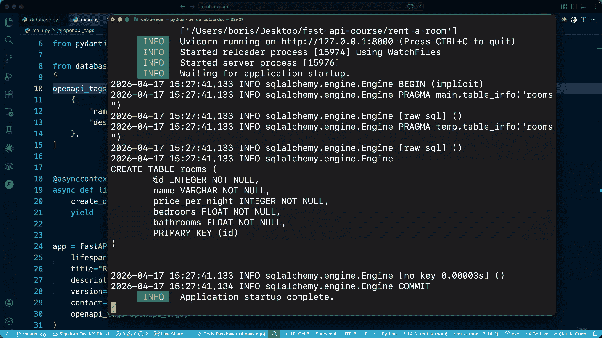
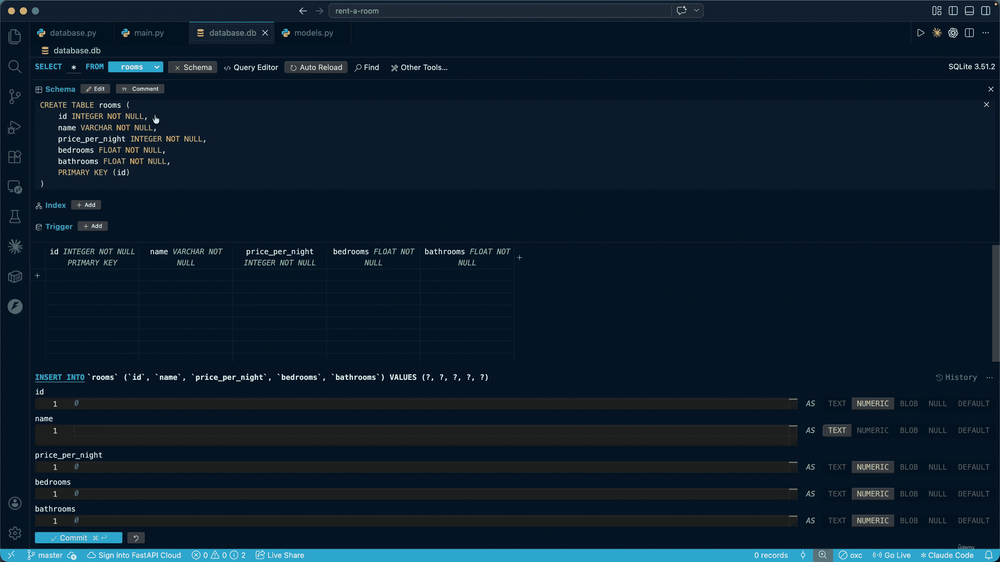

# FastAPI 大师课 第1部分：第57-58节：启动应用并查看数据库 🚀

## FastAPI 大师课 第1部分：第57-58节：课程概述 🧭

在本节课中，我们将要学习如何在 FastAPI 项目里真正启动应用，并查看数据库创建过程在终端和 VS Code 中的表现。上一部分我们已经写好了模型和数据库配置，这一节的重点是把项目跑起来，观察 SQL 建表输出，找到 `database.db` 文件，查看 `rooms` 表以及各个列，最后理解 ORM 生成的 SQL 和主键的作用。整个流程适合初学者跟着操作，不需要先精通 SQL，只要知道每一步在做什么即可。下面从重启服务器开始，一步一步看数据库创建的实际效果。

## FastAPI 大师课 第1部分：第57-58节：重启服务器并启动应用 🔄

上一节我们介绍了数据库配置，本节中我们来看看如何把应用重新启动，让数据库创建过程真正发生。在我的 `rent of room` 项目里，我需要重启服务器，因为只有重新启动应用，启动流程才会执行建表逻辑。需要提醒的是，你随时可以用键盘快捷键 `Ctrl + C` 关闭正在运行的服务器。关闭之后，在项目目录中运行 FastAPI 开发服务器。启动和重启的步骤可以按下面来做，都是很直接的操作：

- 用 `Ctrl + C` 关闭正在运行的服务器。
- 在项目目录中运行 `uv run fastapi dev`。
- 观察终端里的 SQL 输出。

这条命令会启动应用，并触发数据库初始化流程。对应的命令如下：

```bash
uv run fastapi dev
```

启动之后，终端里会看到一些 SQL 输出，这些输出来自我们在 `database.py` 文件里加入的 `echo=True` 配置。也就是说，`echo=True` 的作用是让 SQL 语句显示出来，方便我们观察数据库到底执行了什么操作。下面我们继续看这些输出具体长什么样。

## FastAPI 大师课 第1部分：第57-58节：观察 SQL 建表输出 🧱



上一节我们启动了应用，本节中我们来看看终端里的 SQL 输出。在终端输出中，我们可以看到应用正在创建 `rooms` 表。这里出现的所有表列，都是从我们在 `Room` 模型里写的字段定义翻译过来的。也就是说，模型里的字段会变成数据库表里的列，模型定义和数据库表结构是对应关系。这个过程可以简单理解为：

```text
Room 模型字段定义 → SQLModel/ORM 转换 → SQLite 中的 rooms 表列
```

例如，`id`、`name`、`price_per_night` 这些字段，都会出现在 `rooms` 表里。这里的 `price_per_night` 表示每晚价格，原文里也提到了 `price per night`。理解这一点很重要，因为后面我们添加、删除、更新数据时，都是围绕这张表和这些列来操作。接下来我们切换到 VS Code，看看数据库文件在哪里。

## FastAPI 大师课 第1部分：第57-58节：在 VS Code 中打开数据库文件 📂

上一节我们看到了建表 SQL，本节中我们来看看数据库文件本身。在 VS Code 的文件资源管理器里，为了保险起见，我可以先刷新一下，然后就能看到 `database.db` 文件。这个文件是 SQLite 创建的，整个数据库都会保存在这个文件里面。换句话说，数据不是散落在很多地方，而是集中放在 `database.db` 这个数据库文件中。这里能看到这些内容，是因为我安装了课程前面设置过的扩展 SQLite3 Editor；我很喜欢它，因为它可以让我们在 VS Code 里直接查看表，也可以直接编辑表。打开数据库文件之后，我能在下拉列表里看到所有表。当前只有一张表，名字叫 `rooms`。这张表里有对应的所有列，包括 `id`、`name`、`price_per_night` 等，这些列同样直接来自我们的模型定义。下面我们具体看看表结构。

## FastAPI 大师课 第1部分：第57-58节：查看表和列定义 🗂️

上一节我们打开了数据库文件，本节中我们来看看表和列的结构。当前这张 `rooms` 表还没有任何行，也就是说还没有实际记录。它现在只是数据库表的基础结构，但基础已经搭好了。后续我们可以向这张表添加行、移除行、删除行、更新行等。这里需要再说明一次：对于每一个继承 `SQLModel` 并且设置 `table=True` 的模型，应用启动过程都会在数据库里创建对应的表，所有表都放在 `database.db` 里面。可以用下面的代码关系来描述：

```python
class Room(SQLModel, table=True):
    ...
```

上面的写法表示 `Room` 模型会映射成数据库表。当前我们看到的 `rooms` 表就是这样一个由模型生成的表。接下来我们再看一个更直观的功能，也就是查看 schema 和实际 SQL。

## FastAPI 大师课 第1部分：第57-58节：查看 Schema 和实际 SQL 🔍

上一节我们查看了数据库中的表和列，本节中我们来看看 schema 按钮展示的内容。在 SQLite3 Editor 里，可以点击 `schema` 按钮，它会显示和终端里一样的输出。这个输出展示的是 ORM 生成并发送给 SQLite 的实际 SQL 命令，也就是创建表时真正执行的 SQL。这里看到的代码是 SQL 语言，SQL 和 Python 是两种完全不同的语言，但它并不难读。它表达的意思就是创建一张名为 `rooms` 的表。下面是这类 SQL 命令的结构示意：

```sql
CREATE TABLE rooms (
    id INTEGER NOT NULL PRIMARY KEY,
    name VARCHAR NOT NULL,
    price_per_night INTEGER NOT NULL
);
```

在这段 SQL 里，所有列后面会紧跟数据类型，例如 `integer` 或 `varchar`，其中 `varchar` 表示文本。`NOT NULL` 表示任意一行里的这个条目必须存在，不能为空，也不能缺失。我们还能看到 `integer` 和 `float` 等类型。最后，`id` 列被设置为主键，主键是一行数据的主要标识。创建一行数据时，`id` 列会保存 `1`、`2`、`3`、`4` 等值，数据库本身会在每次创建行时给每一行分配 ID。到这里，整个数据库创建和查看流程就完整了，一切看起来都正常。

## FastAPI 大师课 第1部分：第57-58节：课程总结 ✅



本节课中我们一起学习了如何启动 FastAPI 应用并查看数据库创建过程。我们从重启服务器开始，用 `Ctrl + C` 关闭旧服务，再用 `uv run fastapi dev` 启动开发服务器。接着我们观察了 `echo=True` 带来的 SQL 输出，看到了 `rooms` 表的创建过程，以及模型字段如何变成表列。然后在 VS Code 中找到了 SQLite 创建的 `database.db` 文件，打开后看到了当前唯一的 `rooms` 表和它的列，包括 `id`、`name`、`price_per_night` 等。最后我们通过 `schema` 按钮查看了 ORM 生成并发送给 SQLite 的实际 SQL，理解了数据类型、`NOT NULL` 和主键的作用。当前表里还没有记录，但基础结构已经建好，后续可以添加、删除和更新行。原文最后也说明一切看起来正常，下节课见。

