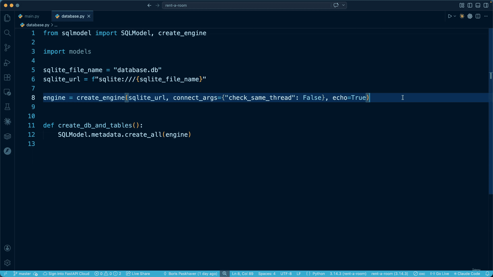
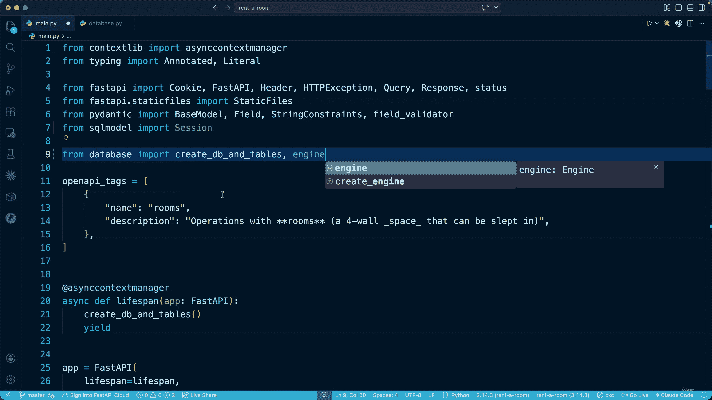
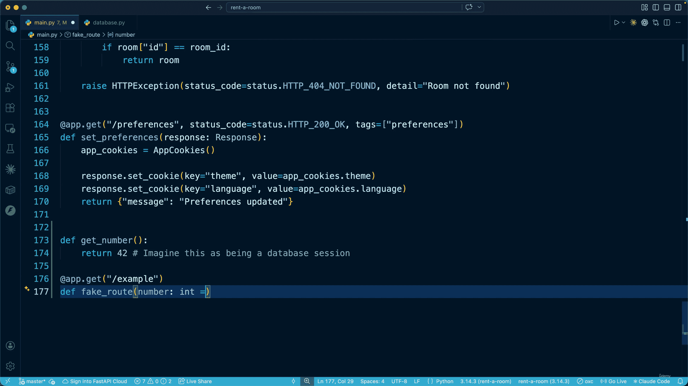
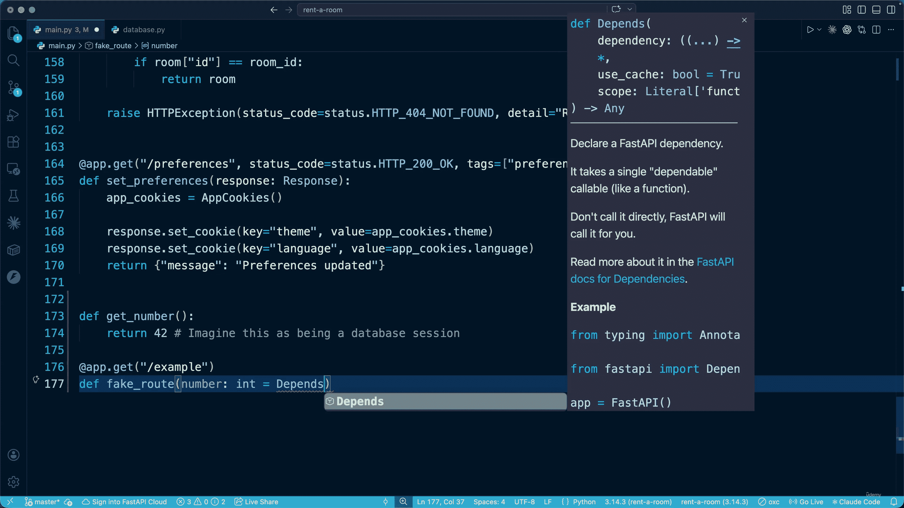
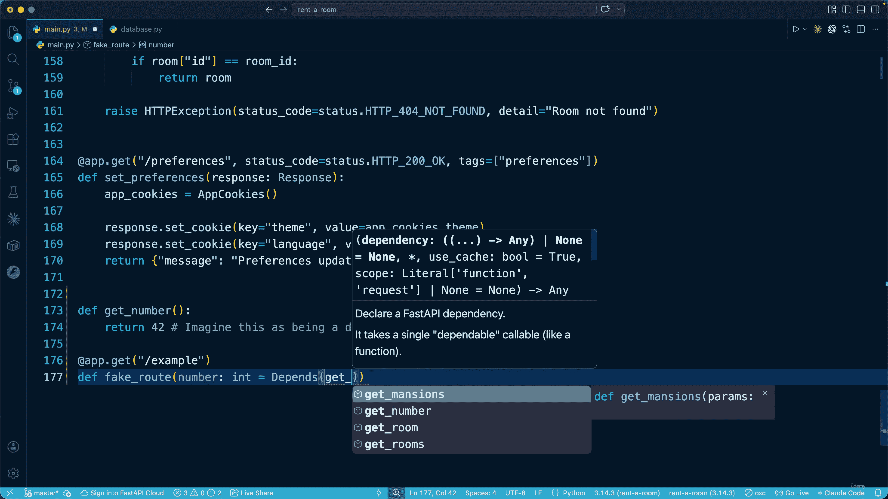
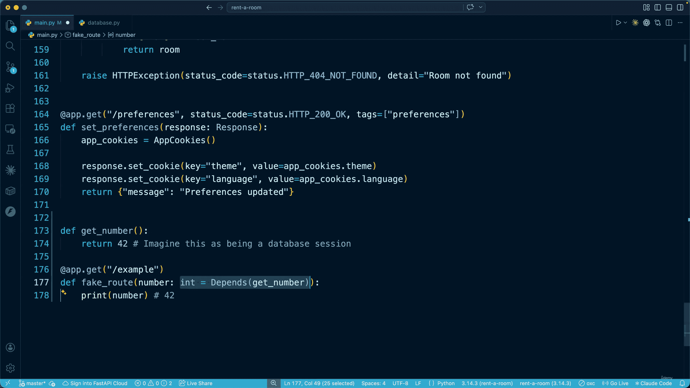
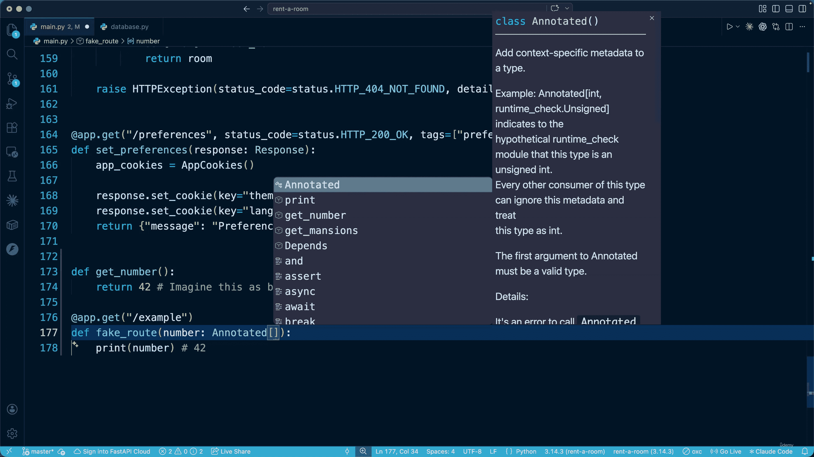
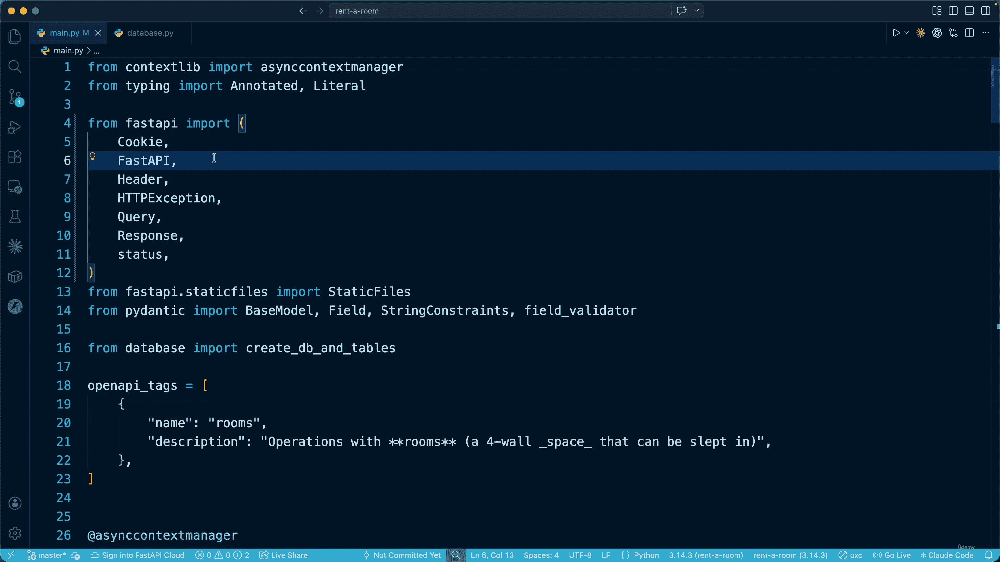

# 🚀 FastAPI Masterclass：第58-59节：依赖注入与 Depends 函数

在本节课中我们将要学习 FastAPI 中依赖注入的基本概念，以及 `Depends` 函数如何把外部对象自动传给路由处理函数。我们会先理解数据库里的 `engine` 和 `session` 分别代表什么，再看到一个直接在路由函数中创建 `session` 的写法以及它的问题，随后用函数参数和 `Depends` 把依赖从函数体里“拿出来”。最后我们会总结两种 `Depends` 写法，并说明为什么这种模式更适合测试和复用。下面从数据库连接对象开始。



## 🗄️ FastAPI Masterclass：1：Engine 与 Session 的关系

上一节我们介绍了数据库连接需要稳定的入口，本节中我们来看看 `engine` 和 `session` 这两个对象如何分工。我们在 database.py 中拿到的 `engine` 对象，代表应用与数据库之间的整体连接。它是应用级别的、单数存在的、长期存在的对象。还有一个与它配合的对象，会在路由处理函数里使用，通过 `engine` 与数据库对话，这个对象叫作 `session`。可以把 `session` 理解成一次与数据库的临时对话：`engine` 对整个应用来说是单例且永久的，而 `session` 是每个路由处理函数各自使用的对象。

`session` 这个词本身表示一段有限的、专门用于某项活动的时间，所以这个命名是合适的。它是一段有限时间内专门用于和数据库交互的对象。`session` 对象会跟踪我们的数据库交互，例如知道读取了哪些行、知道我们想保存哪些修改，并且提供方法真正提交或保存修改到数据库。路由处理函数完成之后，`session` 也会清理自己。下面的代码用公式表达这种关系。

```text
Engine：应用级单例，长期存在
Session：路由级临时对象，一次数据库对话
Engine -> 创建多个 Session
```

换句话说，任何想与数据库交互的路由处理函数，都需要得到一个 `session` 对象。FastAPI 为路由处理函数添加依赖所提供的模式叫作依赖注入。我们先看一种给路由处理函数提供 `session` 的方法，再讨论这个方法为什么不够理想，然后引出 FastAPI 更优化、更理想的方案，让每个路由处理函数拥有自己的 `session`。理解这两个对象的关系很重要，因为后面所有数据库读写都会围绕 `engine` 创建 `session` 来展开。



## 🧱 FastAPI Masterclass：2：直接在路由函数里创建 Session 的问题

上一节我们分清了 `engine` 和 `session` 的职责，本节中我们来看看最直接但不够理想的写法。回到 main.py，第一个示例不需要逐行跟做。这里导入两个东西：第一个来自 SQLModel，也就是 `Session` 类；第二个来自 database.py，也就是刚才看到的 `engine`。需要 `engine` 的原因是它允许我们创建多个 `session`，也就是多次有限的数据库对话。

下面说明这个直接写法的步骤。

* 在路由处理函数中，用 `with` 关键字创建上下文管理器。
* 通过 `Session(engine)` 创建 `session` 实例，并把 `engine` 传进去。
* 给这个对象起名，例如小写的 `session`。
* 在 `with` 代码块中编写与数据库交互的 Python 代码，通过 `session` 对象调用方法。

```python
from sqlmodel import Session
from database import engine

with Session(engine) as session:
    # 在这里通过 session 与数据库交互
    ...
```

因为使用了 Python 的上下文管理器语法，代码块执行完毕后，`session` 会被 Python 自动清理。路由处理函数完成后不会留下悬挂的数据库连接，所以这里使用 `with` 语法。示例场景可以是按 ID 获取房间：当我们移除内存字典后，会查询 room 表，找到路径参数 `room_id` 对应的记录。然后我们在 `with` 块中写实际的 Python 代码，通过调用 `session` 对象的方法与数据库交互。

这个写法有一个问题：如果多个路由处理函数都要与数据库交互，它们都需要写完全相同的代码。并且这段代码是内联写在函数体里的，这并不总是理想。这个问题引出一个设计模式，叫作依赖注入。理解这个问题的关键是：重复代码会散落在多个函数中，后续修改和测试都会变得麻烦。

## 💉 FastAPI Masterclass：3：依赖注入的核心思想

上一节我们看到内联创建 `session` 会导致重复和耦合，本节中我们来看看依赖注入如何解决这个问题。依赖注入是一种模式：函数需要的任何依赖，也就是某种对象或构造，通过参数提供，而不是在函数内部内联创建。

> 依赖注入：函数需要的依赖通过参数传入，而不是在函数体里直接创建。

直接写 `with Session(engine)` 是依赖注入的反面：我们在函数体里直接创建需要的对象。这个写法的问题是函数执行和特定对象耦合，无法替换想传入的对象。例如以后想在测试中测试这个函数，我们会被迫使用真实的 `session` 和真实的 `engine`，因为代码硬编码在函数体里，例如示例里的 149 到 150 行，没有办法改变这个对象。

为了演示这个原则，可以想一个刻意构造的例子：函数参数为什么存在。假设没有 `room_id` 参数，而是直接在函数体里硬编码 `room_id = 5`。问题是我们只能使用一个 `room_id`，因为这是函数体里的运行时代码，没有办法切换这个值。参数的优势在于它表示一个动态值，可以在以后变化。我们可以复用同一个函数，传入不同的 `room_id`，执行不同的查询，或者从数据库中获取不同的记录。

这个例子虽然刻意，但原理相同：内联写 `Session(engine)` 等于把自己耦合到特定的 `session` 和 `engine`。除了每个函数都要重复代码之外，我们也不能为了测试而把 `engine` 或 `session` 换成其他对象。FastAPI 的标准做法是：通过参数把依赖传入函数。理想情况下，`session` 像普通参数一样传入，这样上下文管理器、`session` 的使用、database.py 中定义的 `engine` 的使用，都可以定义在另一个位置。每个需要它的函数都可以复用这段 `session` 创建代码，从而把复杂度隔离或抽象到一个位置。最终目标是依赖注入这个代表临时数据库对话的 `session`，把它作为函数参数传入。之后所有需要数据库会话的路由处理函数都可以复用完全相同的模式。

下面的公式可以帮助记忆这个转变。

```text
内联创建：route_handler() { session = Session(engine); ... }
依赖注入：route_handler(session = Depends(provide_session)) { ... }
```

问题是如何把这样的依赖带进来。为此要介绍 FastAPI 中一个配套函数，叫作 `Depends`。理解依赖注入的关键是“控制权反转”：函数不再自己创建依赖，而是声明自己需要什么，由框架负责提供。

## 🔌 FastAPI Masterclass：4：Depends 的基本用法

上一节我们理解了依赖注入的思想，本节中我们来看看 `Depends` 的具体语法。先清理刚才用于示例的代码，并移除不再需要的两个导入：main.py 中不再直接需要 `engine` 和 `Session`。这些构造仍然会使用，但稍后会在 database.py 中定义一个可复用的依赖，直接提供 `session`。现在先看一个刻意构造的示例，使用 FastAPI 中首字母大写的 `Depends`。这个示例不要求逐行跟做，不过练习语法是有好处的，而且这个示例路由处理函数会在课程结束时删除。



下面说明这个示例的结构。



* 从 FastAPI 导入 `Depends`。
* 定义一个非常简单、甚至有点“傻”的示例函数 `get_number`，返回任意值，例如 `42`。
* 想象一个类似函数可以提供数据库 `session`，这里的 `42` 只是示例。
* 定义一个路由处理函数，让依赖在函数体中可用。



```python
from fastapi import Depends

def get_number():
    return 42

@app.get("/example")
def fake_route(number: int = Depends(get_number)):
    print(number)
```

目标是让 `get_number` 这样的过程运行，并返回我们需要的资源，在这个例子里就是数字 `42`。在 FastAPI 中，声明实际参数 `number`，类型是 `int`，然后用等号把默认参数赋值为 `Depends(get_number)`。`Depends` 的描述是“声明一个 FastAPI 依赖”，它接收一个可调用对象，也就是能使用 Python 括号语法调用的对象。这里内联调用 `Depends`，并传入未调用的 `get_number` 函数。

这表示：每当 FastAPI 运行 `fake_route` 路由处理函数时，因为它看到 `Depends`，就知道这个函数依赖 `get_number` 的调用。每次路由处理函数运行，FastAPI 会自动调用 `get_number`，拿到返回值 `42`，并把 `42` 作为 `number` 参数的实参。示例中如果打印 `number`，它等于 `42`。虽然这里不实际测试，但含义是这样。路由处理函数运行时，依赖函数已经运行，并且我们可以完全访问依赖提供的对象。这个模式和之前见过的 `Query`、`cookies`、`Header` 函数类似：函数需要的所有依赖和契约不在函数体内联编写或实例化，而是作为参数传给路由处理函数。下面的代码展示这个自动调用过程。

```text
FastAPI 运行 fake_route
-> 发现 number: int = Depends(get_number)
-> 自动调用 get_number()
-> 得到 42
-> 把 42 传给 number
-> 执行 fake_route 函数体
```





## 🧾 FastAPI Masterclass：5：Annotated 写法与两种语法

上一节我们用默认参数形式写了 `Depends`，本节中我们来看看另一种更常见的写法。还可以用完全相同的方式完成同样的事情，使用整个课程中见过的 `Annotated` 类型和语法。作为替代方案，移除刚才的默认参数写法，把参数声明为 `Annotated`。方括号中的第一项是类型，仍然是 `int`；第二项再次调用 `Depends`，并传入未调用的 `get_number`。这完成相同的结果，而且这种语法在 FastAPI 文档中更常见。

下面是两种等价写法的对照。

```python
# 写法一：默认参数
def fake_route(number: int = Depends(get_number)):
    ...

# 写法二：Annotated
from typing import Annotated

def fake_route(number: Annotated[int, Depends(get_number)]):
    ...
```

注意这里的模式和之前 `Query` 作为第二个参数、`Header` 等用法相同。区别在于现在传入的是自己的自定义函数。`Query`、`Header`、`cookies` 这些构造从 FastAPI 导入，它们知道如何从查询参数、请求头、cookie 中解析数据。使用 `Depends` 时，可以传入自己的自定义函数，这个函数可以做任何事。`Depends` 会在路由处理函数运行时自动调用这个函数，收集返回值，并把它作为实际参数值传给 `number`。现在依赖是作为参数从外部传入的。可以把这个逻辑理解成在 `fake_route` 的逻辑之前运行。因此在测试中，可以传入一个数字，不必依赖这里的 `Depends`；也可以找到另一种方式传入任意数字。由于没有耦合到路由处理函数函数体里的具体实现代码，替换 `number` 的值或来源会更容易，因为依赖是从外部作为参数传入的。如果内联写 `get_number`，就无法用其他东西替换 `get_number`，因为它是函数执行时总会运行的代码。这里 `get_number` 只是返回 `42` 的依赖，但最终函数只需要一个数字，只要传入任意数字，函数体其余代码就可以按原样运行。理解这个解耦效果，对后面写可测试的数据库路由很有帮助。

## ✅ FastAPI Masterclass：6：本节总结

上一节我们对比了 `Depends` 的两种写法，本节中我们对依赖注入做一个收束。这是依赖注入的基本介绍：依赖注入是一种设计模式，函数需要的任何构造或依赖通过参数传入，而不是在函数内部创建。这个模式在 FastAPI 中非常常见。下一节课我们会看到如何利用它，把 `session` 传给每一个需要与数据库交互的路由处理函数。现在会移除所有示例代码，它只是为了演示；上面未使用的导入也会移除。



本节课中我们一起学习了 `engine` 与 `session` 的分工、内联创建 `session` 的问题、依赖注入的核心思想、`Depends(get_number)` 的默认参数写法，以及 `Annotated[int, Depends(get_number)]` 的等价写法。我们还理解了依赖作为参数传入后，函数体不再耦合具体实现，测试和替换依赖都会更容易。掌握这些内容后，就可以在下一节把可复用的 `session` 依赖放进 database.py，并让所有数据库路由复用同一个模式。

