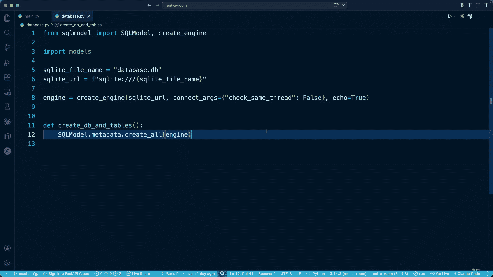
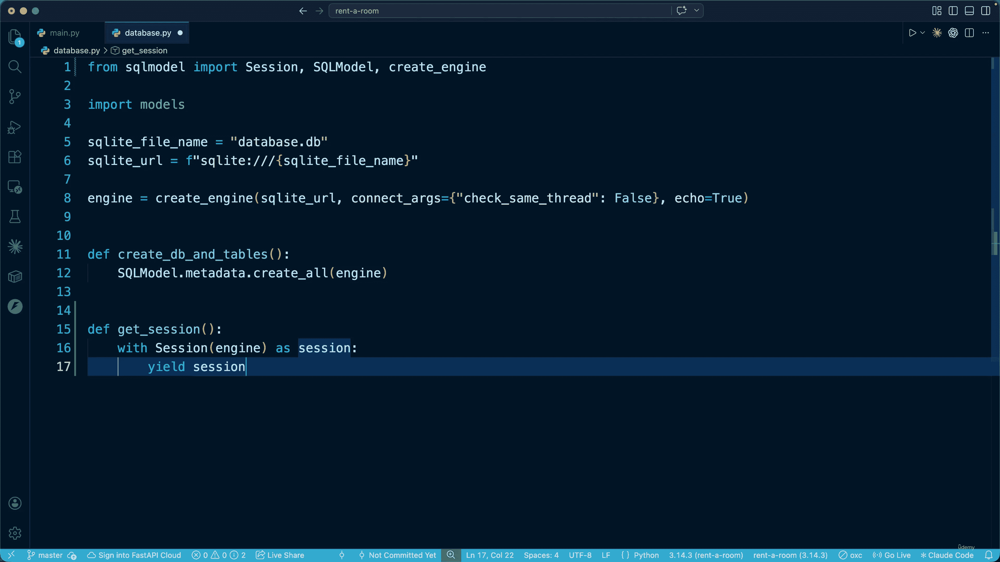
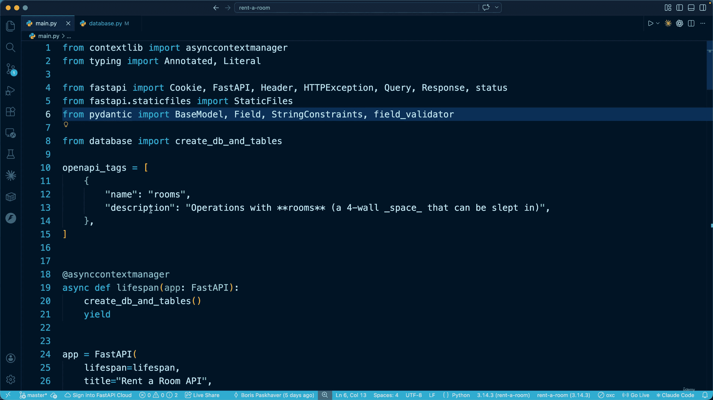
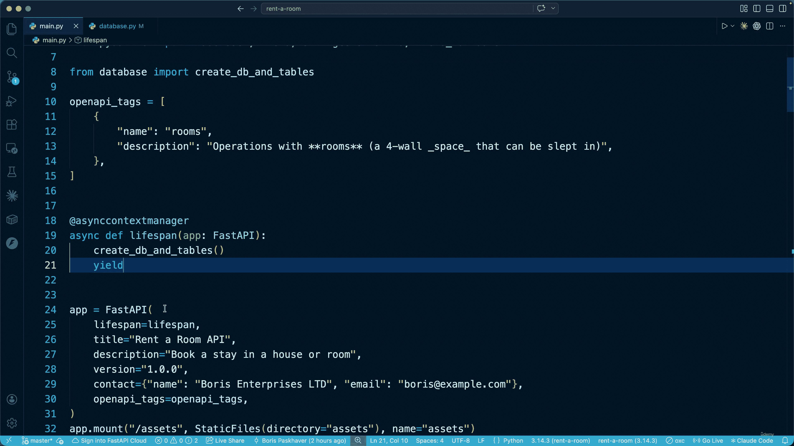
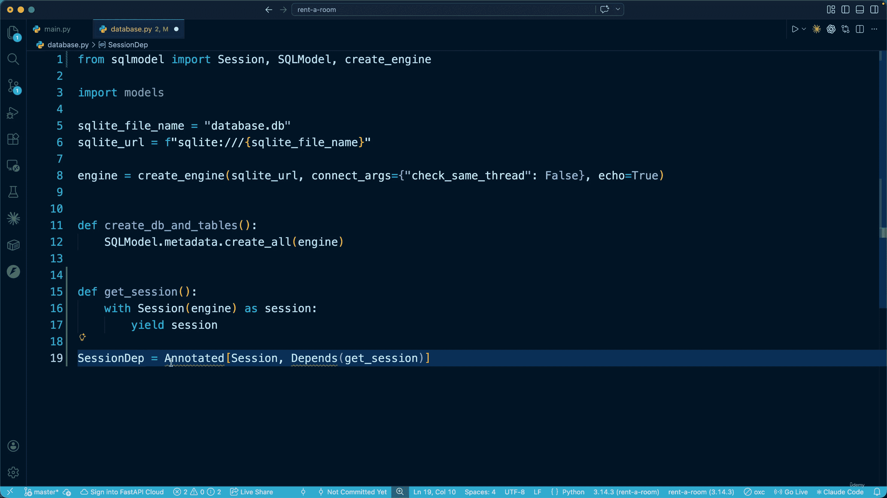
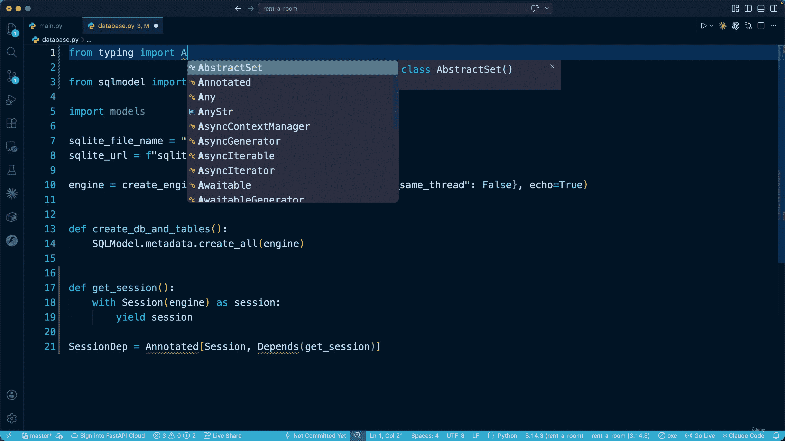
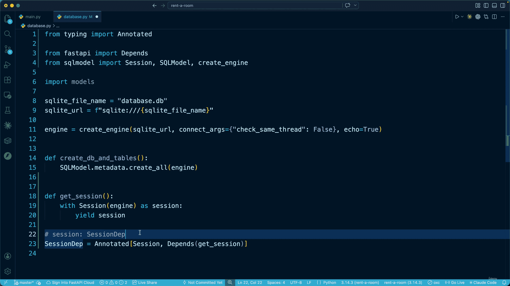

# 🚀 FastAPI Masterclass：第59-60节：创建SessionDep类型

在本节课中，我们将学习如何为FastAPI的依赖注入系统编写一个真正可复用的类型。前面的课程里，我们已经了解了依赖注入的基本概念，也知道了session是什么，但每次都要在路由函数里手动创建session确实很繁琐。本节课我们要做的就是把这个过程封装起来，让路由处理程序能专注于自身的业务逻辑，而不必操心数据库连接这类“琐事”。我们会先写出一个真正的get_session函数，然后再定义一个配套的SessionDep类型，方便在任意路由里直接使用。最后，我们还会解释为什么这里要用yield而不是return，并梳理一下整个请求的生命周期。内容不复杂，跟着一步步来就能看懂。

## 🔍 为什么要用依赖注入？

依赖注入有一个很大的好处：路由处理程序可以专注于请求和响应的核心业务逻辑。比如说，一个创建用户的接口，只需要关心用户的名称、邮箱这些数据怎么处理；至于数据库连接怎么建立、session怎么管理，这些事情如果也塞进路由函数里，代码就会变得又长又乱。相比之下，像创建数据库连接、管理session这类更大的、更偏底层的关注点，应该被放进独立的依赖函数里，和主路由代码隔离开来。这其实就是所谓的“关注点分离”——也就是把不同层次的责任拆开，让代码更简单、更清晰。你可以想象一下，如果每个路由里都写一遍连接数据库的代码，那不仅重复，而且将来要改一个数据库地址，就得把所有文件都翻一遍，那样太痛苦了。所以，本节课的目的就很明确：写一个真正能打开session（也就是用engine和数据库建立连接）的函数，同时再声明一个可复用的类型，让这个函数能和FastAPI的依赖注入系统无缝配合。

既然目标已经清楚了，那我们就从get_session函数开始，看看具体代码怎么写。

## 🛠️ 编写get_session函数

我们即将写的代码，其实和上一节课看到的非常相似，但区别在于：现在我们可以把它放在一个单独的函数里，而不是在每个路由里重复写。这里在这个database.py文件里，我们正好可以很方便地访问到engine对象。所以，我们首先要把上一节课见过的Session类导入进来。

在上一节课里，我们必须在每个路由处理程序里手动创建一个session实例，并且还要把engine传进去。这种写法非常啰嗦，而且到处都是重复代码。现在，我们要把这些逻辑统一放到一个位置，也就是一个函数里。我们把这个函数命名为get_session，当然名字完全由你自己决定，只要你喜欢，叫什么都行。我们会在函数里使用和上一节课完全相同的上下文管理器——也就是with关键字。with关键字会帮我们创建一个Session类的实例，然后把上面已经定义好的engine传进去。这个创建出来的对象，我们就叫它session，然后在with这个代码块内部，就可以直接使用session来进行数据库操作了。因为Python的上下文管理器有自动清理的机制，所以一旦这个代码块里的逻辑执行完毕，session就会被自动关闭和清理。

不过这里有一个关键问题：我们不能直接return session。原因在于这段逻辑的执行方式。设想一下，如果在一个路由处理程序里使用get_session这样的依赖，当这个with代码块执行完毕时，上下文管理器会立刻清理session。也就是说，如果我们把session用return返回出去，那么当return语句执行后，紧接着这个with代码块就会执行清理逻辑，session在还没到达路由处理程序之前就被关掉了，这显然不是我们想要的。所以，这里我们要用一个之前已经在lifespan函数里见到过的关键字——yield，而不是return。为了提醒一下自己，yield的作用是暂停当前的执行，让其他东西先接管，而这个暂停的时间可以相当长。举个例子，回到我们的main.py，在lifespan函数中，我们用yield把控制权交给整个FastAPI应用，让它一直运行，直到应用结束。这个过程可能是几个小时，也可能是几天，只要你的应用作为服务器一直运行下去。yield的含义就是，lifespan函数虽然还在运行，但它已经把控制权交给了别的东西，也就是FastAPI，让它接管并启动服务器。

这里用的是同样的原理：yield会把session的使用权交给路由处理程序，然后路由处理程序会完整地运行，直到它把响应返回给客户端。然后Python的执行流就会回到这里，此时这个with代码块已经执行完毕，而“代码块执行完毕”指的是session的产生和yield暂停的过程已经结束，于是Python就会看到这一行全部完成，接下来就会把session清理掉。这个模式，会在每一个路由处理程序运行时反复执行。

为了让你更直观地理解整个过程，我们可以用下面的步骤来描述一次请求从进入到结束的完整流程：

- 一个请求打到了某个路由处理程序上。
- 这个路由处理程序对get_session有依赖（也就是说，它需要session）。
- get_session函数会创建一个临时的数据库session，用来和数据库交互。
- 然后get_session函数会yield，也就是把控制权交给路由处理程序。
- 路由处理程序运行自己的业务逻辑，直到结束。
- 控制权回到get_session函数中，紧接着的with上下文管理器会把session清理干净。

这个设计最棒的地方在于，所有的细节都被隔离或者抽象在了这个单独的get_session函数里面。对于路由处理程序来说，它只知道“我有一个session可以用”，完全不用关心session是怎么创建、怎么关闭的。这个上下文管理器会负责清理session，所以不用担心连接泄漏之类的问题。

## 🏷️ 创建SessionDep类型

现在基本思路已经清楚了，接下来我们要做的就是定义一个供路由使用的类型，让依赖注入更方便。现在我们可以做的事情是：在main.py中导入get_session，然后在任意一个路由处理程序里，用类似Annotated的语法来声明一个参数类型。这个类型会告诉FastAPI，你这个参数能拿到一个session对象——也就是get_session函数里yield出来的那个东西。然后我们还要说明，这个参数依赖于get_session函数的调用。我们可以给任意路由处理程序定义参数，比如把参数名写成session，然后通过Depends来调用get_session，拿到session，再把它作为session参数传给路由处理程序。这里使用的Depends功能和上一节课看到的一模一样。但这样做会带来一个值得注意的问题：如果每个需要数据库访问的路由处理程序都要写一遍“Annotated[session, Depends(get_session)]”这种代码，那还是会很啰嗦。别忘了，在Python或者FastAPI里，我们其实可以把这种类型构造赋值给一个变量，让一个变量来代表这个类型。之前我们就做过类似的事情，比如在定义查询参数类型的时候，我们把类型变量声明在两个路由处理程序的上方，然后在两个路由处理程序里复用它。现在我们可以达到完全一样的效果。所以，与其在每个路由处理程序的参数里重复写那一大串类型声明，不如在这里定义一个单独的变量，名字就叫session_dep，它是session dependency的缩写。这样，在任何一个路由处理程序里，我们都可以把session_dep当作参数的类型来用。FastAPI看到这个类型后，就会自动调用get_session函数，然后把拿到的数据库session注入到对应的路由处理程序的参数里。

当然，我们之所以会遇到“名字未定义”的问题，是因为还没有导入这些必要的名称。所以我们要从typing中导入Annotated类型，然后从fastapi中导入depends函数。导入完成之后，一切就都准备好了。

这个设计的好处是，session_dep作为一个函数参数类型而存在。在任何函数里，我们都可以写session参数，然后注解它的类型是session_dep。每当FastAPI看到这个类型，它就会知道这个参数依赖于get_session函数的调用。于是FastAPI会调用get_session，这个函数会yield出一个session对象，让我们能够和数据库交互。接下来，session依赖就被注入到我们的路由处理程序里了。最后，最妙的是：当路由处理程序执行完毕，控制流会自动回到get_session函数中，Python会在这里清理session。所以不会留下任何残留的连接或类似的资源。也就是说，所有关于创建session、通过engine与数据库临时交互的复杂性，现在都被隐藏起来、抽象到了这个单独的get_session函数以及配套的session_dep类型变量里。这个类型变量未来可以赋予任何路由处理程序的参数。至于具体怎么用，我们下一节课就会看到。

本节课中，我们一起学习了如何把数据库session的创建过程封装到一个独立的get_session函数中，并理解了为什么需要yield而不是return来保持session的生命周期。我们还一起创建了session_dep这个可复用类型，利用Annotated和Depends把依赖注入的细节包装起来，让路由处理程序可以干净地访问数据库。通过这种方式，我们实现了关注点分离，让代码更简洁、更易于维护。下一节课，我们将实际在路由中使用session_dep，看看它如何帮助我们轻松完成数据库操作。
