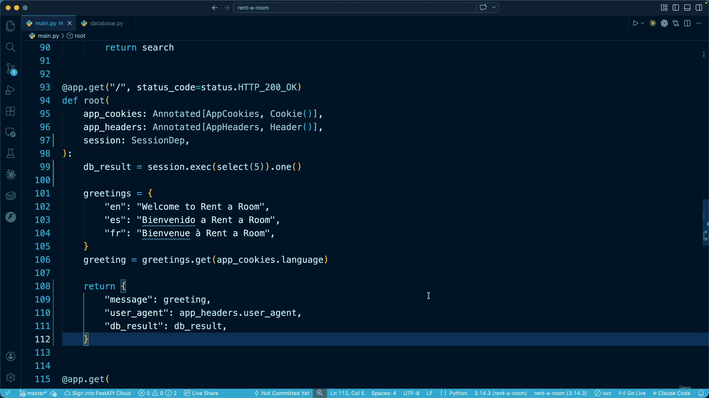
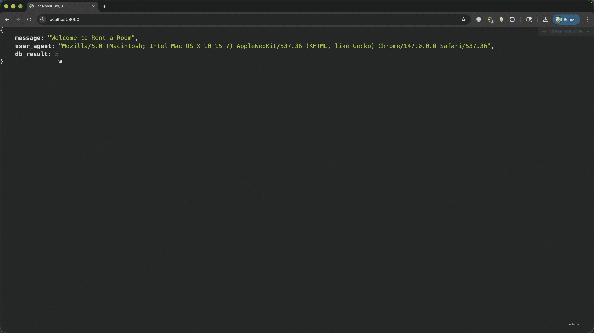
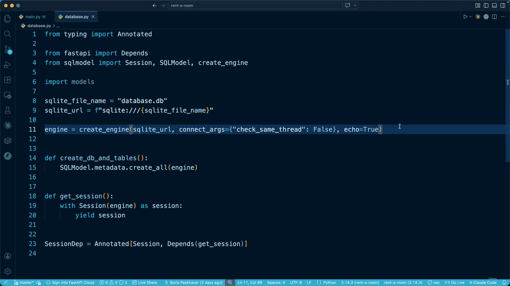
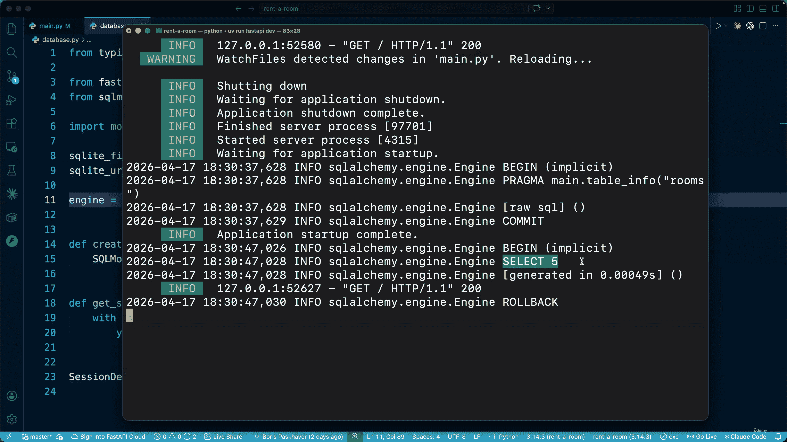

# 🚀 FastAPI 大师课：第60课：执行示例 SQL 查询


在本节课中，我们将要学习如何把已经准备好的 `SessionDep` 依赖类型真正用到路由处理函数里，从而拿到数据库会话对象，并执行一条示例 SQL 查询。这个查询本身很简单，甚至只是让数据库返回数字 5，但它能完整走一遍“从 FastAPI 路由到数据库再返回结果”的流程。简单理解，上一部分我们准备了会话依赖类型，本课要展示另一半：怎样在路由处理函数的参数定义中使用这个类型，访问会话，并证明请求确实碰到了数据库。


## 🧩 FastAPI 大师课：第60.1节：认识 SessionDep 依赖类型


现在我们已经有了一个方便的 `SessionDep` 类型，它的本质仍然是一个会话对象，只不过这个对象是通过调用 `get_session` 函数取到的。很直白地说，`SessionDep` 不是另一种神秘数据库，它就是把“获取会话”这件事包装成了一个可以注入的类型。下面列出本节涉及的关键导入和概念，便于初学者建立整体印象。


- `SessionDep`：从数据库相关文件导入的会话依赖类型，背后会调用 `get_session`。

- `get_session`：负责取得会话对象的函数，`SessionDep` 会在后台自动调用它。

- `select`：从 SQLModel 导入的函数，对应 SQL 里的 `SELECT` 语句，是查询数据的基本方式。

- `session`：路由处理函数中声明的参数，类型写成 `SessionDep` 后即可使用数据库会话。


从概念上看，`SessionDep` 类似一种注解类型，它会在后台通过调用 `get_session` 来取得会话访问权。这个动作会自动发生，所以在路由处理函数里可以认为会话对象已经可用，它代表当前这次请求与数据库之间的临时连接。回到 `main.py` 后，需要导入新的 `SessionDep` 类型，同时从 SQLModel 导入 `select` 函数。核心用法可以概括为下面这段代码。


```python
from sqlmodel import select
from database import SessionDep
```


上一节我们说明了依赖类型的作用，本节中我们来看看它怎样进入路由处理函数的参数。可以随意选一个函数作为示例，这里选择根路由；示例代码在课程末尾会被移除。声明参数时名称可以自己定，这里叫 `session`，最关键的是把类型声明为 `SessionDep`。下面给出路由参数的核心写法。


```python
@app.get("/")
def read_root(session: SessionDep):
    ...
```


## 🛠️ FastAPI 大师课：第60.2节：用 session 执行 select(5)


接下来要写一段示例代码，真正和数据库交互。SQLModel 中用于发出或执行 SQL 语句的主要方法叫 `exec`，也可以把它理解为执行 SQL 命令的方法。SQLModel 底层建立在 SQLAlchemy 之上，所以还有一个来自底层 SQLAlchemy 的补充方法 `execute`，本课先使用 `exec`。下面列出执行查询时需要理解的两个动作，分别是发出查询和取出结果。


- 使用 `session.exec(...)` 发出 SQL 语句。

- 使用 `.one()` 从结果中取出单个值。


在 `exec` 里面调用前面导入的 `select` 函数，就可以运行一条 SQL `SELECT` 查询。这里不查询任何真实表，而是给 `select` 传入一个简单参数 `5`，也就是查询数字 5。SQL 会把值 5 原样返回，这个例子看起来很傻，但它会完整走一趟数据库。示例查询的核心代码可以写成下面这样。


```python
db_result = session.exec(select(5)).one()
```


每当根函数运行时，它都会通过 `session` 对象访问数据库，让 SQL 执行这条查询，然后调用 `one` 方法提取结果。关于如何从 `rooms` 这样的表中查询真正的数据行，下一节会深入展开；本课这一段只是为了示例，故意写得很简单，只想要一段使用会话对象运行的 SQL 代码。数据库返回响应后，SQLModel 会把它翻译成 Python 中的字面数字 5，然后把它赋给变量 `db_result`。下面给出完整的根路由示例，返回结果中增加一个键 `db_result`，值就是数据库取回的数字 5。




```python
from fastapi import FastAPI
from sqlmodel import select
from database import SessionDep

app = FastAPI()

@app.get("/")
def read_root(session: SessionDep):
    db_result = session.exec(select(5)).one()
    return {"db_result": db_result}
```


## 🔍 FastAPI 大师课：第60.3节：在浏览器和日志中验证查询


写完代码后回到浏览器中正在运行的应用，当前已经位于根路由，刷新页面即可看到结果。刷新后首先能看到数值 5，这说明值是从某个地方取回来的，而且确实来自数据库。为了进一步证明向数据库发出了 SQL 语句，可以回想代码中给 `create_engine` 调用添加了 `echo=True` 参数，它允许在终端服务器日志中打印所有 SQL 查询。下面的日志片段表达了本课关心的核心信息，也就是数据库收到了查询并返回了 5。


> 请求进入 FastAPI，SQLAlchemy 输出一条简单的 `SELECT 5` SQL 语句，数据库返回常量 5。


回到运行 FastAPI 服务器的终端后，可以看到 SQLAlchemy 的输出，而 SQLAlchemy 正是 SQLModel 底层的库。日志中能看到请求进来，也能看到非常简单的 `SELECT 5` SQL 语句：我们让数据库查询一个硬编码的常量 5，数据库则返回值 5。这个例子虽然简单，但已经完成了很多事情，因为路由处理函数使用会话对象建立了与数据库的临时连接，并用它发出了一条有效查询。查询由 Python 代码创建，结果从数据库返回，随后又发送回客户端。


## 🧱 FastAPI 大师课：第60.4节：把模式推广到房间操作


这个模式会同样适用于所有房间相关操作。下面列出几个典型场景，方便理解后续章节会怎样复用会话对象。




- 查询房间时，使用 `session` 访问 `rooms` 表并取得所有有效房间。



- 创建房间时，发出 SQL 语句向 `rooms` 表添加一行或一条记录。

- 删除房间时，发出 SQL 语句从 `rooms` 表中删除一行。

- 其他房间操作也会沿用相同思路，通过会话对象与数据库交互。


到这里已经确认，FastAPI 服务器成功连接到了 SQL 数据库，更具体地说是 SQLite，并且使用 ORM 工具 SQLModel 成功发出了 SQL 语句。示例代码只是为了演示，所以接下来会把它移除。上一节我们验证了数据库连接和查询流程，本节中我们把这个流程推广到了后续的房间操作，为下一节查询真实数据表做好铺垫。


## ✅ FastAPI 大师课：第60.5节：本课总结




本节课中我们一起学习了如何在 FastAPI 路由处理函数的参数中使用 `SessionDep` 依赖类型取得数据库会话，如何用 `session.exec(select(5)).one()` 执行一条示例 SQL 查询并取出结果，以及如何通过浏览器返回值和 `echo=True` 的服务器日志确认请求确实访问了数据库。简单总结，`SessionDep` 负责把会话注入路由，`session.exec(...)` 负责执行 SQL，`.one()` 负责取出单个结果；后续房间查询、创建和删除都会复用这套模式。

