# 🚀 FastAPI 精通课程：第62节：章节回顾

## 📚 FastAPI 精通课程：第62节：本节概述

恭喜完成又一个课程章节。按照惯例，本节用一点时间回顾这一节学过的全部内容。本节的核心是 ORM，以及围绕 ORM 展开的数据库模型、数据库引擎、FastAPI 依赖注入、数据库会话和 SQL 查看工具。下面先看 ORM 的基本概念，再逐步把这一节的知识点串起来，最后做一个总结。

## 🧩 FastAPI 精通课程：第62节：ORM 是什么

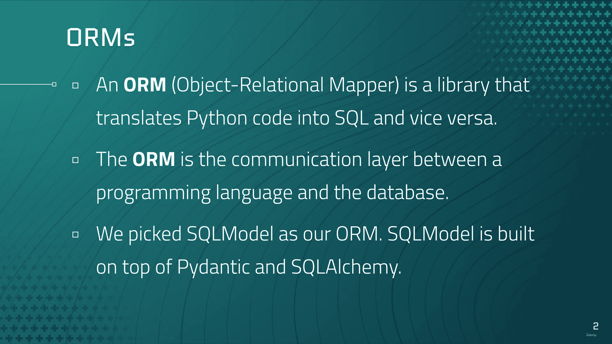

上一节我们进入了 ORM 相关主题，本节先把这个概念讲清楚。ORM 的全称是 Object Relational Mapper，中文可以理解为对象关系映射器。它是一层翻译库，负责把 Python 代码翻译成 SQL，也负责把 SQL 的结果翻译回 Python 对象。这个定义在 Python 社区里很常见，因为任何编程语言和它对应的后端生态里，通常都有类似的工具。

可以用一个简单公式描述 ORM 的位置：

```text
Python 对象  <->  ORM  <->  SQL 语句  <->  数据库
```

在 Ruby 社区、Java 社区、Go 社区里，也会存在等价工具。这些工具都是用对应语言编写的库，帮助开发者生成 SQL 语句。程序或服务器使用编程语言编写，数据库使用 SQL 语言通信，这两者是不同的构造。ORM 就是通信层，让两边可以互相交流。

我们选择的 ORM 是 SQLModel。SQLModel 是生态里相对较新的参与者，但它建立在 Pydantic 和 SQLAlchemy 之上。Pydantic 是数据验证库，SQLAlchemy 本身也是 ORM，并且是 Python 社区里事实上的标准之一。

也就是说，SQLModel 并不是凭空出现的工具，它把 Pydantic 的验证能力和 SQLAlchemy 的数据库能力组合在一起，形成适合 FastAPI 项目使用的 ORM 方案。理解了 ORM 的定位之后，下一节我们来看看数据库模型是怎么定义的。

## 🏗️ FastAPI 精通课程：第62节：数据库模型与 Field

上一节我们介绍了 ORM 是 Python 和数据库之间的翻译层，本节来看看数据库模型。数据库模型是普通 Python 类，这些类会映射到或者连接到一张对应的数据库表。我们定义了一个 `Room` 类，让它继承 SQLModel 超类，并在子类里设置 `table=True` 参数。这样做的效果是，在 Python 类和最终数据库里的对应表之间建立连接。

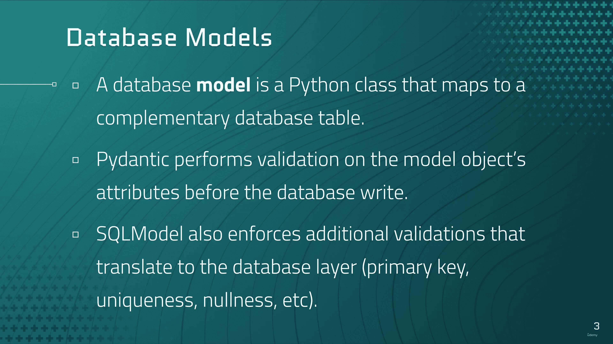

下面是模型定义的核心代码示例：

```python
from sqlmodel import SQLModel, Field

class Room(SQLModel, table=True):
    __tablename__ = "rooms"
    id: int | None = Field(default=None, primary_key=True)
    name: str = Field(unique=True, nullable=False, min_length=1)
```

SQLModel 建立在 Pydantic 之上，所以模型对象的属性在真正写入数据库之前，可以获得 Pydantic 的标准验证。ORM 生成插入行的查询之前，会检查最小长度、数字最大值等要求。任何想添加的 Pydantic 验证，都可以先作用在这个 Python 对象上，然后再翻译成等价的 SQL 语句，把数据行写进数据库。

这种设计的好处是，SQLModel 既有 Pydantic 的全部验证，又额外增加数据库相关的验证。例如，可以规定某一列的值必须唯一，某一列的值不能为空，或者建立主键。主键就是存储每一行唯一标识符的列。这里的关键点是，Pydantic 不知道 FastAPI，也不知道数据库，它只处理 Python 对象，验证对象是否符合某个形状或模式。SQLModel 拿到已有的 Pydantic 功能和已有的 SQLAlchemy 功能，把它们合并起来，再在标准 Pydantic 验证之上添加数据库专用验证。

我们定义了一个名为 `Room` 的 Python 类，继承 SQLModel 超类，并添加 `table=True`。默认情况下，SQLModel 会选择单数形式的表名，也就是类名的小写版本，所以默认表名会是 `room`。通常更推荐把数据库表名设为复数，因为表里会有多条记录。我们使用类定义里的 `__tablename__` 属性来自定义最终数据库表名，把它改成 `rooms`。

定义属性时，这些属性会一一映射到表中的数据库列。这里需要从 SQLModel 导入 `Field`，而不是从 Pydantic 导入 `Field`。SQLModel 的 `Field` 函数在背后相当于 Pydantic `Field` 的增强版，它额外添加了 Pydantic 不支持的数据库专用约束和功能。Pydantic 不知道数据库，所以主键、唯一性约束这类验证属于数据库层验证，由数据库负责执行。Pydantic 默认只接收 Python 对象并确认它符合模式，不知道数据库的存在。

在模型定义里，属性会映射到数据库列。如果某个属性除了类型检查之外还需要额外验证，就把这个属性赋值为 `Field` 的调用结果。技术上，只写类型注解，例如 `: int` 或 `: str`，也可以工作，但 `Field` 可以提供更多验证能力。以 `id` 列为例，这一列存储每一行的数字标识符，这个值由数据库在写入行时填充。对模型里的 `id` 字段，我们给 `Field` 函数设置 `primary_key=True`，告诉 SQLModel 通知数据库这一列是主键。关系数据库里几乎每张表都会通过关联连接起来，每张表通常都会有一个 ID。

这样做的目的是让每一行、每一条记录都有自己的可识别标识。一行里的数据可以变化，但 ID 会保持永久不变，所以 ID 是提取任意一行的主要参照点。我们还讨论了 `Field` 函数的 `default` 参数，用它提供回退值。对于 `id`，我们提供了默认值 `None`，这要求把 `id` 的类型注解写成 `int | None`。这样模型既能表示写入数据库之前的 `Room` 对象，此时它还没有有效的数字 ID；也能表示相反的情况，即数据库保存 `Room` 记录后返回结果，ORM 再把结果翻译成 Python 的 `Room` 对象，此时对象会拥有有效的数字 ID，因为数据库已经写入并在响应里返回了这个 ID。`id` 列需要足够灵活，支持这两种类型，模型才能通过 Pydantic 验证并符合预期模式，不抛出错误。

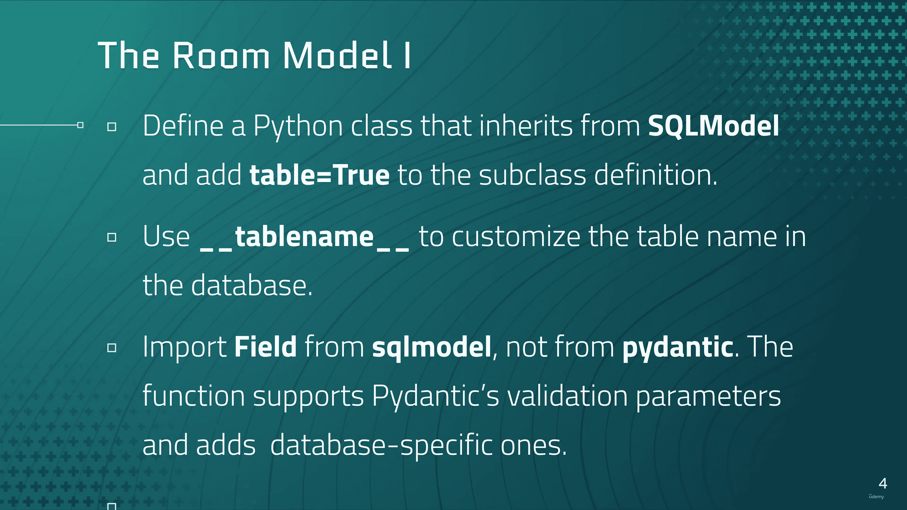

数据库模型讲完后，接下来看看数据库本身如何创建，这就要引入数据库引擎。

## ⚙️ FastAPI 精通课程：第62节：数据库引擎与 SQLite

上一节我们定义了数据库模型，本节来看看如何真正创建数据库。为了创建数据库，需要先创建引擎。引擎是一个 Python 对象，负责管理到数据库的连接。一个应用里通常只有一个总的引擎对象，我们把它定义在 `database.py` 文件里。

下面的代码展示了引擎创建的基本方式：

```python
from sqlmodel import create_engine

engine = create_engine("sqlite:///database.db", echo=True)
```

我们从 SQLModel 导入 `create_engine` 函数，把返回值赋给 `engine`。这一点很重要，因为后续补充代码还会用到这个引擎。`create_engine` 接收一个字符串，用来指定数据库类型和位置。在这里可以配置引擎连接 SQLite，或者连接 PostgreSQL、MySQL 等其它数据库。

选择 SQLite 的原因是它非常简单。不需要安装 PostgreSQL 这种完整应用，也不需要运行独立服务器。SQLite 会把数据库内容保存到单个文件里，非常适合学习。客户端向端点发请求，端点再和数据库通信，保存数据或读取数据，这个常规流程的好处都能体验到，同时又不用处理 PostgreSQL 的复杂性。课程后面进入 FastAPI 全栈模板时，会看到更接近生产环境的方案，可以用在真实应用里。当前阶段继续使用 SQLite，原因就是简单，并且可以用最少麻烦覆盖 FastAPI 和 ORM 的重要概念。

下一步需要告诉 SQLModel ORM 创建 SQLite 数据库和所有对应表。SQLModel 知道要创建哪些表，依据是它已经注册的模型。注册模型只需要导入映射到数据库表的文件或模型。所以，在调用 SQLModel 里 `metadata` 对象上的关键方法 `create_all` 之前，需要导入所有数据库模型，或者至少导入包含这些模型的文件。这样 SQLModel 才能注册它们，并知道把 `Room` 这类数据库模型类映射到对应的数据库表。

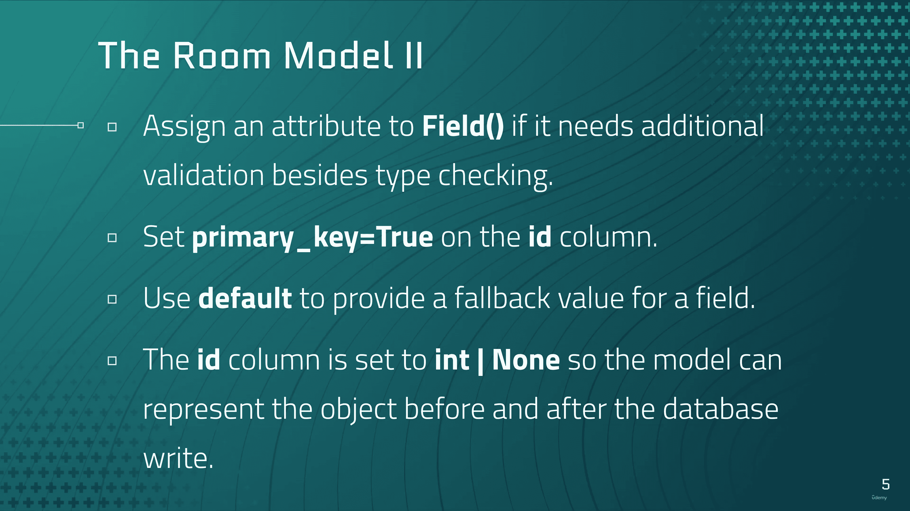

我们不希望数据库和表的创建逻辑放在文件顶层，因为那样每次导入文件都会自动运行。更好的做法是把它包装进一个函数。函数就是一段还没有运行的过程，是一串指令。问题在于，需要有一个点来实际调用这个函数，在 FastAPI 应用启动之前创建数据库。为了解决这个问题，我们引入了 lifespan 的概念。

lifespan 表示某个事物存活的时间跨度。在 FastAPI 语境里，它表示服务器基本运行的那段时间。可以在应用存在期间拦截某些时刻，例如启动之前和关闭之后，并在这些时刻执行额外的 Python 逻辑。FastAPI 类构造函数接收 `lifespan` 参数，这个参数需要一个异步函数，用来决定应用启动时做什么。

下面是一个 lifespan 与建表函数配合的代码示例：

```python
from contextlib import asynccontextmanager
from fastapi import FastAPI
from sqlmodel import SQLModel, create_engine

engine = create_engine("sqlite:///database.db")

def create_db_and_tables():
    SQLModel.metadata.create_all(engine)

@asynccontextmanager
async def lifespan(app: FastAPI):
    create_db_and_tables()
    yield

app = FastAPI(lifespan=lifespan)
```

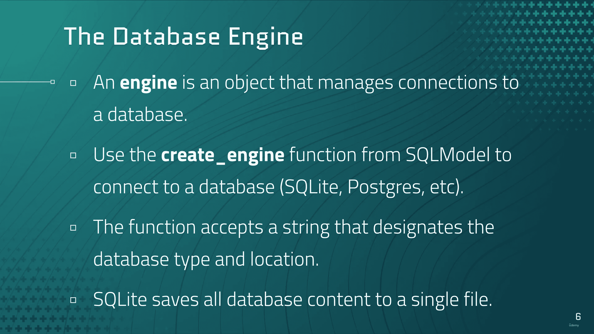

这个过程稍微复杂。需要从 `contextlib` 模块导入 `asynccontextmanager` 装饰器，把它包在一个异步 Python 函数外面。在这个函数里调用 `create_db_and_tables` 来创建数据库和表，然后使用关键的 `yield` 关键字。`yield` 会把控制权交给 FastAPI，并等待应用关闭，例如用 `Ctrl+C` 关闭服务器。在 `yield` 之前，可以写服务器启动前应该运行的 Python 代码，例如创建数据库。在 `yield` 之后，可以写关闭代码，在服务器终止后清理某些东西。

还需要注意，如果数据库文件已经存在，SQLModel 不会再次创建它。这样数据可以持久保存，即使关闭并重启服务器，数据仍然存在。后续课程里会反复经历这个流程。

数据库创建完成后，下一节我们来看看 FastAPI 的依赖注入机制，也就是 `Depends` 函数。

## 🔌 FastAPI 精通课程：第62节：Depends 与依赖注入

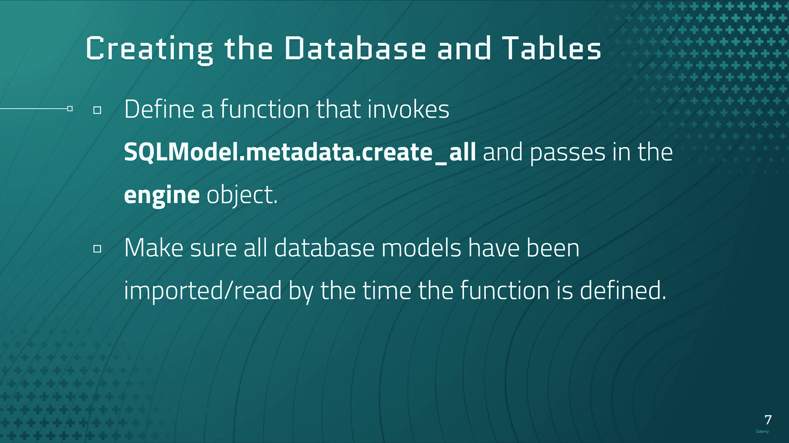

上一节我们创建了数据库和表，本节来看看 FastAPI 的 `Depends` 函数。`Depends` 允许指定一个函数，让 FastAPI 调用这个函数，为路由处理函数提供一个参数。它叫 `Depends`，是因为我们在表示某个路由处理函数依赖另一段逻辑，需要运行另一个函数或过程。我们可以使用那个函数的返回值，也可以像数据库会话那样使用 `yield` 出来的值，把它作为路由处理函数的参数。

这种设计的好处是，可以把构建某种依赖的复杂性隔离到独立、可复用的函数里，然后让多个路由处理函数依赖它。这样就不必在每个路由处理函数之间复制大量代码。这个模式和 Query、Cookie、Header 等依赖非常相似。通常会把 `Annotated` 类型和实际核心类型组合起来。对于数据库会话，核心类型就是 `Session`。会话是临时执行对象，可以在路由处理函数执行期间和数据库交互。

可以把依赖注入理解成下面这个公式：

```text
函数所需依赖 = 通过参数传入，而不是在函数体内部现场创建
```

在代码里，把核心类型 `Session` 放在 `Annotated` 方括号中的第一个位置，把 `Depends` 放在第二个位置，并指定要调用的补充函数。路由处理函数开始执行之前，`Depends` 会先调用这个函数。可以把它理解为用可复用方式构建路由处理函数需要的全部依赖、全部要求和全部对象，然后把这些东西分散给多个路由处理函数使用。核心构建逻辑被隔离在独立函数里，不放在某个具体路由处理函数内部。

这就是依赖注入设计模式的一个例子。依赖注入的意思是，函数需要的任何依赖，也就是任何构造或对象，都作为参数传入函数，而不是在函数体内部现场创建。依赖是真正被注入进去的，不是现场创建的。这个模式有几个好处。第一，它不会把代码耦合到某个具体实现或对象上。现场写死的代码总是固定的，而传入函数的依赖可以变化。例如，测试代码时可以替换真实依赖，因为依赖是传入函数的参数，只要提供不同参数即可。函数体不需要耦合到某个具体类的具体对象，可以更灵活地处理传入的任何对象。

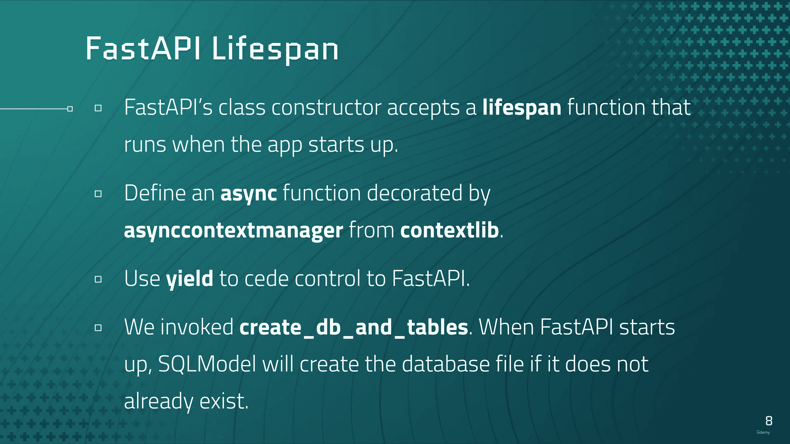

第二，依赖注入让依赖可以轻松复用在多个函数里。数据库会话就是很好的例子。否则，每个路由处理函数都要写一遍使用 `with` 关键字、`Session` 类和传入引擎来创建临时会话的代码。现在可以把它提取到一个函数里，这个函数负责处理会话，它实际上充当依赖。FastAPI 的 `Depends` 会调用这个函数，取得路由处理函数需要的实际对象。

下面是一个依赖函数和类型别名的示例：

```python
from typing import Annotated
from fastapi import Depends
from sqlmodel import Session

def get_session():
    with Session(engine) as session:
        yield session

SessionDep = Annotated[Session, Depends(get_session)]
```

我们传入的一个依赖示例是数据库会话。会话只是和数据库之间的一次临时对话。引擎会创建不同会话，每个路由处理函数对应一个会话，可以把它理解为临时执行上下文。会话是我们用来发出 SQL 命令的主要对象，更准确地说，是我们编写实际 Python 代码，让 ORM 翻译成等价 SQL 命令的主要对象。我们有一个引擎，每次路由处理函数执行时创建一个会话。

在最终传给 `Depends` 的 `get_session` 函数里，使用 `yield` 把控制权交给路由处理函数。`yield` 声明在关联上下文管理器和 `with` 关键字的代码块里。所以路由处理函数运行完毕并把控制权返回给使用 `yield` 的位置后，上下文管理器会清理数据库会话，基本就是关闭会话，确保它不再运行。这个复杂性被隔离或抽象到一个依赖里，不需要写进每个路由处理函数。

如果想让会话对象作为路由处理函数的参数，可以写 `Annotated`，声明 `Session` 类型，并手动调用 `Depends`，传入 `get_session` 函数。但这也会引入大量重复。为了解决这个问题，我们提取了一个特定类型，也就是代表类型的变量，叫 `SessionDep`，它是 Session Dependency 的缩写。它基本上就是 `Annotated` 类型，方括号里第一个值是声明的 `Session` 类型，第二个值是 `Depends` 参数。这些内容都放在 `database.py` 文件里。引擎、上下文管理器和会话的组装都被隐藏在这个独立文件里，路由处理函数可以专注于主要职责，也就是响应请求和发出响应。

现在可以把 `SessionDep` 声明为任意路由处理函数的实际参数类型。FastAPI 看到这一串关系和依赖后，会自动调用 `get_session`，因为 `get_session` 被 `Depends` 使用，然后把新创建的会话作为参数提供给路由处理函数。之后可以在这个会话对象上调用各种方法，和数据库交互。课程最后看到了一个简单 SQL 查询的例子。请求完成后，控制权回到 `get_session` 函数，上下文管理器又自动清理会话。

依赖注入和会话管理讲完后，最后来看看如何查看 SQLite 数据库内容，以及如何观察 ORM 生成的 SQL。

## 🛠️ FastAPI 精通课程：第62节：SQLite3 编辑器与 SQL 日志

上一节我们介绍了依赖注入和数据库会话，本节来看看两个实用的开发工具。我们在 VS Code 里试用了 SQLite3 编辑器扩展，它可以查看单个数据库 `.db` 文件的内容，SQLite 会把所有表和对应数据行存储在这个文件里。现在任意一张表里只有 `rooms` 一张表，后面会有很多表。点击 `schema` 按钮，可以查看 ORM 生成或发出的实际 SQL 命令，也就是创建表时使用的 SQL。类似地，如果想看查询记录、查询多条记录或删除记录时发出的 SQL 语句，可以在创建引擎时添加 `echo=True` 参数。

下面是开启 SQL 日志的代码示例：

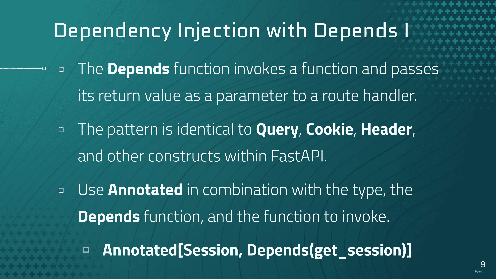

```python
engine = create_engine("sqlite:///database.db", echo=True)
```

这样 ORM 生成的所有 SQL 语句都会输出到服务器日志，也就是终端里正在运行的 FastAPI 应用日志。这个选项不适合生产环境，但很适合本地开发和学习，因为可以直观看到 Python 代码如何被翻译成 SQL。

这里还要提一个好处：使用 ORM 并不要求你完全不懂 SQL，因为 ORM 会替你写 SQL。但它也像一种“作弊代码”。理解 SQL 基础仍然很重要，不只是理解逻辑上怎么工作，还要理解 SQL 核心语言本身。否则 ORM 帮你做了大量工作，它就像一个黑盒或魔术。作为后端开发者，花时间学习 SQL 基础对长期成长有好处。

## ✅ FastAPI 精通课程：第62节：本节总结

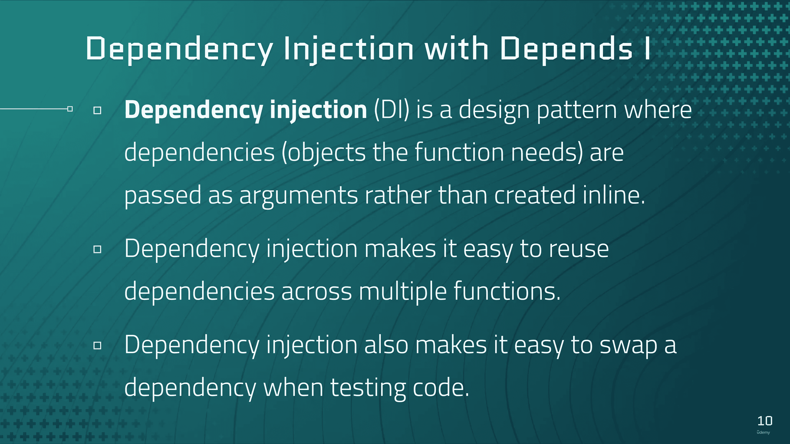

本节课中，我们一起学习了这一节围绕 ORM 和 FastAPI 数据库开发的核心内容。下面是本节知识点的集中回顾，方便把前面的内容串起来。

- ORM 是对象关系映射器，负责在 Python 对象和 SQL 语句之间做翻译。

- SQLModel 是建立在 Pydantic 和 SQLAlchemy 之上的 ORM，结合了数据验证和数据库能力。

- 数据库模型是普通 Python 类，通过继承 `SQLModel` 并设置 `table=True` 映射到数据库表。

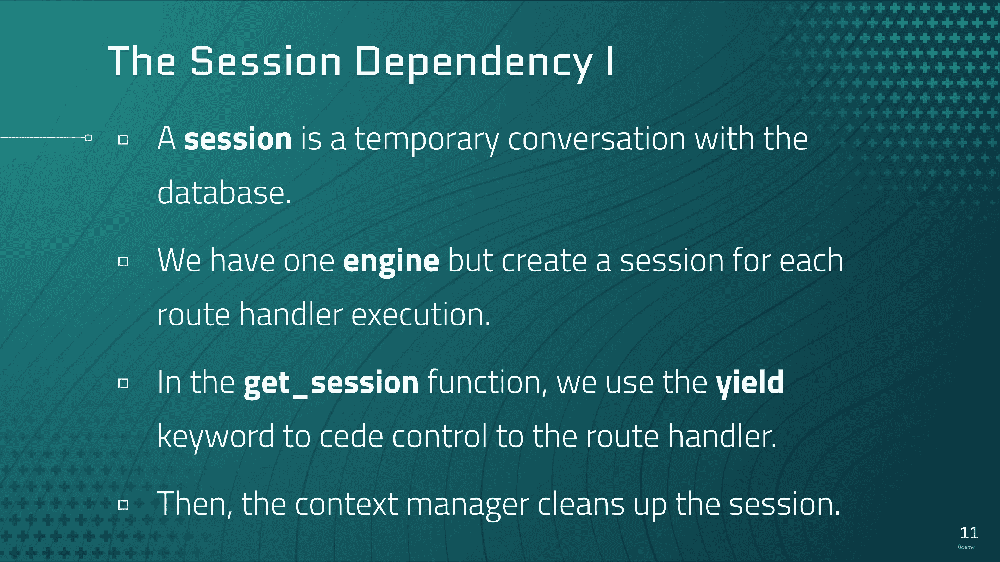

- 模型字段应使用 SQLModel 的 `Field`，它可以添加主键、唯一性、非空等数据库层约束。

- `id` 字段使用 `default=None` 和 `int | None`，可以同时表示写入前没有 ID 和写入后数据库返回 ID 的状态。

- 引擎由 `create_engine` 创建，一个应用通常只有一个引擎，用来管理数据库连接。

- SQLite 把数据保存在单个文件中，适合学习和本地开发，后续可以替换为更接近生产的方案。

- `SQLModel.metadata.create_all(engine)` 会根据已注册模型创建数据库表，调用前需要导入模型文件。

- lifespan 用来在 FastAPI 应用启动前和关闭后执行逻辑，建表函数通常放在启动阶段调用。

- `Depends` 和依赖注入让路由处理函数通过参数获得依赖，避免在函数体里重复创建对象。

- 数据库会话是临时执行上下文，`get_session` 通过 `yield` 提供会话，并在请求结束后自动清理。

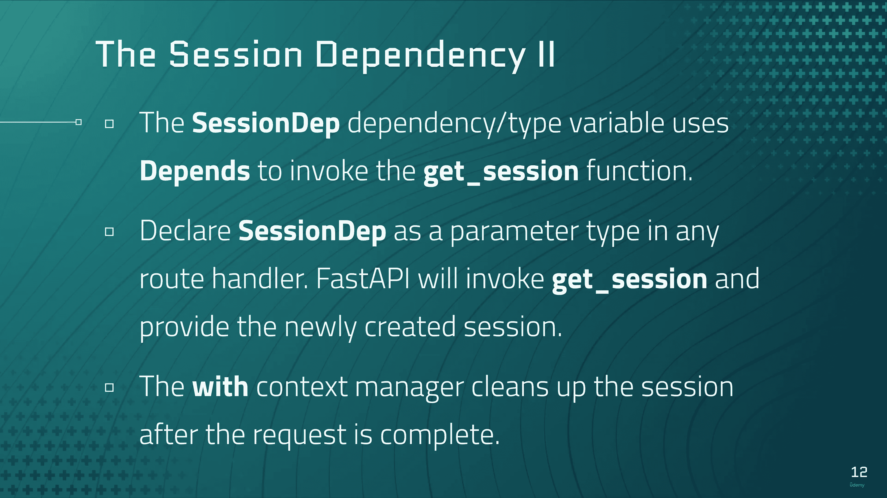

- `SessionDep` 是 `Annotated[Session, Depends(get_session)]` 的类型别名，可以简化路由处理函数参数声明。

- VS Code 的 SQLite3 扩展可以查看数据库文件和建表 SQL，`echo=True` 可以把 ORM 生成的 SQL 输出到日志。

- ORM 可以代写 SQL，但学习 SQL 基础仍然重要，否则 ORM 容易变成黑盒。

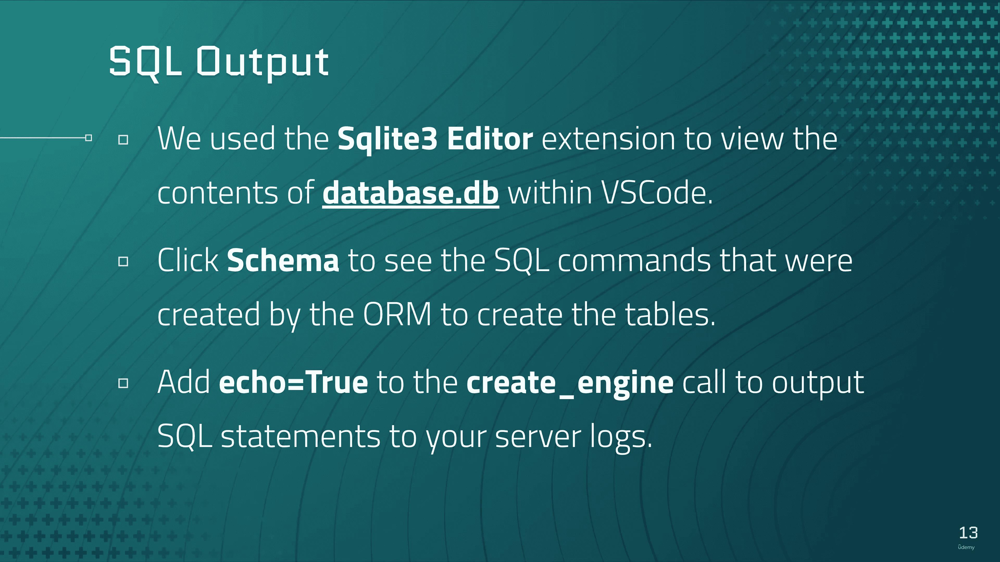

以上就是本节回顾的全部内容。下一节课继续学习新的主题。

