# 🚀 FastAPI 大师课：第62-63节：添加 POST 请求创建房间

在本节课中，我们将要学习如何为 FastAPI 应用添加第一个 `POST` 端点，用它来创建一条房间记录，并把客户端发来的房间数据保存到 SQLite 数据库中。这一课属于数据库操作部分，后续创建、读取、更新、删除记录都会围绕同一套 SQLModel ORM 展开。为了更容易理解，我们会先说明 GET 与 POST 的区别，再动手写路由，最后解释 `add`、`commit`、`refresh` 各自的作用。掌握这些内容后，就能理解 FastAPI 如何通过普通 Python 代码操作数据库。

## 🧩 FastAPI 大师课：第62-63节：数据库操作与 CRUD 概述

进入课程的下一部分后，先建立整体图景。整个数据库操作部分会覆盖创建、读取、更新、删除数据库记录，这四个动作通常缩写为 CRUD。可以记成下面的公式：

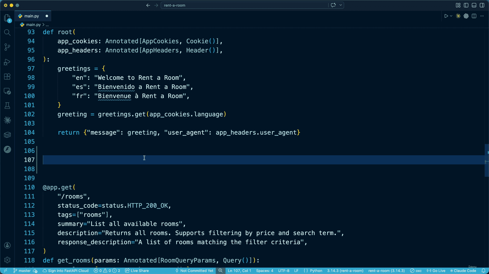

```text
CRUD = Create + Read + Update + Delete
```

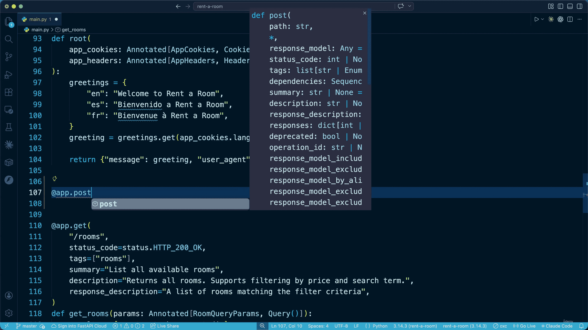

接下来我们会更新许多已有路由，也会引入一些新路由。这些路由都会使用 SQLModel ORM，通过普通 Python 代码与 SQLite 数据库通信。本课从第一个 POST 端点开始。POST 请求表示在服务器上创建数据的请求，而 GET 请求用于获取数据。我们将在 `/rooms` 路径上定义新的 POST 端点，接收客户端发来的房间信息负载（payload）。这个负载包含名称、每晚价格、卧室数、卫生间数等字段。随后会调用数据库，把这个负载保存成 `rooms` 表中的一整行记录。这些内容看似简单，但它们是后面所有数据库操作的基础。

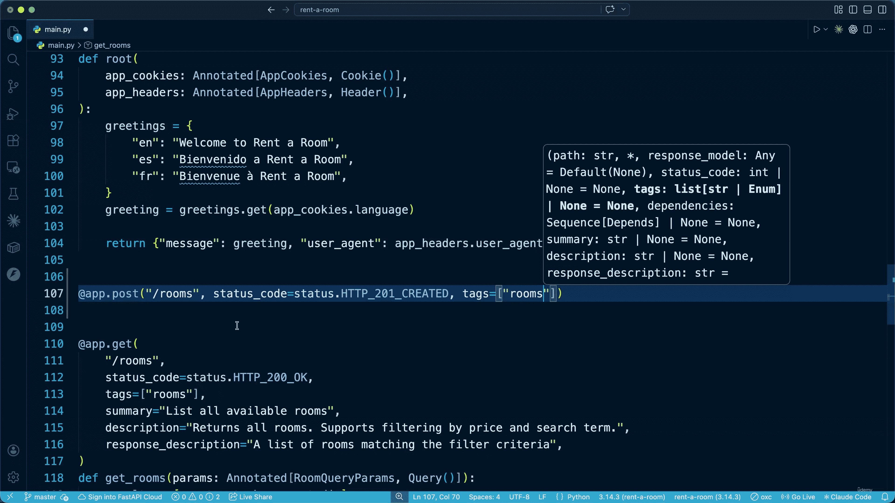

## 🔍 FastAPI 大师课：第62-63节：GET 与 POST 的区别

了解了 CRUD 的整体范围后，本节中我们来看看同一个 `/rooms` 路径为什么可以同时支持 GET 和 POST。现有代码中已经有一个 `@app.get("/rooms")` 端点，用于获取数据。下面是 GET 与 POST 在语义上的基本区别：

- GET：用于获取一条或多条数据。
- POST：用于在服务器上创建一条或多条数据。

同一个路由可以支持多个 HTTP 动词，FastAPI 会根据 HTTP 方法选择正确的路由处理函数。客户端必须说明自己发起的是 GET 请求还是 POST 请求。除此之外，还存在删除记录、更新记录等互补的请求类型。需要注意，新写的 POST 处理函数可以放在已有 GET 处理函数上方，不会干扰下面相同路径的处理函数，因为它们的 HTTP 动词不同。这个机制让我们可以把同一个路径分配给不同操作，代码结构也会更清晰。

## 🛠️ FastAPI 大师课：第62-63节：声明 POST /rooms 路由

上一节我们区分了 GET 和 POST，本节中我们来看看如何声明创建房间的 POST 路由。语法与已有路由相同：从 `@` 和 `app` 开始，然后使用 `post` 方法，定义一个新的创建资源端点，路径仍然是 `/rooms`。这个端点的关键参数可以整理为下面几点：

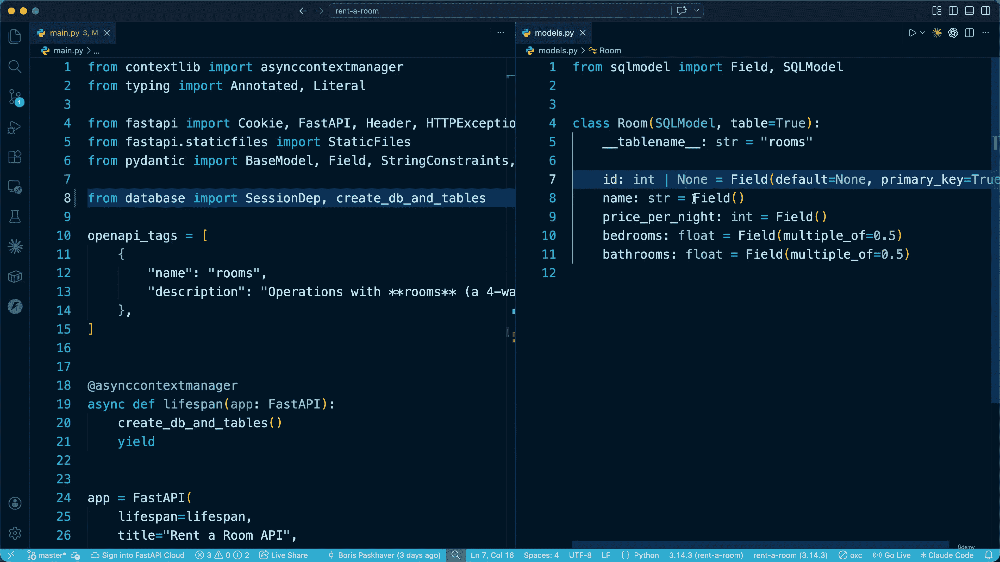

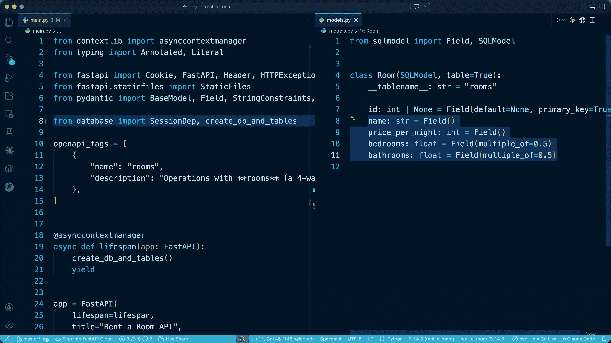

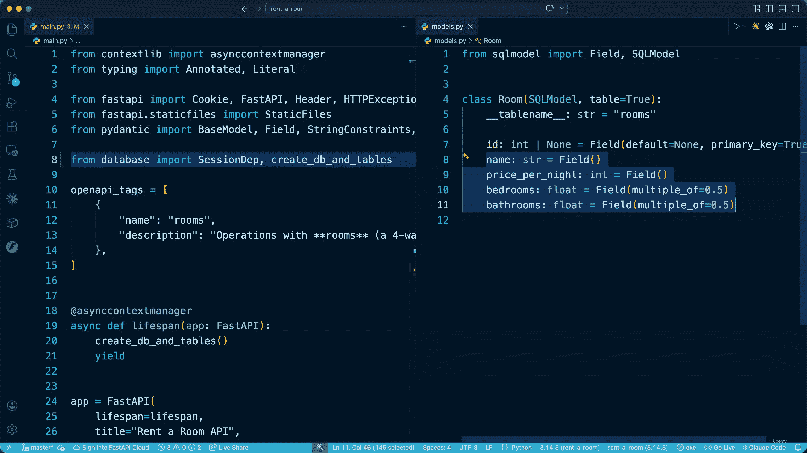

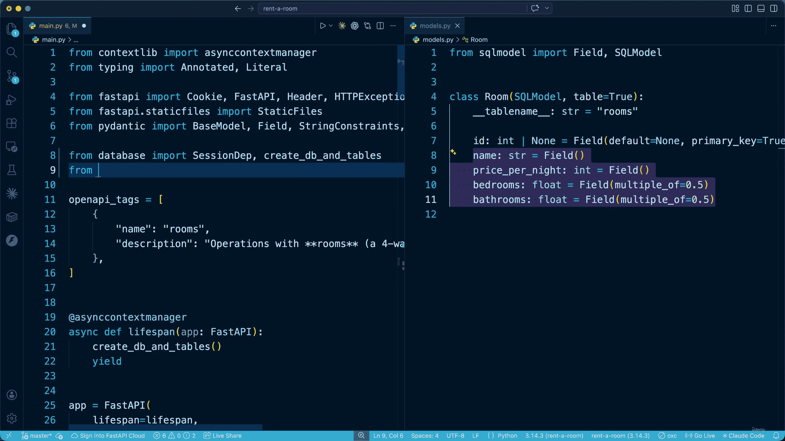

- 路径：`/rooms`，与已有 GET 端点相同。
- 状态码：POST 请求成功创建资源时，标准返回 `201 Created`，因此使用 `status.HTTP_201_CREATED`。
- 标签：添加 `tags=["rooms"]`，把这个新路由与其他 rooms 路由归到 Swagger 的 rooms 标题或标签下。
- 函数名：路由处理函数命名为 `create_room`。

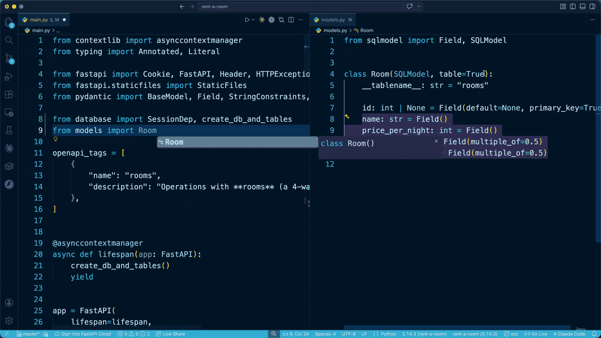

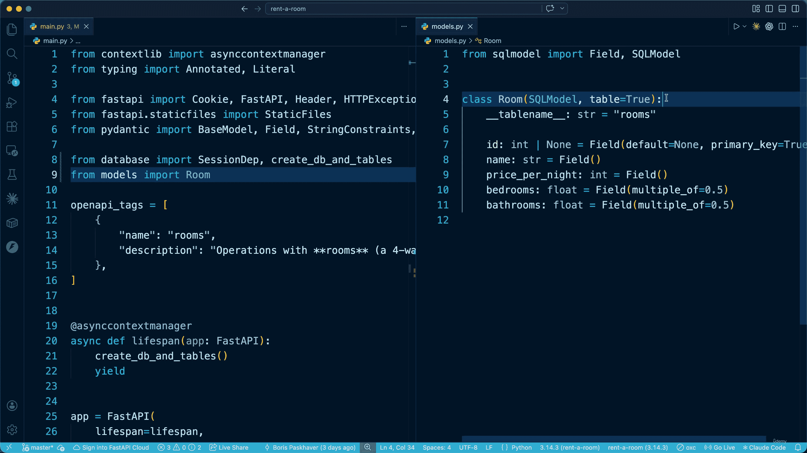

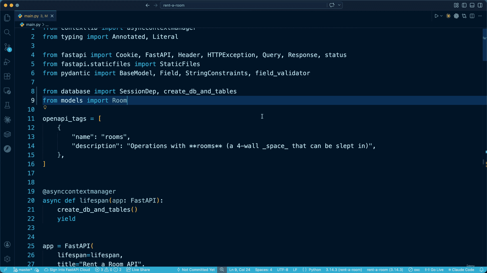

如果 POST 请求成功在服务器上创建资源，标准做法是返回 201 Created 状态码。因此，在 `status_code` 参数中指定 `status` 模块里的 `HTTP_201_CREATED`。同时添加 `tags` 参数，可以让 Swagger 文档中的路由分组更清楚。这个新端点最终会调用数据库，把客户端数据保存为 `rooms` 表的新行。代码只需要先写出路由装饰器和函数签名，函数体中的数据库操作会在后面逐步补齐。

## 🧱 FastAPI 大师课：第62-63节：准备数据库会话与请求体

路由声明完成后，本节中我们来看看处理函数内部需要准备的两样东西：数据库会话和客户端请求体。处理 `POST /rooms` 时，至少需要下面两个关键输入：

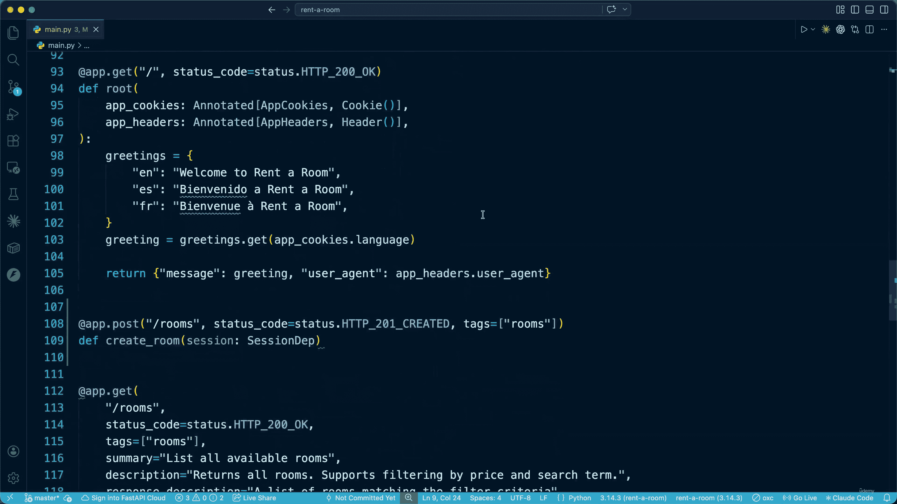

- `session: SessionDep`：用于通过 ORM 与数据库交互的会话对象。
- `room: Room`：客户端发来的房间 payload，也就是请求体 body。

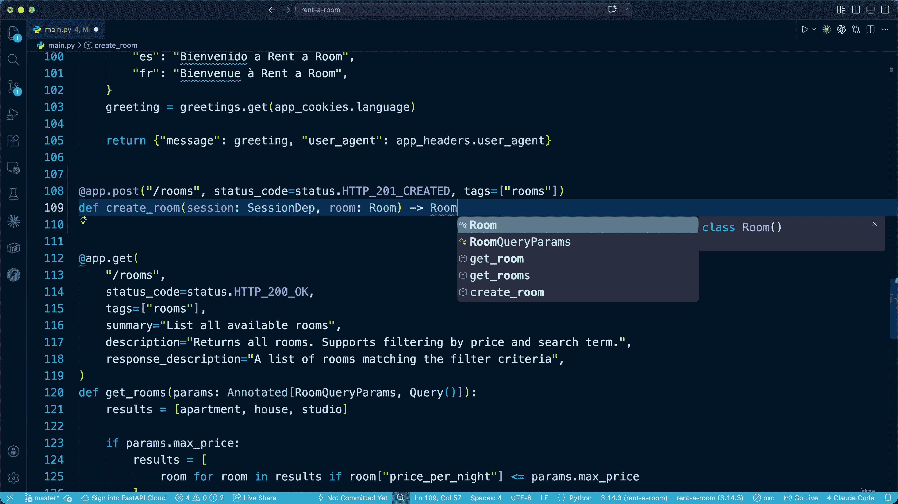

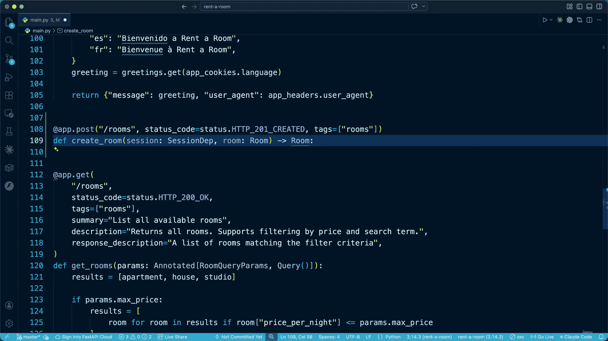

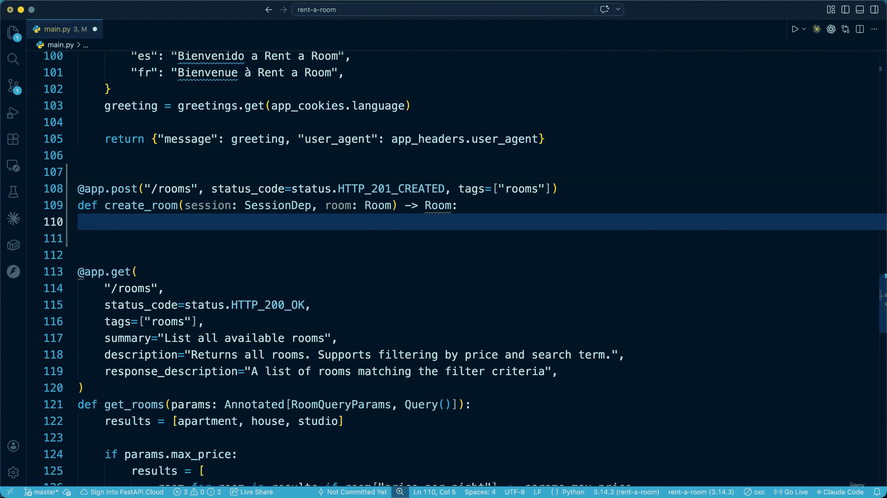

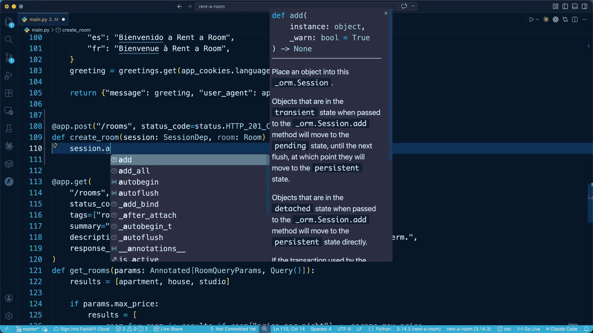

第一个输入是 session 对象，它是与数据库交互的入口。和前面课程中看到的一样，这个参数的类型使用 `SessionDep`。如果当前文件里还没有 `SessionDep`，需要从 `database.py` 文件中导入。原文在导入 `create_db_tables` 函数的地方，也会同时导入 `SessionDep`。导入关系可以概括为下面这段代码：

```python
from database import SessionDep, create_db_tables
from models import Room
```

`SessionDep` 是一个带注释的类型，它使用 `Depends` 调用 `get_session`，从而 `yield` 出一个表示临时数据库连接的对象。可以把它理解为下面这种类型标注的含义：

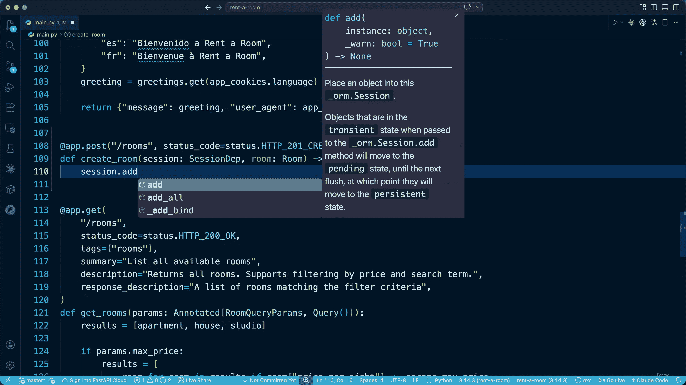

```python
SessionDep = Annotated[Session, Depends(get_session)]
```

第一个需求是数据库连接，也就是 session 对象。第二个需求是客户端发送的 JSON payload，也就是实际房间信息。 `Room` 模型已经在 `models` 文件中准备好，可以把模型文件打开并排查看。这个 `Room` 模型本质上也是 Pydantic 模型，因此可以利用它验证客户端发送数据的形状和 schema 是否符合要求。客户端不需要发送 `id`，因为只有真正把一行保存到 `rooms` 表时，数据库才会填充 `id`。除此之外，客户端需要提供四个属性，因为它们在数据库表中都是必填字段，所以客户端必须提供这些核心组成部分。可以这样导入 `Room`：

```python
from models import Room
```

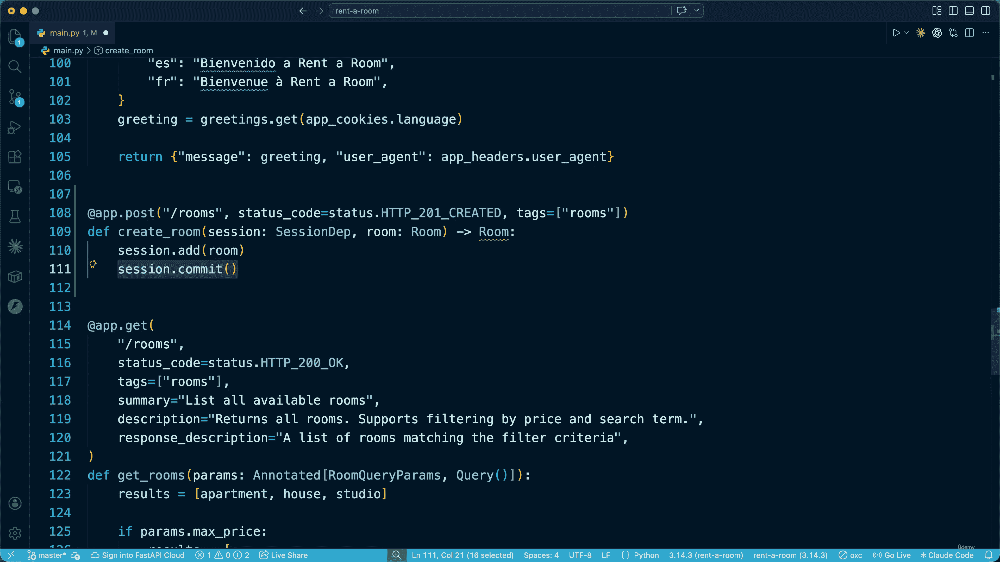

`Room` 是数据库模型，因为设置了 `table=True`，但它仍然是 Pydantic 数据验证模型，因此可以用于数据验证。在 `POST /rooms` 方法定义中，客户端需要提供 room payload，也就是 body。这个参数的类型标注为 `Room`，即完整的 Pydantic 模型。FastAPI 和 Pydantic 会在真正执行路由处理函数体之前完成验证。至于验证成功和失败的各种情况，下一课会在浏览器中测试。函数的返回类型也标注为 `Room`，因为最终保存到数据库并分配新记录 `id` 后，希望把数据返回给客户端，作为创建成功的确认。

## 💾 FastAPI 大师课：第62-63节：写入数据库的 add、commit 与 refresh

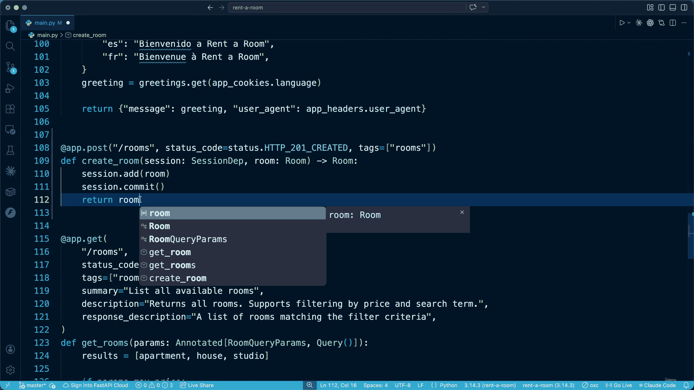

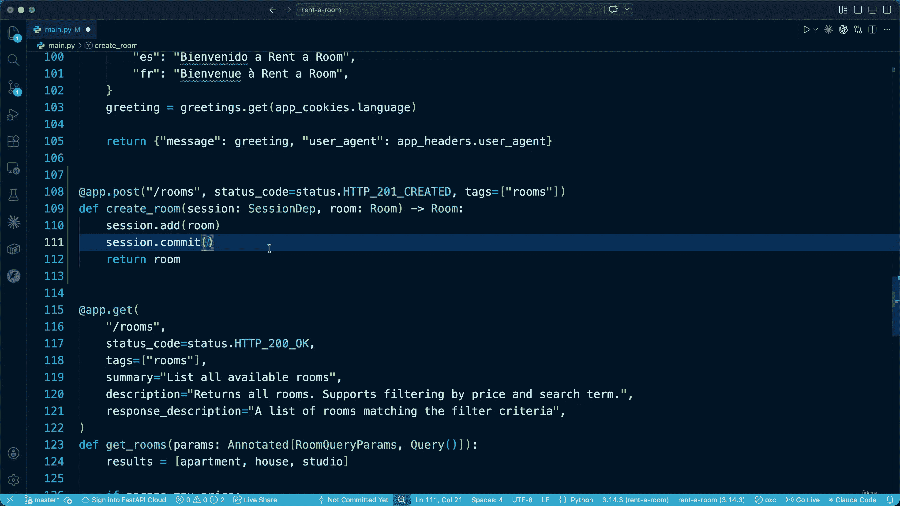

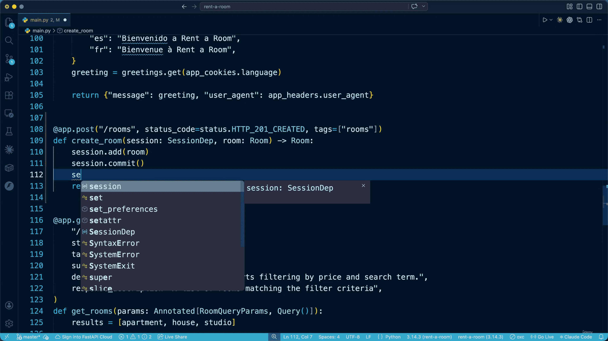

准备好会话和请求体后，本节中我们来看看真正写入数据库的三步操作：`add`、`commit` 和 `refresh`。整个写入流程可以概括为下面这段代码：

```python
@app.post(
    "/rooms",
    status_code=status.HTTP_201_CREATED,
    tags=["rooms"],
)
def create_room(session: SessionDep, room: Room) -> Room:
    session.add(room)
    session.commit()
    session.refresh(room)
    return room
```

这三个方法各自负责的事情可以拆成下面几步：

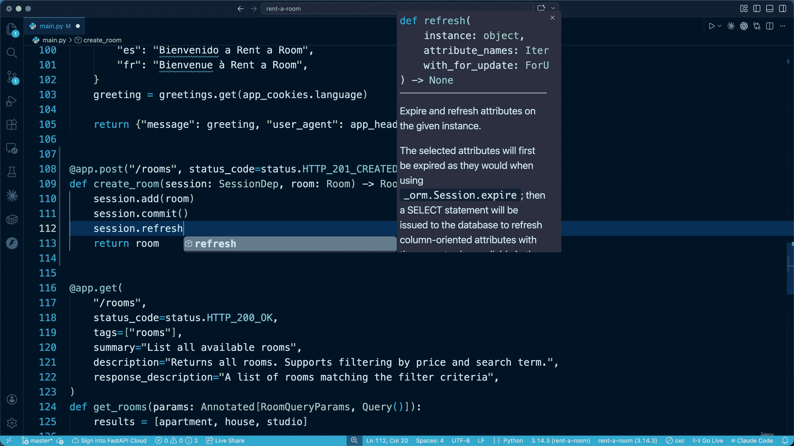

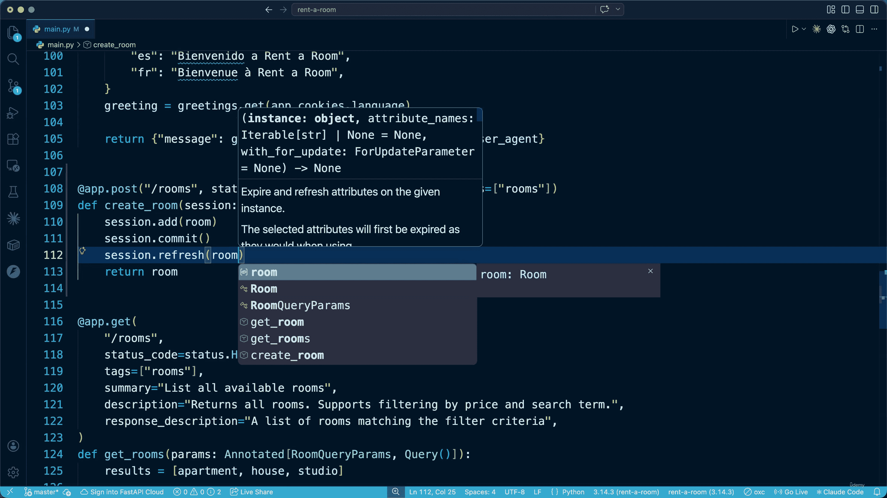

- `session.add(room)`：把一次或多次数据库变更排入队列。
- `session.commit()`：真正执行所有排队的数据库操作。
- `session.refresh(room)`：让当前 Python 对象与数据库中的最新行保持同步。

`session.add(room)` 会把一个或多个变更排入队列。调用这个方法并传入 `room` 时，ORM 会把这个 Python 对象翻译成对应的 SQL 代码，用来向数据库表中写入一行。session 之所以知道要写入 `rooms` 表，是因为当前处理的是由 `Room` 模型类创建出来的对象，ORM 会在幕后建立这种关联。需要注意，`add` 方法不会立刻执行数据库写入。只有调用 `session.commit()` 后，所有排队的数据库操作才会真正执行。可以多次调用 `add`，把所有待处理的变更排成队列，然后由 `commit` 一次性发送给数据库。这个过程和 Git 的版本控制很相似：先用 `add` 暂存变更，再用 `commit` 提交保存。`commit` 的含义就是继续执行已经承诺要做的动作，让 ORM 生成并执行对应的 SQL 语句。

最后返回 `room` 是一个可行的做法，因为它基本就是用户提供的 payload。但这里还有一点可以改进：当前这个 `room` 对象不包含真实 `id`，`id` 值会在 `commit` 调用之后、数据真正成为 `rooms` 表一行时由数据库生成。因此可以在 session 对象上调用 `session.refresh(room)`。`refresh` 方法会刷新指定对象的数据，获取该对象对应的最新记录，使 Python 对象的所有属性与数据库中的对应行保持同步。此时 ORM 会看到 `room` 对象原本没有 `id`，但现在已经保存到 `rooms` 表，于是读取该行的值，看到有效 `id` 比如 `1`，然后把 `room.id` 更新为 `1`。这样一来，客户端发送的 room payload 不带 `id`，而返回给客户端的 room payload 会带有有效的 `id`。可以继续复用 `Room` 模型作为返回类型，因为 `id` 属性被设置为整数或 `None`。

Pydantic 还会验证返回对象是否符合指定的返回类型。如果返回对象缺少 `price_per_night`、`bedrooms`、`bathrooms` 等属性，Pydantic 就会抛出错误，因为返回值不匹配返回类型的预期。因此写代码时需要小心。下一课会集中测试这些成功和失败情况。`refresh` 还会获取对应表中其他列的当前值，这在数据从到达服务器到保存进数据库之间发生变化时很有用。例如，发送一个 email，在保存到数据库前把所有字符转成小写，数据库保存的是小写版本，`refresh` 就会从数据库行中捕获这个更新后的值，因为它才是数据的最终来源。这样最终返回给客户端的响应 payload 也会包含这些最新值。

## ✅ FastAPI 大师课：第62-63节：总结与回顾

到这里，创建房间记录的完整流程已经走完。本节中我们对本课内容做一次收束。本节课中我们一起学习了如何在 FastAPI 中添加第一个 POST 端点，并把房间数据保存到数据库。关键流程可以整理为下面几点：

- 定义新路由，路径仍然是 `/rooms`，但客户端指定 POST 而不是 GET。
- GET 用于获取一条或多条记录，POST 用于创建一条或多条记录。
- POST 发送数据以创建服务器上的条目或资源，最终转换为 `rooms` 表中的新行。
- POST 成功时返回 201 状态码，`tags` 参数主要用于 Swagger 文档分组。
- 处理函数需要 `session` 与数据库交互，也需要 `room` 作为请求体 payload。
- `add` 负责排队变更，`commit` 负责真正保存，`refresh` 负责同步 `id` 和其他列的最新值。
- `refresh` 在数据保存前后可能变化时很有帮助，例如 email 小写化后可以从数据库取回最终值。
- 最终响应会包含数据库中的最新值，本课的核心就是理解如何在数据库表中创建条目。

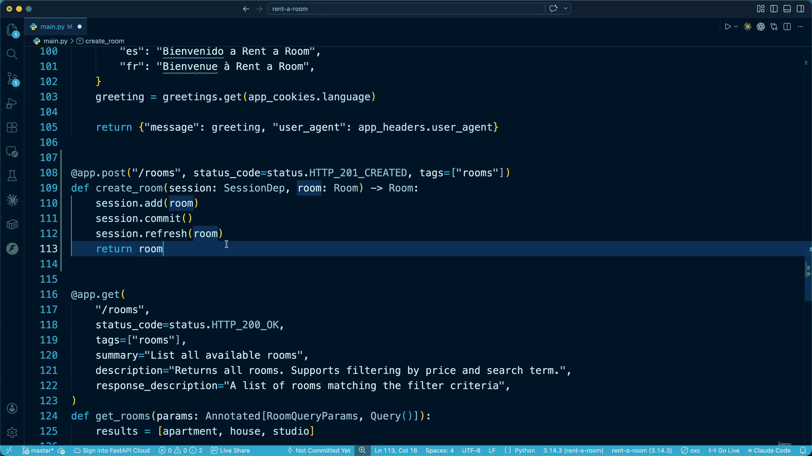

最后回顾一次完整流程：客户端发送 POST 请求和房间 payload，FastAPI 与 Pydantic 先验证请求体，路由处理函数通过 session 调用 `add` 排队写入，再调用 `commit` 保存到数据库，随后调用 `refresh` 获取数据库生成的 `id` 和其他最新字段，最后把带有 `id` 的 `room` 返回给客户端。下一课会在浏览器中测试这段代码，观察各种成功和失败的情况。

