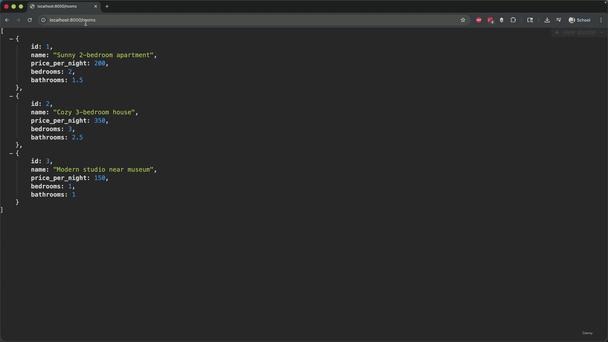
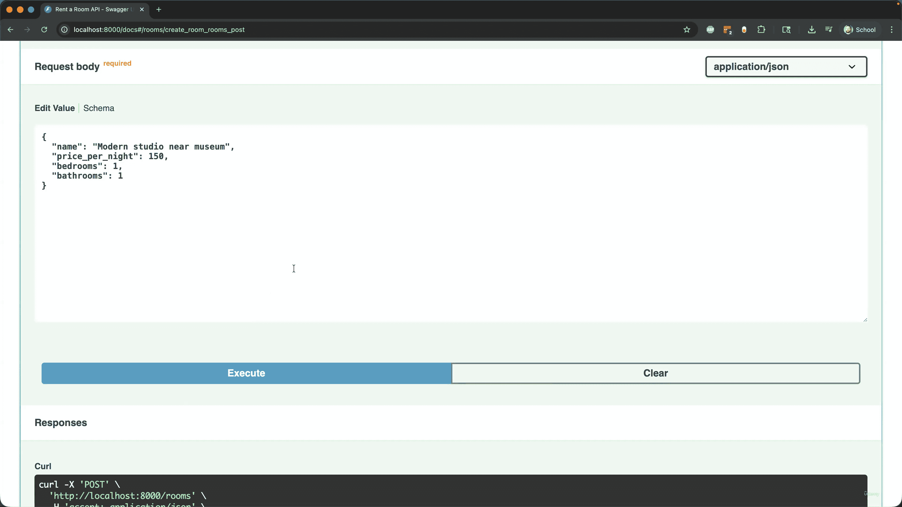
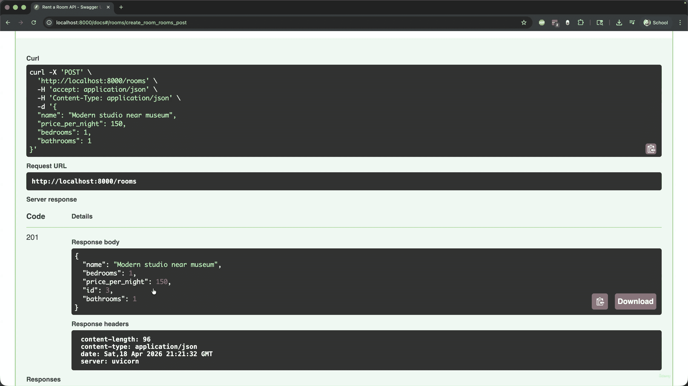
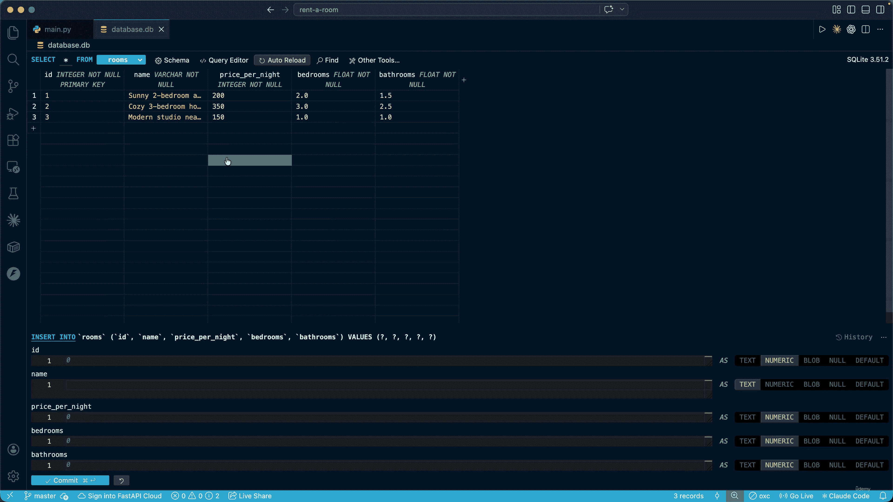

# 🧪 FastAPI Masterclass：63-64：测试房间创建接口

在本节课中，我们将学习如何测试 FastAPI 中新建房间的接口。我们会先看在浏览器里直接访问 `/rooms` 为什么不能完成创建操作，再进入 Swagger 文档发送 POST 请求，填写 JSON 请求载荷，观察 Pydantic 和 FastAPI 如何把 JSON 转成 Python 对象，最后回到 VS Code 确认数据已经保存到 SQLite 数据库。理解整个流程后，初学者就能明白接口测试、请求模型、数据库写入和 ORM 之间的关系。

在明确课程目标后，本节先看浏览器测试的限制，以及为什么需要进入 Swagger 文档。



## 🧭 FastAPI Masterclass：63-64.1：浏览器测试限制与 Swagger 入口

上一节我们明确了要测试房间创建接口，本节中我们来看看为什么不能直接在浏览器里完成这个测试。如果直接在浏览器地址栏访问 `/rooms`，浏览器默认会发送 GET 请求，所以会看到该接口返回的内容，也就是代码里仍然硬编码的字典数据。也就是说，浏览器直接访问只能完成读取操作，不能完成创建操作。

要发送 POST 请求，实际可用的入口是 Swagger 文档。因此需要访问下面这个地址：

```text
http://localhost:8000/docs
```

进入 Swagger 文档后，会看到新定义的路由。这里再次注意，两个接口的核心路径都是 `/rooms`，关键区别在 HTTP 动词。可以把两者的区别记成下面这样：

```text
POST /rooms  -> 创建资源
GET  /rooms  -> 获取资源
```

我们要测试的是创建房间的接口，因此需要展开这个 POST 路由。明确 HTTP 动词差异后，本节继续看 Swagger 如何根据模型生成请求内容。

## 🔍 FastAPI Masterclass：63-64.2：在 Swagger 中查看 POST 路由与请求模型

上一节我们区分了 POST 和 GET 的作用，本节中我们来看看 Swagger 如何展示请求载荷。展开 POST 路由后，Swagger 会自动生成客户端应该发给服务器的预期输入，也就是请求载荷。这个生成过程基于 Pydantic 模型，因此 Swagger 能给出一个示例值。

这个示例值在理论上是一个有效载荷，但其中存在一些小问题，后面会说明。点击 `Schema` 后，可以看到结构同样来自 Pydantic 模型，更具体地说是来自 `Room` 模型。这里能看到所有必填属性都用红色星号标记。

以下是 `Schema` 中需要重点理解的字段和规则：

- `name`：需要提供，红色星号表示必填。
- `price_per_night`：需要提供，红色星号表示必填。
- `bedrooms`：需要提供，红色星号表示必填。
- `bathrooms`：需要提供，红色星号表示必填。
- `id`：技术上不是必填字段，因此没有红色星号。

示例值里给 `id` 填了一个任意值 `0`，原因是技术上请求载荷也可以携带 ID。回看 `Room` 模型，ID 字段的定义允许整数或空值，可以写成类似下面的形式：

```text
id: int | None
```

不过，在请求载荷里手动设置 ID 并不理想，因为这个值应该只由数据库来生成和设置。关于如何控制这类问题，后面会继续讨论。当前阶段先假设用户意图是善意的，也就是客户端会按照正确方式发送载荷。后面还会讨论如何增加额外校验，以处理坏数据或恶意数据进入服务器的情况。

理解字段规则后，下一步是在 Swagger 中实际填写并发送请求载荷。

## ✍️ FastAPI Masterclass：63-64.3：填写 JSON 请求载荷

上一节我们看清了请求模型的必填字段，本节中我们来看看如何填写载荷。点击 `Try it out` 后，Swagger 允许编辑实际发送的载荷。这里需要删除 `id`，目标是模拟或创建当前代码里三个内联字典的副本。代码里一共有三个字典，只要把对应数据作为三行记录加入 `rooms` 表，就可以删掉这些内联字典，并得到相同的结果。

这里从 VS Code 中复制现有值即可，这些数据都是任意构造的假数据。第一条记录的名称使用 `Sunny two bedroom apartment`。如果这是第一次写 JSON，可以把它理解成类似 Python 字典的写法：载荷用花括号表示对象，对象相当于 JavaScript 里的字典；属性就是键，键需要用双引号包起来；键后面写冒号，再写右侧的值；字符串也要用双引号；数组类似列表，需要用方括号声明。语法和 Python 很像，但 JSON 是另一种编程语言生态中的不同记法。

第一条记录对应的载荷如下：

```json
{
  "name": "Sunny two bedroom apartment",
  "price_per_night": 200,
  "bedrooms": 2,
  "bathrooms": 1.5
}
```

这里价格为每晚 `200`，卧室数为 `2`，浴室数为 `1.5`。注意不要在最后一个键值对后面多加逗号，否则可能触发错误。载荷准备好后，下面执行请求并观察数据传输过程。

## 📤 FastAPI Masterclass：63-64.4：发送 POST 请求并理解数据转换

上一节我们填写了第一条房间载荷，本节中我们来看看点击执行后数据如何流动。这个载荷会作为客户端发给服务器的内容，流入上一课定义函数的第二个参数，也就是路由处理器接收的 `room` 参数。随后会把这条记录加入数据库会话 `session`。Pydantic 会把这个 JSON 翻译成等价的 Python 对象，更具体地说，是 `Room` 模型实例。

这个过程与之前的接口方向相反。以前服务器返回 Python 字典，FastAPI 把这个 Python 对象翻译成 JSON；现在则是 JSON 进入服务器，FastAPI 和 Pydantic 把它转换成等价的 Python 对象表示，也就是 `Room` 模型实例。可以把两个方向记成下面这样：

```text
JSON 请求体 --FastAPI/Pydantic--> Room 模型实例
Room 模型实例 --FastAPI--> JSON 响应体
```

点击 `Execute` 后，响应区域会显示等价的 curl 请求。以下是这个 curl 请求中需要理解的部分：

- HTTP 动词是 `POST`，路径是 `/rooms`。
- `Accept` 请求头表示客户端可以接受 JSON 类型的响应载荷。
- `Content-Type` 请求头表示客户端告诉服务器，当前发送的内容类型是 JSON。
- `-d` 是 data 的简写，后面实际携带的就是请求载荷本身。
- 这个 curl 请求就是 Swagger 生成并发送给服务器的基础请求。

请求发出后会命中路由处理器，下一步看看响应内容和数据库写入结果。

## ✅ FastAPI Masterclass：63-64.5：检查响应与数据库写入

上一节我们发出了 POST 请求，本节中我们来看看响应如何证明数据已经写入。请求会命中路由处理器，并和数据库交互。响应体里会返回 `room`，因此能看到 `Room` 模型的所有属性，同时 `id` 已经被填充。这个 ID 出现，说明记录已经成功保存到数据库的 `rooms` 表，并且这是第一行记录，所以数据库给它分配了 ID `1`。

服务器最初收到这条房间记录时没有 ID，刷新这条房间记录后，现在已经有了 ID `1`。这说明数据应该已经保存到数据库，稍后还会实际确认。

以下是判断保存成功的几个信号：

- 响应体包含完整的房间属性。
- 响应体里的 `id` 已经被数据库填充。
- 第一条记录获得 ID `1`。
- 刷新后的房间记录从无 ID 变成有 ID。

在继续创建更多记录前，有一个关于练习数据的提醒需要说明。

## 🧩 FastAPI Masterclass：63-64.6：练习数据与 ID 差异说明

上一节我们确认了第一条记录已经获得 ID，本节中我们来看看练习时数据不必完全一致。如果因为笔误创建了额外记录，或者创建了更少记录，都没有问题。你的数据库不需要和我的数据库完全一样。如果想练习创建新记录，或者练习更新、删除记录，使数据库和我的不同，也完全可以。课程仍然会覆盖核心内容，也就是 FastAPI、路由和 ORM 等内容。数据库里存在不同数据记录没有问题，但需要理解这些操作的后果。例如，如果创建了五条记录，那么下一条记录的 ID 会是 `6`，这可能和我屏幕上创建第二条记录时看到的 ID 不一致。因此不需要太担心这些任意值和 ID，可以按自己的节奏练习。

以下是这段提醒中的关键点：

- 笔误导致记录数量不同，可以接受。
- 数据库不需要和讲师完全一致。
- 可以自由练习创建、更新和删除记录。
- 需要理解不同操作带来的结果。
- ID 可能因为已有记录数量不同而不同。

理解这一点后，本节继续通过另外两个 POST 请求创建剩余房间记录。

## ➕ FastAPI Masterclass：63-64.7：创建另外两条房间记录

上一节说明了练习数据可以不同，本节中我们来看看如何添加剩余两条记录。为了替换另外两个内联字典，需要再发送两次 POST 请求，给表里再增加两行。向上滚动到 Swagger 的请求载荷编辑区，更新条目内容。

第二条记录的名称是 `Cozy Three bedroom house`，每晚价格为 `350`，卧室数为 `3`，浴室数为 `2.5`。对应的载荷如下：

```json
{
  "name": "Cozy Three bedroom house",
  "price_per_night": 350,
  "bedrooms": 3,
  "bathrooms": 2.5
}
```

再次点击 `Execute`，会向服务器发送一个新的 POST 请求。这里会看到新的请求载荷和成功的响应体，第二条记录的 ID 是 `2`，这个 ID 同样来自数据库。

还需要再发一次请求，创建第三个房间。第三个房间可以叫 `modern studio near museum`，每晚价格为 `150`，卧室数为 `1`，浴室数为 `1`。对应的载荷如下：

```json
{
  "name": "modern studio near museum",
  "price_per_night": 150,
  "bedrooms": 1,
  "bathrooms": 1
}
```

这个载荷会流入服务器，流入 `room` 参数所代表的路由处理器，然后加入会话 `session`，再提交到数据库。真正的 SQL 语句就是在这个提交过程中生成的。点击 `Execute` 查看结果时，也可以回到终端查看服务器日志。因为数据库配置里有 `echo=True`，所以能看到 SQLModel ORM 为插入这一行记录而生成的实际 SQL 代码。向下滚动后，会看到第三条记录的 ID 是 `3`。

三条记录创建后，回到 VS Code 验证数据库文件。

## 🗄️ FastAPI Masterclass：63-64.8：回到 VS Code 验证数据库



上一节我们通过 Swagger 创建了三条记录，本节中我们来看看数据库文件里是否真的存在这些数据。打开文件资源管理器，打开 `database.db` 文件。如果界面里显示了 schema，可以先把它关掉，点击对应按钮即可。此时可以看到 SQLite 数据库里的 `rooms` 表确实有三行记录。

数据现在已经永久保存在数据库里，这是一件好事。以下是验证时可以观察到的内容：

- `database.db` 文件可以正常打开。
- `rooms` 表存在。
- `rooms` 表里能看到三行记录。
- 每行记录对应一次 POST 请求提交的数据。

数据库保存成功后，本节继续解释数据库与应用解耦的重要性。

## 🔗 FastAPI Masterclass：63-64.9：数据库解耦与多应用共享

上一节我们确认了数据已经保存到数据库，本节中我们来看看这种保存方式的意义。在真实项目中，数据库通常是单独运行的数据库应用，可能托管在 AWS 或 Google Cloud 之类的云服务商上。数据库因此与代码本身完全解耦。如果关闭或重启 FastAPI 应用，或者向生产服务器部署新的代码变更，应用数据仍然完全独立于 Python 代码，保存在数据库里并且是永久的，这是一件好事。

数据库与应用解耦还有一个优势：多个应用可以各自拥有自己的业务逻辑，同时与同一个数据库交互。比如明天可以创建一个用 Django 编写的第二个应用，也查询这个数据库；下一天可以创建另一个后端应用，使用完全不同的编程语言，例如 Ruby 或 Node，这些应用都可以查询同一个数据库。数据库因此成为事实来源，永久保存数据，而数据本身构成了大部分业务价值。



以下是数据库解耦带来的主要好处：

- 应用重启或部署新代码时，数据不会丢失。
- 数据与 Python 代码分离，保存在独立数据库中。
- 多个应用可以共享同一个数据库。
- 不同语言编写的后端也可以访问同一份数据。
- 数据库成为长期保存数据的真实来源。

到这里，我们已经完成接口测试和数据库验证，本节最后做总结。

## 📝 FastAPI Masterclass：63-64.10：本节总结

本节课中我们一起学习了如何测试房间创建接口。我们从浏览器直接访问 `/rooms` 只能触发 GET 请求这一点开始，理解了创建资源需要使用 POST 请求；随后进入 Swagger 文档，查看根据 Pydantic `Room` 模型生成的请求 Schema，填写并发送 JSON 载荷；接着观察 FastAPI 和 Pydantic 如何把 JSON 转成 `Room` 模型实例，并通过数据库会话写入 `rooms` 表；最后回到 VS Code 确认 SQLite 数据库里存在三行记录，并理解了数据库与代码解耦、多应用共享同一数据库的意义。

以下是本节课的核心收获：



- POST 用于创建资源，GET 用于获取资源。
- Swagger 可以根据 Pydantic 模型生成请求载荷和 Schema。
- `id` 不应由客户端随意提供，数据库应负责生成 ID。
- JSON 请求体会被 FastAPI 和 Pydantic 转换成 Python 对象。
- 响应里的 ID 可以证明记录已经写入数据库。
- ORM 可以把 Python 代码转换成 SQL，并完成数据库写入。
- 数据库与应用解耦后，多个应用可以共享同一份永久数据。

