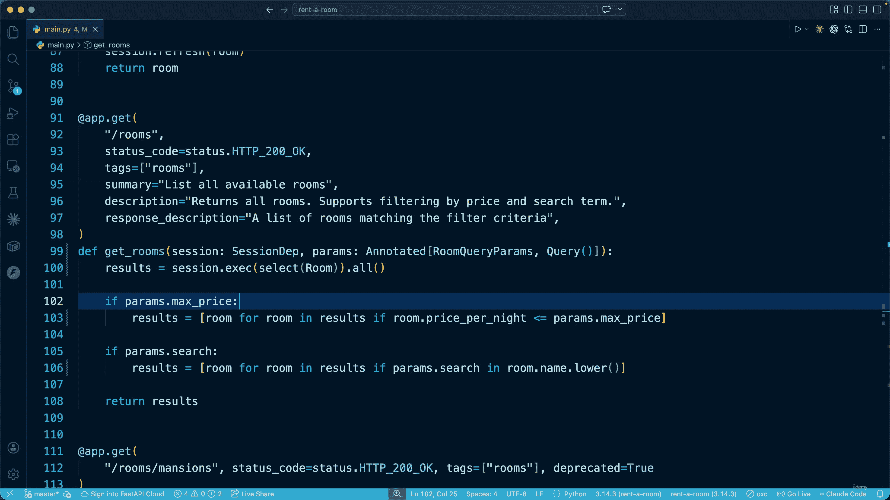
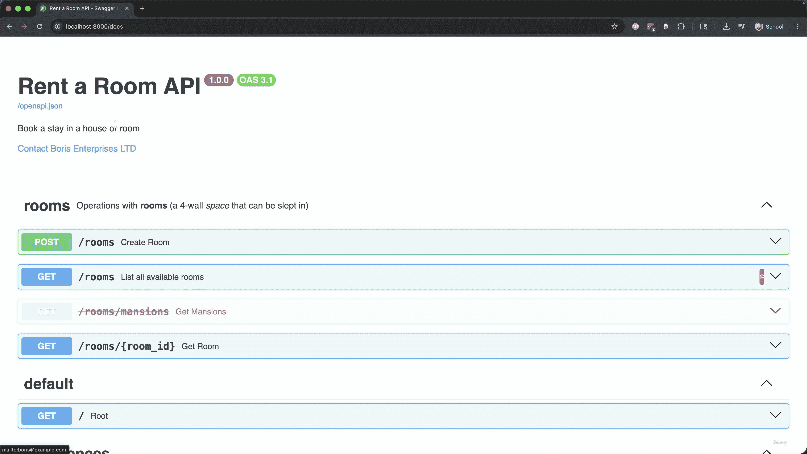
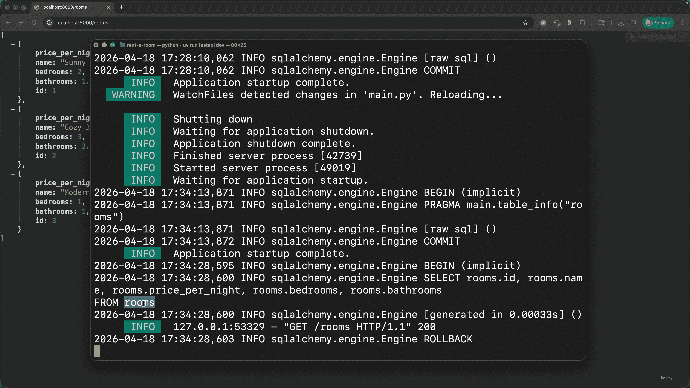

# 🚀 Udemy FastAPI Masterclass：第64-65节：获取所有房间 🏠

在本节课中我们将要学习如何把“获取所有房间”的接口从使用内联字典，改成真正通过数据库查询来取数据。也就是说，上一节我们已经把房间记录写进了数据库，这一节要让接口以数据库作为数据来源，而不是继续依赖代码里手写的假数据。这个改动看似只是删掉一些代码、加上一句查询，但它实际上标志着接口开始真正和数据库打通，是后面所有增删改查功能的基础。


## 🧹 清理内联字典，准备数据库查询

上一节我们介绍了如何通过 POST 请求把房间写入数据库，本节中我们来看看如何删除原来的内联字典，并更新获取房间的函数。先查看当前写法，可以发现在这个文件下面有很多代码，它们只是根据内联条目构建一个列表集合。现在三个内联对象在数据库里都已经有对应的行记录，因此这些内联字典已经没有必要继续保留。

以下是本步骤要完成的清理工作清单。

- 删除当前文件里所有内联字典，它们原本用于构建房间列表。
- 保留获取房间函数的过滤参数，后面仍然会用这些参数做筛选。
- 接下来要在函数内部真正执行数据库查询，所以需要引入会话依赖。
- 要意识到真实项目中创建房间的 POST 请求，通常来自类似 Airbnb 房东填写房屋或房间详情的客户端操作，这正是上一课 POST 请求所模拟的场景。

完成清理后，我们向上滚动代码，开始删除这些内联字典。删除它们是好事，因为数据应该来自数据库，而不是散落在代码里的手写列表。接下来需要在函数下方编写查询逻辑，而要进行数据库查询，就离不开数据库会话对象，也就是 session 依赖。


## 🧩 导入 select，理解 ORM 查询的入口

上一节我们清理了内联字典，本节中我们来看看如何从 SQLModel 中引入查询所需的工具。这里需要一个特殊函数 `select`，它是 SQL 中 SELECT 语句在 ORM 里的基础，而 SELECT 正是数据库中用于获取记录的核心命令。SQL 里的 `select` 关键字用于查询一张表的一行或多行记录，因此在 Python 代码里也需要一个对应的 `select` 函数，稍后把它交给 session 对象执行。

以下是导入查询工具和准备模型连接的要点。

- 从 SQLModel 的 ORM 库中导入 `select` 函数。
- 继续使用已经可用的 `Room` 模型，因为 `Room` 模型连接着 `rooms` 表。
- `select` 需要通过模型知道查询哪张表，所以要把模型传给 `select`。
- 以后如果有 10 张表，就会有 10 个对应的数据库模型，可以把任意模型传给 `select` 来指定查询目标。
- 在获取房间函数中保留过滤参数，代码稍后再微调。
- 在参数列表前面添加 session 参数，参数顺序不重要，类型才重要。
- 为了和上面的路由处理器保持一致，这里也把 session 放在前面，类型使用 `SessionDep`。

导入和模型连接的核心概念可以用下面代码表示。

```python
from sqlmodel import select

# Room 模型对应 rooms 表，select(Room) 表示要查询 rooms 表
```

这个函数此时会显示错误，这是正常的，因为后面的代码还没有完全改完。参数顺序本身不影响功能，重要的是每个参数的类型正确，并且整个项目的写法尽量统一，这样读代码时不容易混乱。


## 🛠️ 编写数据库查询语句

上一节我们准备好了 `select`、`Room` 模型和 session 依赖，本节中我们来看看如何把它们组合成真正的查询。这里要编写一段 Python 代码，让 ORM 把它翻译成等价的 SQL 语句，从而从 `rooms` 表中取出记录。我们保留 `results` 变量来接收查询结果，然后调用 session 上的 `exec` 方法。

以下是编写查询时的关键步骤和注意事项。

- 使用 `session.exec` 执行查询，注意这里用的是 SQLModel 的 `exec`，不是 SQLAlchemy 的 `execute`。
- 调用导入的 `select` 函数，并把 `Room` 模型传进去，表示查询 `rooms` 表。
- 当前写法会目标定为 `rooms` 表中的所有行。
- 真实项目中如果 `rooms` 表有 50 万行，把所有行都转换成 Python 对象会快速膨胀服务器内存。
- 所以要小心限制返回结果数量，这一点后面会专门讨论。
- 目前 `rooms` 表只有三条记录，所以暂时不需要担心规模问题。
- 查询返回的是一个迭代器对象，可以用 `for` 关键字遍历。
- 如果想把查询结果转换成 Python 列表，可以继续调用 `.all()` 方法。
- 上一节见过 `one` 方法，它只取一个结果；这里的 `all` 会把所有结果行都转换成对象表示。
- 转换后的对象是 Pydantic 模型，并统一存放在一个列表里。

核心查询可以写成下面这样。

```python
results = session.exec(select(Room)).all()

# 等价的 SQL 意图：
# SELECT id, name, price_per_night, bedrooms, bathrooms FROM rooms;
```

这里有一个容易混淆的地方：SQLAlchemy 有 `execute` 方法，而 SQLModel 有自己的 `exec` 方法，所以一定要使用 `exec`。当鼠标悬停在 `results` 上时，可以看到它的类型是 `Sequence`，现在可以把它基本当作列表来理解。类型检查器也知道这个列表里存储的是 `Room` 实例，因此 `results` 里的每一个元素都是根据 Pydantic 的 `Room` 类生成的完整房间模型。


## 🔁 从字典访问改为属性访问

上一节我们拿到了由 Pydantic 模型组成的查询结果列表，本节中我们来看看为什么代码里会出现类型检查错误，以及如何修正属性访问方式。之前遍历的房间对象都是字典，所以使用方括号语法访问字段；现在它们变成了完整的 Pydantic 模型，因此不能再使用字典的方括号写法，而要改用常规的点号访问语法。

以下是需要调整的属性访问方式。

- 把原来的字典方括号访问改成对象属性访问。
- 使用 `room.price_per_night` 获取每晚价格。
- 使用 `room.name` 获取房间名称。
- 在遍历 `results` 这个包含三个房间的列表时，继续使用函数参数做进一步过滤，前提是用户提供了过滤条件。

属性访问的核心变化可以用下面代码表示。

```python
# 之前可能是：room["price_per_night"]
# 现在改为：
room.price_per_night

# 之前可能是：room["name"]
# 现在改为：
room.name
```

改完这些之后保存代码，就可以回到浏览器验证结果。这个改动虽然小，但它反映了数据来源和数据类型的变化：从手写字典变成了 ORM 查询后得到的模型对象，所以访问方式也必须跟着变化。


## 🌐 验证接口与查看 SQL 日志





上一节我们完成了属性访问调整，本节中我们来看看接口是否仍然返回正确结果，并确认它确实查询了数据库。回到 Chrome 后，可以访问原来的地址，也可以直接访问 `/rooms`，应该会得到和之前完全相同的结果。这个结果看起来一样，但背后的过程已经完全不同：之前数据来自内联字典，现在接口会真正向数据库发起请求，ORM 会生成 SELECT 查询语句，从 `rooms` 表取出所有房间，再转换成 Pydantic 模型表示，最后转换成浏览器里看到的 JSON 对象。

以下是验证数据库查询是否生效的观察点。

- 访问 `/rooms`，确认返回结果与之前一致。
- 切换到终端查看服务器日志，ORM 生成的 SQL 语句会记录在这里。
- 最近的请求会列在日志最底部。
- 日志里会出现真正的 SQL SELECT 语句，用于从 `rooms` 表选择所有房间。
- 这条 SQL 语句正是本节写的 `select` 代码经 ORM 生成的结果。
- 可以看到查询选择了 `id`、`name`、`price_per_night`、`bedrooms`、`bathrooms` 这些列。
- 数据库返回结果集后，数据会从数据库格式转换成 Pydantic Python 对象。
- 最后这些对象再转换成 JSON 表示返回给客户端。

日志中对应的 SQL 可以概括为下面这条语句。

```sql
SELECT id, name, price_per_night, bedrooms, bathrooms FROM rooms;
```

> 注意：真实项目中 `rooms` 表可能很大，不能无条件把所有行都转换成 Python 对象；后续需要限制返回结果数量。

现在接口已经真正依赖数据库，并把数据库作为查询记录的真相来源。整个流程完成了一次完整的数据库往返：请求进入接口，ORM 生成 SQL，数据库返回结果，Python 对象转换完成，最后输出 JSON，房间接口也就能按预期正常工作。


## ✅ 总结



本节课中我们一起学习了如何把获取所有房间的接口从内联字典改为数据库查询。我们先删除了原来的内联字典，引入了 SQLModel 的 `select` 函数和 session 依赖，然后在获取房间函数中编写了 `session.exec(select(Room)).all()` 这样的查询代码，把数据库中的房间记录转换成 Pydantic 模型列表。接着我们把字典方括号访问改成了对象属性访问，例如 `room.price_per_night` 和 `room.name`，并在浏览器和服务器日志中验证了接口确实执行了 SQL 查询。到这里，获取房间接口已经不再依赖手写假数据，而是完整地走通了从数据库查询到 JSON 返回的流程。
