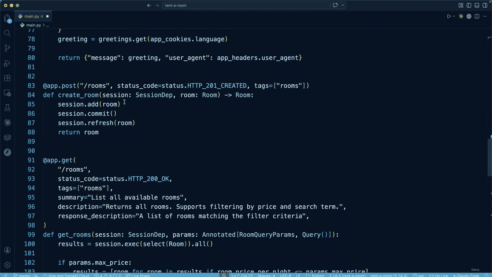
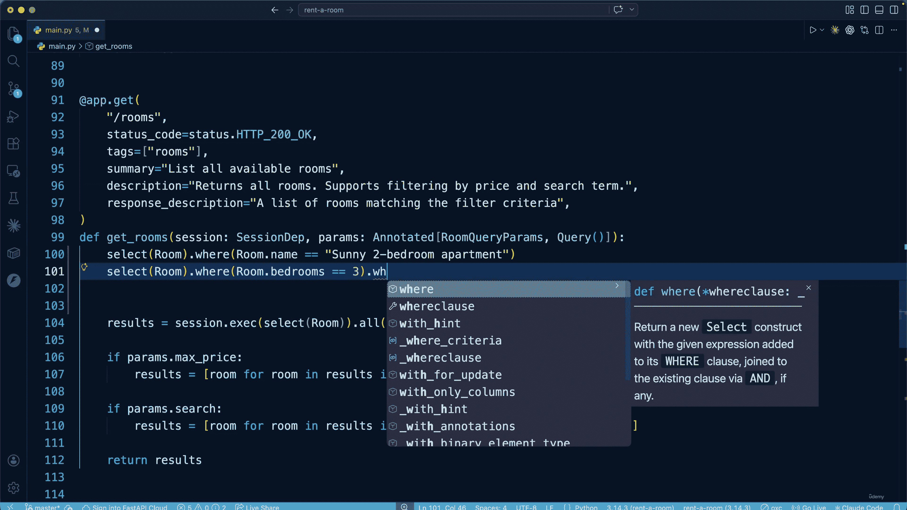
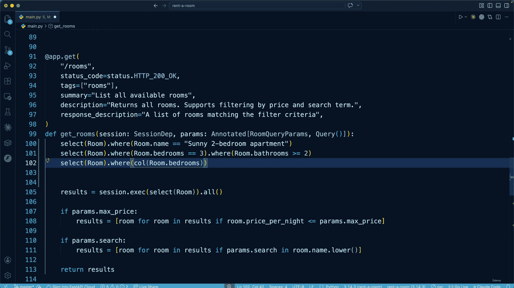
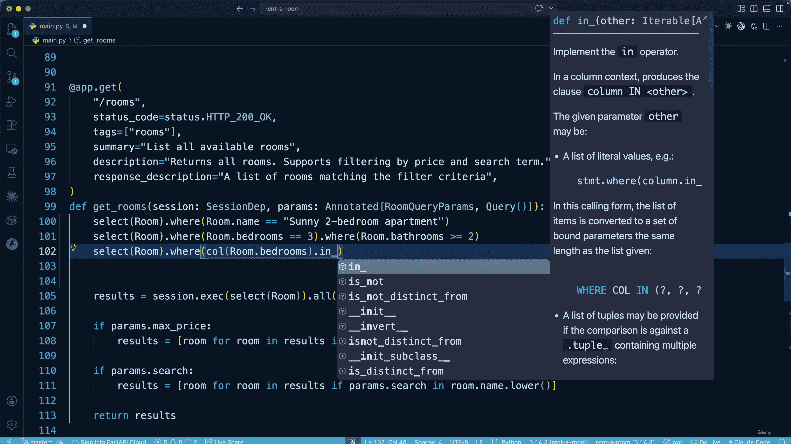
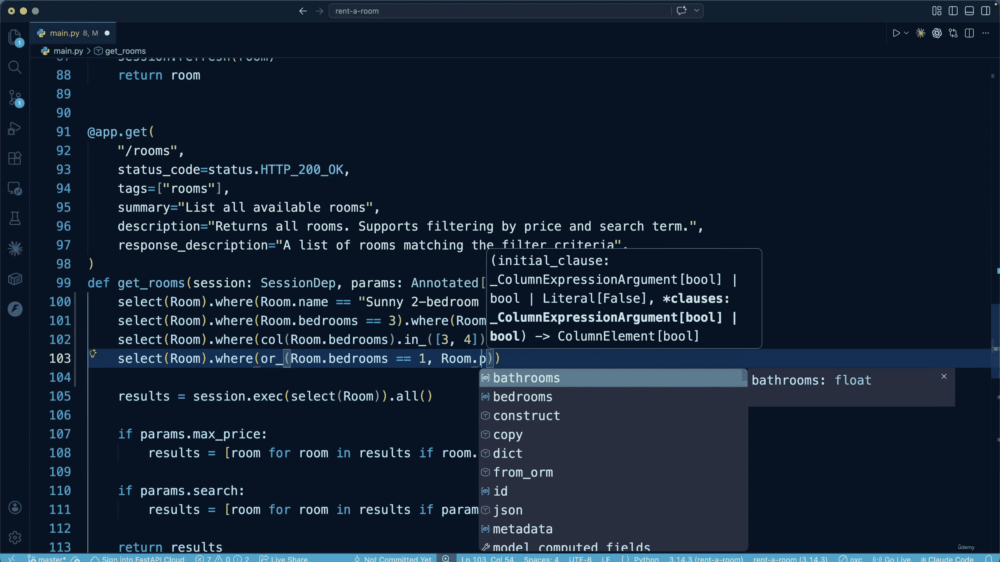
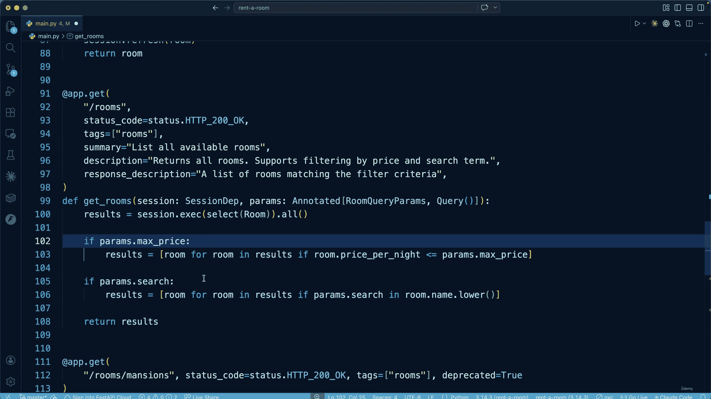

# 🧭 FastAPI 大师课：第65-66课：使用 where 方法进行过滤

在本节课中我们将要学习 SQLModel 中 `where` 方法的过滤语法，理解如何把原本在 Python 列表推导式里完成的过滤逻辑迁移到数据库查询侧。课程会从当前 `get_rooms` 函数的实现出发，说明为什么数据库更适合做条件筛选，然后依次介绍 `statement`、查询构建器、`where` 基本条件、链式 `where` 的 AND 逻辑、`col` 配合 `in_` 的集合包含逻辑，以及 `or_` 的 OR 逻辑。下面先从当前实现的问题开始。

### 🧩 FastAPI 大师课：第65-66课：当前实现的问题

上一节概述了本课目标，本节中我们来看看当前 `get_rooms` 函数的实现方式。当前代码在 `get_rooms` 函数中查询 `rooms` 表，然后在第 100 行把查询结果收集到一个 Python 列表里。接着代码使用 Python 列表推导式做额外过滤，根据查询参数筛选房间，这些参数包括 `max price` 和搜索词 `search term`。

这种做法在技术上没有错误，但它属于额外的运行时逻辑，需要运行额外的 Python 代码。数据库本身针对这类查询做过优化，SQL 擅长从表中提取行，包括提取满足某种条件或标准的行。插入行、提取行、删除行等操作都是数据库的专长。因此，如果能把更多 Python 代码移动到查询构建逻辑中，从而得到更好的 ORM 生成查询，并发送给数据库，那么数据返回时就已经完成过滤。把更多 Python 逻辑迁移到 Pydantic 模型或 ORM 查询中，通常被认为是更好的处理方式。

下面是当前流程与目标流程的对比，用代码形式描述两种思路。

- `当前流程：查询 rooms 表 -> 收集为 Python 列表 -> 用列表推导式过滤`
- `目标流程：把过滤条件交给 ORM -> 生成带 WHERE 的 SQL -> 数据库返回已过滤记录`

如果数据库里只有三行数据，在本地运行这段代码不会看到明显的效率差异，因为比较的是毫秒与毫秒。但在规模更大的应用中，例如一次拉取很多行，而不是几行，循环遍历列表并检查每个模型属性的做法会逐渐累积开销。因此，不需要害怕代码库中出现这类代码，但如果能把更多逻辑移动到数据库侧，或者把更多逻辑放到 ORM 设置中，以确保生成更好的查询，通常更加理想。下一课会重构这段代码，利用这些原则。本节则重点展示 SQLModel 中声明 `where` 子句的实际语法。

### 🔍 FastAPI 大师课：第65-66课：where 子句是什么

上一节说明了为什么要把过滤逻辑迁移到数据库侧，本节中我们来看看 `where` 子句到底是什么。`where` 子句是 SQL 中的过滤条件。它不是在查询时提取表中的所有行，而是指定某种条件，例如提取价格小于给定值的房间，或者提取名称等于特定字符串的房间。

本课中的代码都只用于示例，不需要跟着一起写。这里的目标是理解语法，以及这些语法在 SQL 查询中完成什么作用。

> 提示：本节示例用于理解 SQLModel 的过滤语法，不需要把示例代码全部保留在项目中。

理解 `where` 的用途后，下一节我们来看看 SQLModel 如何先构建查询，再真正执行查询。

### 🧱 FastAPI 大师课：第65-66课：查询构建器与 statement



上一节介绍了 `where` 子句是过滤条件，本节中我们来看看 SQLModel 中称为 `statement` 的查询构建逻辑。当前代码在 `exec` 方法调用中的这段逻辑被称为 `statement`。可以把 `statement` 理解为一份食谱，ORM 会使用这份食谱生成合适的 SQL 语句。实际的 SQL 查询不会在构建 `statement` 时发生，直到把 `statement` 传入 `exec` 方法调用，查询才会真正执行。因此，构建 `statement` 类似于准备食材，`exec` 方法才是真正烹饪食谱。

例如，使用 `select(Room)` 并传入 `Room` 模型，此时不会发出任何查询。这段代码只是在构建查询，并返回一个特殊对象。可以把返回对象赋值给 `result` 变量，鼠标悬停时可以看到类似 `SelectOfScalar` 的复杂类型。可以把这个对象理解为查询构建器。这个对象带有很多方法，每个方法都会修改最终生成的查询。该对象使用一种称为构建器模式的设计模式，每次调用方法都会返回对象本身，因此可以连续链式调用很多方法，这些方法会不断增强或扩充最终要执行的查询。下面用代码表示 `statement` 与 `exec` 的关系。

```python
statement = select(Room)  # 只构建查询，不执行
result = session.exec(statement).all()  # 到这里才执行 SQL
```

理解查询构建器之后，下一节我们回到常规语法，看看第一个过滤方法 `where` 的写法。

### 🧑‍🍳 FastAPI 大师课：第65-66课：where 方法的基本语法

上一节介绍了查询构建器和 `statement`，本节中我们来看看 `where` 方法的基本语法。回到常规查询语法后，可以附加的第一个方法叫 `where`，它会翻译成 SQL 中字面意义上的 `where` 子句。如果不熟悉 SQL，`where` 是一个关键字，允许根据条件过滤行，或者从记录中提取满足条件的子集。这里仍然处在 Python 代码中，因此需要遵循 SQLModel 的语法，告诉 ORM 用于过滤的条件标准。

`where` 方法的工作方式是在括号内引用示例模型，例如 `Room`。虽然 `Room` 是一个类，但仍然可以访问它的顶层字段或属性，例如 `name`、`id`、`bathrooms`。可以引用其中任意属性，例如 `name`，然后在括号内继续提供 Python 运算符，例如等于、不等于、小于、大于，并指定实际要构建的条件。例如可以写等号，并与字符串 `"sunny two bedroom apartment"` 比较。这样表达的含义不只是查询 `rooms` 表，而是专门查找 `name` 列中的值等于该字符串的行。

这种写法使用 Python 代码指定过滤逻辑，比较直观。它看起来可能会生成一个布尔值，实际会生成另一个对象，这个对象会修改更大的表达式并进行定制，等到传入 `exec` 时，再执行所有已经构建好的逻辑。接下来回到 `rooms` 相关代码，逐条写出示例代码。这些代码不会保留，每一行只用于演示不同的过滤原则。以下是相等与不等过滤的写法示例。

- 等值过滤：`select(Room).where(Room.name == "sunny two bedroom apartment")`，含义是查找 `name` 列等于该字符串的行。
- 等值过滤 bedrooms：`select(Room).where(Room.bedrooms == 3)`，含义是查找 `bedrooms` 列等于 3 的行。
- 不等过滤：`select(Room).where(Room.bedrooms != 3)`，含义是查找 `bedrooms` 列不等于 3 的行。

所有熟悉的 Python 运算符，包括等于、不等于、大于、小于，都可以在这里正常工作。下一节我们来看看如何连续调用多个 `where` 方法，从而组合多个条件。

### 🔗 FastAPI 大师课：第65-66课：链式 where 与 AND 逻辑



上一节介绍了单个 `where` 条件，本节中我们来看看连续调用多个 `where` 方法的方式。可以在方法链中多次按顺序调用 `where` 方法，这会应用 AND 逻辑，也就是指定多个必须同时满足的条件。例如在已有条件后又调用一次 `where`，提供另一个过滤条件，例如检查 `bathrooms >= 2`。这样最终生成的 SQL 查询会查找 `bedrooms` 列值恰好为 3，并且 `bathrooms` 数量大于等于 2 的房间。

如果希望应用多个条件，并且所有条件都必须满足，只需要按顺序链式调用多个 `where` 方法。以下是链式 `where` 的代码示例。

```python
select(Room).where(Room.bedrooms == 3).where(Room.bathrooms >= 2)
```

上面的代码表达的含义是 `bedrooms = 3 AND bathrooms >= 2`。掌握 AND 逻辑后，下一节我们来看看如何判断某个值是否属于一个集合。

### 📦 FastAPI 大师课：第65-66课：集合包含与 in_ 方法



上一节介绍了链式 `where` 的 AND 逻辑，本节中我们来看看集合包含条件。另一种逻辑条件是判断某个值是否包含在一个集合中。例如想提取 `bedrooms` 为 3 或 4 的所有房间，可以用下面的代码实现。在 `where` 方法调用中，需要取出 `Room.bedrooms` 引用，并把它包在之前导入的 `col` 函数中，`col` 是 `column` 的缩写。

这个函数存在的原因是帮助类型检查器理解正在构建的逻辑，并明确告诉查询构建器 `bedrooms` 是表中的一个可比较列。包装后会得到一个对象，在对象后面加点，就能看到所有可用的方法，这些方法可以帮助构建更复杂的逻辑条件。例如有一个方法叫 `in_`，以下划线结尾。这个方法通常会映射到对应的 SQL 关键字。在文档中可以看到，在列上下文中会生成 `column in (...)` 这样的子句。很多方法都与对应的 SQL 语句一对一映射。需要再次说明，这仍然是 Python 代码，但这里提供的 API、可用方法和交互接口与 SQL 非常接近，因此练习这些 Python 方法也会为 SQL 打下良好基础。

这个方法以下划线结尾看起来比较特别，但下划线只是方法名中的一个普通字符。调用这个方法时，可以传入一个 Python 列表或某种集合，这个集合用于指定所有可能被查找的值。例如传入 `[3, 4]`，表达的含义是查找 `rooms` 表中 `bedrooms` 列值为 3 或 4 的所有行，也可以说 `bedrooms` 列的值存在于这个可能选项列表中。以下是 `in_` 的用法示例。

```python
from sqlmodel import select, col

statement = select(Room).where(col(Room.bedrooms).in_([3, 4]))
```



上面的代码表达的含义是 `bedrooms IN (3, 4)`，也就是 `bedrooms = 3 OR bedrooms = 4`。到这里已经看到单条件和多条件，下一节我们来看看如何应用 OR 逻辑。

### 🎯 FastAPI 大师课：第65-66课：OR 逻辑与 or_ 函数

上一节介绍了集合包含条件，本节中我们来看看 OR 逻辑。OR 逻辑表示多个条件中只要有一个满足即可，不要求全部满足。为此需要在文件顶部再导入一个函数，它来自 SQLModel，名字叫 `or_`，同样以下划线结尾。这是 SQLModel 库中的有效构造。下面展示这种语法的写法。

例如想查询所有房间，条件是 `bedrooms` 数量为 1，或者每晚价格小于 200。链式调用多个 `where` 方法时会应用 AND 逻辑；而 OR 逻辑表示这个条件或那个条件满足即可，不要求两者同时满足。示例代码会使用 `select(Room)`，然后调用 `where` 方法进行过滤。在 `where` 内先调用 `or_` 函数。这个函数以下划线结尾，原因可能是 Python 本身有原生的 `and` 和 `or` 关键字，这样命名可以立即与原生 `or` 关键字区分开。它仍然是一个普通函数，可以像其他函数一样调用。在函数内部可以传入多个表达式、多个过滤条件，写法与前面的条件类似。例如第一个参数写 `Room.bedrooms == 1`，第二个参数写另一个条件，引用模型上的有效属性 `price_per_night`，并检查它是否小于 200。

这样就在应用 OR 逻辑：选择所有房间，只要 `bedrooms` 数量为 1，或者 `price_per_night` 小于 200，两个条件不需要同时满足，只需要满足其中一个。以下是 OR 条件的代码示例。

```python
from sqlmodel import select, or_

statement = select(Room).where(
    or_(
        Room.bedrooms == 1,
        Room.price_per_night < 200
    )
)
```

上面的代码表达的含义是 `bedrooms = 1 OR price_per_night < 200`。通过这个示例，可以理解 `or_` 与链式 `where` 在逻辑组合上的区别。



### 🧾 FastAPI 大师课：第65-66课：本节总结

上一节介绍了 OR 逻辑，本节中对 SQLModel 的过滤语法做一个总结。SQLModel 中的过滤语法总是通过添加 `where` 方法来提供某种条件或标准，从而缩小当前模型所对应表中的行范围。下一课会使用这种方法执行下方已有的 `max price` 和 `search` 过滤，但这些过滤会在数据库侧完成。



本节课中我们一起学习了当前 `get_rooms` 函数中 Python 过滤逻辑为什么可以迁移到数据库侧，理解了 `statement` 与查询构建器的作用，掌握了 `where` 的基本条件写法、链式 `where` 的 AND 逻辑、`col` 配合 `in_` 的集合包含逻辑，以及 `or_` 的 OR 逻辑。通过这些内容，可以在后续重构中把更多过滤逻辑交给数据库和 ORM，从而生成更合适的查询。

