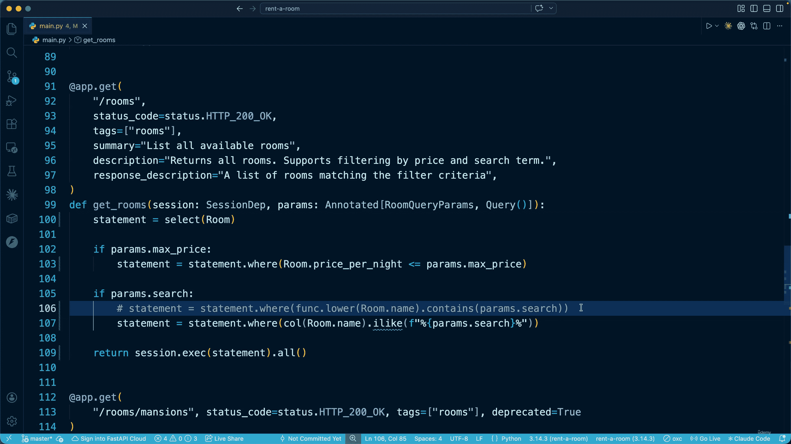
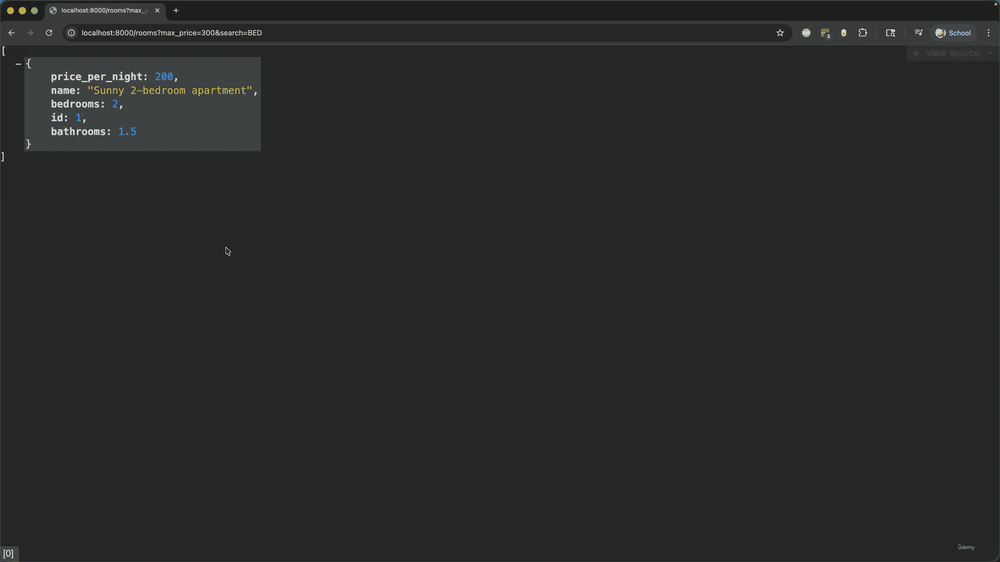
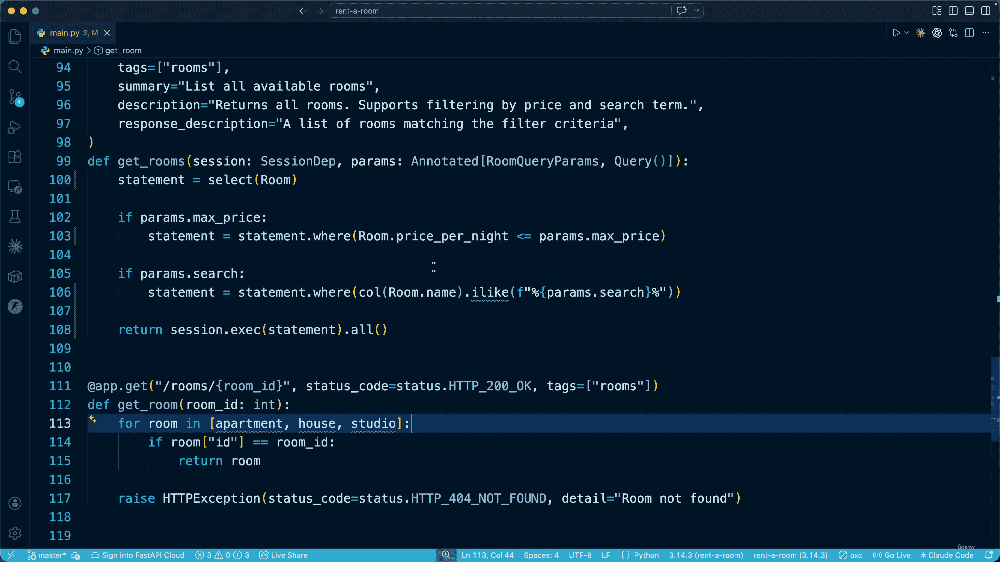

# 🐍 FastAPI 大师课：第1部分第66-67课：优化获取房间查询

在本节课中，我们将要学习如何把 `get_rooms` 函数里的过滤逻辑从 Python 代码搬到数据库查询里。上一阶段我们已经理解了 `where` 方法的作用，本节会继续使用它来优化房间查询。整体目标很明确：用 SQLModel 和 SQL 语句完成筛选，减少 Python 侧的手工过滤。以下是本节课将要覆盖的主要内容，按顺序拆开说明。

- **导入数据库端工具**：使用 `select`、`col` 和 `func` 构建与加工 SQL 语句。
- **构建动态语句**：先建立基础查询，再根据查询参数有条件地追加条件。
- **处理 `max_price`**：把价格上限条件加到 SQL 语句里。
- **处理 `search`**：用两种方式实现大小写不敏感的文本搜索。
- **测试与清理**：在浏览器中验证组合查询，并清理不再需要的端点。

上面的路线会贯穿整节课，下面从导入工具开始，把每一步拆开说明。

## 🧭 FastAPI 大师课：第66-67课：本节概述与导入准备

在进入具体代码之前，先把位置和准备工作说清楚。我们已经有对 `where` 方法更好的理解，因此可以更新 `get_rooms` 函数中的列表推导式，让数据库承担过滤工作，而不是继续用 Python 代码逐条筛选。这个转变是本节的主线，也是后续性能优化的基础。完成这个认识后，第一步是把代码滚动到文件顶部，补充需要的导入。

我们需要从 SQLModel 中增加几个导入项。一个是 `col` 函数，另一个是以前没有见过的 `func`。`func` 的作用是让我们在数据库一侧执行函数调用。SQL 中有很多函数，例如把字符转成小写或大写。换句话说，`func` 可以转换 SQL 语句或查询中的各种元素和片段。导入时在行末补一个逗号，然后滚动回 `get_rooms` 函数。完成导入准备后，下一节开始构建实际查询语句。

## 🛠️ FastAPI 大师课：第66-67课：构建动态 SQL 语句

上一节完成了导入准备，本节来看看如何把查询拆成“先搭骨架、再按条件补充”的方式。处理 `max_price` 查询参数时，不再在当前位置直接用 `exec` 方法发起查询，而是把真正执行查询的动作留到函数的最后一行。中间过程用于构建实际的 SQL 语句，最后才发出语句并转换成 Python 列表。这样做可以把条件组合集中在一个地方，逻辑更清楚。

具体做法是先声明一个变量 `statement`，从始终需要的部分开始，也就是 `select` 函数，并传入 `Room` 模型来查询 rooms 表。核心结构如下。

```python
from sqlmodel import select, col, func

statement = select(Room)
```

接下来，针对每一个查询参数，如果请求中确实提供了该参数，就修改这个 `statement`，并把结果重新赋值给同一个变量，从而更新最终要执行的查询。例如存在 `max_price` 参数时，取出当前以 `select` 开头的语句，使用 `where` 方法添加条件：房间每晚价格小于或等于 `params.max_price`。代码如下。

```python
if params.max_price is not None:
    statement = statement.where(
        Room.price_per_night <= params.max_price
    )
```

这个 `where` 调用会追加额外的条件，也会增强正在构建的语句对象。单独调用 `where` 会返回一个新语句，因此需要覆盖原来的变量。这个过程可以理解为：如果存在该查询参数，就在初始 `select` 调用上追加逻辑并覆盖 `statement`；如果不存在 `max_price` 查询参数，也没有问题，只保留查询所有行的那一部分。完成价格条件后，下一节处理搜索参数，并展示两种文本过滤写法。

## 🔎 FastAPI 大师课：第66-67课：处理 search 参数的第一种写法

上一节已经能按价格动态追加条件，本节继续处理 `search` 参数，并重复同样的条件构建逻辑。这里展示两种可用于文本过滤的方式。第一种方式沿用上面的模式，再添加一次 `where` 方法调用。需要记住，如果连续出现两个 `where` 调用，两个条件会同时生效。因此当 `max_price` 和 `search` 同时存在时，会进入两个条件块，并把两个条件都加到语句中。

第一种写法使用已经导入的 `func`。在这个模块或对象上可以看到 SQL 中可用的很多函数，其中 `lower` 会把文本转成小写。于是可以把 rooms 表中 `name` 列的值转成小写，也就是在数据库一侧完成大小写转换。这样处理的原因很实际：用户给出的搜索词大小写可能不同。假设数据库里 bedroom 拼成大写 BD，而用户输入小写 bd，就需要在返回结果之前控制大小写差异。SQL 可以完成这种转换，使用 `lower` 就是在 SQL 侧说明：比较之前先把每一行房间名称转成小写。

完成小写转换后，再追加一个方法 `contains`，用于检查左侧内容是否包含目标文本。也就是说，在小写后的房间名称中搜索 `params.search`。代码如下。

```python
if params.search is not None:
    statement = statement.where(
        func.lower(Room.name).contains(params.search)
    )
```

这里的 `params.search` 已经是小写，因为它会经过 `RoomQueryParameters` 的 Pydantic 模型，而模型中已经做了小写处理。这样处理即可。随后在下方通过 `session` 调用 `exec` 方法，传入已经构建好的 `statement`，再调用 `all` 方法，把结果转换回列表并返回实际结果集。第一种写法完成后，下一节展示使用 SQL 运算符的第二种写法。

## 🔎 FastAPI 大师课：第66-67课：处理 search 参数的第二种写法

上一节用 `func.lower` 加 `contains` 实现了大小写不敏感的搜索，本节看看另一种等价写法。这里使用底层实际的 SQL 运算符，目标同样是完成相同结果。可以把前一段代码注释掉，写出替代方案。

在 `where` 中使用上一课见过的 `col` 函数，传入 `Room.name`。这个列构建器会提供一个名为 `ilike` 的方法，用于执行大小写不敏感的搜索。右侧说明也写明它实现 `ILIKE` 运算符，也就是大小写不敏感匹配。底层逻辑非常相似：会把搜索词转成小写，并在列值同样转为小写后查找。代码如下。

```python
if params.search is not None:
    statement = statement.where(
        col(Room.name).ilike(f"%{params.search}%")
    )
```

这里调用 `ilike` 并传入 Python 格式化字符串。字符串开头和结尾各有一个百分号，实际是两个百分号。百分号表示一行中零个或多个字符。也就是说，搜索词前面可以有任意数量字符，包括零个；搜索词后面也可以有任意数量字符。这样可以在房间名称的任意位置定位搜索词，它可以在开头、结尾或中间。用公式表达就是 `%搜索词%`，其中 `%` 表示零个或多个字符。花括号用于插入 `params.search` 的值。于是会在房间名称中的任意位置搜索该内容，`ilike` 会自动处理小写转换。两种写法都可以选择，效果相同，收益也相同：所有过滤逻辑，甚至小写转换，都被移动到数据库侧和实际 SQL 语句中。完成两种写法比较后，下一节在浏览器中验证效果。

## 🧪 FastAPI 大师课：第66-67课：浏览器测试与组合参数



上一节完成了两种搜索实现，本节把代码放到浏览器中验证。查询不会在构建语句的过程中发出，只有到达最后执行位置时才会真正查询。我们使用 Python 构建查询计划，其中包含条件策略，因为某些逻辑只有在 `if` 语句满足时才会执行。流程是：先建立基础查询，再按条件增强语句，最后在一个位置发出数据库调用并执行单次查询。这样代码中不再需要额外的 Python 过滤，而 Python 过滤通常比单次数据库调用更慢。删除临时行后，回到浏览器测试。

访问 `localhost:8000/rooms`，这里已经有一个搜索词，可以搜索 `bed`。查看结果，预期会得到包含 bed 和 BED 的房间。也可以修改大小写，例如输入 `BED`，同样能正常工作。随后添加额外参数：使用 `&` 连接，加入 `max_price`，例如设置为 300。可以看到结果进一步缩小。这个参数也在工作，所有参数都按预期工作。参数顺序不重要，例如把 `max_price` 放在问号后的第一个位置，也会得到完全相同的结果。每次请求这个端点时，只会有一条查询打到数据库。这样的方式简洁、优雅，也是更好、更快的方案。测试完成后，下一节处理尚未解决的问题和清理工作。

## 🧹 FastAPI 大师课：第66-67课：清理旧端点与后续优化

上一节验证了组合查询，本节收尾并清理不再需要的代码。目前唯一没有处理的问题是：当前可能查询 rooms 表中的所有房间或大量房间。现在表中只有三条数据，可以想象存在数千或数百万条数据时，这种查询会非常密集。因此后续课程会实现 `limit`，也就是限制最多查询多少行。就本节而言，先结束课程并回到 VS Code。



`get_rooms` 函数现在看起来已经不错。本节课还要清理 `mansions` 端点，它已经不再需要存在，之前只是为了示例。于是可以删除整个处理函数，包括装饰器。其他函数中仍然存在对旧字典的引用，这些会在后续课程中处理。最后总结本节的核心做法：以下是在 SQL 侧创建额外过滤条件的方式，使用 Python 代码告诉 ORM 如何定制它生成的 SQL 查询。

## 📌 FastAPI 大师课：第66-67课：本节总结



本节课中我们一起学习了如何优化获取房间的查询。我们把 `get_rooms` 中的过滤逻辑从 Python 列表推导式迁移到数据库查询，使用 `select` 建立基础语句，使用 `where` 按查询参数动态追加条件。针对价格使用 `Room.price_per_night <= params.max_price`。针对文本搜索展示了两条路线：`func.lower(Room.name).contains(params.search)` 和 `col(Room.name).ilike(f"%{params.search}%")`。两种方式都把大小写转换和过滤放到 SQL 侧，并只在最后执行一次 `session.exec(statement).all()`。我们还验证了组合参数、参数顺序和大小写不敏感搜索，并清理了 `mansions` 端点。后续需要补上的部分是限制查询行数，这会在后续课程中实现。

