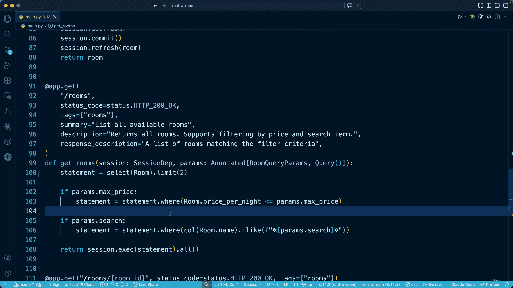
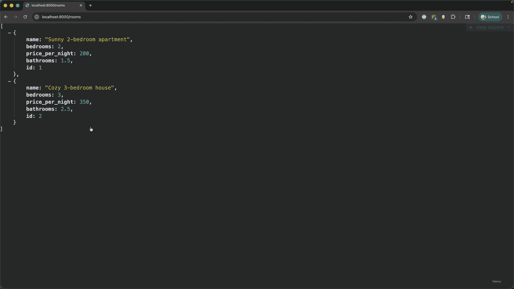
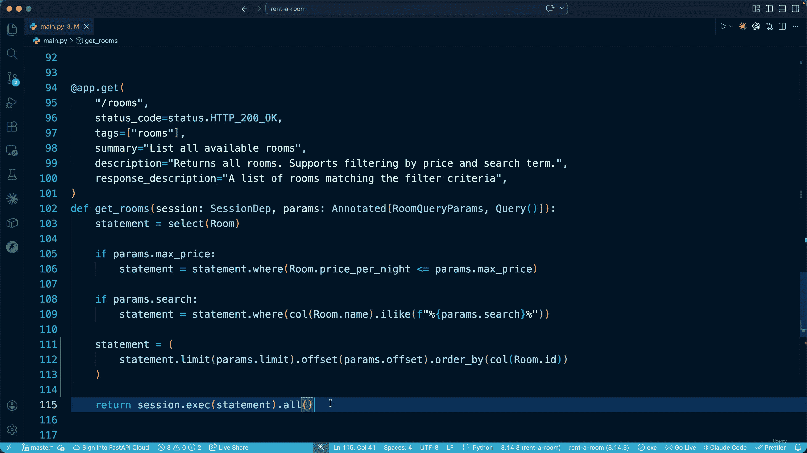
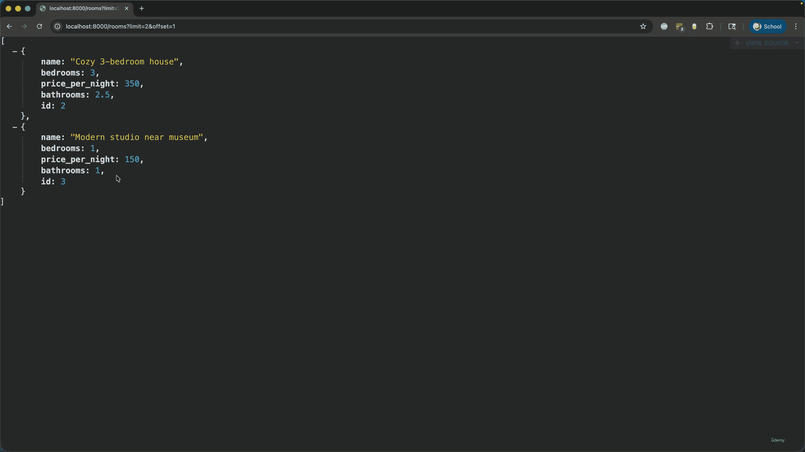

# 🚀 FastAPI 大师课：第67节：限制与偏移查询结果


在本节课中，我们将要学习如何给查询结果加上数量限制，如何用偏移量跳过前面的数据，以及如何通过明确排序让分页结果更稳定。当前 `get_rooms` 路由可能会返回 `rooms` 表里的所有房间。如果数据库里只有三个房间，这不会成为问题；即使有三百个甚至三千个房间，通常也不会立刻成为问题。但是，当数据规模达到 Airbnb 这种级别，表里可能有几百万行数据时，即使通过查询参数做了过滤，返回的数据量仍然可能非常大，而且这些数据还要转换成对应的 Pydantic 模型。为了让这种查询方式更具可扩展性，本课会引入限制返回行数的做法。下面我们先看看为什么需要这样做。


## 🧱 FastAPI 大师课：第67节：为什么需要限制返回行数


在当前的起始查询上，可以调用一个名为 `limit` 的方法。这个方法与 SQL 里的 `limit` 关键字一一对应，作用是对最多可以查询或返回的行数设置一个上限。你可以把 `limit` 理解成一句很直白的话：不要返回超过指定数量的行。

例如，如果设置 `limit(2)`，表达的意思就是整体上不要返回超过两行数据。这样就能减少数据库的压力，因为数据库不必搜索所有行，只需要搜索前两条符合条件的数据。即使查询里还有额外过滤条件，真正的 SQL 查询也不会立刻发出，而是等到最后执行查询的那一刻才发出。到那时，ORM 已经知道如何把所有指令组合起来，SQL 也只需要搜索符合全部条件的两行数据，不需要解析并返回几百万行。

下面是一个最小示例，用代码描述 `limit` 的核心含义：

```python
statement = select(Room).limit(2)
```

回到浏览器查看 `rooms` 接口时，原本可以看到三个房间。刷新页面后，只会看到 `id` 为 1 和 2 的前两个房间，因为已经给最大返回结果数加上了上限。回到代码后，可以把 `limit` 设置成一个更合理的数字，例如十个房间，这通常是一个比较合适的默认限制。


## 🔁 FastAPI 大师课：第67节：只用 limit 会遇到什么问题






上一节我们介绍了 `limit` 如何控制最多返回多少行，本节来看看只使用 `limit` 会带来什么新问题。引入 `limit` 后，查询总是从结果集顶部或表开头开始拉取数据。例如，一张表有一百万行，查询总是从开头开始搜索，直到拿到最多十条记录。这会引出一个问题：怎样搜索数据集中间或末尾的数据。

例如，我们想加入分页功能，让用户先看到十个房间，然后点击“下一页”或页码“2”，再看到下一批十个房间。如果查询总是限制为前十条，那么除了前十条结果，其他数据都看不到，即使已经应用了过滤条件也一样。

以下是只使用 `limit` 时的主要问题：

- 查询总是从表开头开始，无法自然跳到后面的数据。

- 分页场景下，用户无法看到第二批、第三批结果。

- 即使有过滤条件，限制前十条仍然只能看到最前面的十条。

- 需要一个配套方法来指定从哪里开始搜索。

为了解决这个问题，就需要一个与 `limit` 非常互补的方法：`offset`。


## 🧭 FastAPI 大师课：第67节：用 offset 指定从哪里开始


`offset` 同样可以映射到 SQL 里的对应关键字，它的作用是指定在真正开始搜索或查询之前跳过多少条记录。例如，如果提供 `offset=10`，表达的意思是从 `rooms` 表的第十行之后开始拉取数据，并且从那个位置开始最多返回十行。也就是说，`limit` 设置返回行数的最大边界，`offset` 指定从哪里开始搜索。

`offset` 的默认值应当是 0，表示从表的最开头开始。如果设置为 10，就表示跳过十行，然后开始搜索。这里可以用一个简单公式来记忆两者关系：

```text
返回结果 = 跳过 offset 行之后，最多取 limit 行
```

以下是 `offset` 的核心特点：

- `offset` 表示查询前跳过的记录数量。

- `offset=0` 表示从表开头开始查询。

- `offset=10` 表示跳过前十行，再从后面的数据开始查询。

- `limit` 管“最多返回几条”，`offset` 管“从哪里开始”。

> 一句话记忆：`limit` 管上限，`offset` 管起点。


分页功能可以这样工作：用户第一次请求某个接口时，代码可以配置成返回第一批数据；用户可以自定义这些值，例如通过查询参数指定 `limit` 和 `offset`，或者指定页码，再把页码乘以 10。第一次请求完成后，用户点击第二页或“下一页”，客户端会再次请求服务器，仍然要求最多十个房间，但这次从 `offset=10` 的位置开始。第三次请求对应第三页，仍然请求十个房间，但 `offset` 会变成 20。反过来，用户也可以提供类似 `page=2` 的查询参数，服务器拿到页码 2 后乘以 10，用这个结果作为查询数据库时的偏移量基础。这是一种非常常见的分页实现方式，并且可以继续依赖同一个接口。示例代码在讲解完后可以删除。


## 🧮 FastAPI 大师课：第67节：分页偏移量的计算方式


在分页场景里，页码和偏移量之间通常有一个简单换算关系。用户告诉服务器当前在第几页，服务器再根据每页条数计算应该跳过多少行。

以下是一个常见的分页计算公式：

```text
offset = (page - 1) * page_size
limit = page_size
```

如果页码从 1 开始，每页十条，那么第一页的 `offset` 是 0，第二页的 `offset` 是 10，第三页的 `offset` 是 20。原文中提到的做法是直接把页码乘以 10，例如 `page=2` 对应偏移量 20 或相应批次，具体取决于页码从 0 还是从 1 开始。关键点是：用户可以告诉我们当前在哪一页，我们再把这个信息转换成查询数据库时使用的 `offset`。这样就能在不改变接口结构的情况下实现分页。


## 🔤 FastAPI 大师课：第67节：给查询结果加上明确排序


上一节我们说明了如何计算偏移量，本节来看看为什么还需要明确排序。构建分页功能，或者更一般地构建返回一批结果的路线时，另一个好做法是添加明确的排序顺序。应该假设数据库或 ORM 不会以确定的顺序返回行。虽然这种假设并不总是成立，但这样假设更安全。

例如，数据库可能返回前十条记录，但 `id` 为 2 的行可能先出现，`id` 为 1 的行后出现；下一批结果集又可能反过来，`id` 为 1 的行先出现，`id` 为 2 的行后出现。你得到的可能是同样的行，但顺序不稳定。因此，最好明确指定排序顺序，用某一列的值作为排序依据。

以下是在 SQLModel 中指定排序的示例：

```python
statement = select(Room).order_by(col(Room.id))
```

这里的 `order_by` 会翻译成 SQL 中对应的 `order by` 子句。它期望接收模型上的某个属性，这个属性映射到表中的对应列，然后 ORM 会用这个列作为排序基础。实际排序由 SQL 和数据库执行，ORM 负责构建排序逻辑。

默认情况下，排序是升序：数字从小到大，文本按字母顺序。通常更合理的排序字段是 `id`，因为它是房间的主标识符。做分页时，一般希望先看到房间 1 到 10，再看到房间 11 到 20。如果下一批十个房间按价格从低到高排序，导航体验会比较奇怪。因此，`id` 是这里比较符合逻辑的排序字段。

如果直接写 `Room.id` 出现类型检查违规，原因是 `order_by` 担心 `id` 可能为整数，也可能为 `None`，于是产生“如何排序一个可能为 `None` 的行”的问题。这是模型上 `id` 属性定义方式带来的类型提示问题。实际查询数据库时，所有房间都会有保证存在的 `id`，所以这只是类型检查层面的错误。

上一课提到过从 SQLModel 导入的 `col` 函数，它可以帮助类型检查。看到这种违规时，可以把 `Room.id` 或其他属性包在 `col` 函数里，让类型检查工具理解这是对列的引用，尤其是有保证存在的 `id` 列。这样按 `id` 排序就没有问题，并且默认仍然是升序，会得到从小到大排列的 `id`。如果进入下一页，也仍然按升序返回。

如果需要降序，也就是从大到小或反向字母顺序，可以从 SQLModel 导入 `desc` 函数，然后把排序表达式改成 `desc(Room.id)`。下面是降序示例：

```python
from sqlmodel import desc

statement = select(Room).order_by(desc(col(Room.id)))
```

这样每一批结果都会按 `id` 降序排列。示例代码在讲完后可以删除，最终回到按 `Room.id` 升序排序，并用 `col` 包装。


## ⚙️ FastAPI 大师课：第67节：把 limit 和 offset 放进查询参数模型


上一节我们解决了排序问题，本节把 `limit` 和 `offset` 变成动态查询参数。不能一直保留硬编码的 `offset`，否则又会回到原来的问题：总是从固定位置之后开始过滤。我们希望用户能指定要接收多少行，以及从哪里开始搜索。

所有查询参数都定义在 `RoomQueryParameters` 这个 Pydantic 模型里。可以在模型上方找到它，然后添加两个新属性。第一个属性是 `limit`，类型为整数。使用 `Field` 函数并提供默认值，可以让这个查询参数变成可选参数。默认值可以设为 10，因为用户不指定时，返回十个房间比较合理。

还可以给可接受的值设置数字范围。用 `ge` 表示大于等于，可以要求用户提供的 `limit` 至少为 1，因为至少需要拿到一行数据。为了防止用户请求特别大的记录数，可以用 `le` 表示小于等于，把上限设为 100。这样即使用户要求 100 个房间或 10000 个房间，Pydantic 也会在进入路由处理逻辑之前抛出异常，因为该整数超出了边界。

第二个属性是 `offset`，同样映射到查询参数，也是可选整数。这里再次使用 `Field`，默认值设为 0，表示默认跳过零行。如果用户没有提供这个查询参数，查询就会从 `rooms` 表开头开始。如果用户提供了 `offset`，可以用 `ge=0` 要求它大于等于 0，因为 `offset` 表示要跳过的总行数，负数没有意义。

以下是查询参数模型的核心写法：

```python
from sqlmodel import Field

class RoomQueryParameters:
    limit: int = Field(default=10, ge=1, le=100)
    offset: int = Field(default=0, ge=0)
```

这样设置后，`limit` 和 `offset` 都会由 Pydantic 负责校验。用户传入不合法值时，请求会提前被拦截，不会进入后续数据库查询逻辑。


## 🧩 FastAPI 大师课：第67节：改造 get_rooms 路由


现在回到下方的 `get_rooms` 路由，把两个查询参数应用到查询里。为了让代码更容易阅读，可以把逻辑拆开：先创建初始的 `statement`，再用查询参数进一步过滤，然后附加之前的方法调用，并把结果重新赋值给 `statement`。原文中是在第 113 行才真正发出 SQL 查询，这里也保持类似结构：所有 ORM 逻辑先构建，最后才执行一次最终 SQL 查询。

在限制和偏移的位置，不再写硬编码值，而是访问 `parameters.limit`。用户没有提供时，模型里有默认值，所以不会出问题。`offset` 也一样，访问 `parameters.offset`。同时按 `id` 列升序排序，用 `col` 包装类型检查需要的属性。

以下是改造后的核心查询逻辑：

```python
statement = select(Room)
statement = statement.where(Room.price_per_night <= parameters.max_price)
statement = statement.where(Room.name.contains(parameters.search))
statement = statement.limit(parameters.limit)
statement = statement.offset(parameters.offset)
statement = statement.order_by(col(Room.id))
```

这段代码读起来比较直观：选择房间，用查询参数按最高价格和搜索词过滤，然后限制最多返回多少行，并可能从表开头之后的位置开始搜索，以便同一个接口支持分页。`order_by` 指定一致、可预测、确定的排序顺序。最后，ORM 逻辑构建完成，发出唯一一条最终 SQL 查询，结果数量不会超过 `limit`，而 `limit` 最大被限制在 100，因此不会给数据库或 Python 运行时逻辑带来过大负担。最多 100 条记录随后会通过 `all()` 方法转换成列表并返回给用户。


## 🧪 FastAPI 大师课：第67节：在浏览器中验证效果


上一节我们改造了路由，本节回到浏览器验证结果。默认访问 `rooms` 接口时，可以看到默认返回结果。接着可以加查询参数，例如想要最多两个房间，并且从偏移量 1 开始，也就是跳过 `rooms` 表里的一行，再从后面拉取数据。

以下是验证时使用的示例请求：



```text
/rooms?limit=2&offset=1
```

这个请求会返回第 2 行和第 3 行，因为跳过了 1 行，然后最多请求 2 行。实际效果是从第 2 行开始拉取两行，因此返回房间 2 和房间 3。在真实世界中，通常会有成百上千个房间，所以 `limit` 设为 10 或 25 这类合理数字会比较合适。`offset`、`limit` 和 `order_by` 这些方法都一一映射到 SQL 中对应的关键字，理解这一点后，分页和批量返回结果就更容易实现。


## ✅ FastAPI 大师课：第67节：本节总结




在本节课中，我们一起学习了如何用 `limit` 给查询结果设置最大返回行数，如何用 `offset` 指定查询开始前跳过多少行，以及如何用 `order_by` 给分页结果加上稳定排序。`limit` 负责控制上限，`offset` 负责控制起点，二者结合可以实现分页；`order_by` 则让同一批数据在不同请求中保持可预测的顺序。原文中所有方法都一一对应到 SQL 中的关键字，ORM 负责构建逻辑，数据库负责执行搜索和排序。最后还通过 Pydantic 查询参数模型加入了默认值、最小值、最大值和偏移量校验，避免用户请求过大的数据量，也避免非法参数进入路由逻辑。这样改造后，同一个 `get_rooms` 接口就能更安全地返回批量数据，并为后续分页功能打下基础。

