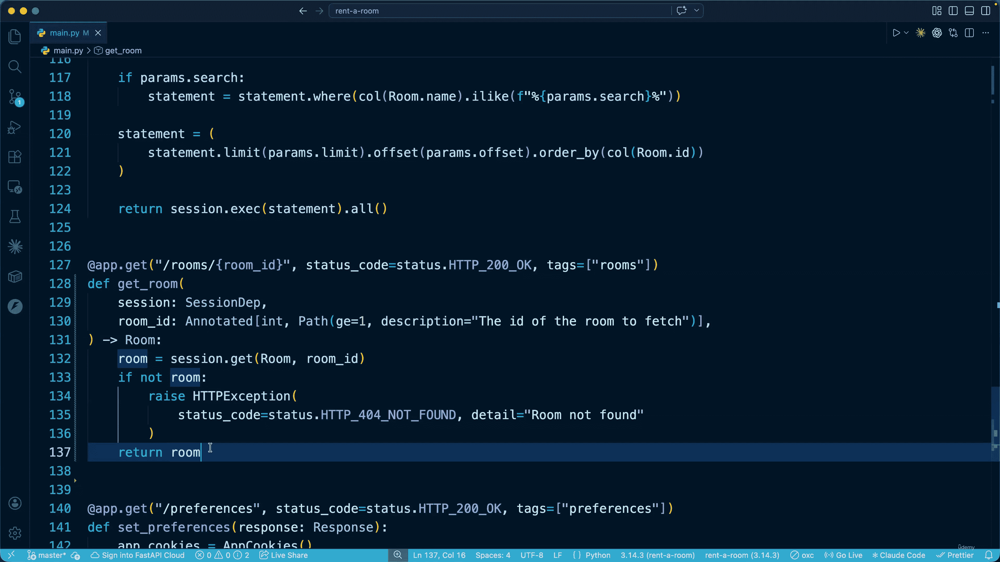
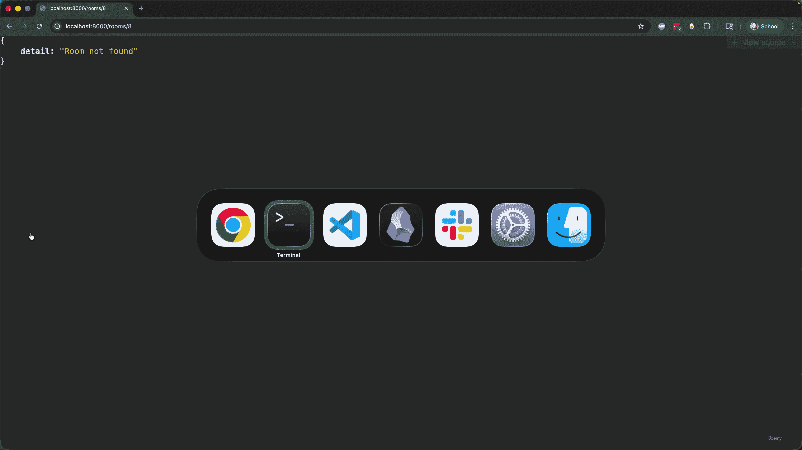
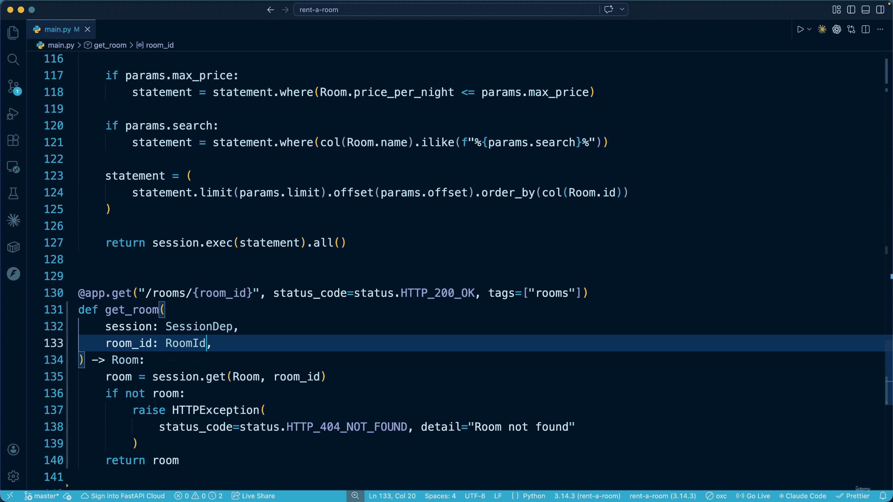

# FastAPI Masterclass：第68-69节：按ID获取单个房间 🚀

本节课我们来学习如何按 ID 获取单个房间。我们会对现有的路由进行改造，让它不再从内存列表里查找数据，而是从数据库的 rooms 表中获取真正的一条记录。在这个过程中，我们会使用 FastAPI 提供的 Path 函数来定义路径参数，还会用到 SQLAlchemy 的 session.get 方法执行单行查询。同时，我们会处理“房间不存在”时的 404 异常，最后再把常用的路径参数验证类型提取成一个可复用的类型别名。

## 1. 先看看要更新的路由

在之前的课程里，我们已经有了一个按 ID 获取房间的路由。它的作用很简单：用户访问类似 `/rooms/{room_id}` 的地址时，FastAPI 会从路径中取出 room_id 参数，然后返回对应的房间数据。现在我们要让这个路由和数据库真正地交互，所以会再次使用 session 来操作 rooms 表。和之前遍历整个列表相比，这次我们只需要根据 ID 提取一行数据，而这个 ID 正是路径参数 room_id 所代表的含义。

也许你会问，为什么不能继续使用旧的方式呢？因为旧的实现只是基于一个临时列表，数据无法持久化，也不够真实。在真实开发中，数据都是放在数据库里的，因此我们要把这段逻辑改成一次数据库查询。接下来，我们就一步步完成改造。

## 2. 认识 FastAPI 的 Path 函数

在动手修改代码之前，我们先来认识一个前面没有用到过的 FastAPI 工具，它叫 Path。你可以在文件顶部从 fastapi 中导入它。Path 的用法和之前见过的 Query、Cookie、Header 这些函数非常相似，本质上它就是一个 Pydantic 验证的包装器，用来对进入路由的某个数据项附加额外的验证规则。

我们可以把 Path 直接应用在路径参数上。这样做有两个作用：第一，它告诉 FastAPI 这个参数是从 URL 路径中解析出来的；第二，我们可以给这个参数加上各种限制。比如，对于一个整数参数，你可以用 `ge` 来限制最小值；对于一个字符串参数，你可以用 `min_length` 和 `max_length` 来限制长度。总而言之，只要是你希望加上的验证，几乎都可以通过 Path 来实现。

另外，在梳理代码的时候，我们还可以顺便把之前课程留下的一些没有用的临时代码清理掉。这些代码已经没有任何作用，留着只会干扰阅读。清理干净之后，我们再回到最底部的 get_room 函数，开始正式修改。

## 3. 重新设计 get_room 的依赖和参数

现在，我们需要在 get_room 函数里同时使用两个依赖。它们分别负责数据库访问和参数接收，下面是一个简单的说明：

- `session`：通过 SessionDep 注入数据库会话，这是我们在路由处理器中和数据库交互的唯一方式。
- `room_id`：从 URL 路径参数中解析出来的房间 ID，用于指定要查询哪条记录。

对于 room_id 这个参数，直接使用 `int` 类型是完全没有问题的。FastAPI 会自动把路径参数中的字符串转换成整数，省去了手动解析的麻烦。不过，如果你想在参数上附加更多验证和文档，就可以使用 `Annotated` 类型来写出更清晰的声明。具体写法是，在方括号的第一个位置放上 `int`，第二个位置放上 `Path()`，这和之前使用 Query、Cookie 的语法完全一样。

使用 Path 的优势立刻就能体现出来。比如，我们可以通过 `ge=1` 来要求房间 ID 必须大于等于 1，这也是 rooms 表中最小的房间 ID。也许你会觉得这个限制有些多余，但它很好地证明了我们可以通过 Path 函数来添加额外的验证，而且这些验证会在路由处理器运行之前自动执行。进一步，我们还可以使用 `description` 参数来扩充文档。比如，我们可以这样描述这个路径参数的含义：“要获取的房间 ID”。这样当用户查看交互式 API 文档时，就能立刻明白这个参数到底代表什么。虽然描述显得有些啰嗦，但给 API 的使用者提供充足的信息绝对不是坏事。

下面是更新后的函数签名示例：

```python
from typing import Annotated
from fastapi import FastAPI, Path, HTTPException

RoomID = Annotated[int, Path(description="The ID of the room to fetch", ge=1)]

@app.get("/rooms/{room_id}")
def get_room(room_id: RoomID, session: SessionDep) -> Room:
    # 函数体我们马上就会实现
    ...
```

在这个代码片段里，`Annotated[int, Path(...)]` 是核心。它表示 room_id 必须是从路径中获取的整数，并且值必须大于等于 1。当然，这只是一个示例，真正的查询逻辑还需要继续往下看。

## 4. 使用 session.get 查询单条记录

现在我们把函数体里的旧逻辑全部删掉。之前我们可能需要通过循环遍历列表，再逐个比较字典中的 id 字段，现在完全不需要这些操作了。我们要使用的是 session 对象上的一个专门方法，叫做 `get`。`get` 方法的设计目标非常明确：从数据库的某一张表中提取一条记录。

`session.get` 需要两个参数。第一个参数是模型类，这里我们传入 Room。通过这个模型，ORM 才能建立与 rooms 表的连接。第二个参数是要查询的记录 ID，也就是 room_id。这个值已经从路径参数中解析出来了，而且已经是一个整数。查询的结果会赋值给一个变量，我们叫它 room。

接下来，我们来理解 get 方法的返回行为。如果传入的 room_id 是有效的，也就是说 rooms 表中确实存在一行数据，它的主键等于这个 ID，那么 get 就会返回一个 Pydantic 模型对象，具体来说就是一个 Room 实例，并赋值给 room 变量。反过来，如果这个 ID 在表中不存在，那么 room 的值就是 None。

所以，我们需要对 None 的情况做判断。一个很自然的写法是 `if not room`。这个条件会检查 room 是否为一个假值，而 None 正好是假值。如果 room 是 None，我们就要抛出一个之前已经定义过的异常：HTTPException。这个异常会返回 404 状态码，表示请求的资源未找到。我们其实已经写过这个逻辑了，现在可以直接拿过来放在这里。当用户为数据库中不存在的记录提供了一个 ID 时，我们就应该返回这个错误，并且让错误信息清楚地说明到底哪里出了问题。

如果检查之后，room 是一个有效的 Pydantic 模型对象，那就可以直接把它返回给用户。同时，我们还可以把 get_room 的返回类型注解为 Room，也就是我们的 Pydantic 模型。这样一来，代码的意图就非常清晰了。



下面是完整的函数实现：

```python
@app.get("/rooms/{room_id}")
def get_room(room_id: RoomID, session: SessionDep) -> Room:
    room = session.get(Room, room_id)
    if not room:
        raise HTTPException(status_code=404, detail="Room not found")
    return room
```

这段代码非常简洁，但信息量很大。`session.get(Room, room_id)` 会根据主键去查询；`if not room` 处理查不到记录的情况；最后正常返回房间对象。到这里，我们已经完成了从数据库按 ID 获取单条记录的核心逻辑。

## 5. 在浏览器里测试一下

代码写完以后，我们切换到浏览器，看看实际效果。URL 还是我们熟悉的 `/rooms/{id}` 格式。比如访问 `/rooms/1`，这是一个存在的房间 ID，那么我们应该能够看到那个房间的数据。这次访问会真正向数据库发送请求，也就是说，我们正在和 SQL 打交道，查询 rooms 表，然后把那一条记录取回来。

反过来，如果我们访问一个不存在的 ID，比如 `/rooms/8`，那么 session.get 就会返回 None，接下来程序就会进入 `if not room` 这个分支，最终我们看到的将是“Room not found”这个 404 错误。整个过程非常直观，也符合我们之前的预期。

如果你想知道背后到底执行了什么 SQL，可以打开服务器日志。日志中会包含 SQLAlchemy 生成的 SQL 语句。你可以看到类似“从 room 表中选择所有列”的语句，而且 session.get 的过滤方式就是一个普通的 WHERE 子句。之前我们使用过 where 方法，这里其实是同一个道理，只不过现在只按一个条件过滤，也就是 room_id 这个主键。

在日志里，你还会看到 SQL 语句中有一个问号，比如 `WHERE room.id = ?`。这个问号代表一个动态值，这个值并不会直接拼进 SQL 字符串，而是稍后由程序单独传入。这样做有一个非常实际的好处：防止 SQL 注入攻击。恶意用户可能会尝试在参数里塞入一些危险的 SQL 代码，例如“删除数据库中的所有行”。ORM 提供的保护机制会确保这些值在进入 SQL 之前被清理干净，不会被当作代码执行。尽管在我们的场景里没有攻击者，但这就是为什么你会看到这种带问号的参数化查询语法。

## 6. 把 RoomID 提取成可复用的类型

功能已经正常工作了，不过我们还可以做一个优化。你注意到没有，在函数签名里，我们直接写下了一长串 `Annotated[int, Path(...)]`。如果以后还要写类似的路由，比如更新一个房间、删除一个房间，这些路由同样需要一个路径参数，而且类型几乎是完全一样的。因为无论是删除、更新还是获取，路径中的房间 ID 都指向同一个东西。



因此，一个很自然的想法就是把这整段类型定义提取出来，单独命名为 RoomID，放在所有路由声明的上方。比如可以放在现有的那些参数依赖定义下面。这样，RoomID 就成了一个类型别名，本质上代表一个整数，但同时附带了“必须来自路径参数、值必须大于等于 1”这两条验证信息。FastAPI 看到这种类型后，就会自动把它当作路径参数来解析。

这个类型别名的好处是，只要在其他地方声明了 RoomID，FastAPI 就会自动应用同样的验证逻辑，完全不需要重复写。现在，我们只需要把 get_room 函数里的参数类型改成 RoomID，就完成了本次重构。后面写其他路由时，也可以直接复用这个类型，从而避免代码重复。

这就是本节课想让你掌握的全部内容。我们来做个总结。

## 总结

本节课我们一起学习了如何把“按 ID 获取房间”的路由改造为真正的数据库查询。我们首先引入了 Path 函数，并用它作为路径参数的验证包装器，添加了最小值和描述等约束。然后我们更新了 get_room 处理器，使用 session.get 从 rooms 表中提取单条记录，并处理了房间不存在时的 404 异常。接着，我们通过浏览器测试了正常 ID 和不存在的 ID，也查看了 SQL 日志，理解了参数化查询和 SQL 注入防护的原理。最后，我们提取了可复用的 RoomID 类型别名，为以后的更新和删除路由做好了准备。



下一节课，我们会继续探索更多关于 FastAPI 和 SQLAlchemy 的内容。感谢阅读。
