# Udemy FastAPI 大师课 Part1：第69–70节：使用 PATCH 请求更新房间 🛠️

在本节课中我们将要学习如何给房间 API 增加一个更新房间的接口，也就是让房东可以更新自己创建的房间的任意属性或全部属性。比如房东打错字，把房间名称拼错，或者把卫生间数量、卧室数量填错时，就需要这样的接口。这个接口不负责新建房间，而是先从数据库取出已有房间，再更新它的一个或多个字段。课程还会介绍 HTTP 中 PUT 和 PATCH 的区别，说明为什么这里选择 PATCH，并演示 PATCH 接口的基本写法：查询记录、更新属性、保存回数据库。课程也会提醒，这个接口的初始设计并不完美，后面还会继续演进，下一节会到 Swagger 中测试并查看它的限制。

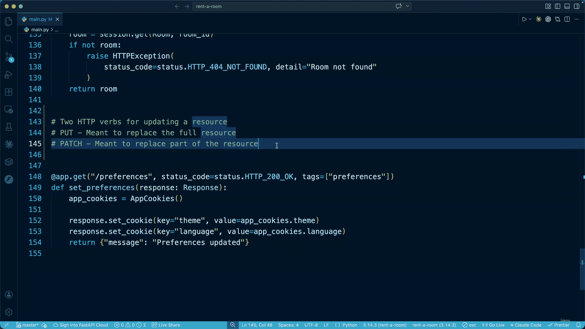

## Udemy FastAPI 大师课 Part1：第69–70节：更新房间接口的目标 🎯

上一节我们已经完成了房间相关接口的一部分基础工作，本节来看看更新房间接口到底要解决什么问题。这个接口的核心目标是让房东更新自己创建的房间，而且允许更新任意属性或全部属性。原文举了两个典型场景：房东把房间名称拼错，或者把卫生间数量、卧室数量填错。接口不会新建一条房间记录，而是根据房间 ID 从数据库中取出已有房间，再修改它的一个或多个字段。这样既符合“更新已有资源”的语义，也能避免误创建重复房间。

## Udemy FastAPI 大师课 Part1：第69–70节：PUT 与 PATCH 的区别 ⚖️

在进入代码之前，需要先理解 HTTP 协议中更新资源的两种方式。HTTP 协议提供两个用于更新的动词，分别是 PUT 和 PATCH。作者提到自己经常混淆这两个动词的区别，总是需要查资料确认。在多数代码库中，开发者通常选择其中一个并贯穿整个代码库保持一致，也可能看到两者混用的情况。规范上的设计目标可以用下面的公式概括：

\[
PUT = 全量替换资源
\]

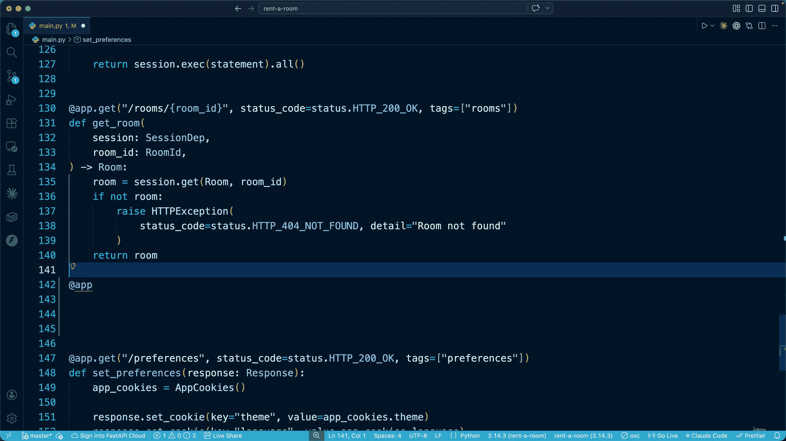

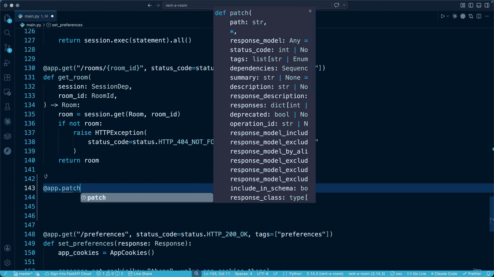

\[
PATCH = 部分替换资源
\]

为了把这两个动词的区别讲清楚，下面列出它们各自的设计目标：

- PUT 用于替换完整资源。比如针对一个已有房间，在单个请求中修改房间名称、卫生间数量和卧室数量等全部属性，这就是 PUT 想表达的操作。
- PATCH 用于替换资源的一部分。比如只修改四个列值中的一个或两个，而不是一次性替换全部字段。

因此，PUT 表示全量替换，PATCH 表示部分替换。本课程选择 PATCH，因为从语义象征上看更正确。我们希望房东可以自由修改任意属性或全部属性，最终提供的 payload 可以只有一个字段、两个字段或三个字段，接口要能支持这种意图。需要说明的是，这个接口在本节剩余部分还会继续演进，因为最初设计并不完美，下一节会看到不少问题。现在先介绍最基本语法：取出记录、更新属性、再保存回数据库。

## Udemy FastAPI 大师课 Part1：第69–70节：新增 PATCH 路由 🧭

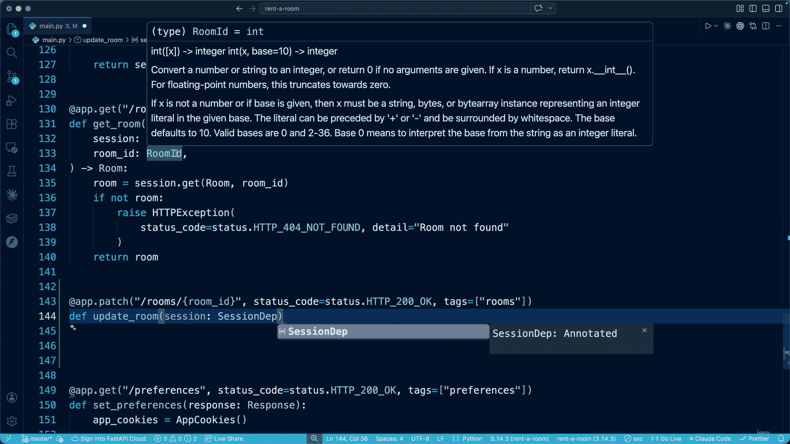

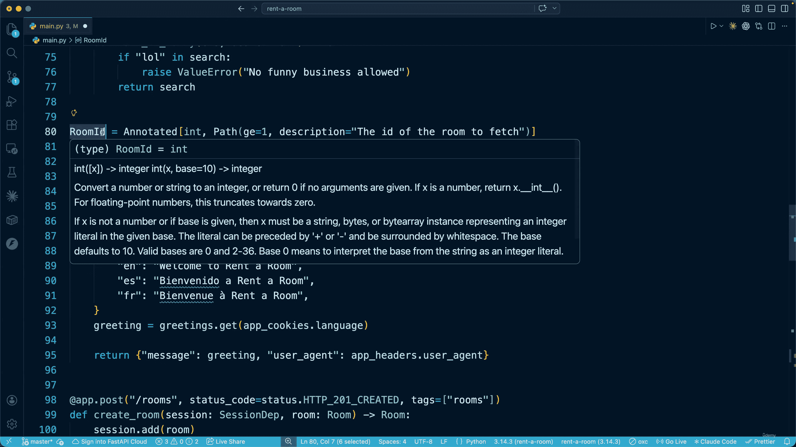

理解了 PUT 和 PATCH 的语义后，本节开始编写新的 PATCH 接口。先删除这些注释，然后在现有路由下方定义新路由，位置其实不影响结果。新路由会使用完全相同的路径，并通过路径参数指定房间 ID，但因为 HTTP 动词不同，FastAPI 能知道应该调用哪个对应的路由处理函数。这里同样访问 `app`，本次对应 PATCH 动词的方法就是 `patch`。代码结构如下：

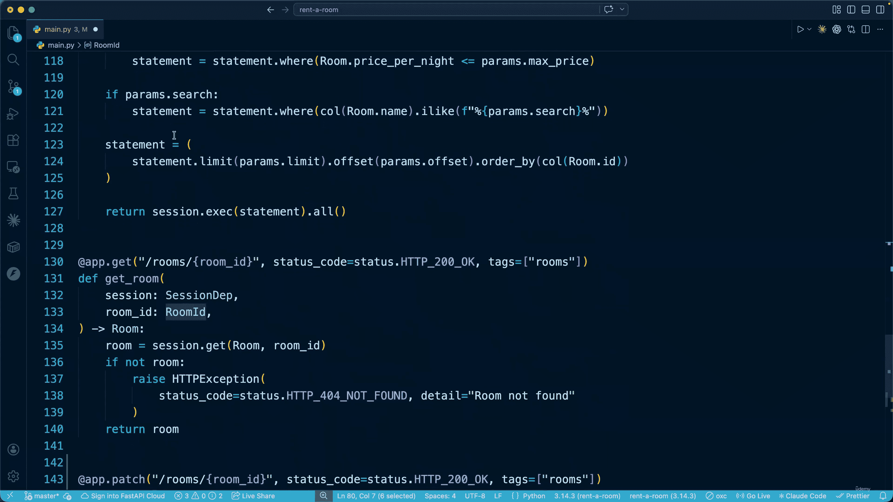

```python
@app.patch("/rooms/{room_id}", status_code=200, tags=["rooms"])
def update_room(
    room_id: room_id,
    room_payload: Room,
    session: Session = Depends(get_session),
) -> Room:
    ...
```

上面的写法与前面的路由非常相似。接口路径是 `/rooms/{room_id}`，其中 `room_id` 是路径中的动态部分，也就是路径参数，可以在函数签名中访问。状态码可以返回 `200 OK`，这里写为 `status_code=200`。标签提供 `tags=["rooms"]`，这样新路由会在生成的 Swagger 文档中归类到 rooms 标题下。函数名可以叫 `update_room`。

在编写路由处理函数时，需要关注以下参数和依赖：

- 需要 `session` 参数并设置为数据库 Session 依赖类型，因为要与数据库通信。这里需要与数据库交互两次：一次按 ID 查询已有房间，另一次覆盖某一行中的记录。
- 需要从路径中提取房间 ID。方便之处在于上一节已经定义了 `room_id` 类型，这个类型会从路径中提取整数并转换成整数，因此完全可以复用。这也是把它单独提取成类型的原因。
- 需要第三个也是最后一个参数，也就是 payload。它是客户端发送的 JSON 请求体，表示希望更新的字段，方式和 POST 接口接收初始字段并写入新行一样。
- 现在需要指定要更新的字段，先把这个参数叫 `room_payload`。后续会扩展模型，让它成为更动态的模型，支持 name、bathrooms、bedrooms 等任意可用属性。

不过现在先把 `room_payload` 的类型设为 Room 类型，这会带来一些额外问题。这样写本身是有效模型，但意味着每次向这个接口提交请求时，都必须提供所有必填字段，主要设计问题就在这里。现在先这样保留，从错误中学习。更新完成后，还希望把房间返回给用户，因此函数返回类型先写为 Room。

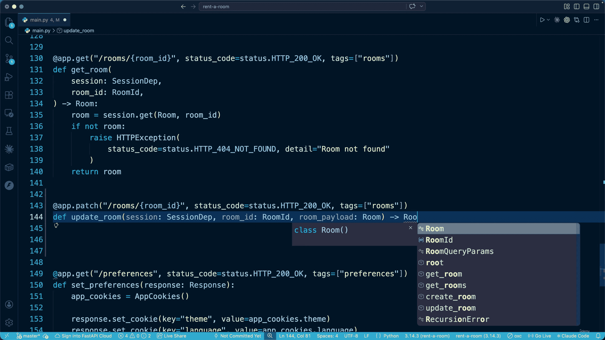

这里还要强调路径参数的关键点：默认情况下，尤其没有使用 `Path` 函数时，路径参数名必须与函数参数名匹配。不过在 `room_id` 类型内部已经显式使用了 `Path` 函数，这不仅增加 Pydantic 验证，也再次强化了 FastAPI 应从路径中获取该值。下面按与 GET 方法相同的方式提供参数 `room_id`，类型为 `room_id`，就能解析路径中的值。

## Udemy FastAPI 大师课 Part1：第69–70节：查询房间并准备更新 🔍

路由装配完成后，进入处理函数主体逻辑。处理函数中第一件事是按给定房间 ID 从数据库中查询房间。好消息是，这与上面函数中的逻辑完全相同，可以直接复制这些代码行并粘贴到下面。查询代码使用 session 的 `get` 方法定位房间表中的记录，房间模型会连接到该表；更具体地说，就是获取 ID 由 `room_id` 参数指定的那一行。代码如下：

```python
room = session.get(Room, room_id)

if room is None:
    raise HTTPException(status_code=404, detail="Room not found")
```

在上面的函数中，如果房间不存在就会抛出异常，这里也需要完全相同的逻辑，因为房间不存在时无法更新。这里不再把房间直接返回给用户，而是使用 `room_payload` 中的数据更新它，Room 对象上有一个方便的方法可以完成这件事。此时如果 `get` 成功且 `room` 不是 `None`，那么它就是 Room 模型，也就是一个 Pydantic 模型，拥有各种属性和方法。比如 bathrooms、bedrooms 等字段会作为属性存在，同时还存在一个名为 `sqlmodel_update` 的方法，两个单词之间有一个下划线。

这个方法的运作方式是接受多种不同对象，包括字典或另一个 Pydantic 模型。它会遍历传入对象，取出所有值，并用这些新值覆盖 `room` 中对应条目的值。简单例子是传入一个只包含一个键值对的字典，例如把 `bedrooms` 设为 5，它就会取出从数据库查询到的 room 模型，并把 bedroom 属性覆盖为 5。需要注意，此时代码只在 Python 中执行，还没有保存到数据库；只是更新了数据库中数据的对象表示，也就是在内存中更新 room 对象，之后仍需要提交到数据库。`sqlmodel_update` 的方便之处在于，传入对象可以包含任意多个属性，所以单个键的字典可以工作，多个键的字典也可以工作，例如把 bathrooms 设为 2.5，就会更新这两个字段。

如果继续查看 `sqlmodel_update` 的源码，可以看到它接受多种输入。字典有效，传入任何基于 Pydantic 的模型也有效，而这正是 `room_payload` 参数最终会使用的形式。`room_payload` 技术上以 JSON 到达，但由于声明的类型是 Room，Pydantic 会把它解析成基于 Pydantic 的模型，因此会进入 Pydantic 模型这一分支。这个分支内部做的事情本质上一样：遍历指定字典中的每个键值对，或者遍历传入的 Pydantic 模型中每个可用键或字段，然后更新调用 `sqlmodel_update` 的左侧 room 对象中的条目。当前意图是让 `room_payload` 不必提供所有房间属性；无论只给一个、两个还是三个字段，都希望这些条目填充并覆盖当前 room Pydantic 模型中的值。因此这里传入 `room_payload`：

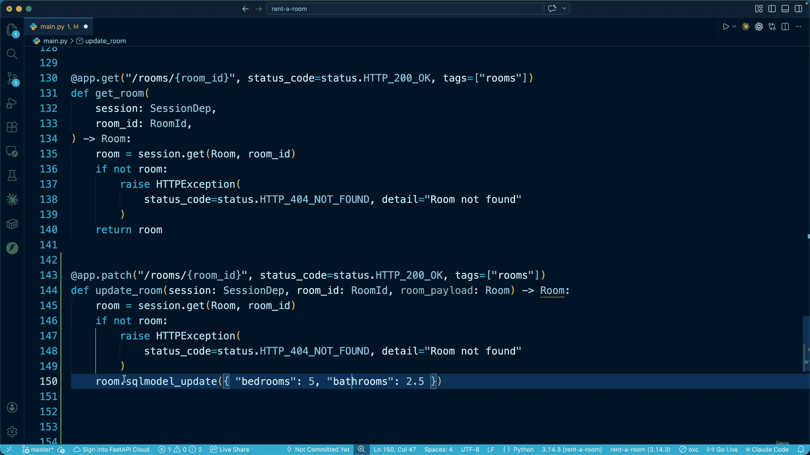

```python
room.sqlmodel_update(room_payload)
```

## Udemy FastAPI 大师课 Part1：第69–70节：保存更新并返回结果 💾

内存中的更新完成后，还需要真正保存到数据库。当前这些更改只存在于运行时代码中，因此要应用与 POST 路由中完全相同的保存逻辑。首先对 session 调用 `add` 方法，把当前已经带有更新字段值的 room 加入队列，准备写入；然后调用 `commit` 方法，真正向数据库发出提交，从而执行写入。随后调用 `refresh` 并把 room 传入。这一步可能不是严格必需，但始终是好习惯，可以确保 Python 侧的对象或模型与数据库完全同步。此时对象理论上应该已经是最新的，因为已经把 payload 中最新的属性写入这个 room 版本，但再查询一次数据库确认 room 与已保存行完全一致没有坏处。最后把 room 返回给用户。整体逻辑可以按下面几个步骤理解：

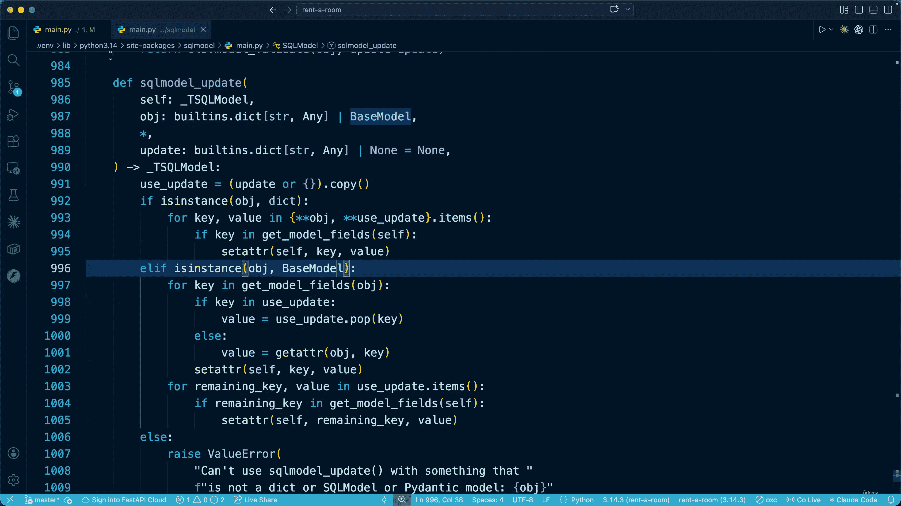

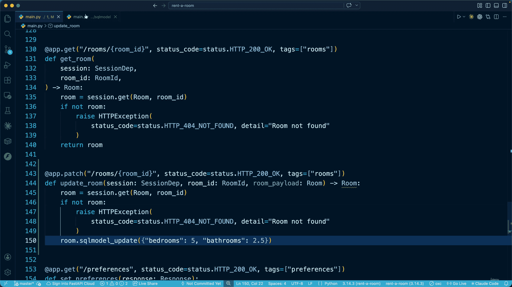

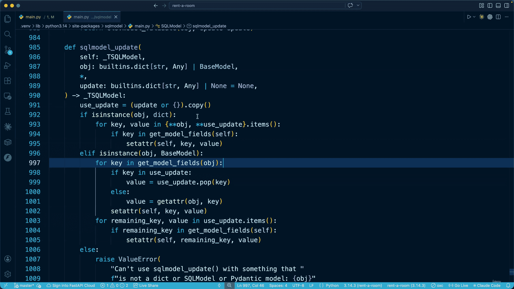

- 使用 `session.get(Room, room_id)` 按 ID 查询房间。
- 如果房间不存在就抛出异常，因为不能更新不存在的房间。
- 使用 `room.sqlmodel_update(room_payload)` 在内存中覆盖字段。
- 使用 `session.add(room)` 排队修改，使用 `session.commit()` 提交，再使用 `session.refresh(room)` 刷新对象。
- 最后 `return room`，把更新后的房间返回给客户端。

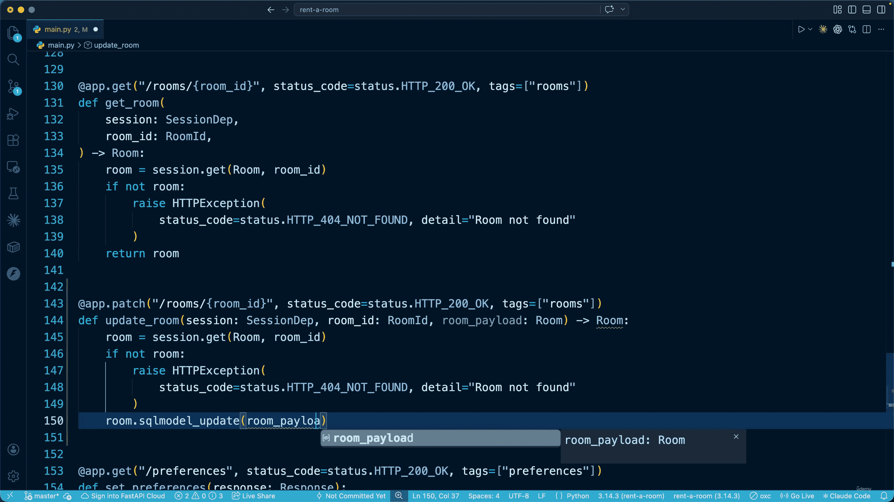

对应代码可以组织如下：

```python
room = session.get(Room, room_id)

if room is None:
    raise HTTPException(status_code=404, detail="Room not found")

room.sqlmodel_update(room_payload)

session.add(room)
session.commit()
session.refresh(room)

return room
```

这就是第一个 PATCH 接口，用于部分更新资源。下一节会到 Swagger 中测试这段代码，并查看它当前设计带来的一些限制。

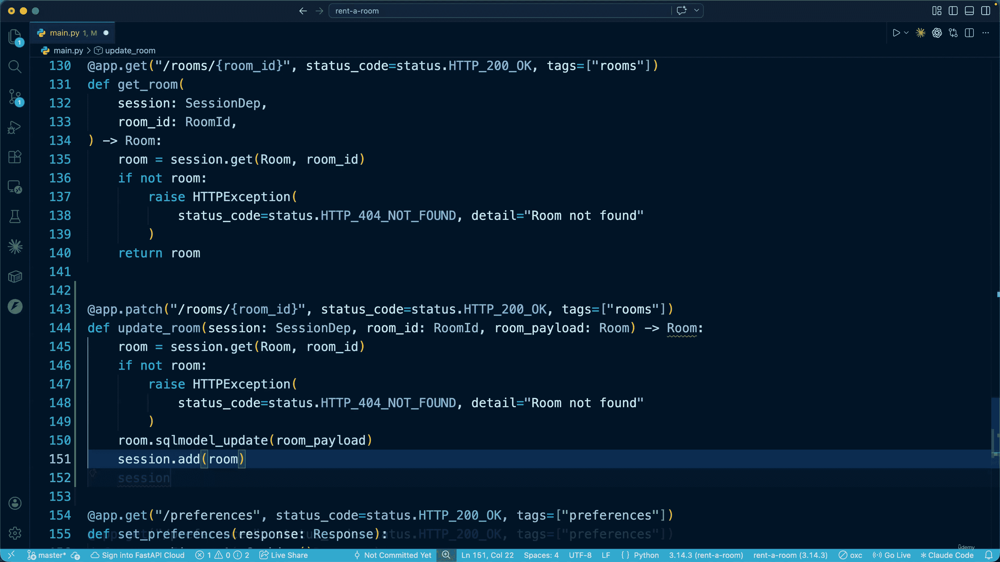

## Udemy FastAPI 大师课 Part1：第69–70节：本节总结 📝

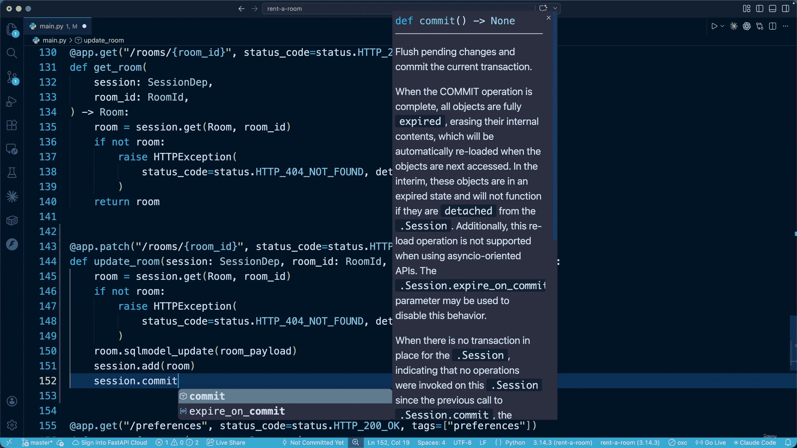

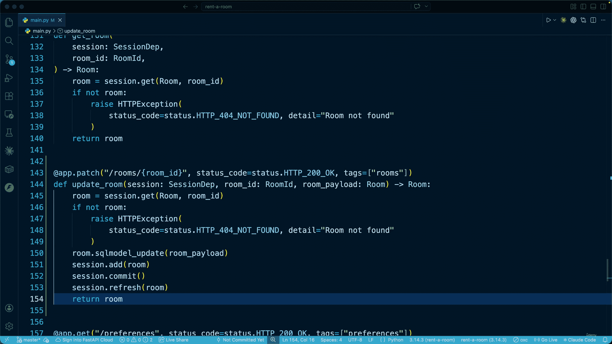

本节课中我们一起学习了如何为房间 API 增加 PATCH 更新接口，理解了 PUT 表示全量替换资源、PATCH 表示部分替换资源，并选择用 PATCH 支持房东更新任意字段或全部字段。我们还完成了新路由的基本写法，使用可复用的 `room_id` 类型解析路径参数，通过 `session.get` 查询房间，使用 `room.sqlmodel_update(room_payload)` 在内存中覆盖字段，再通过 `session.add`、`session.commit` 和 `session.refresh` 保存并同步数据库，最后返回更新后的房间。还需要记住，当前先用完整 Room 类型作为 payload 会导致请求必须提供所有必填字段，这是后续要改进的主要设计问题，下一节会在 Swagger 中测试并查看这些限制。

