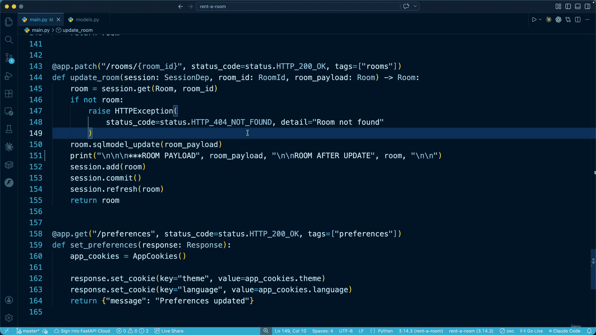
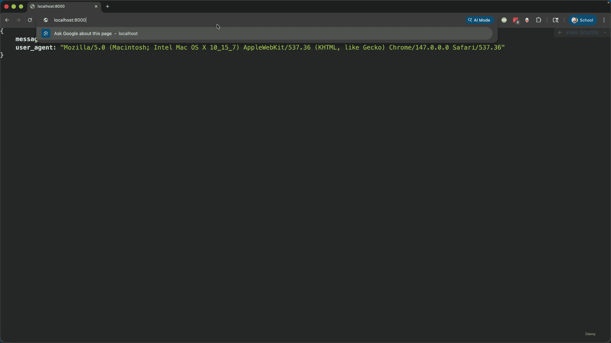
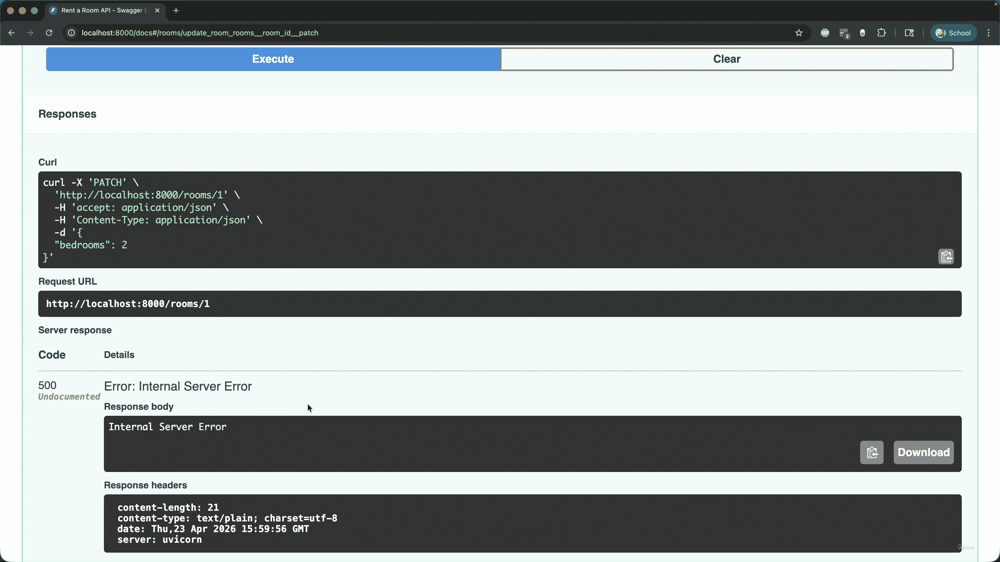
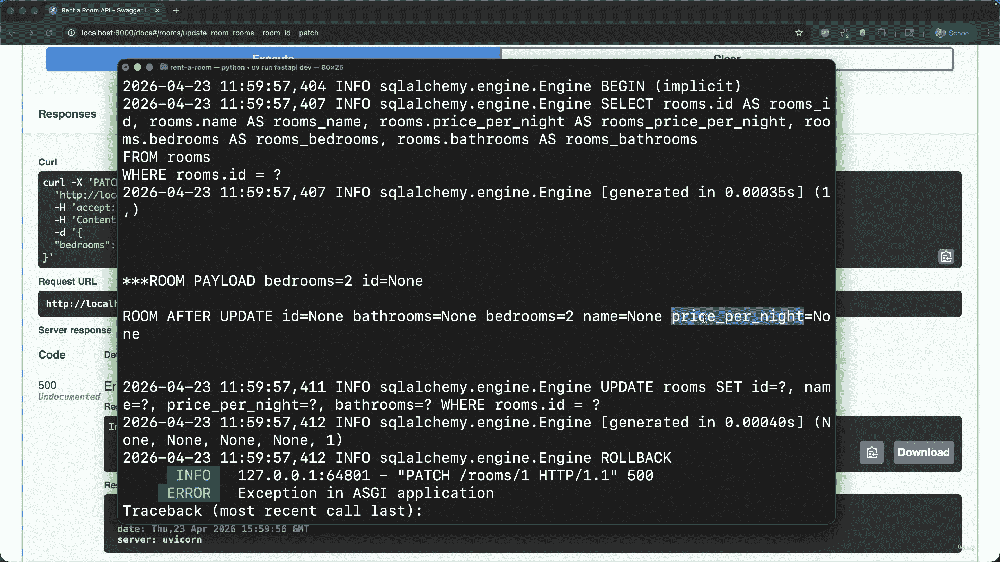
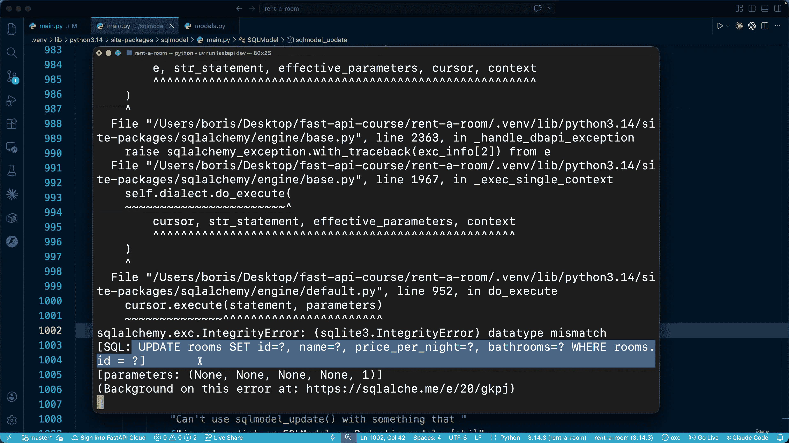
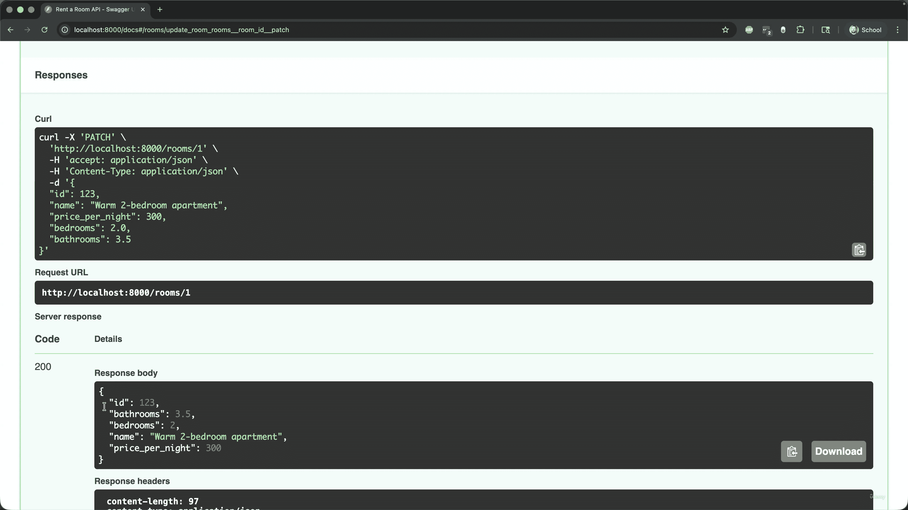
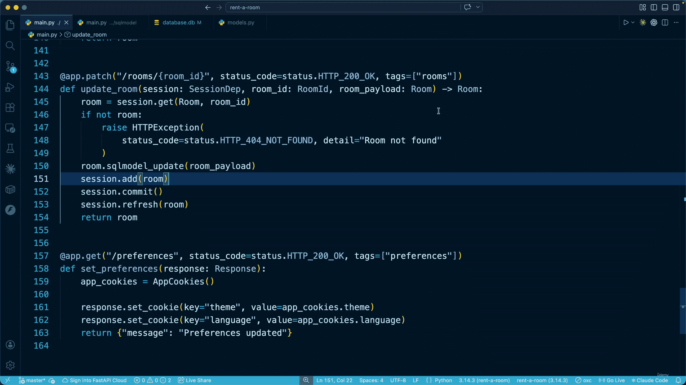

# 🧭 FastAPI 大师课：第71节：Room 模型设计问题

## 📌 FastAPI 大师课：第71节：本课概述

在本节课中我们将要学习 `Room` 模型当前设计存在的问题，重点是通过 Swagger 文档验证新的 `PATCH` 接口，并观察一个模型同时承担多种角色时会出现哪些典型缺陷。上一节我们已经完成了 `PATCH` 接口的基础代码，本节中我们来看看它为什么“表面能用、实际不理想”，以及这些问题会如何影响创建、更新、数据库写入和响应返回。课程会先演示当前代码的 bug，再解释 bug 的根源，最后给出后续重构方向。为了让初学者更容易理解，本课会把模型想象成“数据模板”：同一个模板如果既当创建表单、又当更新表单、还当数据库表和返回结果，就很容易互相打架。

## 🧱 FastAPI 大师课：第71节：一个模型承担太多角色

接下来待办事项中的下一步，是在 Swagger 文档里使用 `PATCH` HTTP 方法验证新的补丁接口。这里需要再次强调：当前代码并不理想，里面有不少 bug 和缺陷；保留这些代码的目的是展示我们如何以及为什么会走向最终的理想方案。当前设计的根本问题在于，我们试图用单个 Pydantic `Room` 模型来表示或建模很多不同的想法。作为提醒，打开 `models.py` 文件可以看到这里只有一个模型，它映射到数据库中的 `rooms` 表。

下面列出这个 `Room` 模型当前承担的角色，可以看出它被复用得非常厉害。

- 它表示创建房间时发往服务器的 payload。
- 它也表示更新房间时的 payload，但创建房间需要所有属性，更新房间不应该要求所有属性。
- 部分更新的意图是用户可以只提供一个字段，例如先更新 `name` 和 `price_per_night`，下一次请求再更新 `bedrooms` 和 `bathrooms`，四个字段可以有任意组合。
- 它还被当成连接 `rooms` 表的实际连接层。
- 最后，它还被用来表示任意接口返回给用户的响应。

从这些角色可以看到，一个类不足以建模所有这些不同想法，它们之间存在差异。我们一直努力减少总代码量并依赖单一模型，但这种方式不会像期望中那样工作。本课会展示这些问题。用公式可以直白表示为：





\[
\text{RoomModel} = \text{创建 payload} + \text{更新 payload} + \text{数据库连接层} + \text{响应模型}
\]

这个公式看起来省事，实际会让不同场景互相污染。接下来我们回到 `main` 文件，通过打印日志观察请求进入服务器后发生了什么。

## 🖨️ FastAPI 大师课：第71节：打印请求数据和更新后对象

上一节我们说明了单一模型承担过多角色的问题，本节中我们来看看实际请求中数据是如何流动的。这里会添加一点输出代码，每当向服务器发出请求时，就把一些内容打印到服务器日志。这部分代码不要求跟着敲，但可以通过它看清正在发生什么。这里添加 `print` 函数，并因为服务器日志会比较多，先加几个换行来区分输出。先加几个星号，再写类似 `room payload` 的内容，然后展示 `room payload` 的形状；也就是 `PATCH` 请求流入的数据，代表我们想更新的属性。之后再加几个换行，继续展示数据库更新后的实际 `room` 对象，所以在上一行 `SQLModel` 更新调用之后输出 `room`。

下面是演示用的日志打印思路，不需要完全照抄。

```python
print("\n\n*** room payload ***")
print(room_payload)

# 执行 SQLModel 更新之后
print("\n\n*** room after update ***")
print(room)
```

这些打印只是为了观察，课程结束时会删除。现在回到浏览器，导航到 `http://localhost:8000/docs`，可以看到新的 `PATCH` 接口。展开并点击 `Try it out`，需要提供房间 ID 的路径参数。更新数据库里的哪条记录并不重要，这里只是为了示例，所以假设提供 ID 为 `1` 的房间。下方是请求体，也就是发送给服务器的数据形状。

这里要记住：这个接口的意图是所有属性都应该是可选的。事实上，我们甚至不想发送 `ID`，因为 `ID` 会由路径参数提供。但因为这里的 schema 和 `Room` 模型耦合在一起，而 `Room` 的 Pydantic 模型定义了 `ID` 字段，这个字段可以是整数或 `None`，所以根据模型定义生成的 Swagger 文档会假定 payload 包含 `ID`。其实不需要这样做，因为房间 ID 会从路径中获取；但因为同一个模型到处复用，Swagger 文档就产生了这个假设。这一点并不理想。更严重的技术问题还在后面：除非 payload 包含所有这些字段，否则这个接口不会工作。



## 🐞 FastAPI 大师课：第71节：第一个问题：所有字段都被要求必填

上一节我们看到了 Swagger 中请求体的形状，本节中我们来看看只更新一个字段会发生什么。举例来说，如果只想更新 `bedrooms` 一个字段，可以删掉其他代码，发送一个 JSON payload，把 `bedrooms` 设置为新值 `2`，并确保删除末尾多余的逗号。理想情况下，这个接口应该允许提供任意数量的字段，并更新 ID 为 `1` 的房间的 `bedrooms` 列。执行后却会得到 `500 Internal Server Error`，说明服务器端出了问题。

下面是理想中的部分更新请求，只传一个字段。

```json
{
  "bedrooms": 2
}
```



接下来查看服务器日志。FastAPI 服务器里有错误信息，向上滚动到 `print` 函数输出的位置。因为处于错误状态，输出会比较多。这里可以看到进入服务器的 `room payload` 和更新后的 `room`。实际流入的数据里，`bedrooms` 被设置为 `2`，而 `ID` 被设置为 `None`，这可以预测，因为 `Room` 模型中的 `ID` 字段默认值是 `None`。这个 `room payload` 被发送到实际的 `SQLModel` 更新调用中，仅这一点就已经不好，因为我们要求所有属性都覆盖到核心对象上，也就是从 `rooms` 表取出的数据库数据表示。我们甚至要求把 `ID` 设置为 `None`，这没有意义。我们应该确保省略对 `ID` 的设置，因为 `ID` 是唯一不应该被更新的属性；一行数据写入后，`ID` 就固定了。这是第一个问题。

再看更新后的 `room`。这是 `SQLModel` 更新方法调用之后的对象，也是我们尝试加入会话并提交到数据库、让 ORM 生成相应 SQL 查询的对象。这里发生的情况很有意思：`bathrooms`、`name`、`price_per_night` 等属性也被设置成了 `None`。这个奇怪现象来自模型既来自 `SQLModel`，又连接着数据库表。回到代码点击 `SQLModel` 的更新方法，可以看到我们传入的是 `room_payload`，它是一个 Pydantic 模型。实际发生的是：遍历传入对象时，它会取出 Pydantic 模型的全部字段，甚至包括没有显式设置的字段。例如 Pydantic `Room` 模型没有设置有效的 `name`，也没有设置 `price_per_night`，但它仍然获取所有模型字段，并尝试把这些字段和值设置到从数据库取出的对应 `room` 对象上。因为这些字段在技术上根本没有设置，所以实际会回退为 `None`。因为 `price_per_night` 没有提供但存在于 Pydantic 模型中，数据库记录对象的 `price_per_night` 就被设置成了 `None`；其他没有提供的字段也一样。

最终回到终端，会看到一团混乱：试图把原本 ID 为 `1` 的 `room` 记录写入数据库，却把 ID 设为 `None`、`bathrooms` 设为 `None`、`name` 设为 `None`、`price_per_night` 设为 `None`。这会触发一条非常离谱的 SQL 语句，在 SQL 侧完全破坏。这里不会损坏数据或丢失数据，但服务器会按预期返回错误，数据库调用失败，整个流程完全坏掉。第一个主要问题就是：当前这个接口要求 payload 提供所有实际属性才能工作。再次强调，这不理想，是当前设计的缺陷，后续会修复，但当前代码就是这样工作的。

## 🧪 FastAPI 大师课：第71节：在 Swagger 中提供完整 payload 才能成功

上一节我们看到缺字段会导致 500 错误，本节中我们来看看提供完整 payload 后为什么能成功，以及为什么这种成功也很别扭。回到浏览器，在 Swagger 文档中提供一个有效 payload。唯一能工作的方式是模型上的五个属性全部存在。这里甚至可以用 `Command + Z` 回到全部字段都出现的样子，然后可以看到甚至 `ID` 也必须提供。这很烦人，因为用户已经在路径参数里提供了房间 ID，但这里又必须重复一遍。这里显然还必须提供所有属性；如果想保持数据库现有值，就基本要复制完全相同的字符串，这很烦人。现在这些值本身不重要，只是示例，所以可以把 `name` 设置为类似 `warm two bedroom apartment`，把 `price_per_night` 设置为 `300`，`bedrooms` 设置为 `2.0`，`bathrooms` 设置为 `3.5`。再次注意，每个键值对后面要有逗号，最后一个不加；JSON 键都要用双引号包裹。



下面是一个能通过当前接口的完整 payload 示例。

```json
{
  "id": 1,
  "name": "warm two bedroom apartment",
  "price_per_night": 300,
  "bedrooms": 2.0,
  "bathrooms": 3.5
}
```

执行后向下滚动，可以看到请求成功，返回 `200`。现在成功命中了 ID 为 `1` 的房间的 `PATCH` 接口，甚至还把 ID 作为模型字段或请求 payload 属性传了进去，这很烦人；然后成功更新数据库，把这些值填充到 ID 为 `1` 的行。再次回到第一个问题：这个接口把 `rooms` 表模型当作传入 payload 的形状，导致现在所有属性都必须存在。如果不存在，Pydantic 在更新表示现有房间的数据库对象时会回退到 `None`，然后整个数据库更新调用会失败，因为会在 `price_per_night`、`ID` 等列上设置 `None` 值，而 `ID` 需要实际有效值。所以第一个问题是所有属性都必须存在，包括不应该更新的 `ID`，这一点不好。

## 🚨 FastAPI 大师课：第71节：更严重的问题：ID 可以被请求体篡改

上一节说明了字段必填带来的麻烦，本节中我们来看看更严重、更丑陋的 bug。因为进入服务器的 `room payload` 现在要求 `ID` 属性，而且我们没有做任何数据验证；当然，我们验证了 `ID` 必须存在，但这是把 `Room` 模型用于 `room payload` 参数的不幸副作用。现在，进入服务器的 payload 可以把 `ID` 设置成任意值，而且会实际更新 `rooms` 表中该记录的 `ID` 列。这是大灾难，在 SQL 中是大忌，因为我们实际上覆盖了 `ID`，而 `ID` 本应是该行稳定的主标识符。

例如，在路径参数中指定 ID 为 `1` 的房间，也就是请求 `/room/1`，然后假设把数据库中记录的实际 ID 改成 `123`。执行后会看到返回 `200`，房间的 ID 实际上从 `1` 更新成了 `123`。回到 VS Code，在文件资源管理器中打开 `database.db` 里的 `rooms` 表，记得刷新。点击查看后可以看到现在有一个 ID 为 `123` 的房间。原本的 first room ID 是 `2`，然后是 `3`，然后到了 `123`。这说明我们开始操作数据库中绝对不应该被触碰的列。

下面的代码块展示这个危险操作的核心问题：请求体中的 `id` 覆盖了路径参数指向记录的主键。

```json
{
  "id": 123,
  "name": "warm two bedroom apartment",
  "price_per_night": 300,
  "bedrooms": 2.0,
  "bathrooms": 3.5
}
```

> 注意：当前代码只是教学过渡版本，存在设计缺陷；后续会回来修正。

好消息是这里玩的都是模拟数据和人为构造的数据。如果想从头创建数据库，只需要删除 `database.db`，然后重新启动服务器，再创建想要的合法房间，它们会按照 `1、2、3` 等正确 ID 顺序重新创建。但这进一步强化了本课的中心思想：这个设计真的不理想，因为我们试图用完全相同的模型表示很多不同想法。

## 🛠️ FastAPI 大师课：第71节：拆分模型与后续安排

上一节我们看到 ID 被篡改的严重后果，本节中我们来看看正确的设计方向。最终需要把这个模型拆成多个模型，让它们分别表示不同想法：创建房间的 payload、更新房间的 payload，以及返回给用户时的房间形状，后者还可以用于隐藏或模糊某些字段。我们为了最小化代码而持续复用同一个模型，尤其是复用连接数据库表的模型，这实际上是计划中的致命缺陷。展示这种方法是因为它是 FastAPI 社区中的常见错误，尤其在使用 `SQLModel` 时。



下面是后续拆分模型时需要覆盖的角色，列表前先说明这些角色应该彼此分开。

- 创建房间 payload：通常需要完整字段。
- 更新房间 payload：字段应该可选，并且不应允许更新 ID。
- 数据库表模型：只负责和 `rooms` 表映射。
- 响应模型：只负责返回给用户的数据形状。

为了清理本课现场，删除刚才添加的那一行打印代码。下一节可能会进入下一个主题，但后续会回到这些代码并更新它们，确保修复这类底层设计问题。表面层面上，我们确实可以成功更新一个房间，所以可以走“happy path”：给 `PATCH` 接口提供包含所有属性的 payload，包括不幸的 `ID`，而且所有属性都必须存在。这个 happy path 并不理想，因为它充满缺陷，但技术上仍然可以在数据库中更新一个合法房间。目前先保留这部分代码，后续会回来把它改得更好。

## ✅ FastAPI 大师课：第71节：本课总结



本节课中我们一起学习了 `Room` 模型设计中的核心问题：单个 Pydantic 模型同时承担创建 payload、更新 payload、数据库连接层和响应模型，导致 `PATCH` 接口要求所有字段必填，并且允许请求体篡改 `ID` 主键。我们还通过 Swagger 和服务器日志观察了 `SQLModel` 更新时未提供字段回退为 `None` 的过程，理解了数据库调用失败的原因。最后我们明确了后续方向：把单一模型拆分为多个职责清晰的模型，分别服务创建、更新、数据库映射和响应返回。当前代码只是教学过渡版本，后续会回到这里修复这些底层设计问题。

