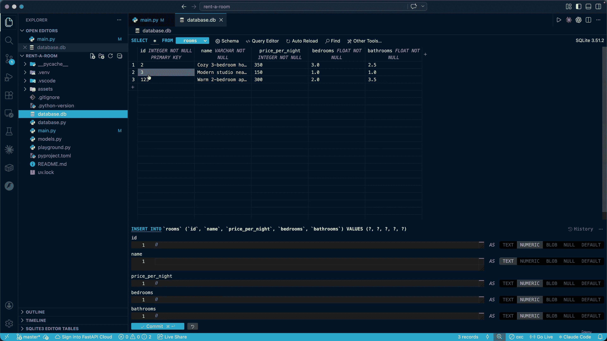
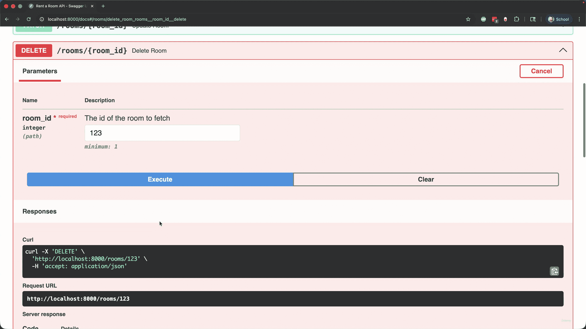
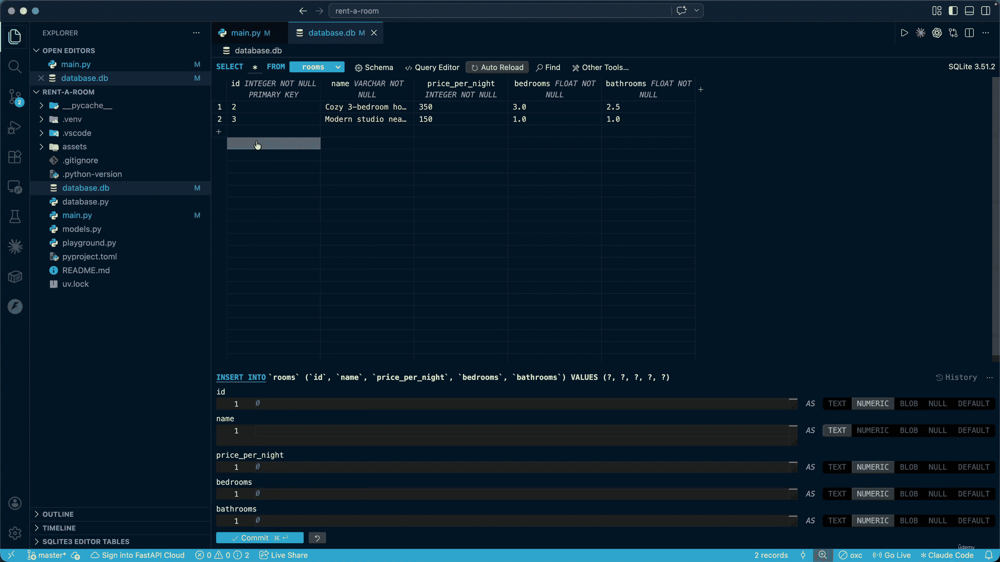
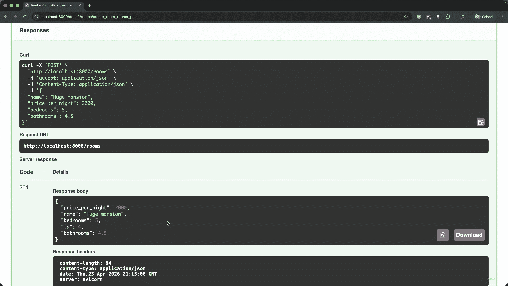

# 🚀 FastAPI 大师课：第71-72节：删除房间接口

在本节课中，我们将学习如何在 FastAPI 中为“房间”资源新增删除接口，从而补全 CRUD 中的删除操作。我们会先说明一点：之前在使用 room model 以及 update room 函数时看到的问题，我会很快开始修复；但在进入重构和清理之前，还需要先增加一个删除房间的路由。这个路由会删除 rooms 数据库表中对应的那一行记录。接下来，我们会围绕 HTTP DELETE 动词、路径复用、数据库删除流程、状态码选择、Swagger 测试、数据库 ID 自增影响以及 POST 请求模型问题展开说明。

## 🧩 FastAPI 大师课：第71-72.1节：CRUD 与删除路由

上一节我们处理了更新房间的逻辑，本节中我们来看看删除房间的接口。之前在课程中提到过 CRUD 这个缩写，它代表 Create、Read、Update、Delete，也就是创建、读取、更新、删除。我们已经有一个创建函数，也就是 POST 请求；已经有一个读取单个房间的函数，也就是获取单个房间；现在也有一个更新单个房间的函数；最后缺少的 D 就是 deletion，也就是删除。现在的目标是新增一个删除房间的端点，它会把 rooms 数据库表中对应的行删除掉。

下面是 CRUD 的核心含义，可以用一个简单公式表示：

```text
CRUD = Create + Read + Update + Delete
```

在 FastAPI 中，这些操作通常对应不同的 HTTP 动词。以下是 CRUD 与 HTTP 动词之间的对应关系：

- Create 对应 POST，用来创建资源。

- Read 对应 GET，用来读取资源。

- Update 对应 PATCH，用来更新资源。

- Delete 对应 DELETE，用来删除资源。

在代码中，这种映射可以写成下面这样：

```text
GET    = 读取资源
POST   = 创建资源
PATCH  = 更新资源
DELETE = 删除资源
```

接下来，我们会从 `app` 开始，引入一个新的 HTTP 动词，名字可以预料到就是 `delete`。这个动词表示我们希望删除服务器上的某个资源。GET 用来获取，POST 用来创建，PATCH 用来更新，DELETE 用来删除。这里可以复用完全相同的路由路径，因为同一个路由可以支持多个 HTTP 动词。我们要引用的房间仍然需要一个标识符，可以通过 room_id 路径参数来指定。

同一个路径可以被不同 HTTP 动词复用，示意如下：

```python
@app.get("/rooms/{room_id}")      # 读取房间
@app.patch("/rooms/{room_id}")    # 更新房间
@app.delete("/rooms/{room_id}")   # 删除房间
```

这样一来，就可以向完全相同的端点发起请求，例如根据房间 ID 获取房间、根据房间 ID 更新房间，或者根据房间 ID 删除房间。路径部分可以直接复制之前写过的部分，因为路径结构保持一致，变化点在于 HTTP 动词和函数内部的处理逻辑。

## 🛠️ FastAPI 大师课：第71-72.2节：定义删除函数与数据库操作

上一节我们确认了删除路由可以复用已有路径，本节中我们来看看删除函数内部应该怎么写。删除成功时，可以返回 200 状态码，并把房间返回给用户。把被删除的房间返回给用户并不是技术上的硬性要求，但我喜欢这样做，因为客户端如果愿意，可以拿到刚删除的记录并展示在屏幕上，例如提示“这是刚刚删除的记录”。不过需要指出，如果希望端点不返回任何内容，只是告诉客户端“请求成功了，但没有数据可以返回”，可以使用一个互补的状态码，也就是 204。204 的完整含义是 No Content，表示服务器说这次请求成功，但没有内容或数据返回给客户端。本次我们会把被删除的房间返回给用户，更准确地说，是返回该对象的 JSON 表示，因为房间在数据库中将不再存在，因此这里选择 200 OK 状态码。

删除接口的示意代码如下：

```python
@app.delete("/rooms/{room_id}", status_code=200)
def delete_room(
    room_id: int,
    session: Session = Depends(get_session),
):
    room = session.get(Room, room_id)

    if not room:
        raise HTTPException(status_code=404, detail="Room not found")

    session.delete(room)
    session.commit()

    return room
```

下面定义函数，名字可以叫 `delete_room`。这里仍然需要和数据库交互，因此提供 session 参数，设置为依赖注入的 session。然后需要根据房间标识符提取房间，因此提供 room_id 路径参数，并使用可复用的房间 ID 类型。这里的模式和之前的代码非常相似，因为在真正删除房间之前，需要先从数据库取出这条记录，这样才有一个 room 对象，也就是 ORM 中的 room model 实例，然后再把这一行的删除操作排队。同时，需要先确认这个 room_id 对应的房间确实存在，然后才能删除。

以下是删除接口的处理步骤，方便初学者按顺序理解：

- 接收数据库 session 和 room_id 路径参数。

- 使用 room_id 从数据库中查询对应的房间记录。

- 如果房间不存在，就抛出 HTTPException，状态码为 404 Not Found。

- 如果房间存在，就调用 session.delete 把删除操作加入队列。

- 调用 session.commit 真正执行删除。

- 返回被删除的 room 对象，FastAPI 会把它转换成 JSON 返回给客户端。

这里可以复制之前查询房间的代码段并粘贴到下面。关于这些代码重复的问题，不用担心，后面会找到更好的方式复用这些公共代码，只是现在先保留重复写法。此时，如果给定的 room_id 在 room 表中不存在，就会抛出 HTTPException 404 Not Found。如果代码走到后面，说明房间确实存在。这里使用 session 对象时，不再使用 add 方法；add 方法用于把某种新增操作加入队列，例如写入、创建记录或更新记录。对于删除，需要使用一个互补的方法，也就是 delete。调用 delete 时，仍然传入表示要删除条目的 Python 对象或 ORM 模型实例。这里传入已经查询到的 room，ORM 会找到这个 room 对象对应的数据库行，也就是这个给定 ID 的那一行；真正执行删除要等到调用 commit 时才会发生。

需要特别说明，此时还没有真正发出 SQL 删除语句，只是把最终删除操作加入队列；删除真正发生是在调用 commit 方法时。本次不需要调用 refresh 方法，事实上调用 refresh 可能触发错误，因为删除之后已经没有东西可以刷新。执行删除语句后，这个 room 对象在 room 表中不再有对应的行，因此没有可刷新的内容。此时可以返回 room 对象，它代表一行已经不再存在的记录；这只是一个 Python 对象表示，是那一行曾经存在过的残留表示。随后 FastAPI 会把它转换成 JSON 并发送回用户。下一次用户请求删除完全相同的 room_id 时，将无法再查询到它，因为对应 ID 的行已经不存在。因此，如果用户第二次对同一个 room_id 发起删除请求，就会进入前面的 if 判断，抛出异常并返回 404 Not Found。

## 📬 FastAPI 大师课：第71-72.3节：返回状态码与响应选择

上一节我们完成了删除函数的数据库操作流程，本节中我们来看看删除成功后应该返回什么状态码。删除成功时返回 200，并把被删除的房间返回给用户，这样客户端可以展示刚删除的记录。这个返回对象不是技术要求，但它是很实用的做法。如果不希望返回任何数据，可以使用 204 No Content。204 表示服务器成功处理了请求，但这次没有内容或数据返回给客户端。因为本次会返回被删除房间的 JSON 表示，而该房间在数据库中已经不存在，所以选择 200 OK 更合适。

两种常见选择可以用下面的公式表示：

```text
删除成功 + 返回被删除对象 -> 200 OK
删除成功 + 不返回响应体     -> 204 No Content
```

> 注意：204 表示成功但没有响应内容；200 表示成功并且可以返回响应体。选择哪一种取决于客户端是否需要拿到被删除的数据。

## 🧪 FastAPI 大师课：第71-72.4节：在 Swagger 中测试删除接口

上一节我们确定了删除成功后的响应方式，本节中我们来看看如何在 Swagger 文档中实际测试删除请求。先保存代码，然后进入 Swagger 文档练习发起删除请求。在进入 Swagger 之前，先检查数据库文件 database.db。这里想删除的一行是 ID 为 123 的记录，这一行是上一节 update 端点出现问题时留下的结果。现在删除这个 ID 为 123 的行。如果你的数据库行和我的不同步，完全没有关系；行数少一些或多一些都可以，如果想删除其他标识符的记录也完全可以。这里练习的是核心概念，具体数据不需要完全一致。

回到 Swagger 文档后刷新页面，会看到新的删除端点。注意，这三个端点的实际路由或路径完全相同，之所以能同时支持它们，是因为 HTTP 动词不同，分别是 GET、PATCH 和 DELETE。现在点击删除接口的 Try it out，在要删除的房间标识符中传入 123。第一次执行应该成功。向下滚动可以看到请求使用的 HTTP 动词是 DELETE，下方成功返回 200，响应体是被删除房间的形状，其中可以看到标识符 123。这个房间已经不再存在于 room 表中。

以下是测试删除接口时可以观察到的结果：

- 第一次删除 ID 为 123 的房间时，请求成功并返回 200。



- 响应体包含被删除房间的数据，可以看到 ID 为 123。

- 再次对同一个 ID 发起删除请求时，会返回 404 Not Found。

- 404 来自删除函数中的 if 判断，因为此时 `session.get` 查不到 ID 为 123 的房间，room 为 None。

- 回到 database.db 并刷新或重新打开文件后，可以看到原来 ID 为 123 的记录已经被删除。

可以用两种方式证明这个房间已经不存在。第一种方式是再次对完全相同的 ID 123 发起删除请求；此时会触发前面的 if 判断，因为使用 `session.get` 查询 ID 为 123 的房间时已经查不到，room 会变成 None，于是提前抛出 404 异常，返回“房间未找到”。这个 404 就来自那行 if 判断。第二种方式是回到 database.db，可能需要刷新或重新打开文件，可以看到原来 ID 为 123 的那条记录已经被删除。



## 🔢 FastAPI 大师课：第71-72.5节：数据库 ID 自增带来的影响

上一节我们验证了删除操作确实生效，本节中我们来看看 SQL 的 ID 自增规则会带来什么影响。SQL 会根据上一行的 ID 加一，来选择下一行的 ID。可以用下面的公式表示：

```text
next_id = last_id + 1
```

因此，保留 ID 为 123 的行会带来一个额外问题：如果向 rooms 端点发起新的 POST 请求来创建新房间，新房间很可能会被分配 ID 124，这会在数据库中造成很大的空洞。现在删除这个不必要的行之后，SQLite 应该会把下一个房间的 ID 设为 4。可以快速在浏览器中验证这一点，这一步不是严格必要，但可以用来确认结果。进入 POST 端点并点击 Try it out，这里会看到请求 schema。这个 schema 还暴露出另一个之前没有讨论的问题：POST 请求体中也包含了可以传入 ID 的可能性。之前尝试时可以把 ID 完全移除，但理想情况下，Swagger 中看到的这个 schema 不应该包含 ID。ID 不是客户端在创建房间时应该发送的合法字段，客户端创建房间时只应该发送四个属性。

创建房间时，客户端应发送的字段可以表示为：

```text
创建请求体 = { name, price_per_night, bedrooms, bathrooms }
```



以下是创建房间时客户端应该发送的四个字段：

- name，房间名称。

- price_per_night，每晚价格。

- bedrooms，卧室数量。

- bathrooms，浴室数量。

## 🧱 FastAPI 大师课：第71-72.6节：验证 POST 请求与 ID 问题

上一节我们看到了 POST schema 中包含 ID 的问题，本节中我们通过一次实际创建请求来确认 ID 自增结果。现在移除 ID，选择一些任意值：name 填“巨型豪宅”，price per night 填 2000，bedrooms 填 5，bathrooms 填 4.5。执行一次新的 POST 请求，向下滚动可以看到返回 201 Created 成功状态码。返回的房间确实拥有 ID 4，这是正确结果；如果之前没有删除 ID 为 123 的行，这里很可能会得到 ID 124。

到这里，删除接口和数据库操作都处于良好状态。下一节课会开始讨论如何清理当前代码中的混乱：目前同一个 room model 被用于服务多种不同目的，包括进入服务器的 payload、从服务器返回的 payload、用作验证模型，以及其他用途。这些用途混在一起会带来维护和理解上的困难，因此后续会围绕模型拆分和复用展开清理。

## 🧾 FastAPI 大师课：第71-72.7节：本节总结



本节课中我们一起学习了如何为房间资源增加 DELETE 接口，从而补全 CRUD 中的删除操作。我们理解了 DELETE 表示删除服务器资源，同一个路径可以复用给 GET、PATCH 和 DELETE 等不同 HTTP 动词；删除函数需要先查询房间、确认存在、使用 `session.delete` 把删除操作加入队列，再通过 `session.commit` 真正删除；删除后不需要调用 refresh，并可以把被删除房间的 JSON 表示返回给客户端。我们还比较了 200 OK 和 204 No Content 两种状态码选择，在 Swagger 中测试了删除接口和重复删除返回 404 的行为，确认了 SQL ID 自增规则带来的空洞问题，并观察了 POST schema 中不应包含 ID 的问题。最后，我们为下一节清理单一 room model 承担多种职责的问题做好了准备。

