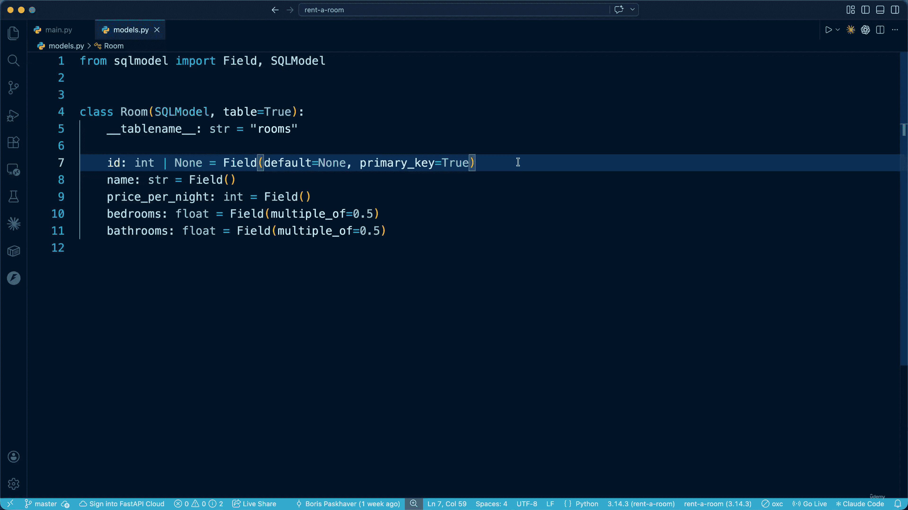
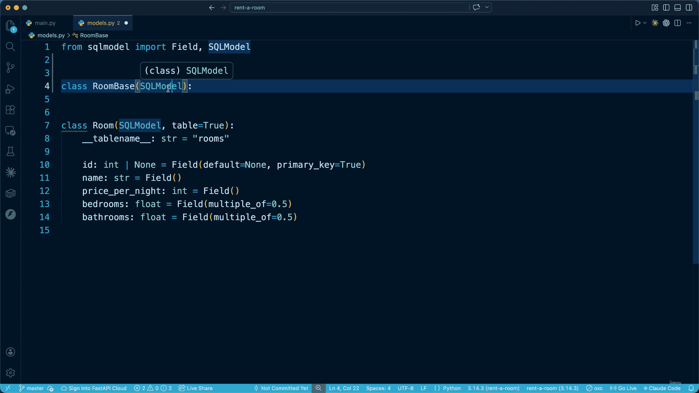
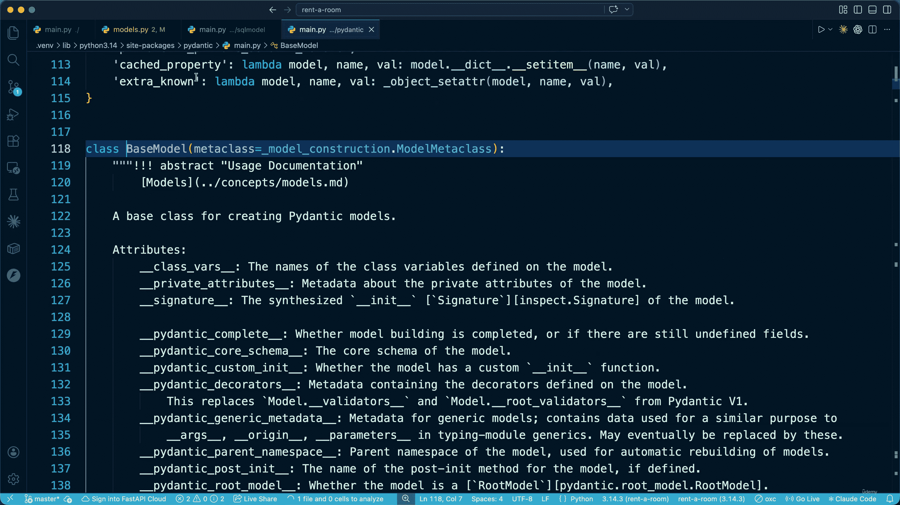
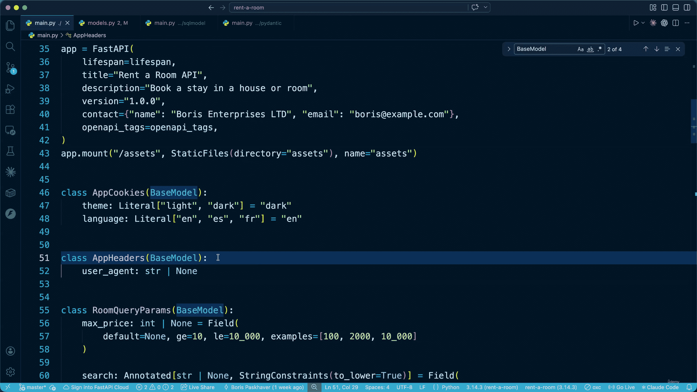
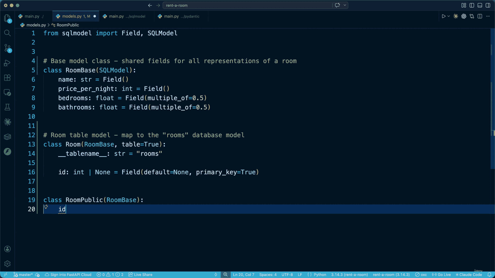
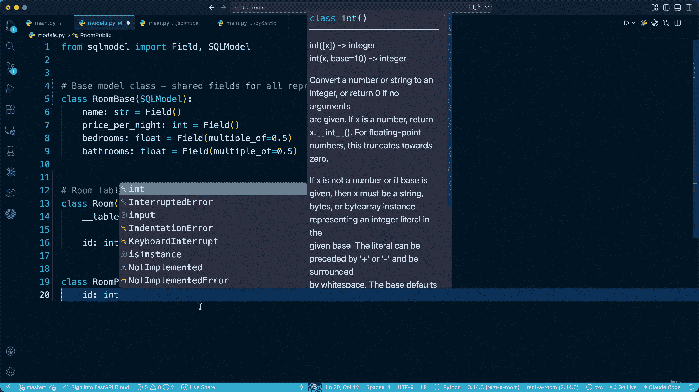
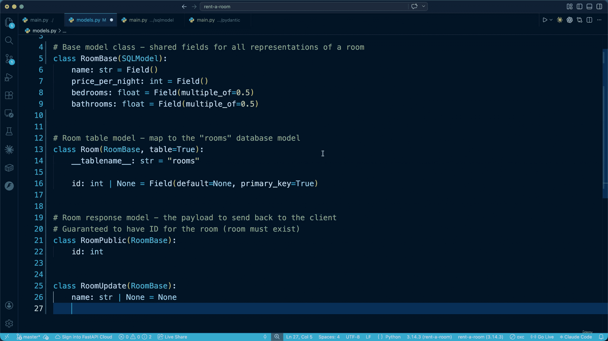
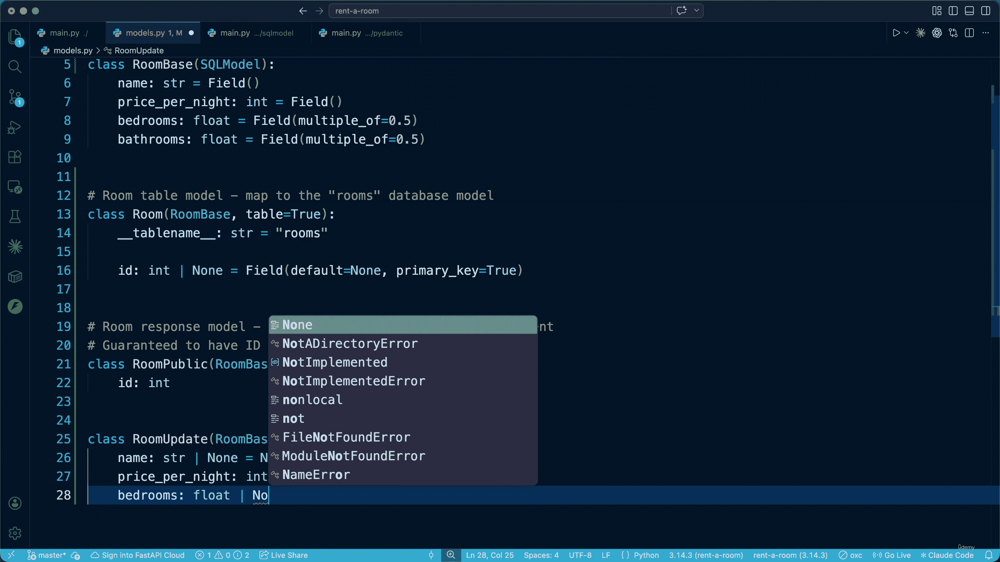
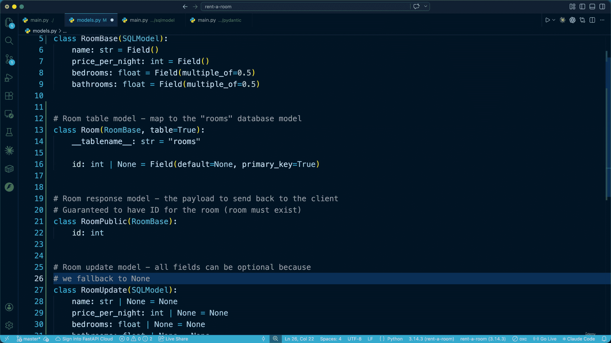

# 🚀 FastAPI Masterclass：p72-73：为 Room 创建多个 Pydantic 模型




在本节课中，我们将学习如何为同一个核心业务对象 Room 创建多个 Pydantic 模型。到目前为止，我们的 API 一直复用同一个 Room 模型来应付创建房间、更新房间、返回房间数据以及映射数据库表这四类任务。这种做法虽然简单，却存在不少隐患。接下来，我们会从问题出发，理解为什么需要多个模型，然后通过继承体系一步步定义出 RoomBase、Room、RoomPublic 和 RoomUpdate 四个模型，让每一种使用场景都有自己专门的数据模型。


## 🎯 为什么不能只用一个 Room 模型？


在之前的实现中，我们仅仅靠一个 Room 模型支撑起了所有与房间相关的数据交换。这个类既被当作创建房间时的请求体，又被当作更新房间时的请求体，还被当作查询房间后的响应体，甚至直接连接到数据库中的 rooms 表。换句话说，一个模型同时干了四份工作，听起来很省事，但实际上会带来非常多的麻烦。

以下是几个典型的问题场景：

- 对于 PATCH（部分更新）请求，调用方可以通过精心构造的载荷随意修改 id 字段的值，造成数据不一致。
- PATCH 端点本身缺乏灵活性，如果请求体中没有包含全部字段，它就无法正常工作，这完全违背了“部分更新”的初衷。
- 对于 POST（创建）请求，因为 id 字段在技术上可以是一个普通数字，所以调用方可以在请求体中指定任意 id，比如 900。数据库会照单全收，真的创建一条 id=900 的记录。可实际上，id 应该由数据库自动生成，而不是由调用方说了算。

综合来看，这种“一个模型包打天下”的方式显然不够理想。那么，FastAPI 和 SQLModel 对于这类“同一个核心对象有多个变体”的场景，究竟给出了什么解决方案呢？


## 💡 解决方案：用继承构建多个模型


解决方案的核心就是创建多个 Pydantic 模型，并把它们组织成一个子类继承体系。Python 本身支持继承，也就是一个类可以继承另一个类的属性和方法。一个现成的例子就是 SQLModel：SQLModel 本身就是 Pydantic BaseModel 的子类。Pydantic 模型同样支持继承，子类会继承父类的所有字段，还能够添加新的字段，或者对继承来的字段进行类型和校验规则的修改。

因此，我们可以在 models.py 中建立一个模型家族，让不同模型负责不同的数据形态。这样既能保证字段复用，又能让每个端点使用最合适的模型。下面我们开始动手实现。




## 🧱 定义 RoomBase 基类






首先，我们在 models.py 中定义一个名叫 RoomBase 的新类。这个名称其实可以随便取，但在 FastAPI 官方文档中，你经常会看到 base 这个字样，它表示这是一个基础模型，包含大量共享字段。

RoomBase 将作为所有 Room 相关模型的父类，保存那些所有子类都需要的核心字段。你可以这样理解：无论用户是发送创建房间的请求，还是获取一个或多个房间，房间的名字、每晚价格、卧室数量、浴室数量这些信息都是必不可少的。因此，我们把这些字段放在基类里。

这个类直接继承 SQLModel，但注意：我们没有设置 table=True。所以它本质上是一个普通的 Pydantic 模型，和数据库没有半点关系。你可以在编辑器中按住 Command（Windows 上为 Control）点击类名，会看到它最终继承自 Pydantic 的 BaseModel。这和我们在 main.py 中定义 AppCookies、AppHeaders 时使用的 BaseModel 是同一个类。也就是说，虽然名字叫 SQLModel，但因为没开 table 开关，它不会连接任何数据库表。

```python
# base model class：所有 Room 相关模型的共享字段
class RoomBase(SQLModel):
    name: str
    price_per_night: float
    bedrooms: int
    bathrooms: float
```

有了这个基类，POST 请求的载荷类型就可以直接使用 RoomBase 了。因为创建新房间时，我们不需要客户端提供 id，id 应该由数据库自动生成。接下来，我们看看原来的 Room 类要怎么调整。


## 🗄️ 改造 Room 为数据库表模型


原来的 Room 类直接继承 SQLModel，并且设置了 table=True。现在，我们让它改成继承 RoomBase，这样原本分散在 Room 里的四个公共字段就自动从父类拿过来了。

```python
# room table model：直接映射 rooms 数据库表
class Room(RoomBase, table=True):
    id: int | None = None
```

你可能会问：这里把 id 声明成 `int | None`，是什么意思？这是因为在创建房间时，调用方不需要提供 id，id 应该由数据库在插入时自动生成；而在从数据库读取时，id 一定会是整数。所以这里使用 `int | None` 并默认为 None，是一种很灵活的处理方式。

在这个继承关系中，Room 总共要校验五个字段：四个从 RoomBase 继承的字段，加上自己声明的 id 字段。由于设置了 table=True，SQLModel 依然可以正确地在数据库中创建包含五列的 rooms 表。也就是说，rooms 表实际拥有的五列是：id、name、price_per_night、bedrooms、bathrooms。这样一来，我们就成功地把“数据库专用字段”和“通用字段”解耦了。

这里有一条非常实用的建议：在子类继承体系中，尽量不要继承“代表数据库连接”的类。比如 Room 这个类，它直接对应 rooms 表。如果你让其他模型继承 Room，那么这些模型也会继承与数据库表相关的逻辑，最终会有不止一个类对应同一张数据库表，这会非常容易混淆。相比之下，像 RoomBase 这样的模型只是一个普通的 Python 校验类，它虽然继承自 SQLModel，但没有任何数据库连接信息。所以你可以放心大胆地多次继承 RoomBase，用来表示一个房间在你的领域内可能存在的各种数据形态。


## 📦 定义 RoomPublic 响应模型


现在我们有了数据库模型 Room，还需要一个专门用于返回给客户端数据的模型。想象一下，当用户通过 GET 请求获取房间列表或单个房间时，我们希望返回给用户的数据是公开的、干净的，而且最好保证一定带有合法的 id。

于是我们定义 RoomPublic 类。它同样继承 RoomBase，因此自动获得 name、price_per_night、bedrooms、bathrooms 这四个字段。然后我们额外添加一个 id 字段，并把它声明为 int，表示这个模型代表的房间一定已经存在于数据库中，必然拥有一个整数 id。



```python
# room response model：返回给客户端的公开数据，保证有 id
class RoomPublic(RoomBase):
    id: int
```

举个例子，数据库中的房间表可能有二十个字段，但你只想向用户暴露其中的五个。使用这种子类层次结构，你可以灵活地选择包含哪些字段、排除哪些字段。RoomPublic 这个模型也完全不了解数据库，它只负责描述一个“响应对象”的数据形状。换句话说，它定义的是“返回给客户端的房间长什么样”。注意，我们依然没有选择继承 Room，而是继承 RoomBase，原因和前面一样：避免让多个类与同一张数据库表绑定。




## ✏️ 定义 RoomUpdate 更新模型


接下来我们还需要处理 PATCH 请求的载荷。PATCH 请求要做的是部分更新，也就是说用户应该能够只提交任意一个字段，比如只改名字，或者同时改名字和浴室数量。RoomBase 的默认行为是四个字段全部必填，这显然不符合部分更新的需求。我们需要一个更灵活的模型，让所有字段都可选。

一种朴素的想法是直接继承 RoomBase，然后重新声明这四个字段。比如把 name 的类型改成 `str | None`，并给出默认值 None。对于 price_per_night、bedrooms、bathrooms，也做同样的处理。这样一来，RoomUpdate 看起来确实支持可选字段了。

```python
# 第一种写法：继承 RoomBase 并覆盖所有字段
class RoomUpdate(RoomBase):
    name: str | None = None
    price_per_night: float | None = None
    bedrooms: int | None = None
    bathrooms: float | None = None
```

但是，这种写法存在一个尴尬的问题：我们几乎把从 RoomBase 继承来的每一个字段都重新声明了一遍。既然所有继承的内容都被覆盖，那继承本身的意义就变得非常微弱。与其这样，不如直接创建一个独立的普通模型。

所以更推荐的做法是：让 RoomUpdate 直接继承 SQLModel，不设置 table=True，把所有字段都声明为可选类型，并默认设为 None。这样，这个模型就可以接受任意一个、任意几个或全部字段的输入，缺失的字段自动使用 None。Pydantic 也只会校验这四个字段，而不会引入任何数据库相关的逻辑。



```python
# room update model：所有字段都可选
class RoomUpdate(SQLModel):
    name: str | None = None
    price_per_night: float | None = None
    bedrooms: int | None = None
    bathrooms: float | None = None
```

到这里，一个完整的模型家族就诞生了。目前这些模型还没有接入路由处理器，所以完整效果还不直观。但核心好处已经体现出来：我们让每个端点都拥有了适合自身需求的数据形状。


## 📋 四种模型的总结




到目前为止，我们一共定义了四个不同的类，它们各自承担不同的职责。以下是这些模型的用途概览：

- RoomBase：基础模型，包含 name、price_per_night、bedrooms、bathrooms 四个共享字段，不连接任何数据库表。
- Room：数据库表模型，继承 RoomBase，额外添加 id 字段，并设置 table=True，直接映射 rooms 表。
- RoomPublic：公开响应模型，继承 RoomBase，额外添加 id 字段且类型为 int，用于返回给客户端的数据。
- RoomUpdate：更新请求模型，直接继承 SQLModel 且不连接数据库，所有字段均可选，用于接收 PATCH 请求的部分更新数据。

需要注意的是，在这四个模型中，只有 Room 真正与数据库表建立了连接。其他模型都是独立的 Pydantic 校验模型，它们不知道也不关心数据库的存在。这样的分工让每个模型都专注于自己的场景，同时通过继承保持字段的复用，大大提高了代码的可维护性和安全性。


## 🏁 小结


本节课中，我们一起学习了如何为 Room 创建多个 Pydantic 模型。我们首先回顾了复用单一模型带来的种种问题，比如 PATCH 请求可以任意修改 id、端点对字段要求死板、POST 请求可以伪造 id 等。接着我们引入了继承方案，通过定义 RoomBase 作为共享字段的基类，再让 Room 继承它并连接数据库，又派生出 RoomPublic 作为公开响应模型，以及 RoomUpdate 作为部分更新模型。我们还特别强调了不要继承数据库表模型的重要性。



目前这些模型还没有真正应用到路由处理器中，所以整个方案的威力可能还看不出来。在下一节课中，我们就会把这些逻辑接入端点，让请求校验和响应序列化都切换到新的模型上。到那时，你会看到这套设计带来的实际好处。

