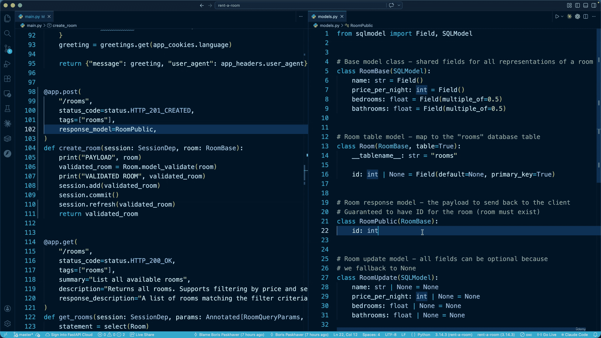
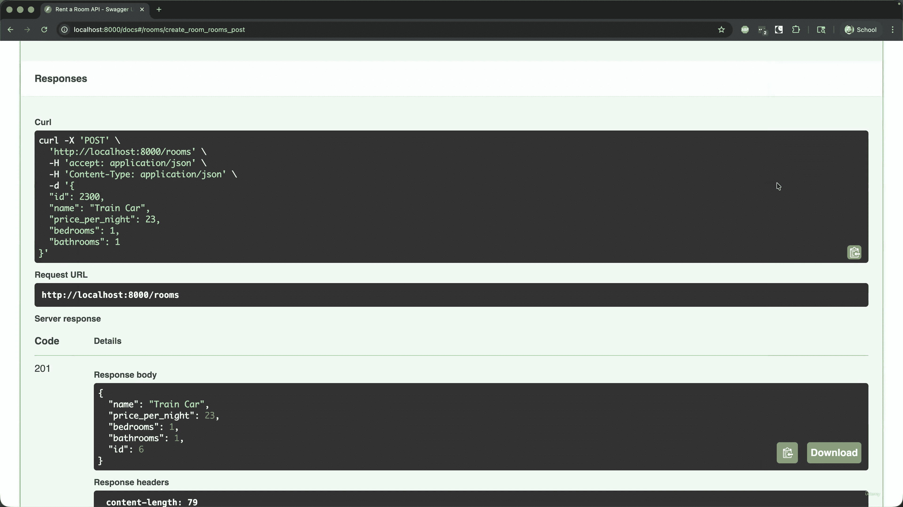
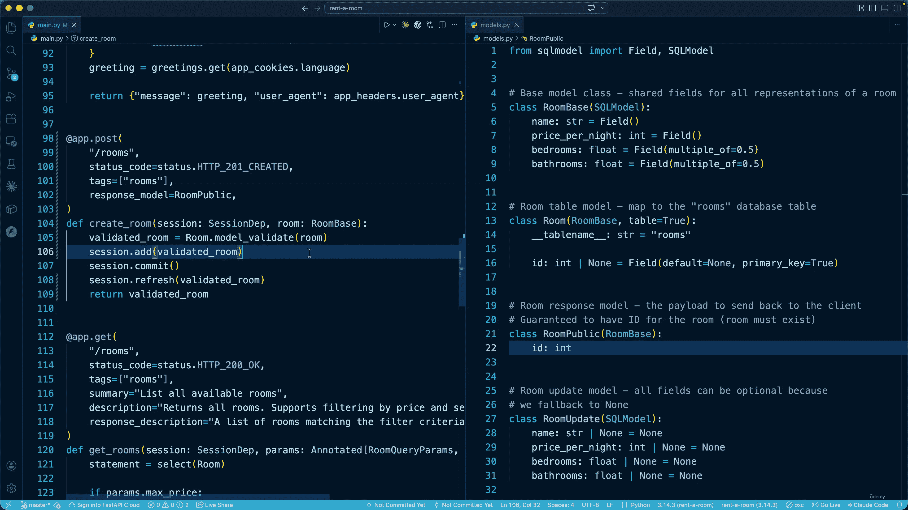

# 🚀 FastAPI 大师课：第73-74节：用新模型更新房间创建路由

在本节课中，我们将学习如何利用前面定义好的多个 Pydantic 模型来更新房间创建路由。我们之前已经花了不少时间，为房间可能呈现的各种不同形态定义了相应的模型类。现在，是时候在真正的路由处理函数中使用这些新模型了。我们要从 POST 路由开始，这个路由的作用是在数据库中创建一条新的房间记录。我们会一步步分析现有代码中存在的隐患，调整参数类型，然后解决新类型带来的一系列连锁问题，最终让这个接口既安全又文档准确。

首先，在做任何改动之前，我们需要把代码文件准备好。我打算打开 main.py 文件和模型文件，把它们并排显示在屏幕上，这样我们就能随时对照所有可选择的模型，心里更有底。我们要做的是更换路由处理函数中的许多参数，给数据加上更严格的约束和限制。

让我们先看看导入部分。这里我们已经有了 Room 模型，这个是真正映射到数据库表的模型。现在，让我们把其他几个新模型也一起导入进来。以下是需要添加的导入语句：

```python
from app.models import RoomBase, RoomPublic, RoomUpdate, Room
```

导入完成之后，我们可以往下滚动找到 POST /rooms 端点。它就在这个位置。找到这个端点之后，我们其实获得了修复一个非常危险 bug 的机会。

真正的问题出在我们现有的实现上。目前我们的路由参数类型使用的是 Room 模型。提醒一下，Room 模型既包含 ID 字段，又包含另外四个字段。Pydantic 模型在表示一个房间时，要求这五个属性必须全部存在。这意味着，在当前以及之前的模型版本中，客户端发送的请求负载可以包含一个类似 ID 的属性，并且把它设置成任意值，比如 900。由于参数类型声明为 Room，Pydantic 只是去验证负载是否具备全部五个属性，但它并不会阻止 ID 被传入，这样我们就等于允许别人任意指定记录的主键 ID。

这可不是什么好的实践，实际上还挺吓人的。造成这个现象的根本原因，在于我们试图复用数据库模型 Room 去表示进入服务器的数据载体。但你仔细想想，创建房间的时候，我们需要提供的其实只有四个属性，它们恰好都包含在独立的 RoomBase 类里面。所以，第一件要做的事就是把路由参数的类型从 Room 改成 RoomBase。

那么，改完之后 Pydantic 会如何工作呢？每当它接收到一个请求负载时，它会先确认这四个字段是否存在，然后还会接着执行一些校验和类型转换。比如说，它会检查 JSON 中是不是有 name 字段，并且这个字段必须是字符串类型。对于 bedrooms 和 bathrooms 这类数值字段，它则会确认数据是否是浮点数，并且是否满足 0.5 的倍数关系。除了这些常规校验，Pydantic 还有一个非常棒的特性，那就是它会自动剥离或者删除掉任何不属于这个模型范围的额外属性。

举个例子。假设我们发送了 name、price_per_night、bedrooms 和 bathrooms，但同时还附带了一些乱七八糟的字段，比如 random_property 设置为 5，unknown 设置为 3。那么，在把 JSON 负载转换成 room 参数所对应的 RoomBase 类型时，那些额外属性都会被统统删掉。这个模型就是唯一的权威标准，Pydantic 依据它判断数据是否合法。RoomBase 又是 SQLModel 所继承的父类，所以任何多出来的属性都会自动被丢弃。

这就意味着，即使客户端试图偷偷传递一个 ID 字段，等到路由处理函数真正运行的时候，这个 ID 早就没了。因为在函数开始之前，传入的 JSON 负载已经被转换成了一个 RoomBase 模型对象，所有额外的属性也已经被清理干净。通过这么一个小小的改动，我们就解决了一个非常关键的安全隐患，也就是原本负载中能够随意指定房间 ID 的问题。

不过，把参数类型更新为 RoomBase 只是朝正确方向迈出了一步，可它同时也引出了新的麻烦。这里的 session.add() 方法有一个严格的限制：它只能接受一个由映射到数据库表的类创建出来的对象。为什么呢？原因很简单，session 必须借助这个对象才能知道应该把它关联到哪一张表。可是，如果我们传入一个 RoomBase 实例，请记住，它是一个纯粹的 SQLModel，也可以说是一个纯粹的 Pydantic 模型，它对数据库是完全无知的。只有这个 Room 类，也就是设置了 table=True 的那个类，才真正知道对应的 rooms 表。

所以，如果我们把一个 Pydantic 模型或者 SQLModel（本质上它们是一回事，因为 SQLModel 是它的子类）传进去，这段代码就会出错。我们不会得到类型错误，但每次在 Swagger 里测试时，都会收到一个 500 内部服务器错误。错误信息的大意是：“喂，这个对象我没法映射到对应的表，我不知道该把它存到哪里。” 因此，我们接下来要做的是，把这个 RoomBase 对象转换成对应的 Room 对象，然后才能把它传给 session.add()。

其实办法不止一种。回忆一下，这些本质上都是 Python 类，所以一种很朴素的方案是直接内联实例化一个 Room，把所有需要的属性手动搬过去。比如我们可以从 room 这个 payload 数据中取它的 name 属性，再依次处理其他几个属性。但这样写很啰嗦，尤其是当属性数量很多的时候。如果能够用一个方法来自动完成转换，那会舒服得多。实际上，任何一个 Pydantic 模型（比如我们的数据库模型 Room）上都有一个叫做 model_validate 的方法。注意，这是一个类方法，而不是实例方法。也就是说，我们要在 Pydantic 类本身（也就是 Room）上调用它。

你可以在方法中传入需要验证的数据，这个数据会作为创建 Room 对象的基础。这个类方法最终返回一个新的 Room 实例。于是，我可以直接传入完整的 room payload。尽管这个 payload 仍然是 RoomBase 类的实例，但这没有问题，因为它拥有所需的四个属性，而 Room 类继承自 RoomBase，本来也需要这些属性。当然，你要小心千万不要传入一个什么都不包含的无效对象，否则会出事。在这里，我们传进去的数据是完全合法的，所以它能够实例化出一个全新的 Room，确切地说是 Room 类的实例。

我们把结果赋值给一个变量，比如叫 validated_room。在转换的同时，它还会执行 Pydantic 的校验。当我们把鼠标悬停在这个变量上时，类型提示会显示它是 Room。这个实例除了包含从 payload 中填好的四个字段之外，还会有一个 ID 属性。由于 ID 并没有提供具体的值，所以它自动回退为 None——这正是我们在写入数据库之前所期望的形态。

现在，我们来把代码改完。整体逻辑本质上就是一次类型转换，我们从一个对象类型切换到另一个对象类型。之所以需要这种转换，还是因为 RoomBase 不足以传给 session.add()，但是我们把它用作参数类型又很有价值，因为它可以防止像 ID 这样的额外属性混进 payload。现在，我们要把 validated_room 传给 session.add()，让数据库真正发生变更。接下来，refresh 方法同样需要一个 Room 类的对象，因为这样才能知道去哪张表查询最新的数据。这里我也传入 validated_room。最后，我们返回 validated_room 实例，这时它应该已经包含数据库生成出来的 ID 了。

为了让你更清楚地区分这两个对象，我在代码里临时加上一条 print 打印语句。到课程结束的时候我会把它删掉，所以你不需要跟着写。这里我会打印出 payload，也就是进入服务器的实际对象，它的类型是 RoomBase。同样，我也会打印出 validated_room，也就是对应到数据库模型的 Room 对象。打印出来之后，两条数据在控制台里的样子会一目了然。

这里还有一点我想补充一下，既是为了举例，也是为了文档的准确性。注意，我们目前是用 validated_room 来创建房间，然后在刷新之后返回它。之所以采用这么灵活的方式，是因为 Room 类上的 ID 属性既可以是整数（也就是记录保存成功之后的值），也可以是 None（也就是记录还没写进数据库之前的值）。问题在于，当 Swagger 生成文档的时候，它会去看 create_room 函数的返回值类型，也就是 Room。因此，每次它在 Swagger 文档里展示响应给客户端的形状时，都会告诉用户：返回的负载中 ID 的值可能是整数，也可能是 None。

但我们知道，这其实不符合事实。如果我们返回的是 validated_room，那就说明我们已经成功保存了数据库记录，并且我们还专门执行了 refresh，所以 ID 属性的实际类型完全可以精确地保证为整数。它不再是“整数或 None”，而是确定只有整数。幸运的是，我们正好有一个完美的模型，叫做 RoomPublic。这个模型对 ID 属性的定义非常精确。它继承自 RoomBase，所以包含了全部四个基础字段，同时 ID 被进一步明确为只能是整数。这样，尽管我们返回的 validated_room 技术上还是 Room 类的实例，但如果我们指定 Pydantic 将它当作 RoomPublic 模型来对待，那么在响应形状和数据上两者是完全一致的，只不过现在 Swagger 文档会明确地告诉阅读者：ID 将是一个整数。这样一来，我们的文档反而变得比以前更加准确了。

那我们来试试看，如果把函数的返回类型改成 RoomPublic 会发生什么。你会发现类型检查器会立刻报错，因为严格来说，这是两个不同的类。我们返回的是一个由 Room 类创建的实例，它的 ID 可能是整数或者 None，但函数声明的返回类型是 RoomPublic——这是一个专门表示响应形状的 Pydantic 模型，其中 ID 是必然存在的。这种不一致就会造成类型检查器的违规。

FastAPI 官方文档给出的解决方案很聪明：我们不再使用常规的 Python 类型注解来标注返回类型，而是把这个返回类型注解删掉，然后在实际的 POST 装饰器里添一个名叫 response_model 的额外参数。通过这个参数，指明服务器返回给客户端的数据模型，也就是这个响应负载的 Pydantic 形状是什么。我们把它设为 RoomPublic。这样，类型检查器就不会再报错了，整个代码也是完全合法的。

我要再强调一下，这里我们实际返回的值仍然是 Pydantic 模型 Room，但我们同时也告诉 FastAPI 和 Pydantic，返回模型应该是 RoomPublic，而后者最终拥有更高的优先级。FastAPI 会获取我们返回的值，并确保它符合这里指定的 Pydantic 模型。目前这两个模型之间没有任何差异，因为它们拥有完全相同的五个属性：四个基础属性加上 ID。但在某些场景下，这个 response_model 参数就可以用来指定完全不同的对象形状，而且非常有用。

举例来说，假设我们的 Room 模型有五个额外属性，对应的是五个额外的数据库列。你可以想象，此时 validated_room 这个对象总共有十个属性。默认情况下，如果我们返回这个模型的对象，所有十个属性都会出现在响应里。但如果，我们只希望其中五个属性能够回到客户端，也许是这五个属性特别敏感，我们不想泄露出去，比如用户的密码哈希值；又或者只是因为我们觉得响应太臃肿，想要精简到真正关心的几个字段。这时，response_model 就派上用场了。它允许我们声明一个 Pydantic 模型，作为最终响应负载的唯一权威形状。

你可以理解为：在 return 关键字之后，还有一段额外的逻辑。我们先返回某种类型的对象，在这里是 Room 类型，随后 Pydantic 会接管这些数据，并强制它符合 response_model 所规定的形状。现在因为两个模型字段一样，所以看不出区别。但如果我们返回一个拥有二十个字段的 Pydantic 模型，同时指定 response_model 是一个只有其中五个字段的模型，那么客户端看到的响应里就只有那五个属性。因此，这个 response_model 才是决定客户端最终数据形状的真相来源。

希望这样解释能够让你理解。我们也可以用另一种方式来看同一件事：请注意，我们现在为数据流的不同阶段使用了不同 Pydantic 模型。从客户端进入服务器的房间数据，其形状由 RoomBase 负责定义；从服务器返回给客户端的房间数据，其形状由 RoomPublic 负责定义；而在路由处理期间，真正和数据库表打交道的是第三个模型 Room。也就是说，各个 schema 的职责被拆分开来，分别放在三个不同模型中。我们不再试图把所有事情都塞进 Room 一个类里。Room 现在只是负责数据库操作之前的那个模型。数据进来有单独的 schema，数据出去也有单独的 schema。

再举个例子，假如明天我们决定，最终返回给用户的只有房间的 ID 和名称。我们可以很轻松地只改模型来适应这个需求。比如，目前 RoomPublic 继承自 RoomBase，因此它继承了全部四个属性，再加上一个 ID。所以当我们返回对象时，这五个属性都会伴随响应出现。但如果我们只想要 ID 和 name，我们可以不让 RoomPublic 继承 RoomBase，而是改为继承 SQLModel，然后手动规定 name 为字符串类型。这样一来，发送给客户端的响应只会包含两个属性，而进入服务器的 payload（用 RoomBase 表示）则有四个。由此可见，在不同形状之间建立独立性和可变性变得容易了很多。我这里之所以要回到原来的继承关系，只是因为我们确实希望客户端响应包含房间的全部分信息和标识符。但这并不是强制的，具体情况完全由你决定。



现在一切功能都准备就绪了。让我们打开浏览器，实际测试一下这段新代码。我建议你也刷新一下页面，确保看到的是 Swagger 最新生成的文档，毕竟它是由我们当前的模型实时生成的。

打开 POST /rooms 端点，你会注意到，进入服务器的 schema 由 RoomBase 类表示，而且非常舒服的是，它已经不再包含 ID 字段了。这正是之前更新参数类型带来的一个重大好处：我们再也不和任何带 ID 的模型绑在一起了。客户端现在清清楚楚地知道自己需要发送哪些数据。除此之外，如果客户端在请求负载里塞入了任何多余字段，比如 ID 或者其他乱七八糟的东西，这些多余字段也会被自动剔除。这四个属性是唯一允许发送的字段。并且，如我们点击 schema 后所见，它们全都是必填的。因此，如果负载里缺少任意一个，请求就会失败；如果多出几个，Pydantic 也会帮我们统统剥掉。

让我们点击 Try it out，输入一些示例值。我们创建一个“火车车厢”，每晚价格 23 美元，1 间卧室，1 间浴室。点击执行。接着，你会看到响应形状是 RoomPublic Pydantic 模型的形状，它继承自 RoomBase，所以包含了从 RoomBase 继承过来的四个属性，并且我们还指定了最终的响应模型也要包含 ID。所以响应里会带上 ID 字段。记住，我们实际返回的对象其实是第三个模型 Room 的实例，但因为它已经由数据库赋予了 ID，Pydantic 在将 Room 转换为 RoomPublic 时，会非常轻松。

我还想再演示一下，如果我再发送一次请求，并且故意在负载里附带一个 ID 字段，比如在记录里尝试插入一个 ID 为 2300 的完全随机的值。执行之后，Pydantic，更准确地说，是参数对应的 RoomBase 模型，会把这个 ID 字段直接剥离掉，因为它根本没有在模型上声明。注意，请求依然会成功，我们得到 201 状态码，但实际生成的 ID 是 6。也就是说，传入的那个 ID 属性被完全忽略了。到了这一步，恶意用户已经没有办法再随意指定房间 ID 了。

接下来，我们可以切换到终端，往上滚动，看看实际进入服务器的数据，这样能够更直观地感受一下这两个模型之间的差异。这边是参数 room，表示一个 RoomBase 模型的实例。你可以看到它包含四个字段：name、price_per_night、bedrooms 和 bathrooms。然后我们调用 Room 类上的 model_validate 类方法，把这个负载传进去，得到一个 Room 类的实例。这里最关键的差异在于，在写入数据库之前，ID 被设置为 None。接着，当我们调用 refresh 时，仍然是那个 room 模型，但 ID 已经被数据库填充成了实际的行号数值。然后我们返回这个 Room 实例。最后，在 return 之后还有额外的一段处理，也就是我们声明的 response_model，也就是 RoomPublic，它会把 Room 进一步转换成 RoomPublic 的形状，也就是我们在浏览器或 Swagger 里看到的最终响应。

到这里，我们可以回到 VS Code，把刚才临时添加的那段 print 打印代码删除。这样就大功告成了。我们这节课处理的内容确实有点复杂，但好消息是，如果今天有任何地方让你觉得不清楚，也没有关系，因为在接下来的课程中，我们会继续更新剩余的路由处理函数，并且反复练习和巩固这些概念。到时候我们还会再见的。





本节课中，我们一起学习了如何用新的 Pydantic 模型来更新房间创建路由。我们从导入新模型开始，一起发现并修复了旧实现中巨大的安全漏洞，也就是客户端可以任意指定房间 ID。随后，我们面临了 RoomBase 不能直接用于数据库操作的问题，并通过 model_validate 方法完成了到 Room 实例的转换。紧接着，我们引入了 response_model 参数，用它来精确控制响应的数据形状，让 API 文档更加真实准确。最后，我们还通过 Swagger UI 和终端日志，实际观察了不同类型对象之间的差异，也验证了额外字段是如何被剥离的。希望这些内容能帮助你在自己的 FastAPI 项目中更安全、更灵活地设计请求和响应模型。
