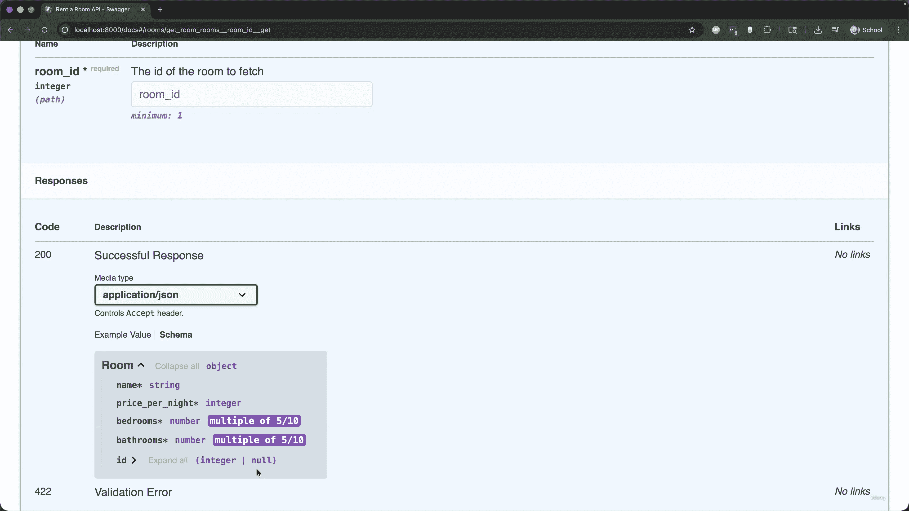
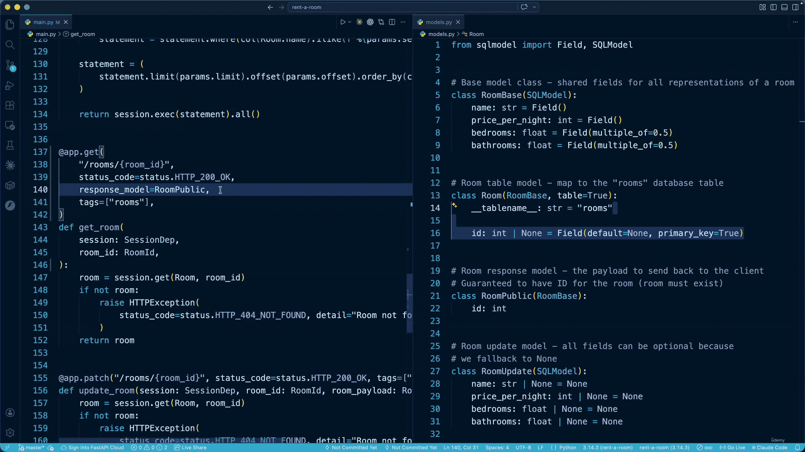
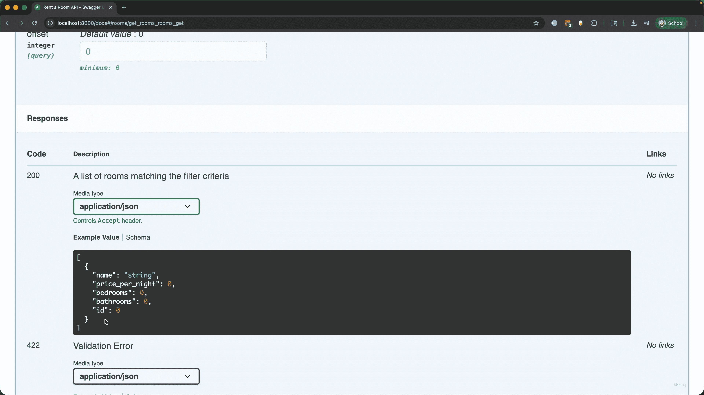

# FastAPI 大师课：第74-75课：使用新模型更新获取房间路由 🏨

在本节课中我们将要学习如何用新的 Pydantic 模型更新两个 GET 路由。原文说明，接下来要更新的两个路由都是 GET 路由：一个返回房间集合，另一个检索单个房间。我们会先看当前 Swagger 文档为什么不准确，再分别修改这两个路由的 `response_model`，最后刷新页面验证文档结果。整节课的目标很明确：让接口返回的数据形状在代码里表达得更准确，也让 Swagger 文档更贴近真实响应。

## FastAPI 大师课：74-75.1：定位两个 GET 路由的文档问题 🔍

上一段我们明确了本课要处理两个 GET 路由，本节中我们来看看当前 Swagger 文档为什么会给出不准确的描述。原文先指出，如果展开文档，可以看到代码里的路由处理器声明返回类型为 `Room`。问题出在 `Room` 模型上，因为这个模型是连接数据库的模型。`Room` 的 `ID` 属性可以是整数，也可以为空，也就是类似 `int | None` 的形式。Swagger 会使用这个返回类型来生成文档，所以当你向下滚动并查看 possible responses 时，会发现 schema 说响应里会有一个 `ID` 属性，但它可以是整数，也可以为空。从技术上说，这个描述并不正确，因为只要我们能按 ID 在数据库里成功找到房间并返回它，这个房间一定存在 `ID` 字段。原文把这种情况称为又一个例子：只依赖单一模型，可能带来不完美的文档。本课会通过少量更新得到更好的结果。

> Swagger 文档不会真正查看代码逻辑，只会查看接口的 setup 和类型注解。



## FastAPI 大师课：74-75.2：修改返回房间集合的 GET 路由 🧩

上一节我们定位了文档不准确的原因，本节中我们来看看第一个路由，也就是返回多个房间的 GET 路由应该如何修改。原文说回到 VSCode，然后找到 `get_rooms` 函数。在这个函数里可以看到，函数声明末尾根本没有声明返回类型。因此 Swagger 文档完全不知道响应数据长什么形状。前面已经强调过，Swagger 文档不会真正查看代码逻辑，只会查看接口 setup 和类型注解。因为没有提供函数返回类型注解，Swagger 就不知道如何处理。原文给出的第一个选项是直接提供实际返回类型，但上一课已经看到，作者通常更喜欢使用 `response_model` 这个替代选项。因此在真实 setup 中，这里要声明 `response_model`。这里必须小心，因为这是检索多个房间的端点，返回的会是一个列表。声明特定类型列表的方式是写 `list`，再加一对方括号，方括号里的类表示每个列表元素的类型。这里要提供 `RoomPublic`。为什么用 `RoomPublic` 而不是 `Room`：如果提供 `Room`，就等于说返回一个房间列表，并且每个房间的 `ID` 可以是整数，也可以为空。这不是最准确的描述，因为从数据库检索已保存的房间集合时，每个房间都一定有 `ID`，因为它已经被保存过。`RoomPublic` 这个 Pydantic 模型是 `RoomBase` 的子类，甚至没有以任何正式方式与数据库耦合，但我们用它来表达返回数据的形状。还要注意，这个方法返回的是 `Room` 对象列表。返回房间列表完全没问题，因为 Pydantic 会在拿到返回值之后，把 `Room` 对象列表转换成 `RoomPublic` 对象列表。这个操作会成功，因为两个模型共享字段。

以下是该路由的核心改动示例，教学重点是 `response_model` 接收一个列表类型：

```python
@router.get("/rooms", response_model=list[RoomPublic])
def get_rooms():
    ...
```

对应的响应形状可以用公式表示：

\[
\text{GET /rooms 的响应形状} = \text{list[RoomPublic]}
\]

## FastAPI 大师课：74-75.3：修改获取单个房间的 GET 路由 🎯

上一节我们处理了返回集合的路由，本节中我们来看看下方的 `get_room` 函数，并应用完全相同的逻辑。原文说这里可以移除实际的返回类型注解，再次依赖补充的 `response_model` 参数。这个参数甚至可以加在 `tags` 之前，顺序无关紧要。这个路由获取单个房间，希望返回给客户端的负载形状是 `RoomPublic`。写法类似下面这样：

```python
@router.get("/rooms/{room_id}", response_model=RoomPublic)
def get_room(room_id: int):
    ...
```

这里遵循同一原则：`get` 方法检索的是 `Room` 类的对象。从技术上说，它可能是 `Room` 或 `None`，以防提供的 ID 不对应任何房间。但执行到 `if` 语句之后，这个 `room` 保证是 `Room` 模型实例。它是一个 `Room` 类实例，但因为这里指定了 `response_model`，Pydantic 会把最终返回的对象从当前形状转换成 `RoomPublic` 形状。两者基本上是同一种东西。唯一区别是 `Room` 声明 `ID` 可空或可选，而 `RoomPublic` 明确 `ID` 一定存在。这个区别很重要，因为它会影响 Swagger 文档。对应的响应形状可以用公式表示：

\[
\text{GET /rooms/\{room\_id\} 的响应形状} = \text{RoomPublic}
\]

## FastAPI 大师课：74-75.4：验证 Swagger 文档变化 ✅

上一节我们改完了两个路由的代码，本节中我们来看看保存后 Swagger 文档会发生什么变化。原文说保存代码，回到浏览器，刷新页面，然后向下滚动查看。现在 schema 会告诉我们 `ID` 始终存在。星号表示什么：对进入服务器的数据来说表示必填，对从服务器返回给客户端的数据来说表示存在。类似地，展开 rooms 端点的文档，这个端点返回列表。向下滚动可以看到 schema 会告诉我们是包含多个项的集合或迭代器，每个项是一个包含这些属性的 room。甚至可以看到 sample response：一个列表，每个条目都是遵循 `RoomPublic` 模型形状的对象。为了便于检查，以下是根据原文整理出的验证要点：

- `get_room` 的响应 schema 中，`ID` 应显示为始终存在。

- `get_rooms` 的响应 schema 中，响应应是包含多个项的集合或迭代器。

- 每个列表项都应是遵循 `RoomPublic` 形状的对象。

- Swagger 中应能看到对应的 sample response。

## FastAPI 大师课：74-75.5：本课总结 📌

前面几节我们分别定位了文档问题、修改了返回集合的 GET 路由、修改了获取单个房间的 GET 路由，并验证了 Swagger 文档变化，本节中我们做一个小结。本节课中我们一起学习了如何用 `response_model` 更新两个 GET 路由的文档形状：返回多个房间时使用 `list[RoomPublic]`，返回单个房间时使用 `RoomPublic`。这样做的核心原因是让 Swagger 文档更准确地表达真实响应，避免继续依赖带有可空 `ID` 的数据库模型来生成不完美文档。原文最后说明，本课内容到这里，下一课见。以下是本课要点回顾：



- 数据库模型 `Room` 适合表达数据库记录，但不一定适合表达接口响应。

- `RoomPublic` 是 `RoomBase` 的子类，适合用来声明返回给客户端的公开数据形状。

- 返回集合的端点应使用 `response_model=list[RoomPublic]`。

- 返回单个房间的端点应使用 `response_model=RoomPublic`。



- Pydantic 会在返回时完成模型转换，两个模型共享字段是转换成功的基础。

