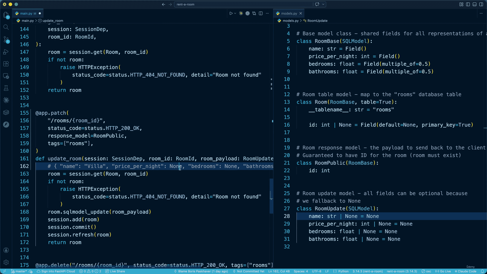
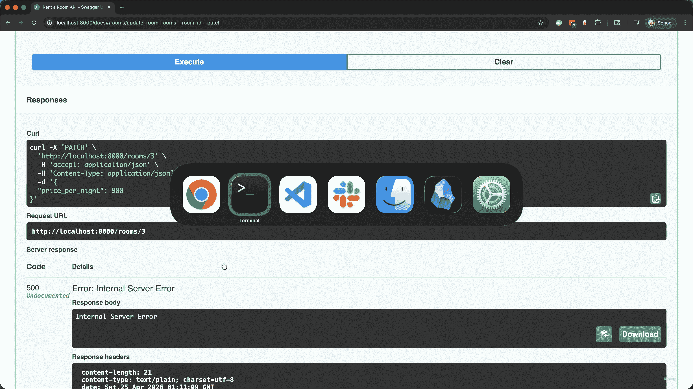
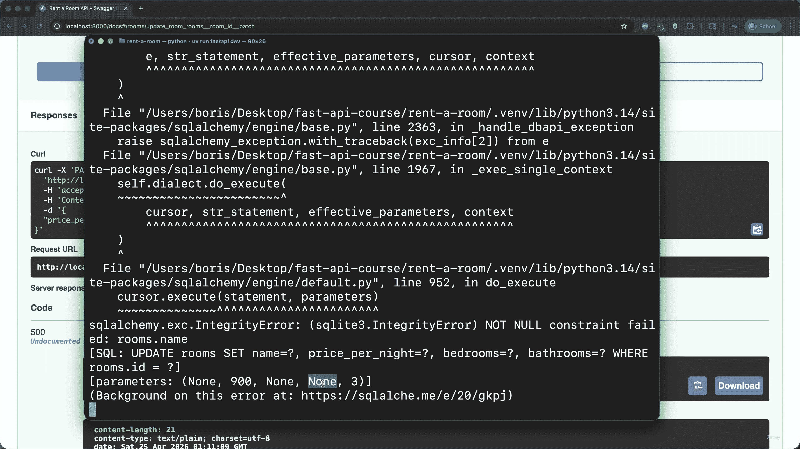
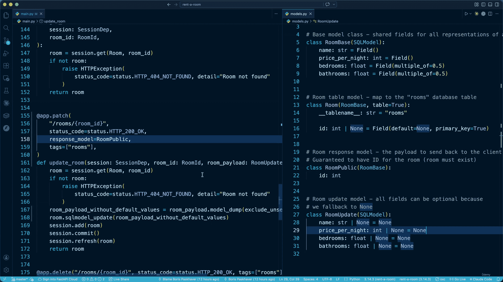
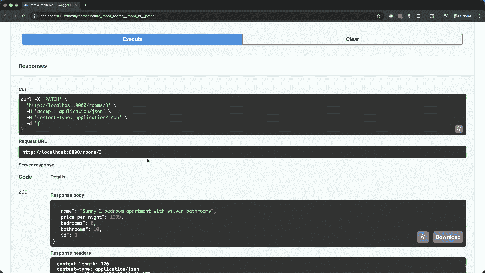

# 🚀 FastAPI大师课：第75-76节：model_dump方法与exclude_unset参数

在本节课中，我们将要学习如何重构更新房间的PATCH端点，让客户端可以只提交需要更新的字段，而不是被迫提交全部字段。我们会先给端点补上响应模型，再分析`room_payload`参数当前为什么不够灵活，接着复现一个由默认值`None`引发的数据库错误，最后使用`model_dump(exclude_unset=True)`把请求体过滤成只包含客户端显式提交的字段，并在浏览器中验证任意字段组合。整个教程会围绕“请求体模型如何从客户端数据中区分显式字段和默认字段”这个核心展开，让初学者也能看明白每一步的原因和结果。

下面先看端点的响应模型，因为这是重构更新函数时最直接的改动。

## 🧭 FastAPI大师课：第75-76节：重构PATCH端点与响应模型

上一节中我们已经完成了一些房间相关端点的整理，本节中我们来看看更新现有房间的`update_room`函数。首先要在PATCH方法调用中添加`response_model`参数，用它指定返回给客户端的数据形状应该是`RoomPublic`类型。这样做的目的是复用右侧已有的`RoomPublic`模型，而这个模型包含来自`RoomBase`的四个属性，再加上固定的`id`。代码示意如下：

```python
@router.patch("/{room_id}", response_model=RoomPublic)
def update_room(...):
    ...
```

因为已经指定了`response_model`，所以可以移除返回值上的手动类型注解。换句话说，客户端拿到的响应会由FastAPI和Pydantic按照`RoomPublic`来校验和序列化，我们不需要再在函数签名里重复写返回类型。

响应模型确定之后，下一节要处理更新函数里最关键的参数，也就是表示待更新属性的`room_payload`。

## 🧩 FastAPI大师课：第75-76节：灵活更新需求与RoomPayload的问题

上一节我们给更新端点指定了响应模型，本节中我们来看看`update_room`函数里的`room_payload`参数。这个参数代表客户端希望更新的属性集合。我的意图是让这个端点尽可能灵活，客户端可以提供任意数量的属性：例如只给`name`来更新名称，或者只给`price_per_night`来更新每晚价格，也可以给这四个字段中的任意组合。一次请求可能包含`name`和`bedrooms`，下一次请求可能包含`price_per_night`和`bathrooms`，第三次请求可能包含四个字段中的三个，我希望这些情况都能被支持。端点应该接收JSON请求体，并把其中指定的属性用于更新数据库中已有的房间记录。

问题在于，当前`room_payload`参数连接的是`Room`模型，而`Room`继承自`RoomBase`。代码关系可以写成下面这样：

```python
Room = RoomBase + id
RoomBase -> name, price_per_night, bedrooms, bathrooms 必填
```

这就导致Pydantic会要求请求体必须包含这些属性。严格来说，`id`是可选的，因为`id`可以回落到默认值`None`；但除此之外，`Room`模型要求客户端发送的请求体必须包含四个字段，因为这里声明的类型就是`Room`，而`Room`继承了强制要求这四个字段存在的`RoomBase`模型。因此，如果请求没有包含全部四个字段，就会报错。



为了解决“必须提交全部字段”的问题，我们把这里的类型改成`RoomUpdate`，也就是前一两节课定义的最终模型。这个方向是正确的，但只改类型仍然有一个大问题。下面列出这个改动带来的效果和副作用，先看它怎样让字段变成可选。

```python
name: str | None = None
price_per_night: float | None = None
bedrooms: int | None = None
bathrooms: int | None = None
```

这里使用`= None`语法，或者等价地写成`Field(default=None)`，会把字段的默认值设为`None`。因为字段有默认值，所以这个属性或字段实际上变成了可选字段，Pydantic模型会为缺失字段提供后备值。这样一来，客户端请求体里缺少四个字段中的任意一个时，Pydantic都会用`None`替代。这个设计解决了“客户端必须提供全部四个属性”的问题，但同时也引入了另一个问题。



下面用一个具体场景说明这个副作用，先看客户端只提交一个字段时会发生什么。

- 客户端发送`{"name": "Villa"}`，只希望更新名称，不提供另外三个字段。
- Pydantic实例化`RoomUpdate`时，会自动把`price_per_night`、`bedrooms`、`bathrooms`回落到默认值`None`。
- 这个带有三个`None`的`RoomUpdate`实例随后会传给数据库模型的`update`方法。
- `update`方法会尝试把`price_per_night`、`bedrooms`、`bathrooms`这三列更新为`None`。
- 但数据库中这些列是非空列，要求实际有效值，例如整数或浮点数，因此SQL查询会失败。

这里的关键公式可以概括为：



```text
默认None + 直接update => 非空列被写入NULL => 数据库报错
```

另一个例子是客户端只提交`name`为`Villa`，没有提供其他三个字段。由于默认值回退机制，函数收到的`RoomUpdate`实例会自动拥有另外三个属性，但它们的值都是`None`。把这种数据传给`SQLModel.update`时，ORM会请求把房间记录中`price_per_night`、`bedrooms`、`bathrooms`列改成`None`，而这些列不允许`None`，所以实际SQL查询失败。总结来说，我们解决了一个问题，也就是去掉了客户端必须提供全部四个属性的要求；但又引入了另一个问题，也就是客户端没有提交的字段会在服务端回退成`None`，从而触发错误。这个端点还在朝正确方向移动，但仍然容易出错。

在修代码之前，下一节先到浏览器中直接复现这个错误，看清楚它为什么发生。

## 🔎 FastAPI大师课：第75-76节：浏览器复现500错误

上一节我们分析了默认值`None`会怎样污染更新数据，本节中我们在浏览器中把这个错误实际跑出来。回到Chrome并刷新页面，尝试发送PATCH请求。先确保提供一个有效的房间`id`，例如`3`。这个请求本来就不会成功，但正好用来演示问题。向下滚动，只尝试更新`price_per_night`，值设为`900`，并确保去掉末尾逗号。

执行请求后，浏览器会返回内部服务器错误，错误码是`500`。查看服务端日志，其中包含SQL代码和错误信息。可以看到SQLModel ORM尝试写入的代码里有`update`关键字，用来更新`rooms`表中的一行，并尝试给`name`、`price_per_night`、`bedrooms`、`bathrooms`等列设置新值，过滤条件是房间`id`等于`3`。日志中占位符`?`的顺序会映射到值列表的顺序，因此可以看到`name`列尝试设为`None`，`price_per_night`列设为`900`，这正是请求体中指定的值，所以这一项是正确的；`bedrooms`列尝试设为`None`，`bathrooms`列也尝试设为`None`。这就是刚才讨论的现象：路由处理器实例化出来的`RoomUpdate` Pydantic模型除了`price_per_night`之外没有有效值，于是回退到模型里指定的默认值`None`，然后这些非值或它们在SQL中的表示被写向数据库，触发了错误。日志含义可以用下面的引用概括。

> UPDATE rooms  
> SET name = NULL, price_per_night = 900, bedrooms = NULL, bathrooms = NULL  
> WHERE id = 3

看到这个错误后，下一节回到代码，用`model_dump`和`exclude_unset`来修复它。

## 🛠️ FastAPI大师课：第75-76节：用model_dump与exclude_unset过滤默认值

上一节我们在浏览器里看到了由默认`None`造成的500错误，本节中我们回到代码解决这个问题。解决方案的思路很直观：拿到`RoomUpdate`模型实例后，把它缩小或过滤成只包含客户端实际提供的字段。例如客户端只发送了`name`，我们希望把模型缩小成只含`name`键的对象，把所有仅因为默认回退而值为`None`的字段排除掉，因为这些字段并不对应有效的客户端输入。如果能把数据缩小到只包含客户端显式设置的字段，这种数据形状就可以传给`SQLModel.update`方法。该方法接受键值对形式的数据来更新记录，所以只要告诉数据库客户端只给了`name`时仅更新`name`，就能达到目的。

那么怎样从Pydantic模型得到这种过滤后的字典？先看`room_payload`，它是`RoomUpdate`模型实例。Pydantic模型上有一个方法叫`model_dump`，它会把模型转换成Python字典，把模型字段名如`name`、`price_per_night`变成键，把字段值变成字典的值。仅调用`model_dump()`本身帮助不大，因为它会把那些由默认值填充的`None`也包含进字典里。不过这个方法接受很多参数，可以定制生成的字典。其中一个参数叫`exclude_unset`，可以设为`True`。代码示例如下：

```python
room_payload_without_default_values = room_payload.model_dump(exclude_unset=True)
```

`exclude_unset`参数是关键。它指示Pydantic排除或省略那些仅因为默认值而存在的值。换句话说，我们要求Pydantic只选择那些直接由客户端设置、也就是直接由请求体设置的值。这里的`unset`指的是“客户端没有设置”。请排除所有不是客户端显式设置的字段值。这种省略会发生在模型方法把Pydantic模型表示转换成等价字典的过程中。真正有用的不是`model_dump`单独本身，而是这个定制能力，是这个参数让我们能把某些字段值从字典中排除，原因正是这些字段值来自默认值而不是原始数据源。`model_dump`能够判断这一点，是因为`room_payload`来自客户端请求体，Pydantic在模型内部会跟踪哪些字段是由进入服务端的请求体显式提供值，哪些字段只是由类定义中的默认值填充。

下面列出几种典型输入对应的过滤结果，先看它们如何帮助理解`exclude_unset`。

- 如果客户端显式提供`name`字段，而Pydantic把另外三个字段回退为`None`，`exclude_unset=True`会移除另外三个字段，因为它们的值不是由原始客户端数据源设置的。
- 如果客户端发送的请求体完全没有属性，那么`model_dump`创建`RoomUpdate`时，四个字段都会因为默认值`None`而存在，四个字段都不是客户端设置的，因此过滤后得到零个键值对的字典。客户端什么都没发，就什么都不更新，这正是想要的结果。
- 如果客户端发送`name`和`price_per_night`，Pydantic模型内部仍然存储四个字段，但知道前两个来自客户端，后两个的`None`是默认回退值。`exclude_unset`会告诉Pydantic在转换成字典时移除后两个字段，因为它们不是客户端设置的。
- 如果客户端只发送模型中不存在的字段，进入路由处理器的`RoomUpdate`里四个字段都会是默认值，过滤后字典为空，请求仍然成功，但不会更新任何内容。

得到过滤后的字典后，把它赋值给变量，例如`room_payload_without_default_values`，因为它基本就是`model_dump`方法生成的结果。这个字典存储的是确实想更新的字段的键值对。然后把这个字典传给`SQLModel.update`方法，告诉ORM把对从数据库`get`方法取出的房间对象的修改排入队列。接着把房间加入待更新队列，用`commit`方法生成实际SQL语句，用`refresh`刷新房间以拿到表中该行的最新值，再返回给用户。返回之后，Pydantic会再次接管，确保返回数据形状符合`RoomPublic`模型。核心流程可以写成下面的公式。

```text
room_payload_dict = room_payload.model_dump(exclude_unset=True)
room = SQLModel.update(room_payload_dict)
commit()
refresh(room)
return RoomPublic校验(room)
```



这个端点现在支持任意请求体：客户端可以发送空请求体，可以发送一个字段、两个字段、三个字段或全部四个字段，任意组合都可以，端点只会更新客户端在请求体中指定的字段。

代码修好后，下一节转到浏览器，用多种字段组合验证端点行为。

## 🧪 FastAPI大师课：第75-76节：浏览器验证任意字段组合

上一节我们完成了`model_dump(exclude_unset=True)`的代码修复，本节中我们到浏览器测试这个端点。先刷新页面，展开PATCH端点，点击`Try it out`，提供一个示例房间`id`，例如`3`，然后尝试多种属性组合。下面列出几组测试，先看只更新一个字段的情况。

- 首先移除多余属性，只提供`name`键，把它设为新的名称，例如`Sunny two bedroom apartment with gold bathrooms`，确保去掉末尾逗号，然后点击执行。
- 在下方查看实际发出的请求，可以看到请求体只有一个字段`name`。Pydantic生成的`RoomUpdate`模型会有四个字段，但Pydantic知道只有`name`是由实际输入或请求体显式设置的。调用`model_dump`并加上`exclude_unset=True`时，所有没有显式设置的Pydantic字段都会被排除，结果字典只有`name`键和对应值，其他三个不关心的字段如`bathrooms`、`bedrooms`被省略。更新这个房间时只会更新这个字段。
- 向下滚动可以看到响应码为`200`，除了`name`被更新成这个新名称之外，其他数据点保持不变。

接着看更新两个字段的情况，仍然使用同一个端点，但提供不同的请求体。

- 可以把名称改成别的内容，例如加入`silver bathrooms`，同时把`bathrooms`更新为`10`，确保删除末尾逗号，然后执行。
- 这次请求体提供两个属性`name`和`bathrooms`。`exclude_unset`逻辑运行后得到包含两个键值对的字典，因为这两个字段由流入Pydantic模型的数据源显式设置。Pydantic模型会记录`name`和`bathrooms`是由传入数据源显式设置的，而另外两个属性`price_per_night`和`bedrooms`是Pydantic自动设置的回退值。
- 查看响应可以看到`name`已更新为新的`silver`值，`bathrooms`也更新为`10`。

再看一次更新全部四个字段的情况，用来说明过滤逻辑在满字段请求体下也正常工作。

- 把`bedrooms`设为`8`，把`price_per_night`设为类似`999`的值，然后执行。此时请求体较大，包含全部四个键值对。
- 因为`RoomUpdate`模型里没有任何字段是通过默认值设置的，四个字段都由最初的客户端请求体填充，并由FastAPI在实例化`RoomUpdate`时使用。过滤后的字典包含全部四个键值对。
- 向下滚动可以看到`silver bathrooms`、`999`、`8`、`10`等值都更新了。

除了正常更新，还要验证Pydantic会自动剥离额外属性。下面列出几个恶意或边缘测试，先看额外`id`字段的情况。

- 尝试在请求体里加入`id`，例如把`id`设成`765`，模拟恶意替换记录。这个攻击会失败，记录仍按四个合法字段更新。
- 为了证明这一点，可以把`price_per_night`更新为`1999`。执行后向下滚动可以看到价格更新为`1999`，但`id`保持不变。
- 原因是流入函数参数的请求体与`RoomUpdate` Pydantic模型耦合，而该模型只支持四个字段：`name`、`bathrooms`、`bedrooms`、`price_per_night`。任何额外字段如`id`或其他字段都会在到达路由处理函数体之前被自动省略或排除。
- 这与`model_dump`逻辑没有关系，这是使用Pydantic校验的常规好处：它会移除不属于`RoomUpdate`模型定义的所有字段。

最后看两个故意构造的边缘例子，它们可以证明上面的观点。

- 发送一个只包含模型中完全不存在字段的请求体。请求进入路由处理器时，`RoomUpdate`模型的四个字段都设置为默认值，因此调用`model_dump(exclude_unset=True)`会得到没有键值对的字典，因为四个字段都是由默认值设置，而不是由客户端请求体显式设置。这个请求仍会成功，但不会更新任何内容。
- 发送完全空的请求体也等价于上面的情况。`room_payload`参数仍是对应`RoomUpdate` Pydantic模型的请求体，但四个模型字段都设置为`None`，Pydantic知道它们都不是来自客户端请求体。由于`exclude_unset`参数，`model_dump`会返回空Python字典。把空字典传给`SQLModel.update`，含义就是什么都不更新，因此数据库端不会有任何变化，最后返回数据库中已经存在的同一个房间。

至此，这个端点已经按预期工作：客户端可以发送1到4个属性，`RoomUpdate` Pydantic模型也会确认请求体不包含四个字段之外的额外属性。下一节对本节课做一个小结。

## ✅ FastAPI大师课：第75-76节：总结



本节课中我们一起学习了如何重构更新房间的PATCH端点。我们先添加`response_model=RoomPublic`并复用模型来约束响应形状，然后分析了`room_payload`使用`Room`模型时要求全部字段的问题，接着把类型改为`RoomUpdate`，认识到默认值`None`会让缺失字段被写入非空数据库列并触发500错误。之后我们使用`room_payload.model_dump(exclude_unset=True)`只保留客户端显式提交的字段，把过滤后的字典交给`SQLModel.update`，再通过`commit`、`refresh`和`RoomPublic`校验完成响应。最后在浏览器中验证了只更新一个字段、两个字段、全部字段、额外字段被剥离、不存在字段和空请求体等场景。核心公式就是`可更新字段 = 客户端显式提交的字段`，而`exclude_unset=True`就是实现这个过滤的开关。掌握这个模式后，就可以让PATCH端点灵活支持任意字段组合，同时避免默认值污染数据库更新。

