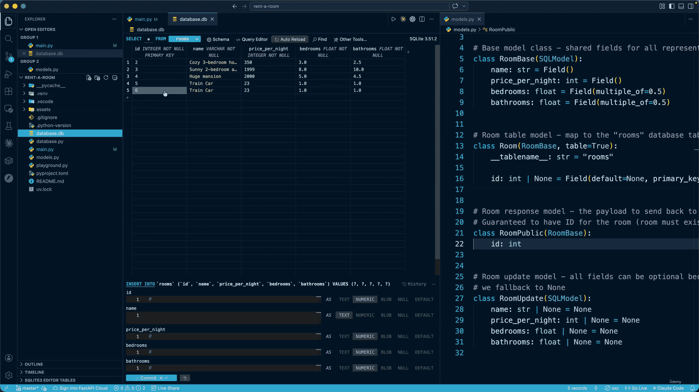
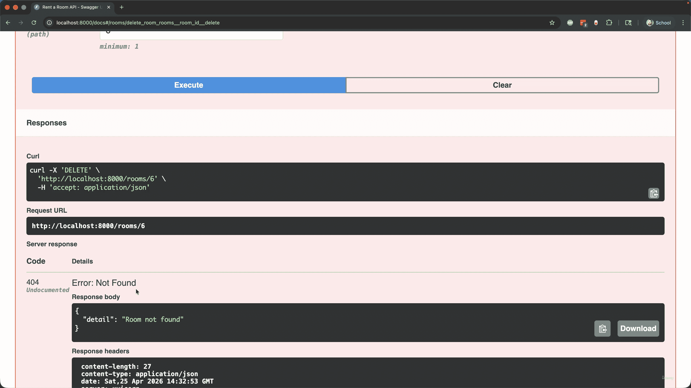

# FastAPI 大师课：76-77：使用新模型更新删除房间路由 🧹

在本节课中我们将要学习如何把删除房间路由更新为使用新的 Pydantic 模型。这个更新看起来只是在接口上加一个参数，但它背后涉及响应模型的转换、数据库模型的隔离，以及接口返回数据形状的统一。我们会先看删除路由需要改什么，再理解 `Room` 和 `RoomPublic` 之间的区别，然后梳理删除接口从查找、删除到返回的完整流程，最后用 Swagger 实际测试一次删除成功和一次删除不存在记录的情况。通过这节课，初学者可以更直观地理解为什么要把一个模型拆成多个模型来使用。

## FastAPI 大师课：76-77.1：删除路由的改动范围 🔄

上一节我们说明了要把房间相关的接口逐步切换到新的 Pydantic 模型，本节中我们来看看最后一条需要更新的路由，也就是删除路由。需要更新的是我们这里的删除路由，好消息是这个更新的范围应该非常有限。我们在这里唯一需要做的事情，就是再次在实际的删除方法调用中提供 `response_model` 参数。换句话说，路由逻辑本身不用大改，主要是在接口层面告诉 FastAPI：这个删除接口返回的数据应该长成什么样子。

以下是删除路由更新时要关注的几个具体点：

- 最后需要更新的路由是删除路由。
- 这个更新范围很有限。
- 唯一需要改的地方是再次在实际的 `delete` 方法调用中提供 `response_model` 参数。
- 这里把响应模型指定为 `RoomPublic`。

上面这些点说明，本次改动并不是重写删除逻辑，而是把返回值的形状约束补上。这样客户端拿到的数据就会按照 `RoomPublic` 的结构来组织，而不是随随便便返回一个内部模型实例。

## FastAPI 大师课：76-77.2：响应模型与数据形状 🧩

上一节我们确认了删除路由的改动重点，本节中我们来看看 `response_model` 到底意味着什么。这里需要提醒一下，指定 `response_model=RoomPublic` 的意思是：每当我们提供返回值时，即使这个返回值是另一个实例或另一个类，Pydantic 也会把返回的数据载荷转换成 `RoomPublic` 这个形状。这个机制很有用，例如你想省略或排除某些属性时就可以借助它。在本例中，`Room` 和 `RoomPublic` 的属性其实完全一样，唯一的区别是：在 `Room` 里，`id` 属性被声明为整数或 `None`；而在 `RoomPublic` 里，`id` 被声明为严格的整数。不过现在我们已经到了把数据返回给客户端的阶段，所以这个差异实际上不太重要。

核心概念可以用下面的代码来描述：

```python
@router.delete("/{room_id}", response_model=RoomPublic)
def delete_room(room_id: int, session: Session = Depends(get_session)):
    ...
```

数据形状的转换关系可以直白地写成下面这样：

```text
Room（数据库通信模型） --Pydantic 转换--> RoomPublic（返回给客户端的响应模型）

Room.id: int | None
RoomPublic.id: int
```

这里的关键结论是：我们已经移除了很多对 `Room` 的依赖，比如在响应模型里不再直接依赖 `Room`，在函数参数里也不再直接依赖 `Room`。这样一来，我们只在路由处理函数的函数体内部，才直接和负责数据库通信的实际类打交道。比如 `get` 这样的方法会检索一个 `Room` 实例，但也就是到这里为止；每当我们在路由里返回它时，Pydantic 都能在返回给客户端之前，把它完整转换成 `RoomPublic` 表示的目标形状。这个设计让“数据库里怎么存”和“客户端看到什么”分开了，后面维护起来会更清楚。

## FastAPI 大师课：76-77.3：删除端点的执行流程 🛠️

上一节我们理解了响应模型如何转换数据形状，本节中我们来看看删除端点本身是怎么工作的。快速回顾一下这个端点的工作方式：我们使用房间 ID 路径参数，通过 `get` 方法在数据库里定位房间。这里存在一种可能：这个 ID 对应的房间不存在；如果不存在，我们就会提前返回，并抛出 `404 Not Found` 异常。如果房间存在，我们就会把它放入删除队列，然后使用 `commit` 方法真正保存这次修改，最后把这个房间返回给客户端，以防客户端还想对返回结果做点什么。

删除流程可以用下面的伪代码表示：

```python
room = session.get(Room, room_id)

if room is None:
    raise HTTPException(status_code=404, detail="Not found")

session.delete(room)
session.commit()
return room
```

以下是这个删除端点执行时的关键步骤：

- 使用房间 ID 路径参数定位数据库中的房间。
- 通过 `get` 方法查找对应记录。
- 如果房间不存在，提前返回并抛出 `404 Not Found`。
- 如果房间存在，将它放入删除队列。
- 使用 `commit` 方法保存删除操作。
- 最后把房间返回给客户端。

到这里，删除端点的逻辑就完整了。可以看到，路由签名层面用 `RoomPublic` 约束返回形状，而函数体内部仍然使用 `Room` 和数据库会话完成真正的查找、删除与提交。接下来我们就把这个端点放到实际环境里运行一次。

## FastAPI 大师课：76-77.4：在 Swagger 中实测删除接口 🧪



上一节我们梳理了删除接口的内部流程，本节中我们来看看这个端点在真实请求中的表现。现在可以看一眼这个端点的实际运行情况。我要在数据库里找一个示例房间来删除，所以我会打开文件资源管理器，查看 `database.db`。再次说明，如果你的数据行和我的不完全一样，那完全没有问题。我注意到这里有一条来自上一课的重复记录，数据库里有两个 `train cars`，所以我要删除 ID 为 6 的这一行。接下来回到 Swagger 文档，也就是 `localhost:8000/docs`。

以下是实际测试删除接口时可以采用的步骤：

- 打开 `database.db` 查看数据库记录。
- 找到准备删除的示例房间记录。
- 回到 `localhost:8000/docs`。
- 展开删除端点并点击 `Try it out`。
- 提供要删除的房间 ID。
- 发起请求并观察响应。

在 Swagger 页面里，我可以展开删除端点，点击 `Try it out`，然后提供要删除的房间 ID。这里我提供 `6`，然后发起请求，确认一切仍然正常。可以看到请求从 `curl` 进来，使用的是 `DELETE` 这个 HTTP 动词，这里是房间的 ID。向下滚动后，我们得到 `200` 响应，可以看到响应确实是 `RoomPublic` 那种形状，并且这里的 ID 是 `6`。这说明删除成功，返回的数据也符合新的响应模型。

接下来我再发起一次同样的请求。这一次会命中前面的 `if` 语句，因为 `session.get` 方法已经无法再定位 ID 为 `6` 的记录，这个房间已经不存在了，因此应该返回 `404` 状态码。执行后向下滚动，确实可以看到我们得到 `404 Not Found`。这个测试说明，删除成功和删除不存在记录这两条路径都符合预期。到这里，所有端点都按预期工作。

## FastAPI 大师课：76-77.5：拆分模型后的设计收益 ✅

上一节我们通过 Swagger 验证了删除接口的成功与失败情况，本节中我们总结一下这次改动带来的设计变化。现在我们的设计比之前更好，原因是我们把一个单一的 `Room` 模型拆分成了多个 Pydantic 模型。每个模型都表示同一个基础房间资源的不同形状或不同形式。也就是说，数据库通信、请求输入、响应输出这些场景可以使用各自合适的模型，而不是所有地方都共用一个大模型。

以下是拆分模型后可以明确感受到的收益：

- `Room` 更偏向数据库通信场景。
- `RoomPublic` 更偏向返回给客户端的响应场景。
- 响应模型和函数参数可以减少对 `Room` 的直接依赖。
- 路由处理函数体内才直接使用数据库通信相关的类。
- 同一个房间资源可以用多个模型表达不同用途。



本节课中我们一起学习了如何更新删除房间路由：我们确认了改动范围很小，只需要在删除方法中补上 `response_model=RoomPublic`；理解了 Pydantic 会把返回值转换成 `RoomPublic` 的形状；梳理了删除端点先查找、不存在则返回 `404`、存在则删除并提交、最后返回房间的完整流程；还在 Swagger 中实际验证了删除成功返回 `200` 和重复删除返回 `404` 的情况。最终，我们通过把一个 `Room` 模型拆成多个 Pydantic 模型，让同一个房间资源在不同场景下拥有更清晰的数据形状，整个接口设计也更容易维护。
