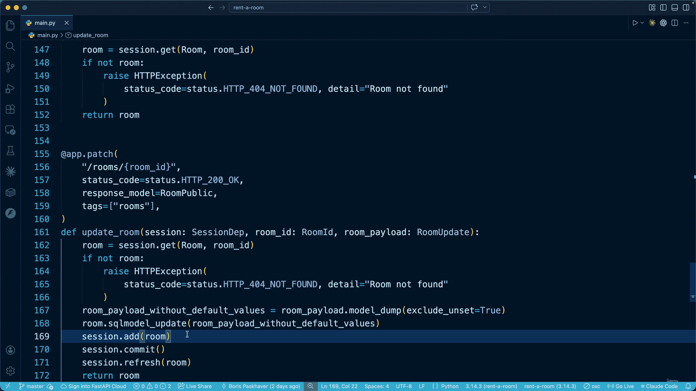
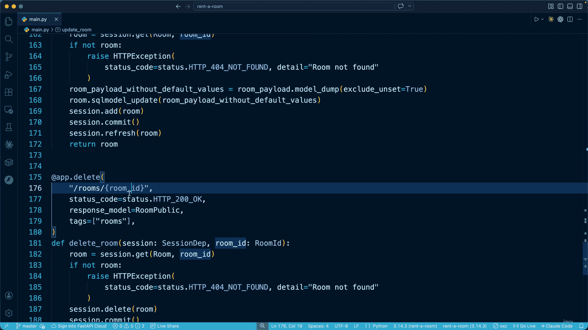
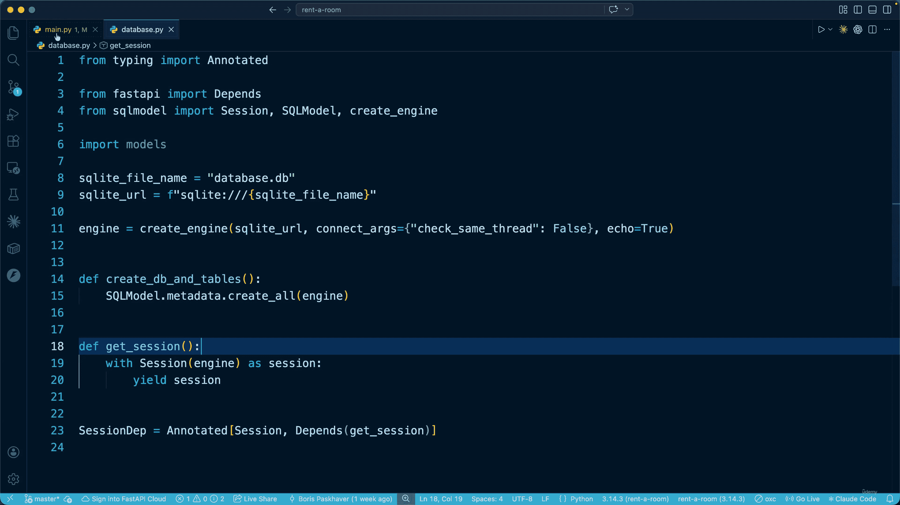
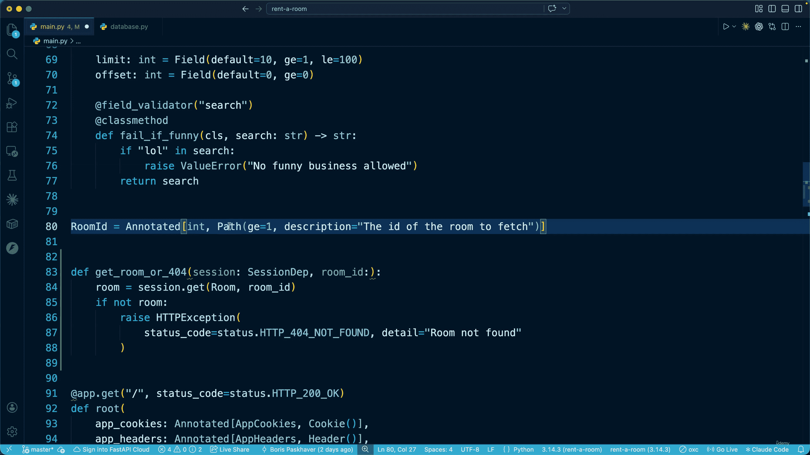
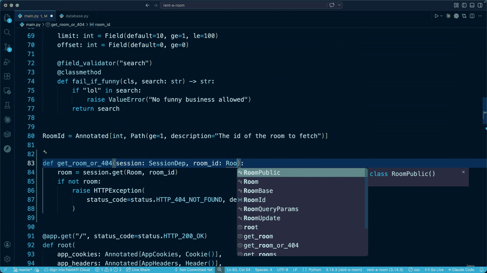
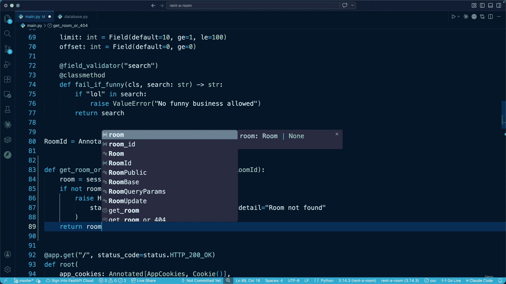
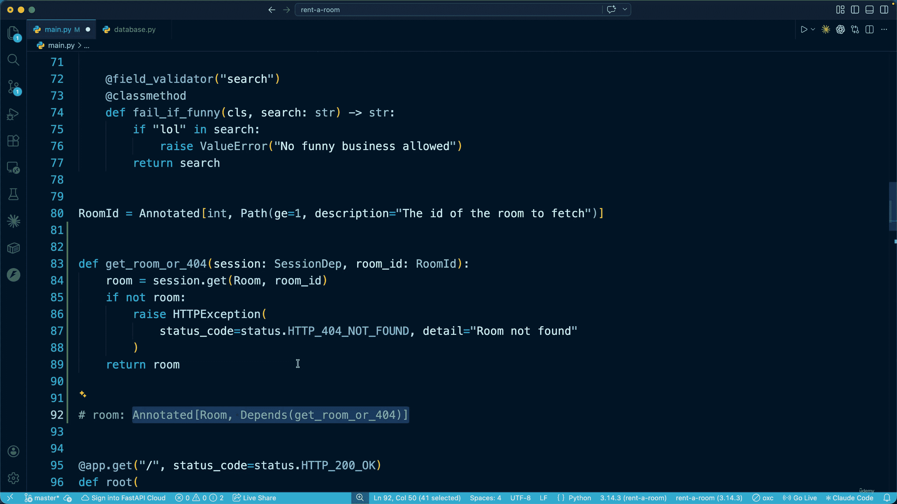
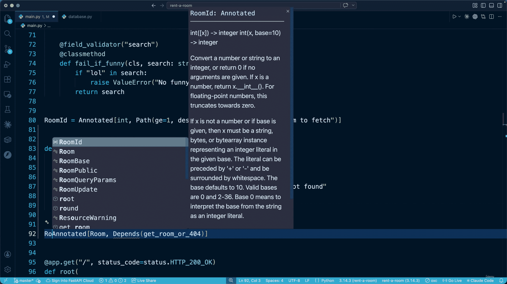
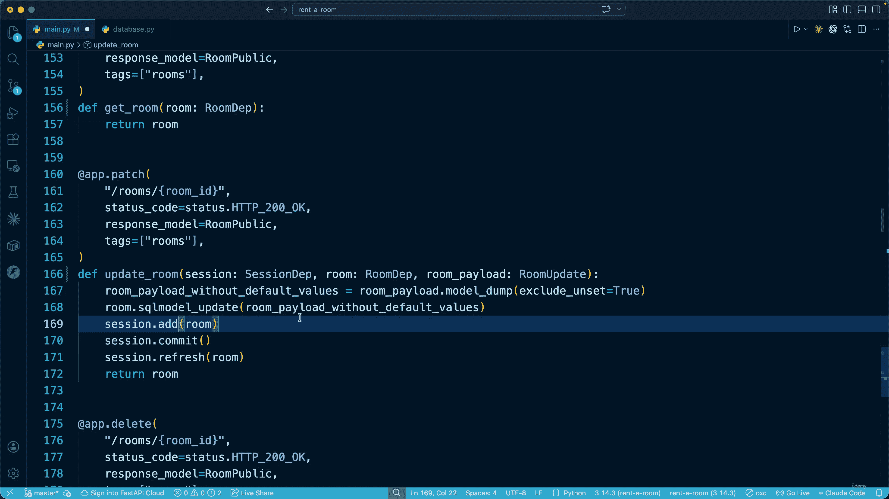
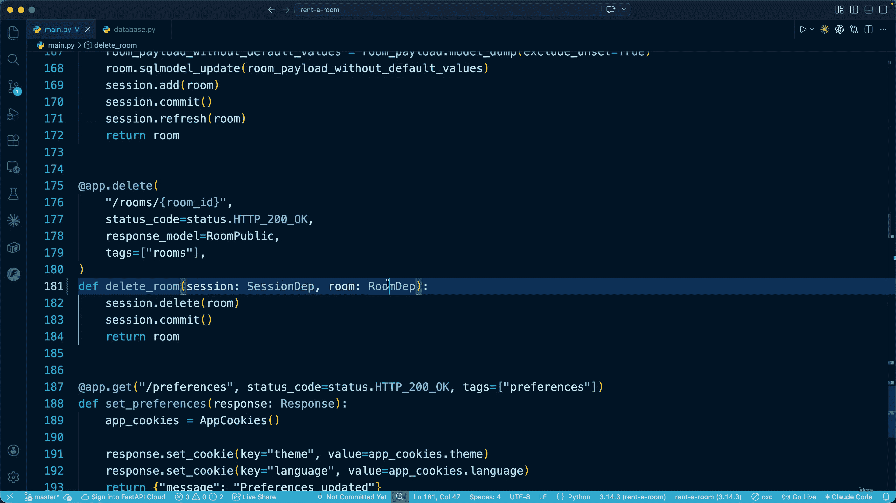

# FastAPI Masterclass（第1部分）：第78章：使用 Depends 函数实现可复用依赖 🔁

在本节课中我们将要学习一个很适合初学者掌握的优化技巧：把三个路由处理器里重复出现的代码提取出来，做成一个可复用的依赖函数，再通过 FastAPI 的 `Depends` 把它自动注入到路由中。这样做的直接好处是减少总代码量，让路由函数更短、更清楚，也更容易维护。原文从一个具体项目里的房间接口出发，带我们一步步看到重复代码如何被抽取、如何形成依赖链，以及如何改造 GET、PATCH、DELETE 三个接口。

下面进入问题背景，先看清楚重复代码到底出现在哪里。

## FastAPI Masterclass（第1部分）：第78章：问题背景 🔍

上一节我们说明了本课目标，本节中我们来看看三个路由处理器里的重复逻辑。原文指出，在 `get`、`patch`、`delete` 三个路由里，都在复用同一段代码：通过 session 和路径参数里的 `room_id` 去数据库取房间。以 GET 房间为例，代码会取房间，如果房间不存在就返回 404，而 `room_id` 来自路由的路径参数。PATCH 路由里的逻辑完全相同，因为更新房间前需要先取出房间，然后才能提交更新到数据库。DELETE 路由也一样，它同样使用路径里的 `room_id`，把它传给 session 的获取方法，从数据库取出房间，以便排队删除，最后再对数据库做删除变更。





重复代码主要出现在下面三个路由位置：

- GET 路由：使用 session 和路径里的 `room_id` 获取房间，房间不存在时返回 404。
- PATCH 路由：使用同样的方式获取房间，因为需要更新它，再把更新提交到数据库。
- DELETE 路由：再次使用 `room_id` 获取房间，为删除做准备，然后提交数据库变更。

这三个位置本质上做的是同一件事：根据路径参数里的 ID 取房间。上一节我们看到了重复点，本节中我们来看看如何把它提取成一个可复用的依赖函数。

## FastAPI Masterclass（第1部分）：第78章：提取依赖函数 🧩

原文说，这段重复代码可以提取成一个可复用函数，也就是可复用依赖，然后再次使用 FastAPI 里的 `Depends` 函数，确保这个辅助函数在三个路由处理器中任意一个运行之前被调用。因为三个函数基本是同一段代码，都是根据路径参数里的 ID 获取房间，所以可以从任意一个函数里复制这段代码，三个函数里的代码块完全一样。接着向上滚动，在所有路由处理器之前声明这个依赖。函数名可以自己起，原文这里把它叫作 `get_room_or_404`，名字完全由我们决定。然后把刚才复制的代码粘贴到函数体里。



这个函数依赖两个东西：`session` 和 `room_id`。我们可以像给路由处理器提供参数一样，给这个函数提供这两个参数。工作方式是：只要把这个函数传给 FastAPI 的 `Depends`，FastAPI 就会理解 `get_room_or_404` 需要哪些依赖，并且用和路由处理器一样的方式把这些依赖注入进来。对于 session，可以使用项目里已经定义好的 `SessionDep` 类型。原文提醒我们可以用命令点击进入 `SessionDep` 的定义查看，它内部同样使用 FastAPI 的 `Depends` 去调用 `get_session` 函数。





新依赖函数需要的参数和返回内容如下：

- `session: SessionDep`：告诉 FastAPI 先调用 `get_session`，拿到数据库会话。
- `room_id`：使用已经声明好的路径参数类型，让 FastAPI 从路径里提取整数房间 ID，并执行 Pydantic 校验。
- 返回值 `Room`：从数据库取到的房间对象，供路由处理器继续使用。

当任意一个路由处理器依赖 `get_room_or_404` 时，FastAPI 会自动运行 `get_room_or_404`，而这个函数又会自动运行 `get_session`。这样我们就建立了一条完整的依赖链或依赖层级，FastAPI 会按照需要的顺序依次运行它们，最终把数据或值提供给路由处理器。这里的关键点是依赖套依赖，这种做法很实用，因为它让我们可以从小依赖搭出更大的依赖。

依赖链调用顺序可以这样理解：



1. 路由处理器声明自己依赖 `RoomDep` 或直接依赖 `get_room_or_404`。
2. FastAPI 发现 `get_room_or_404` 依赖 `SessionDep`，于是先调用 `get_session`。
3. FastAPI 再从路径参数中提取并校验 `room_id`。
4. 最后执行 `get_room_or_404`，把房间对象返回给路由处理器。

上一节我们提取了函数骨架，本节中我们来看看这个函数体里具体怎么写。回到 `main.py` 后，我们已经有 session，也需要 `room_id`。幸运的是，上方已经定义了房间 ID 的类型，它说明了如何从路径中提取整数房间 ID，并应用额外的 Pydantic 校验。所以这里直接提供 `room_id` 即可。通过复用前面声明好的类型，我们就能自动调用 `get_session`，并对路径参数 `room_id` 做 Pydantic 校验。

在依赖函数体里，我们使用 session 的 `get` 方法获取房间；如果房间不存在，就返回 404 异常；最后还需要返回房间，这样路由处理器才能复用这个返回值。这个返回值会变成附加到对应路由处理器参数上的依赖值。代码大致如下：

```python
from fastapi import Depends, HTTPException
from typing import Annotated
from sqlmodel import Session

SessionDep = Annotated[Session, Depends(get_session)]

def get_room_or_404(
    session: SessionDep,
    room_id: int,
) -> Room:
    room = session.get(Room, room_id)
    if room is None:
        raise HTTPException(status_code=404, detail="Room not found")
    return room

RoomDep = Annotated[Room, Depends(get_room_or_404)]
```





上一节我们写好了依赖函数，本节中我们来看看如何把 `Annotated` 加 `Depends` 再包装成一个可复用类型。原文接下来采用完全相同的模式：把使用 `Depends` 的 `Annotated` 类型赋值给一个辅助类型或辅助变量。这样做之后，这个辅助类型或变量就可以用在任意路由处理器的函数参数上，因为它依赖 FastAPI，FastAPI 会自动处理所有注入和调用。

原文也说明，反复重写代码本身没有错。例如，对于任意路由处理器函数参数，可以写成 `room: Annotated[Room, Depends(get_room_or_404)]`。当然可以把这行代码复制粘贴到每个路由函数参数上，但那样每次都要重写整段。更简单的办法是把它赋值给一个专用变量。于是删掉注释，创建一个变量叫 `RoomDep`，这是 room dependency 的缩写。

这里再次使用相同的 `Annotated` 语法：第一个值是参数真正的核心类型，让类型检查器知道函数参数会是 `Room` 类型；第二个值说明如何获取这个值，也就是让 FastAPI 在路由处理器执行前自动调用 `get_room_or_404`。原文提醒，为了使用 `Depends`，要滚动到文件最上方，从 FastAPI 直接导入 `Depends`。把这个类型加到任意路由函数参数上时，FastAPI 会理解参数值类型是 `Room`；为了取得这个值，它会调用 `get_room_or_404`。如果房间不存在，路由处理器还没执行就会报错并返回 404；如果函数成功，就会返回真正的房间对象，也就是 `Room` 模型类的实例，这个对象会成为路由处理器执行时使用的参数值。

改造时有几个细节需要注意：

- `RoomDep` 是带 `Depends` 的 `Annotated` 类型，不是 `Room` 模型本身。
- `Room` 是真正的数据库模型类，`RoomDep` 是告诉 FastAPI 如何取得 `Room` 的类型。
- 路由参数写成 `room: RoomDep`，就能在函数体里直接使用已经取到的房间对象。
- `SessionDep` 内部也使用 `Depends(get_session)`，所以依赖可以一层套一层。

上一节我们定义了 `RoomDep`，本节中我们来看看 GET 路由如何被大幅简化。原文说，构建这些依赖确实增加了一些复杂度，但现在有了可复用的积木，路由函数会大大简化。向下滚动到 `get_room` 函数，可以看到这个端点被清理得很干净。`get_room` 用于获取单个房间，现在原来那段代码都包含在类型里了。我们可以声明 `room`，并把它的类型声明为 `RoomDep`。这个类型正是刚才声明的类型，它使用 `Depends` 功能调用 `get_room_or_404`，从数据库获取房间。

当这个函数开始运行时，我们已经能访问 `room`。这意味着不再需要原来那段取房间和判断 404 的代码，也不再需要 `session` 和 `room_id` 参数，甚至可以把它缩减成一行。现在获取房间和返回 404 的魔法都发生在路由处理器执行之前，已经被隔离并提取到 `RoomDep` 依赖里；而 `RoomDep` 又依赖自己的依赖，比如 `get_session`，去和数据库通信。对比原来的写法，这个路由处理器简单很多。改造后的 GET 路由大致如下：

```python
@router.get("/rooms/{room_id}", response_model=Room)
def get_room(room: RoomDep):
    return room
```

上一节我们改造了 GET，本节中我们来看看 PATCH 路由。原文继续更新剩下的端点。在 PATCH 里，一旦定义 `room: RoomDep` 参数，就不再需要原来那些取房间的代码行，因为路由处理器运行时已经能拿到从数据库取出的房间。这里的关键区别是仍然需要保留 `session`，因为后面要使用它把房间的修改或更新写入数据库。但现在不再需要 `room_id`，因为 `room_id` 原本只是为了发起数据库获取调用。可以把 `room_id` 替换成 `room`，并再次把类型声明为 `RoomDep`。

这样当客户端请求这个端点时，FastAPI 会构建依赖。它看到 `RoomDep` 依赖 `get_room_or_404`，就会在路由函数体执行之前自动调用这个函数。假设函数成功并返回房间，那么 `get_room_or_404` 返回的房间模型实例就会赋值给 `room` 参数。然后我们就可以继续执行路由处理器的实际逻辑：修改这个房间对象，并把更新保存到数据库。改造后的 PATCH 参数部分可以写成这样：

```python
@router.patch("/rooms/{room_id}", response_model=Room)
def update_room(
    room: RoomDep,
    session: SessionDep,
    payload: RoomUpdate,
):
    ...
```

上一节我们改造了 PATCH，本节中我们来看看 DELETE 路由。向下滚动到 `delete_room`，同样不再需要原来取房间的那段代码。我们仍然需要 `session`，因为要调用 `delete` 和 `commit` 方法提交删除变更。但这里也不再需要 `room_id`，所以可以把它改成 `room`，并提供 `RoomDep` 依赖。这里要特别注意写 `RoomDep`，不要写成 `Room`，因为 `Room` 是真正的模型，而 `RoomDep` 是使用 FastAPI `Depends` 的 `Annotated` 类型，用来告诉 FastAPI 它依赖 `get_room_or_404`。



现在可以清理函数体。当路由处理器执行时，我们可以保证 `room` 存在于数据库中；如果不存在，`get_room_or_404` 早就已经抛出异常并返回 404，根本不会执行到这个函数体。这样我们就成功把三个路由处理器中可复用、可重复、重复出现的部分提取成了一个方便的 `RoomDep` 依赖。改造后的 DELETE 路由大致如下：

```python
@router.delete("/rooms/{room_id}")
def delete_room(
    room: RoomDep,
    session: SessionDep,
):
    session.delete(room)
    session.commit()
    return {"ok": True}
```

## FastAPI Masterclass（第1部分）：第78章：本课总结 📌



本节课中我们一起学习了如何使用 FastAPI 的 `Depends` 函数构建可复用依赖。我们先找出了 GET、PATCH、DELETE 三个路由里重复的取房间逻辑，再把这段逻辑提取成 `get_room_or_404` 函数。这个函数依赖 `SessionDep` 和路径参数 `room_id`，会在房间不存在时返回 404，成功时返回房间对象。接着我们把 `Annotated[Room, Depends(get_room_or_404)]` 包装成 `RoomDep`，让任意路由参数都能直接声明 `room: RoomDep`。这样 FastAPI 会自动构建依赖链，先调用 `get_session`，再调用 `get_room_or_404`，最后把房间对象注入路由处理器。GET 路由因此变得非常简洁，PATCH 和 DELETE 路由也去掉了重复的获取和判断代码，同时保留必要的 `session` 来完成数据库更新或删除。整套做法的核心价值就是：把重复逻辑变成可复用的依赖积木，让路由函数更短、更清楚、更好维护。

