# 🚀 FastAPI Masterclass：78-79：依赖缓存

在本节课中，我们将学习FastAPI的依赖缓存机制。上一节课我们已经介绍了如何使用依赖来处理数据库会话和房间查询，但你也许没有注意到FastAPI在后台是如何优化这些依赖的。我们会通过一个具体的场景来理解：当同一个依赖在多个地方被使用时，FastAPI到底会怎样处理？我们会揭开FastAPI如何通过依赖图和缓存来避免重复创建资源，同时也会介绍如何关闭这一默认优化行为。这样，你在日常使用中就能更放心地让FastAPI替你打理这些细节。

## 一、回顾：session的两处使用

细心的你可能已经注意到，在上一节课的代码中，delete_room和update_room这两个路由函数都接收了一个session参数，而这个session来自session依赖。同时，我们还使用了room_dep，这个room_dep依赖于get_room_or_404，而get_room_or_404本身也需要一个session。于是，session就在两个位置上被使用了：

- 一次在路由处理器内部，比如delete_room和update_room函数体里直接使用session。
- 一次在依赖内部，也就是room_dep所依赖的get_room_or_404需要session。

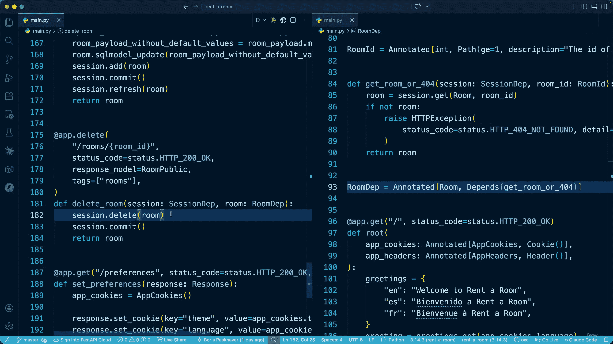

换句话说，同一个session依赖被两条不同的代码路径引用。你可能会想，这难道不会导致FastAPI创建两个数据库会话吗？带着这个疑问，我们继续往下看。

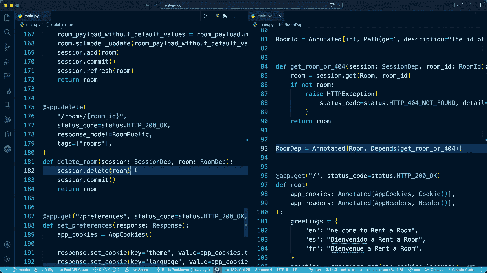

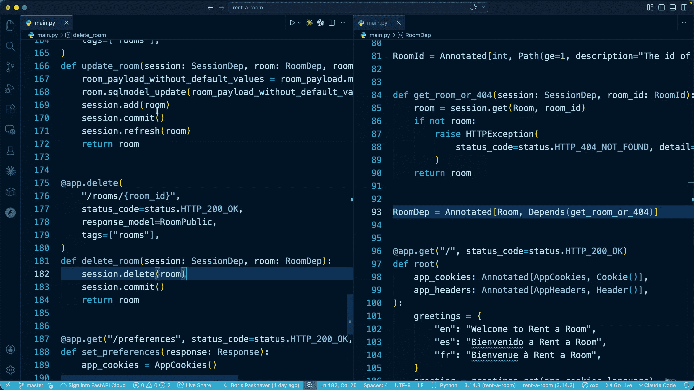

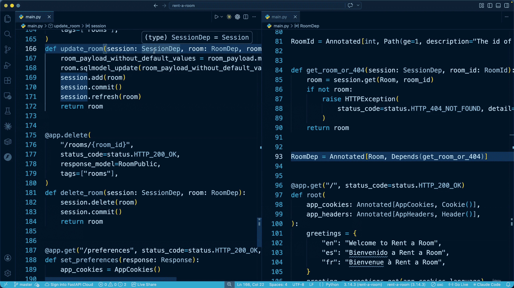

## 二、问题：FastAPI会不会创建两个会话？

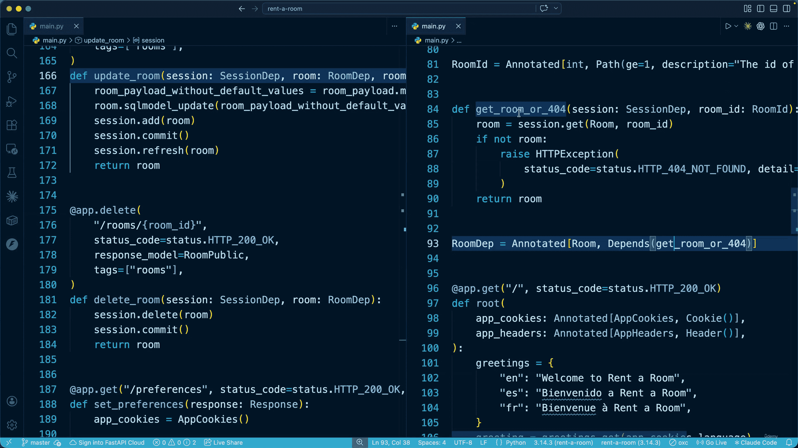

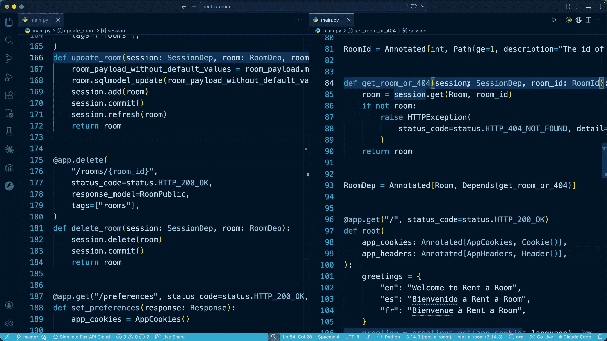

看到上面的回顾，你可能已经产生了疑问。FastAPI会不会在后台把get_session调用两次，并创建两个独立的数据库会话？比如说，一个会话用于get_room_or_404，等这个函数运行结束后就销毁它；另一个会话则给真正的路由处理器使用。

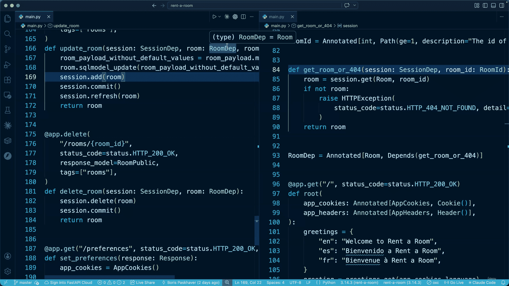

答案是：不会。FastAPI会缓存这个依赖，也就是说，它会在单个请求的整个生命周期内把这个依赖实例保持存活。每当一个新的请求进来时，FastAPI都会认真计算它需要创建的资源总量，并且尽量避免不必要的重复创建。如果确实不需要多个会话，它就不会创建多个会话。

你可能会说，就算创建两个会话，也不会有太大影响。事实并非如此，我们来看看背后的原因。

## 三、为什么需要避免多个会话？

你可能会想，多创建几个会话也不会有太大影响。但事实上，如果FastAPI真的为同一个请求创建多个会话，那反而会给程序带来出错的可能。因为每一个数据库会话都代表一个到数据库的临时连接，这个连接需要感知它正在管理的对象当前处于什么状态，而这些对象最终会映射回对应的数据库表。换句话说，会话必须保持对事务和对象状态的跟踪。如果同一个请求里出现两个不同的会话，它们各自跟踪的对象状态可能不一致，后续的数据操作就容易出现混乱。

所以，为了既保证正确性，又节省资源，FastAPI采用了一套优雅的机制。那么这套机制具体是怎么工作的呢？

## 四、FastAPI的做法：依赖图和缓存

为了回答上面的问题，我们需要看看FastAPI的具体策略。它的做法可以分为两步：

1. **构建依赖图**。FastAPI会先分析当前路由需要哪些依赖，接着分析这些依赖自身又需要哪些依赖，然后继续往后分析，直到把所有依赖关系都梳理清楚。这个过程最终会形成一张依赖图。

2. **复用重复出现的依赖**。如果在依赖图里发现同一个依赖（比如session）出现了多次，FastAPI就只会创建它一次，然后把这个实例缓存起来，供所有需要用到它的地方重复使用。

以我们的场景为例，依赖图大致可以表示如下：

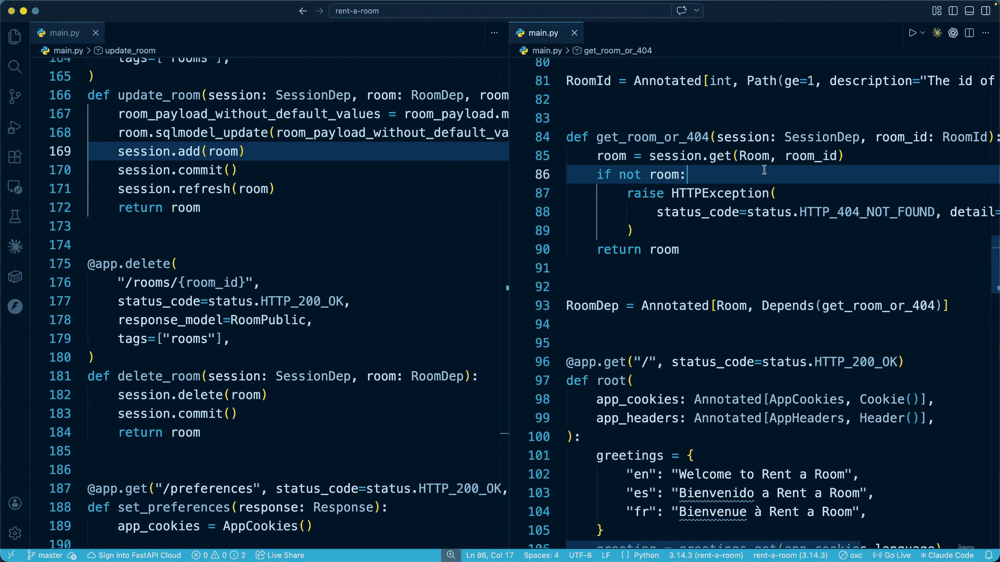


```text
delete_room / update_room
├── session
└── room_dep
    └── get_room_or_404
        └── session
```

从这张图可以看出，session节点出现了两次。为了让你更直观地理解FastAPI内部的缓存逻辑，下面再用伪代码展示一下：

```python
# 示意：FastAPI内部对同一依赖的缓存处理
session_cache = {}

def get_cached_session():
    if "session" not in session_cache:
        session_cache["session"] = get_session()
    return session_cache["session"]
```

在上面的场景中，整个请求只会产生一个数据库会话。从技术上讲，这个会话是在第一次被使用的位置创建出来的。之后每当你再次声明session参数时，FastAPI都会把那个已经创建好的缓存会话提供给你，而不是重新创建。

## 五、日常使用中无需担心

理解了这些后台机制之后，有一点你需要明白。这些由FastAPI完成的后台优化并不需要你在日常开发中手动干预。你只需要正常写出依赖函数，并把它声明在需要的地方，FastAPI就会自动判断是否应该复用同一个实例。这种设计既保证了代码简洁，也避免了多个数据库会话带来的状态混乱问题。

不过，如果你真的需要在某个特殊场景下关闭这种缓存，FastAPI也提供了相应的灵活性。我们接着看。

## 六、调整默认缓存行为

FastAPI的默认行为是缓存并复用依赖，但它也允许你显式地告诉它：“我不想要这种优化的缓存行为，我希望每次用到依赖时都创建一个全新的实例。”即使这会导致同一个依赖被创建多次，FastAPI也可以做到。但需要提醒你的是，这并不是FastAPI的默认行为。FastAPI的默认策略是尽量重用同一个依赖，而不是在路由处理器的执行过程中反复创建新的对象、新的实例。

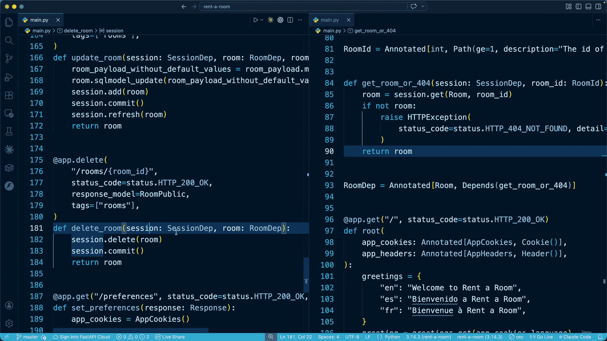

从本质上说，这是一种性能优化。依赖被保留或缓存下来，而不是从头重新创建。FastAPI之所以在后台这样努力，正是因为希望获得更快的响应速度、更少的内存占用，以及更稳定的运行状态。

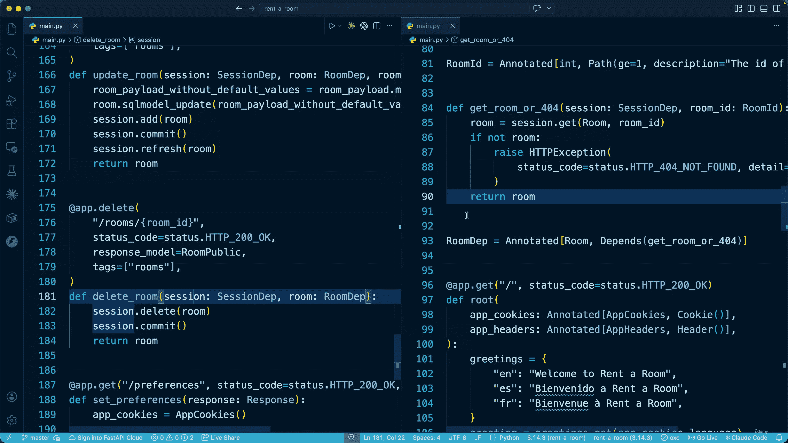

## 七、小结

到了这里，本节课的内容已经接近尾声。我们一起学习了FastAPI的依赖缓存机制。我们首先回顾了上一节课中session依赖在路由处理器和另一个依赖中重复出现的情况，然后提出了一个关键问题：FastAPI是否会为同一依赖创建多个实例？结论是否定的。FastAPI会通过构建依赖图来确定所有依赖之间的关系，并识别出重复出现的依赖；对于这些重复依赖，它只创建一个实例，并在整个请求生命周期中缓存复用。这样的设计不仅减少了资源开销，还避免了多个数据库会话跟踪状态不一致的风险。

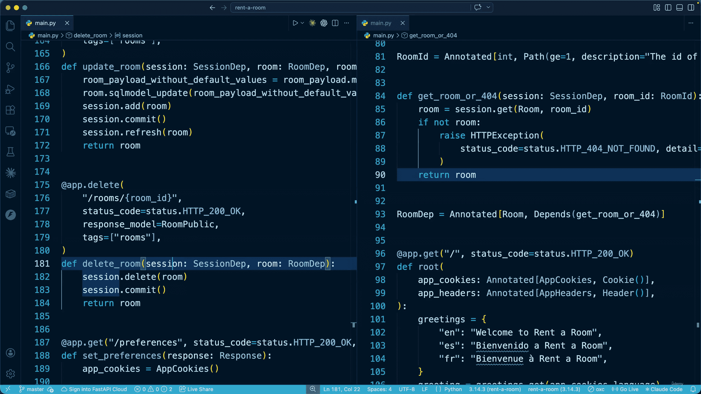

此外，我们还了解了FastAPI的默认优化策略是重用依赖，而不是重复创建。虽然可以通过一些方式来调整缓存行为，但在大多数日常场景中，使用默认的缓存机制是最合适的选择。FastAPI在后台默默为你做了这些优化，让应用响应更快、内存占用更低。希望本节能让你对FastAPI的依赖系统有更深入的认识。

