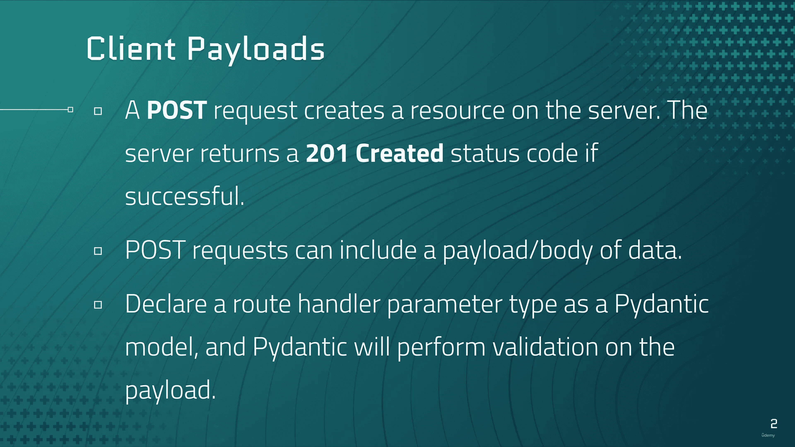
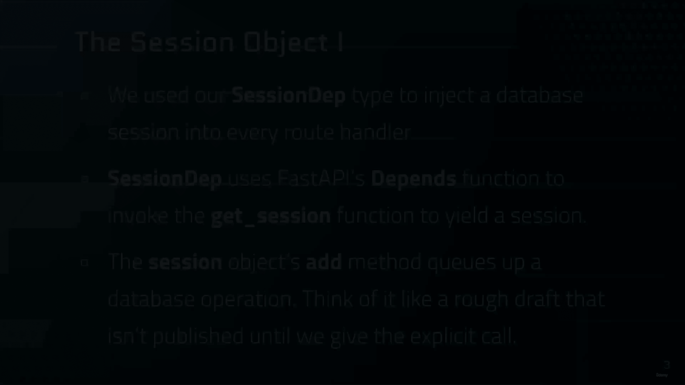
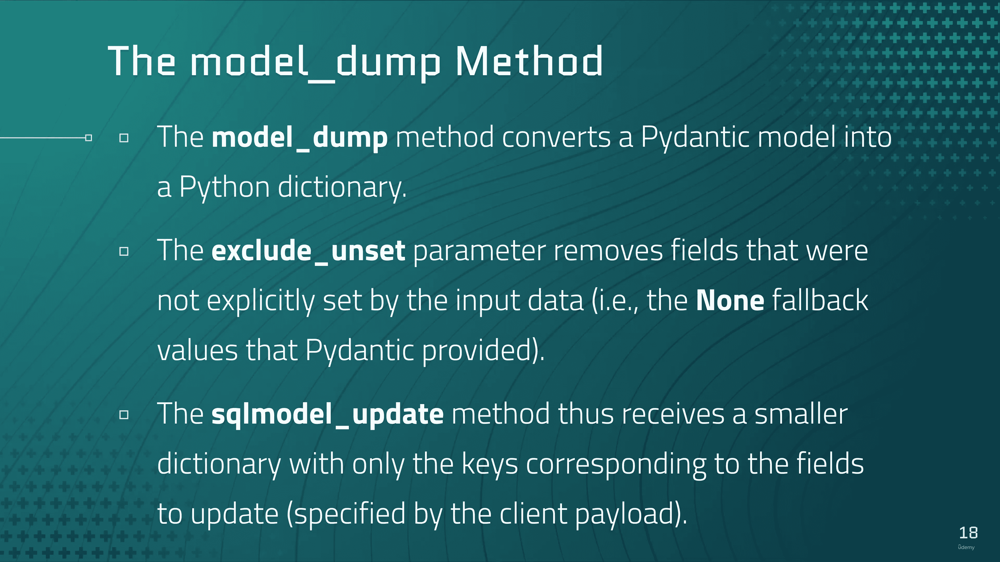
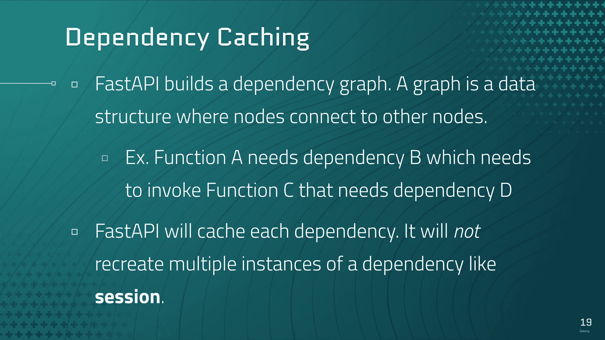

# 🚀 FastAPI 大师课：P79-P80：章节回顾——数据库 CRUD、查询、依赖与响应模型

在本节课中我们将要学习又一个课程章节的回顾内容。这个章节围绕数据库最常见的四类操作展开，也就是创建、读取、更新和删除记录，同时还会把请求体校验、Session 依赖、查询过滤、分页排序、路径参数、PATCH 更新、模型分层、响应模型和依赖缓存串起来。下面按照开发一个资源接口的自然顺序来整理，先看创建，再看查询，接着看路径参数、更新、模型设计、删除、响应控制和依赖注入，最后做一个小结。

## 🧱 1. POST 创建资源：请求体、Pydantic 校验与 Session 依赖

上一节的内容从创建资源开始，本节中我们来看看 POST 请求如何把一条记录写入数据库。POST 请求的作用是在服务器上创建资源，如果请求成功，服务器应当返回 `201 Created` 状态码；客户端通常需要指定要写入数据库的数据或字段，因此 POST 请求一般会携带 payload，也就是请求体数据。为了在路由处理器中接收这些数据，我们会声明一个参数，并通常把它关联到 Pydantic 模型，这样 Pydantic 就能对资源中的所有嵌套字段执行校验。





以房间资源为例，我们想发送一个包含四个属性的 payload：名称、每晚价格、卧室数量和浴室数量。使用 Pydantic 后，可以验证三件事：第一，这四个属性是否存在；第二，它们是否符合预期类型；第三，是否满足字段函数上的额外校验，例如最小长度或最大值。Pydantic 会把传入的 JSON 转换成等价的 Pydantic 模型对象，接下来就是把变更排队到数据库中。

为了与数据库交互，我们需要使用 session 对象，因此使用了 session 依赖。这个依赖本质上是一个表示类型的变量，它通过 `Annotated` 类型和关联元数据连接到 `Depends(get_session)`，而 `get_session` 函数会 yield 一个 session。这个 session 是一次临时的数据库交互，但这种设计的好处是把 session 创建的复杂逻辑抽象到单独函数中，再把对该函数的依赖隔离到一个类型里；只要函数参数声明为这个 session 依赖类型，相关逻辑就会在路由处理器执行之前运行。到了路由处理器内部，我们直接使用 session 参数即可，因为已经知道它带着数据库连接。

创建流程中最重要的方法是 `session.add()` 和 `session.commit()`。`add` 方法会把数据库操作排队，可以把它理解成一份草稿，所有变更还没有真正发布，直到显式调用保存方法，也就是配套的 `commit` 方法。`add` 方法接受一个来自模型类的对象，这个模型类需要连接数据库表；早期使用同一个 Room 模型表示多种形状时，这一点比较容易处理，因为 Room 模型同时也连接数据库中的 rooms 表。需要特别注意的是，`add` 只能接受连接数据库表的对象，也就是 SQLModel 中设置了 `table=True` 的模型；如果传入普通 Pydantic 模型，编辑器不会报错，但运行时会报错，因为 session 不知道如何把这个普通 Pydantic 模型映射到数据库表。Room 模型连接数据库，因此 session 知道传入的 Room 对象对应 rooms 表，也知道如何读取、写入、删除这张表的数据。

下面用一段代码概括创建资源时的核心动作。

```python
session.add(room)       # 把变更排入队列，类似草稿
session.commit()        # 真正保存到数据库，生成 SQL
session.refresh(room)   # 用数据库最新数据刷新模型对象
```

`add` 方法是在修改内存中的现有对象，并告诉 session 把这个变更排队；`commit` 方法才会真正保存队列中的变更到数据库，也会在终端生成实际的 SQL 代码。之后还可以在 session 对象上调用 `refresh`，并传入同一个模型实例，例如 Room 模型，以确保对象被更新为数据库中的最新数据。POST 请求中这个动作很有用，因为记录只有在保存到数据库之后才会被分配数字 ID；保存之前的 Room 实例没有有效 ID，技术上它被设置为 `None`，而 `commit` 之后它才会有有效 ID。以上就是使用 session 对象向数据库写入数据的基本方式。

上一节我们介绍了如何创建记录，本节中我们来看看如何从数据库中读取记录。创建完成后，读取和查询就是下一步自然要处理的事情。

## 🔎 2. 查询数据：select、exec、where、过滤、分页与排序

查询已有数据同样可以使用 session 对象，而且实现方式很多。`exec` 方法是 `execute` 的缩写，它接受用于构建 SQL 查询语句的代码，本质上就是向数据库或某张表请求数据。一个常见做法是从 SQLModel 导入 `select` 函数，然后传入与数据库表对应的有效模型，例如 Room 模型；session 之所以知道这是在查询 rooms 表，是因为 Room 模型映射回 rooms 表。把 Room 模型传给 `select`，就会提取该模型对应表中的所有行。

`exec` 方法会返回一个可迭代对象，因此可以用 `for` 循环遍历，但通常我们会调用 `all()` 方法把它转换成 Python 列表。你也可以把这个 Python 列表直接从路由处理器返回，Pydantic 会把它转换成对应的 JSON 并发送回客户端。不过，直接查询某张表的所有行可能会在数据量很大时出现问题，因此通常需要过滤或缩小结果范围。

SQL 本身有原生的 `WHERE` 子句来完成过滤，SQLModel 中对应的方法是 `where`。调用 `where` 时传入某种逻辑过滤布尔条件，可以引用模型的任意属性；例如 `Room.bedrooms`，既可以访问字符串字段，也可以访问数值字段，然后执行等于、不等于、大于、小于、包含、取反等逻辑比较。你构建布尔逻辑后，SQLModel ORM 会生成合适的 SQL，只定位满足条件的行。例如 `Room.bedrooms == 3` 会让 SQLModel 生成查询 bedrooms 列值正好等于 3 的行。如果链式调用多个 `where` 方法，会应用 AND 逻辑，也就是所有条件都必须满足；也可以通过导入 `or_` 函数来应用 OR 逻辑，表示满足这个条件、满足那个条件，或者两个条件都满足。

下面是查询、过滤、排序和分页的核心写法。

```python
statement = (
    select(Room)
    .where(Room.bedrooms == 3)
    .order_by(Room.id)
    .limit(25)
    .offset(0)
)
rooms = session.exec(statement).all()
```

一般情况下，过滤应当优先放在数据库侧完成。换句话说，如果先从数据库取回一批结果，再用 Python 内联代码过滤，这种做法并不理想；它不一定非常糟糕，但数据库针对过滤做了优化，通常会比 Python 更快，也能让接口响应更快。因此应当尽量构建 ORM 查询，让 SQL 替你完成工作。例如，当我们要在房间名称中搜索查询参数里的子串时，可以展示两种在数据库侧过滤的方式：导入 `func` 对象，其中包含 `lower` 等方法，可以在 SQL 侧把条目转成小写；也可以使用 `contains` 方法检查字符串是否包含某个子串，这同样发生在 SQL 侧；最后还介绍了 `ilike` 方法，它可以执行大小写不敏感的搜索。这些都是数据库特定功能，但 SQLModel ORM 通常为几乎每个 SQL 关键字或子句提供了对应方法。

即使做了过滤，返回的记录数量仍可能很大，因此通常会把查询与 `limit` 和 `offset` 方法结合使用。`limit` 方法限制返回行数的上限，例如传入 25，就是让 ORM 生成 SQL，指示数据库最多返回 25 行；这能帮助数据库不必扫描所有行，只扫描到满足条件的足够行数即可。问题在于，查询总是从数据集的开头开始搜索，而有时我们希望从中间或接近末尾的位置开始，尤其是在实现分页功能时，用户从一页导航到另一页，需要一批新的结果，就必须从数据开头之后的某个位置开始查询。为此可以使用配套的 `offset` 方法，它会在数据库侧开始实际查询之前跳过指定数量的行；例如传入 10，就是跳过 10 行后再应用查询并寻找匹配行。`limit` 和 `offset` 可以一起使用，例如分页时每页返回 10 行，后续页面把 offset 增加到 10、20、30，从而确保每页返回不同的结果集；实际提取不同批次数据的工作由数据库完成，我们只是用 ORM 构建查询，让数据库返回预期结果。

当返回一批或一组多个资源时，建议调用 `order_by` 方法确保顺序一致，它会翻译成 SQL 中对应的 `ORDER BY` 子句。使用 `order_by` 时，可以传入表示为模型属性的数据库列，ORM 会以它为基础执行实际排序；如果不确定用哪一列，ID 列通常是较好的选择，但具体取决于客户端希望如何接收数据以及通常如何使用数据。无论列类型如何，默认排序顺序都是升序，也就是数字从小到大、文本按字母顺序、日期时间从最早到最晚。如果希望结果按降序排列，也就是数字从大到小、文本反向字母顺序、日期时间从最新到最早，可以从 SQLModel 导入 `desc` 函数，并把它放在实际查询之前。

下面用公式概括分页的核心思路。

```text
offset = page * page_size
limit = page_size
```

这里的目标不是记住所有语法选项。如果忘记了，通常应当查阅 SQLModel 或 SQLAlchemy 文档，找到所需的关键字或方法调用；更重要的是理解这些操作的价值，以及为什么要应用它们，并尽量写出正确的代码，让 ORM 生成尽可能好的 SQL 查询，让数据库完成尽可能多的工作。理想情况下，路由处理器只需委托给一个合适的 ORM 调用，然后拿回形状正好符合要求的数据，立即发送回客户端，不需要额外的 Python 代码。

上一节我们介绍了查询和过滤，本节中我们来看看 URL 中的路径参数以及更严格的校验方式。查询参数和路径参数都属于接口输入的一部分，只是数据来源不同。

## 🛣️ 3. 路径参数与 Path 校验

路径参数是 URL 或路径中的动态片段，我们可以从中提取数据。默认情况下，FastAPI 会根据路由处理器的参数名与路由字符串中花括号内容是否匹配来自动识别路径参数，而路由字符串是传给 `get` 方法、`post` 方法等的第一个参数。FastAPI 还可以根据类型注解自动转换数据类型，但如果想使用 Pydantic 做更广泛的验证，并且想把类型提取到一个可复用的类型变量中，就可以使用 FastAPI 的 `Path` 函数，例如在处理 room ID 时就可以这样做。`Path` 能提供更多验证能力，例如验证参数大于等于某个值、小于某个值，或者包含某些文本；`Path` 的工作方式与 `Query`、`Cookie` 等函数完全一致。

一般协议是使用 `Annotated`：方括号中的第一个条目写实际需要的类型，第二个参数是 `Path` 的调用，在那里可以提供验证规则和描述，同时也明确告诉 FastAPI 以及未来的代码阅读者，流入路由处理器的这个值的数据来源是路径参数，而不是查询参数、Cookie 或请求头等其他数据源。

下面是路径参数校验的典型写法。

```python
RoomId = Annotated[int, Path(ge=1, description="房间 ID")]

@router.get("/rooms/{room_id}")
def get_room(room_id: RoomId):
    ...
```

上一节我们介绍了路径参数，本节中我们来看看如何更新资源。创建、读取和获取单个资源之后，PATCH 更新就是很自然要补齐的一环。

## ✏️ 4. PATCH 更新：先取记录、404、依赖与 sqlmodel_update

在完成创建房间、获取多个房间和获取单个房间的端点后，我们进入了 PATCH 请求端点。更一般地说，有两个 HTTP 动词用于更新资源：PUT 请求用于完整更新资源，也就是保留数据库行并替换其中的所有条目；PATCH 请求用于部分更新，可以更新给定房间的任意或全部属性。这些是 HTTP 标准规则，但在现实世界中，大多数开发者对这些规则比较宽松，因此在一个代码库中可能看到两者混用，也可能只选择其中一种。关键结论是，更新资源基本上就是使用 PUT 或 PATCH；这些方法可以返回你想要的状态码，例如返回 `200 OK` 表示正常，返回 `201 Created` 表示把更新标记为技术上的创建，如果没有实际 payload 要返回给客户端，也可以返回 `204 No Content`。对于 API 来说，最重要的细节通常是端点与端点之间保持一致。

编写 PATCH 端点更新记录时，路由处理器首先要做的是从数据库中获取记录。为此可以使用 session 对象的 `get` 方法，它接受 SQLModel 类和记录 ID，ID 通常来自路径参数。`get` 方法要么返回模型实例，例如 Room，它是对表中该行记录的 Pydantic 模型表示；要么在记录未找到时返回 `None`，例如 ID 无效。如果记录未找到，应当抛出 404 Not Found 异常，这会自动终止请求并返回该状态码；否则就可以使用客户端在 payload 中发送的数据更新记录。PATCH 端点也会接收客户端 payload，区别在于 POST 端点通常接收创建记录所需的全部字段，而 PATCH 通常更灵活，因为它接受客户端想更新的任意数量字段。

我们还可以把查询本身，也就是获取实际数据库记录的逻辑，提取到依赖函数中，`room_or_404` 就是这么做的。再结合 FastAPI 的 `Depends` 函数和 `Annotated` 类型，可以声明一个名为 `RoomDep` 的配套类型，让获取房间和返回 404 的逻辑在路由处理器内部任何逻辑运行之前发生。这样就能把可复用代码提取到独立函数中，让它们在多个路由处理器之前运行，从而避免代码重复。

一旦使用 `get` 方法获取了表示一行数据的 Pydantic 模型，通常要做的就是更新这个内存中的 Python 对象，也就是用新数据点更新模型实例。对 SQLModel 对象来说，一个简单方法是调用 `sqlmodel_update`，它接受多种输入，例如字典或另一个 Pydantic 模型，并使用输入参数的值作为现有实例中字段的新值。例如传入一个只有一个键值对的字典，它会找到模型中已有的该键，只更新该字段的值。需要注意的是，这类方法限制在代码层面，数据库记录尚未受到影响；我们已经获取了数据库数据，然后调整这个对象，或者改变它的内部数据，使其变成我们想要的形状。模型中的所有字段也可以作为普通属性访问，因此可以写 `room.bedrooms = payload.bedrooms` 这样的代码，覆盖表示数据库行的 Pydantic 模型对象上的数据有很多方式；但 `sqlmodel_update` 这种方法是自动且声明式的，不管要更新一个属性还是五个属性，只要传入变更，它们就会反映到 Pydantic 模型实例的状态中。

下面是 PATCH 更新的核心流程。

```python
room = session.get(Room, room_id)
if room is None:
    raise HTTPException(status_code=404, detail="Room not found")

changes = payload.model_dump(exclude_unset=True)
sqlmodel_update(room, changes)

session.add(room)
session.commit()
session.refresh(room)
```

更新只发生在代码层面，因此还需要调用 `add` 方法，传入更新后的模型实例，也就是把所有字段都设置为期望值的更新后资源；然后调用 `commit` 方法把变更真正保存到数据库。此时 ORM 会实际发出 SQL UPDATE 语句，以模型的状态和字段作为真值来源。完成之后可以调用 `refresh` 方法，用数据库中的记录数据刷新这个模型对象；通常对象应该已经是最新的，但刷新没有坏处，因为数据库应当是最终真值来源。

上一节我们介绍了 PATCH 更新流程，本节中我们来看看为什么在接口变多以后，一个模型往往会不够用。随着端点增加，请求体和响应体的形状会开始分叉，模型分层就变得重要。

## 🧬 5. 模型分层：Base、数据库模型、Public 响应模型

在连接所有这些路由处理器和端点时，我们尝试只使用一个 Room 模型，同一个模型既表示与数据库的连接，又表示进入服务器的 payload 形状，例如 POST 请求或 PATCH 请求的请求体，还表示从服务器发送回客户端的 payload。实践发现这种做法不能很好地扩展，一个 Pydantic 模型很快无法容纳记录的所有变体、形状和形式。我们仍然在处理表示房间所需的数据片段，但发现这些数据会有变化。例如 POST payload 还不包含任何 ID，因为该数据表示一个尚不存在的潜在房间；而返回已创建房间或从 GET 端点返回房间时，通常会包含实际 ID。它们仍然是同一个资源，仍然是房间，只是每个端点需要的数据有细微差异。

FastAPI 推荐的解决方案是创建多个 Pydantic 模型，并形成子类层级。SQLModel 本质上也是 Pydantic BaseModel，只要不设置 `table=True`，就可以让一个 Pydantic 模型继承另一个模型；子类会获得父类的所有字段，并且可以声明额外字段，或者在子类中覆盖某些字段。通常我们会提取一个普通数据模型，把跨所有场景都通用的字段放进去，例如名称和卧室数量；然后从这个数据模型创建子类，例如表示实际数据库记录的模型，用来和数据库通信；还可以创建另一个子类表示房间的公开响应形状，在那里省略某些字段，或者添加希望在响应中看到的字段。模型数量没有标准答案，重要的是准确理解数据需要呈现的所有形状，然后为每种形状准备一个 Pydantic 模型；当发现某些字段可以共享时，就把这些共享字段提取到超类模型中，让其他模型继承。

下面用代码表示这种模型层级。

```python
class RoomBase(SQLModel):
    name: str
    bedrooms: int

class Room(RoomBase, table=True):
    id: int | None = None

class RoomPublic(RoomBase):
    id: int
```

有一条建议是避免子类化对应数据库表的 Pydantic 模型。在本例中，对应数据库表的模型只有 Room，代码中多个模型继承的是 `RoomBase`，它是一个普通 Pydantic 模型，而 Room 模型保持独立。这样 Room 就成为唯一负责与数据库对话的类。提醒一下，调用 `session.add()` 时传入的对象必须对应于确实连接数据库的模型对象，也就是说，类定义中必须设置 `table=True`。

我们还定义了一个名为 `RoomPublic` 的模型或类，目的是移除 ID 等字段的可选性。对于我们知道一定存在的字段，不应该把它声明成可选。例如按 ID 获取房间时，ID 字面上就是路径参数的一部分，而且房间存在，因此 ID 字段一定存在。如果使用 Room 作为返回类型，而 ID 声明为 `int | None`，这种信息会进入生成的 Swagger 文档，可能对进出服务器的 payload 给出不准确或不完整的解释。因此应当对用户诚实，准确说明数据会是什么样子。按 ID 获取房间时，响应一定会有 ID，它不是返回 payload 中的可选内容，因此声明 `RoomPublic` 模型并把 ID 显式声明为整数，这个信息就会进入实际文档。还有一点很重要：永远不要把敏感数据返回给用户，例如密码、银行账号，或者任何可能被泄露、不值得通过公共连接共享的内容。

上一节我们介绍了模型分层，本节中我们来看看删除资源的流程。删除和更新一样，都需要先找到记录，再对 session 排队变更并提交。

## 🗑️ 6. DELETE 删除资源

当想删除记录时，可以使用配套的 DELETE HTTP 动词。我们会遵循同样的 RESTful 路由约定：资源使用复数形式，例如 `/rooms`，后面跟一个路径参数，表示要从数据库中删除的记录 ID。在路由处理器中获得 session 对象后，可以调用 `delete` 方法，并传入已获取的模型对象，表示要删除的行。因此首先要使用 `session.get` 之类的方法获取该记录，然后把那个确切的对象传给 `session.delete`，而不是传给用于更新的 `session.add`。

和 `session.add` 非常相似，`session.delete` 也是在排队变更，所以在调用 session 对象的 `commit` 方法之前，实际上没有任何内容被提交或保存到数据库，也不会发出 SQL 查询。删除记录之后不需要调用 `refresh`；事实上调用它也没有意义，因为被删除的记录已经不在数据库表中，模型对象中也没有数据需要更新。

下面是删除资源的核心代码。

```python
room = session.get(Room, room_id)
if room is None:
    raise HTTPException(status_code=404, detail="Room not found")

session.delete(room)
session.commit()
```

上一节我们介绍了删除资源，本节中我们来看看如何控制返回给客户端的响应形状。响应形状既影响文档，也影响安全性，因此值得单独梳理。

## 📦 7. 响应形态控制：return type、response_model 与 model_dump

我们看到了两种指定返回给客户端响应形状的方式。一种是在函数签名中声明 Pydantic 模型作为返回值或返回类型，也就是在路由处理器的类型语法中声明；这样做时，Pydantic 会执行验证和转换。好处不仅是操作或验证类型，还包括移除被省略的字段。例如返回值的模型有六个字段，而指定为返回类型的模型只有四个字段，Pydantic 会移动或复制这四个字段，最终响应中只出现这四个字段。因此可以用 Pydantic 移除字段；这个概念也可以反过来用在 PATCH 端点中：如果客户端发送额外字段，它们会被剥离，因为表示输入数据的 Pydantic 模型没有这些字段。Pydantic 模型中声明的字段是最终真值来源，Pydantic 会确保你拥有这些字段，并确保这些字段的类型得到满足。

另一种定制响应形状的方式，也是通常更偏好的方式，是把 `response_model` 参数传给路由装饰器或方法，也就是同样可以设置 `status_code` 和 `tags` 的那个方法。这意味着返回一个值时，Pydantic 会使用 `response_model` 把形状强制转换成响应模型的形状；这也允许实际返回类型与响应模型不同。例如获取一个或多个房间时，实际返回值是 Room 实例，也就是对应数据库表的 ORM 对象，但 `RoomPublic` 完全可以作为 `response_model`。Pydantic 和 FastAPI 会把 Room 转换成 `RoomPublic`，再转换成对应的 JSON payload，这也是剥离不想返回给客户端的属性的地方。因此除了验证字段和类型，还可以移除额外属性。Pydantic 会验证进入服务器的数据，无论端点类型是 PATCH 还是 POST，也会验证发送回客户端的数据，因此可以同时控制数据接收和发送时的形状。

下面是响应模型和 `model_dump` 的典型用法。

```python
@router.get("/rooms/{room_id}", response_model=RoomPublic)
def get_room(room_id: int, session: SessionDep):
    ...

changes = payload.model_dump(exclude_unset=True)
```

在重构 PATCH 端点时，我们还介绍了 `model_dump` 方法，任何 Pydantic 模型都可以使用。它会把模型转换成等价的 Python 字典表示：每个字段键或属性，例如名称或每晚价格，都会成为字典中的键，对应的值就是模型中的字段值。这个方法的目的就是把 Pydantic 类实例转换成普通 Python 对象或字典，但好处是在转换时可以定制哪些字段被包含、哪些字段被省略。例如，`exclude_unset=True` 参数可以移除那些没有被输入数据显式设置的字段。在 PATCH 端点场景中，输入数据是客户端 payload；如果模型有四个字段，而客户端只发送了一个字段，其他三个字段会回退到自动提供的默认值，例如 `None`。使用 `exclude_unset=True` 就表示，如果某个字段没有被数据显式设置，就移除它。因此一个四字段模型只有其中一个字段由客户端数据设置时，用 `model_dump` 转成字典后，会得到一个只有一个键值对的字典，而不是四个键值对。这很有帮助，因为可以避免把不想更新的属性提供给 `sqlmodel_update`，也就是客户端没有提供的那些属性。

我们希望 PATCH 端点尽可能灵活，不希望客户端为了更新房间而必须提供全部四个字段，因此通过这种方式实现了灵活性：客户端可以发送一个字段、两个字段，最多四个字段；客户端没有直接提供的字段，在调用 `model_dump(exclude_unset=True)` 时会被剥离或移除。然后再次使用 `sqlmodel_update`，用表示变更的键值对更新内存中的 SQLModel 或 Pydantic 模型对象；再通过 `add` 方法和 `commit` 方法把变更提交到数据库。这样 PATCH 端点就能支持在单个请求中更新任意数量的字段或行值。

上一节我们介绍了响应形状和 `model_dump`，本节中我们来看看依赖注入如何提取公共逻辑，以及 FastAPI 如何缓存依赖。依赖注入是前面多个端点能够保持简洁的重要原因。

## 🔗 8. 依赖注入与缓存




依赖注入部分包括把公共代码提取到辅助函数。例如根据路径参数提供的 ID 获取房间的逻辑，我们把它移到了 `get_room_or_404` 函数中，然后使用 `Depends` 函数把它连接到配套的 `RoomDep` 类型；这个类型可以关联到路由处理器中的任意参数。这样在路由处理器运行之前，就能从数据库中获取实际的房间或资源，如果房间不存在还可以返回 404。关键优势是，不必在处理器与处理器之间复制代码，而是可以把共性提取到辅助函数中。

我们还讨论了 FastAPI 如何执行依赖缓存。FastAPI 会构建依赖图，依赖图本质上是一个复杂的数据结构，知道谁需要谁。例如，FastAPI 会理解函数 A 需要依赖 B，B 需要调用函数 C，C 又需要依赖 D，并且会缓存每一个被复用的依赖，因此不会重复创建多个实例。例如在 PATCH 端点中，我们使用 `RoomDep` 类型，`RoomDep` 会调用 `get_room_or_404` 函数，该函数内部使用 session，而 PATCH 路由处理器本身也使用 session；FastAPI 默认不会创建两个 session 实例，而是理解完整的依赖链，知道我们只需要一个 session，并在 `get_room_or_404` 这个依赖中复用同一个 session 实例，然后让同一个 session 流入路由处理器，也就是 PATCH 端点，并在其中继续调用其他方法。FastAPI 总是尽量在内存中创建更少的对象，从而加快 API 响应速度。

下面是依赖注入和依赖缓存的核心写法。

```python
SessionDep = Annotated[Session, Depends(get_session)]
RoomDep = Annotated[Room, Depends(get_room_or_404)]

@router.patch("/rooms/{room_id}")
def update_room(room: RoomDep, payload: RoomUpdate, session: SessionDep):
    ...
```



本节课中我们一起学习了 FastAPI 中数据库 CRUD 和接口设计的章节回顾内容。我们从 POST 创建资源开始，理解了请求体、Pydantic 校验、session 依赖，以及 `add`、`commit`、`refresh` 的配合；接着学习了使用 `select`、`exec`、`where`、`or_`、`func`、`contains`、`ilike`、`limit`、`offset`、`order_by` 和 `desc` 来查询、过滤、分页和排序；然后回顾了路径参数和 `Path` 校验；在更新部分，我们梳理了 PUT 与 PATCH 的差异、`session.get`、404 处理、`RoomDep` 依赖、`sqlmodel_update` 以及提交和刷新流程；在模型部分，我们理解了 Base 模型、数据库模型和 Public 响应模型的分层，以及避免子类化数据库表模型、不要返回敏感数据；删除部分使用 `session.delete` 加 `commit`，删除后无需 `refresh`；响应部分比较了返回类型和 `response_model`，并学习了 `model_dump(exclude_unset=True)` 的用途；最后回顾了依赖注入、辅助函数提取和 FastAPI 依赖缓存。这个章节内容复杂且涉及不少高级主题，核心目标始终是让 Pydantic 负责数据形状和校验，让 ORM 生成合适的 SQL，让数据库完成尽可能多的工作，并让端点之间保持一致。

