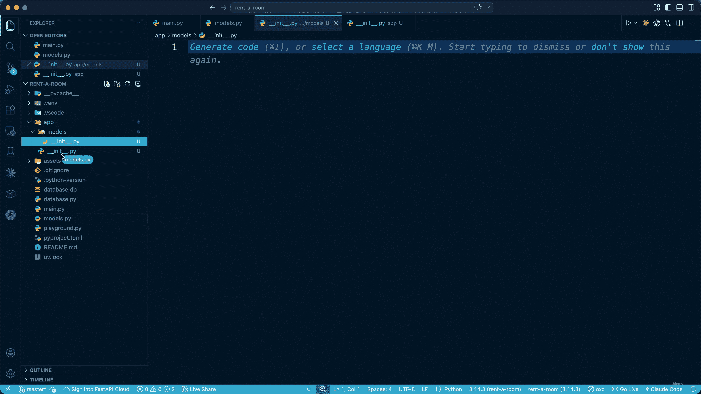
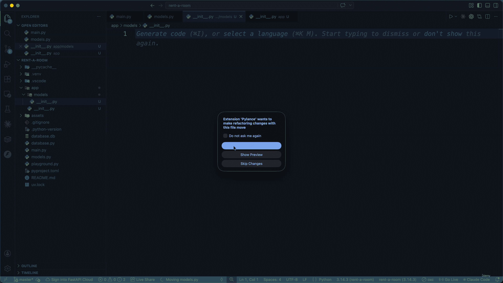
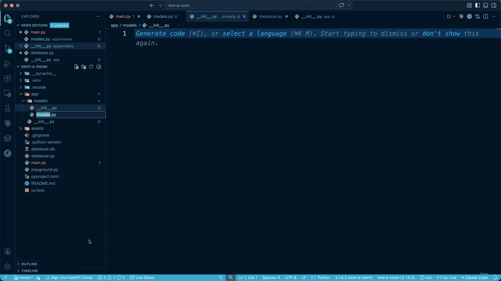
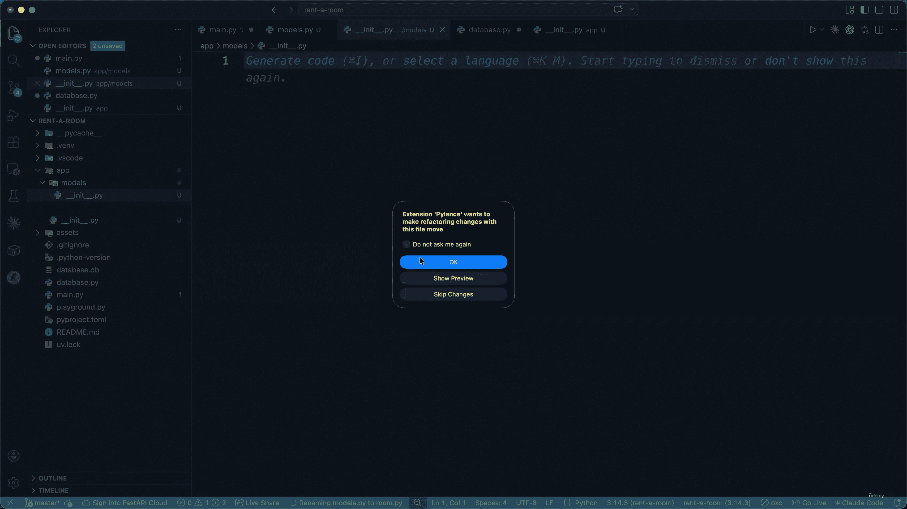
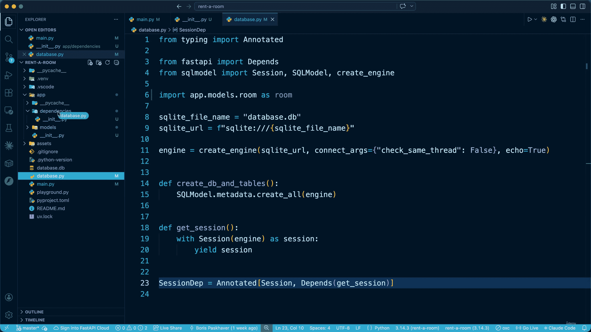
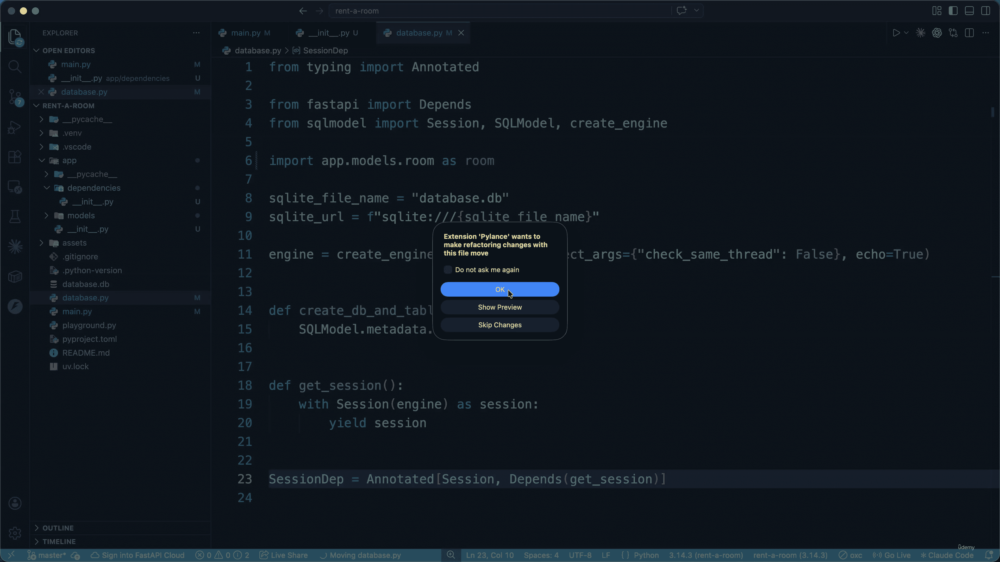
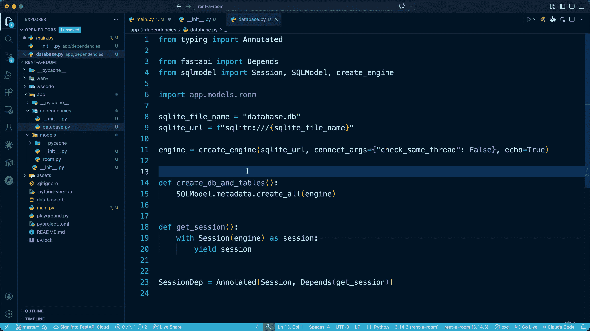

# 🚀 FastAPI 大师课：P80-81：开始把逻辑拆分到文件和文件夹


在本节课中我们将要学习应用组织，也就是如何把一个 FastAPI 应用的复杂度拆分到多个文件和文件夹中。当前 `main.py` 承担了较多职责，本课程会从简单的按技术职责拆分开始，逐步把模型、依赖和路由整理到更清晰的结构中。


## 🧭 FastAPI 大师课：1：应用组织目标


在上一段概述中我们明确了课程主题，本节中我们来看看当前应用存在哪些复杂度。当前 `main.py` 集中保存了应用初始化设置、用于表示查询参数、请求头和 Cookie 等结构的各种 Pydantic 模型、类似 `get_room_or_404` 的依赖，以及所有路由处理函数。下面列出这些集中在一起的内容，便于理解为什么要拆分。

- 应用初始化设置。
- 表示查询参数、请求头和 Cookie 等结构的 Pydantic 模型。
- 类似 `get_room_or_404` 的依赖。
- 所有路由处理函数。


因此，本节要把应用整理成更好的结构，为模型、路由和依赖等构造创建独立文件和文件夹。这样做的目的不是追求唯一正确答案，而是让代码更容易阅读、修改和扩展。本小节说明了组织目标，下一节我们看看 FastAPI 对项目结构有没有统一标准。


## 📚 FastAPI 大师课：2：没有唯一标准


上一节我们说明了当前 `main.py` 的问题，本节中我们来看看 FastAPI 是否要求固定的目录结构。需要特别说明，组织 FastAPI 应用没有单一最佳方案；与某些框架不同，FastAPI 库本身没有规定文件夹和文件必须叫什么、必须放在哪里。FastAPI 比较轻量，把结构决定权交给开发团队；生态中存在多种相互竞争的组织方式；课程后段会展示开源社区给出的两种结构示例。下面列出这一节的关键认识，帮助初学者建立正确预期。

- 组织 FastAPI 应用没有唯一最佳方案。
- FastAPI 没有像某些框架那样规定固定目录和文件。
- FastAPI 比较轻量，结构由开发团队决定。
- 生态中有多种组织方式。
- 课程后段会展示开源社区的两种结构示例。


理解这一点后，我们暂时不追求复杂方案，而是先从一个简单思路开始：按技术职责拆分应用。下一节我们具体看这种拆分方式。


## 🧱 FastAPI 大师课：3：按技术职责拆分


上一节我们确认了 FastAPI 没有统一目录标准，本节中我们采用一个简单起点：按技术职责拆分。也就是说，把应用按 Python 技术构造来分成模型、路由和依赖，而不是先按房间、支付方式等领域概念来分。可以用下面的公式概括这种拆分思路。

```text
应用结构 = models（模型） + routes（路由） + dependencies（依赖）
```


这种拆分依据的是 Python 技术构造，而不是房间、支付方式等领域概念。当前所有文件都放在项目顶层，所以下一步先把这些文件放进一个目录中。下面开始整理目录结构，下一节会创建 `app` 文件夹和关键的 `__init__.py` 文件。


## 📁 FastAPI 大师课：4：创建 app 目录和 __init__.py


上一节我们确定了按技术职责拆分，本节中我们开始动手创建 `app` 目录。当前文件都位于项目顶层，第一步是把它们嵌套到一个目录中；这个目录可以叫 `app`，也可以叫 `src` 或 `code`，名字没有技术上的硬性要求。这里把 `app` 作为应用主要启动点，并把大量文件拖进 `app` 中，形成把应用代码集中存放的习惯。随后要在 `app` 文件夹内添加一个名字非常具体的文件 `__init__.py`，它由两个下划线、单词 `init`、两个下划线以及 `.py` 扩展名组成，这个文件名很关键。这个文件本身可以完全为空，但它的存在会让 Python 把 `app` 目录识别为一个 Python 包，从而允许从该目录导入内容。可以用下面的公式和代码表示这个核心概念。

```text
目录 + __init__.py ⇒ Python 包
```

```python
from app import some_file
```


有了 `__init__.py` 后，在 `main.py` 这样的文件中就可以写类似 `from app import ...` 的代码，Python 会理解 `app` 是一个嵌套包，并去 `app` 文件夹里查找目标文件。如果在 `app` 内再创建嵌套目录，并在其中也放入 `__init__.py`，那么也可以从 `app` 和嵌套目录中访问其中的文件。下面列出这一步的关键动作，便于对照操作。

- 创建 `app` 文件夹。
- 把应用文件拖入 `app`。
- 在 `app` 内创建 `__init__.py`。
- 让 `__init__.py` 保持为空。


这样第一步目录整理就完成了。下一节我们在 `app` 内创建 `models` 目录，并把原来的 `models.py` 整理成 `room.py`。


## 🗂️ FastAPI 大师课：5：创建 models 目录并整理 room.py


上一节我们创建了 `app` 和 `__init__.py`，本节中我们在 `app` 内创建 `models` 目录来存放模型相关代码。这里需要先说明术语：如果按“映射到数据库的类”来理解，当前技术意义上只有一个模型；但 `model` 这个词经常有多种定义，有时指任何与数据库交互的类，有时指任何建模领域概念的类。查看原来的 `models.py` 可以看到，`Room` 是唯一与传统数据库表交互的模型类，而表示响应或请求载荷形状的辅助类有时叫 schema 类，有时也叫 model 类。因此，`models` 目录计划同时存放 schema 类和实际模型，并把房间的所有表示放在同一个文件中；以后遇到用户或支付方式等互补领域概念时，再在 `models` 中创建对应的 Python 文件。下面列出这一步要完成的整理动作，随后会说明重命名和导入影响。

- 在 `app` 内创建 `models` 文件夹。
- 在 `models` 内创建 `__init__.py`，注册为包。
- 把原来的 `models.py` 拖入 `models` 文件夹。
- 把 `models.py` 重命名为 `room.py`。
- 以后按领域模型增加 `users.py`、`payment_methods.py` 等文件。




创建 `models/__init__.py` 后，就可以使用 `from app.models import ...` 这类导入。把 `models.py` 拖入 `models` 后，它会直接位于 `models` 目录中；确认移动即可，后续会讨论这些变化如何影响其他文件。接着把 `models.py` 重命名为 `room.py`，因为 `models` 目录将按领域模型存放 Python 文件，一个领域模型对应一个文件；以后如果引入用户概念，可以创建 `users.py`，支付方式可以创建 `payment_methods.py`。重命名时编辑器会弹出提示，警告其他文件里存在对这些导入的引用；它提供自动更新机会，但我们后面会逐个检查所有文件并手动确认导入，所以这里可以先确认。完成后的结构含义是：`app` 下有 `models`，`models` 下有 `room.py`，其中存放房间模型及其相关 schema 类；如果增加更多模型，就继续在这个目录中添加文件。下面用目录树展示当前结构。







```text
app/
├── __init__.py
├── main.py
└── models/
    ├── __init__.py
    └── room.py
```


此时可以关闭两个空的 `__init__.py` 文件，里面不需要放内容。VS Code 扩展会显示发生变化的文件，例如 `database.py`，其中会从新的嵌套 `room.py` 文件导入内容；后面会回到这个文件，这里只是说明刚才的重构选择已经在代码中产生效果。下一节我们创建 `dependencies` 目录，把数据库连接等依赖移进去。


## 🔌 FastAPI 大师课：6：创建 dependencies 目录并移动 database.py


上一节我们整理了模型目录，本节中我们在 `app` 内创建与 `models` 并列的 `dependencies` 目录。这个目录用来存放应用需要的函数、依赖对象或其他构造；像数据库连接这类内容不适合放在 `models` 或以后的 `routers` 目录中，所以要把应用其他部分需要的东西隔离到 `dependencies` 中。下面列出这一节的目录操作，便于按顺序完成。

- 在 `app` 内创建 `dependencies` 文件夹。
- 在 `dependencies` 内创建 `__init__.py`。
- 把顶层的 `database.py` 拖入 `dependencies`。
- 确认移动，并在提示中确认。


`database.py` 是设置所有数据库相关内容的地方，把它移动到 `dependencies` 后，结构更加清楚。如果操作时没有看到这些弹窗也没关系，后面会统一说明所有变化。此时结构应当是：`app` 下有 `dependencies` 和 `models`，这三个目录都含有空的 `__init__.py`；`dependencies` 中有 `database.py`，`models` 中有由原 `models.py` 重命名而来的 `room.py`。下面用目录树表示当前结构。

```text
app/
├── __init__.py
├── main.py
├── dependencies/
│   ├── __init__.py
│   └── database.py
└── models/
    ├── __init__.py
    └── room.py
```


目录整理完成后，还需要修正 `database.py` 中的导入，让 SQLModel 在创建数据库之前知道所有模型。下一节我们进入 `database.py` 手动写出导入逻辑。


## 🔍 FastAPI 大师课：7：在 database.py 中导入模型以完成注册


上一节我们移动了 `database.py`，本节中我们进入 `database.py` 修正导入。这里的代码虽然已经存在，但需要手动写一遍以理解其作用：要使用 `import` 关键字，并且必须在创建实际数据库之前、特别是在注册相关函数之前，导入所有 SQLModel 模型。原因是 SQLModel 需要知道已经定义了哪些模型以及它们关联的表，才能创建或映射这些表；我们不需要实际使用导入的模型，只需要保证一个或多个模型文件在这段逻辑运行前都被导入。核心导入代码如下。

```python
import app.models.room
```






这里之所以能获得自动补全并写出嵌套导入语法，是因为 `app` 和 `models` 这两个文件夹都有配套的 `__init__.py`；如果没有创建这些文件，编辑器会给出语法警告，因为 Python 无法定位这些文件夹（也就是包），也无法支持这种嵌套导入。现在从项目顶层进入 `app` 目录，再进入嵌套的 `models` 目录，并引用 `room.py` 文件；因此写 `import app.models.room`。`room` 不是包，而是一个普通 Python 模块，也就是 `room.py`；但这个导入语句本身会强制 Python 先读取该文件中的所有代码，从而在文件后续内容运行前注册连接数据库的 `Room` 模型。下面列出本节的关键规则，帮助初学者避免常见错误。

- 在创建数据库和注册函数之前导入模型。
- 不需要使用导入的模型，只要保证导入发生。
- `room` 是普通模块，不是包。
- `import app.models.room` 会先执行 `room.py` 中的代码。
- `__init__.py` 让嵌套导入能够被 Python 识别。


完成这些操作后，代码库重构的第一步就完成了。下一节我们总结本节内容，并说明后续还有更多组织方式的内容。


## ✅ FastAPI 大师课：8：本节总结


本节课中我们一起学习了如何开始把 FastAPI 应用逻辑拆分到文件和文件夹。我们理解了当前 `main.py` 的复杂度，明确了 FastAPI 没有唯一目录标准，采用了按技术职责拆分的简单方案，创建了 `app`、`models` 和 `dependencies` 目录，添加了让目录成为 Python 包的 `__init__.py`，把 `models.py` 重命名为 `room.py`，把 `database.py` 移入 `dependencies`，并在 `database.py` 中通过 `import app.models.room` 让模型在数据库逻辑运行前完成注册。下面列出本节的核心收获，方便复习。

- 应用组织是把复杂度分散到多个文件和文件夹。
- FastAPI 不强制固定目录结构。
- 按技术职责可以拆成模型、路由和依赖。
- `__init__.py` 让目录成为可导入的 Python 包。
- `models` 目录按领域模型存放文件。
- `dependencies` 目录存放数据库连接等依赖。
- 创建数据库前要导入所有 SQLModel 模型。




这就是代码库重构的开始，下一节课还会继续介绍更多与应用组织相关的内容。

