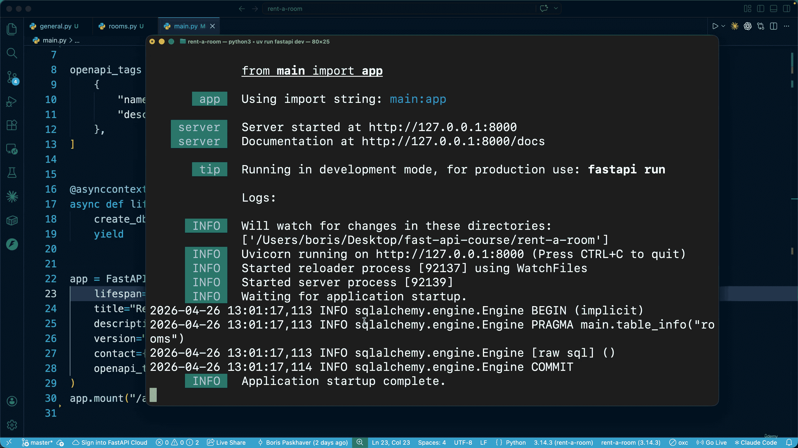
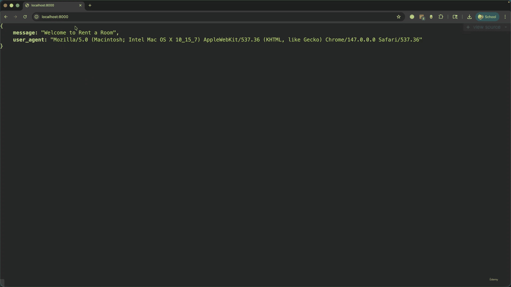
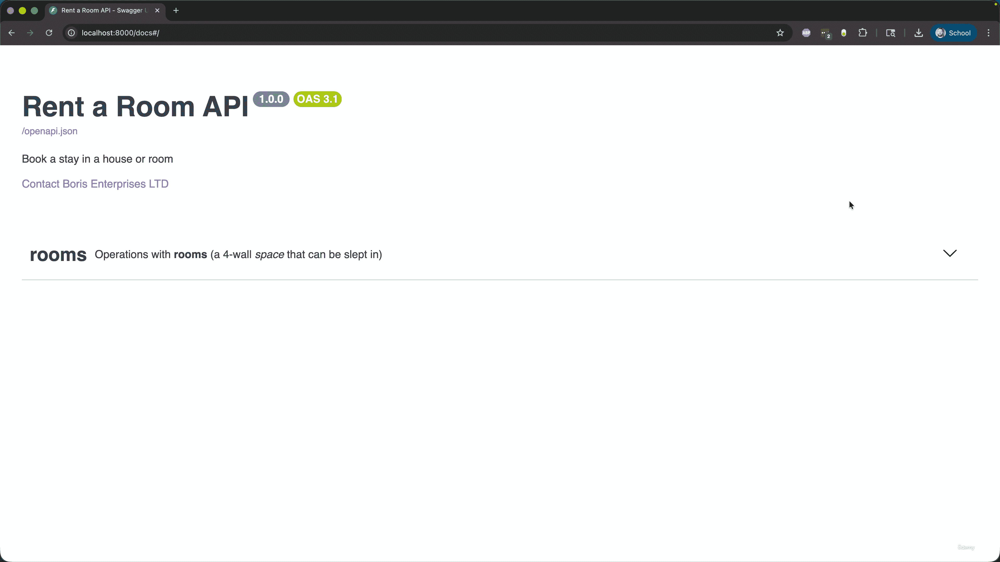

# 🚀 FastAPI Masterclass：82：APIRouter 类

在本节课中我们将要学习如何把 `main.py` 里的路由拆分到更小的文件中，并认识 FastAPI 提供的 `APIRouter` 类。上一节课我们已经调整过项目目录，这一节课会继续沿着这个方向前进，把通用路由和房间路由分别放进独立的文件里。这样做的目的很简单，就是让主文件变得更轻、更好读，让每个文件只负责一类事情。下面我们会从“为什么拆”讲到“怎么拆”，再讲到“拆完以后怎么检查”。

## 🧭 FastAPI Masterclass：82.1：为什么要拆分路由

上一节课中我们创建了 `app` 目录以及一些嵌套文件夹，并且在目录结构里移动了两个文件。上一节已经完成了目录层面的准备，本节中我们来看看为什么要继续拆分代码。最终目标是从 `main.py` 中移除或转移大量代码，让这个文件保持轻量，基本上只负责创建最初的 FastAPI 应用。简单说，主文件应该像一个总开关，而不是把所有路由都塞在一起的杂物间。接下来我们要把大量路由移动到代码库中更小的文件里，因为目前 `main.py` 承载了大部分代码，继续堆下去会越来越难维护。

可以用一个简单关系来描述这个目标：

```text
main.py ≈ 创建 FastAPI 应用 + 核心配置
```

FastAPI 提供了一个很好用的特性，叫作 routers。你可以把 router 理解成一个更小的单元或组件，用来把相关路由组织在一起。这样就不必把所有路由都放在单个文件里，而是先把它们打包进一个 router，再在 `main.py` 这样的顶层文件中导入所有独立 router，并把它们整合进整个应用。router 本质上就是组织单位，`APIRouter` 这个类帮助我们许多不同路由拆分到各自的组织分组或容器中。理解了这一点，下一节我们就动手创建 routers 目录和具体路由文件。

## 🧭 FastAPI Masterclass：82.2：创建 routers 目录和路由文件

上一节我们说明了 router 的作用，本节中我们来看看项目里应该怎么放置这些 router。在 `app` 文件夹中创建一个新目录，名字叫 `routers`，使用复数形式。然后在这个目录里再创建一个 `__init__.py` 文件。这个构造和 FastAPI 没有关系，它只是基础 Python 的用法，用来确保我们可以从 `app.routers` 导入内容。这里需要补充一个上一节课忘记提到的点：如果你看到 `__pycache__` 这样的文件夹，不需要担心，也不要修改它或对它做任何操作。它只是 Python 自动生成的额外文件夹，用来记录一些缓存和计算结构，让程序运行得更快，属于不需要操心的 Python 附加内容。

下面列出这个目录中需要放置的文件和它们的作用。

- `routers/__init__.py`：普通 Python 包初始化文件，确保可以从 `app.routers` 导入。

- `routers/general.py`：存放与房间没有直接关系的通用路由。

- `routers/rooms.py`：存放与房间相关的路由，最终形成房间 router。

在 `routers` 文件夹中，我们会创建 router 文件，这些文件都是普通 Python 文件，用来组织相关路由。`main.py` 里有很多与房间相关的路由，所以最终会有一个 rooms router。同时也要记得，还有少数路由并不专门与房间相关，例如根路由，它是网站的基础页面或首页。对于这类路由，我们会创建一个 router 文件，文件名本身不重要，这里把它命名为 `general.py`，用来存放这些通用路由。接着再创建 `rooms.py`，用来把房间路由存进一个 Room router 中。目录和文件准备好后，下一节先从较容易理解的 `general.py` 开始。

> 💡 提示：`__pycache__` 是 Python 自动生成的缓存目录，不需要修改或删除，它用于缓存部分计算结果，让程序运行更快。

## 🧭 FastAPI Masterclass：82.3：先创建 general.py 并迁移通用路由

上一节我们创建了 `routers` 目录和两个路由文件，本节中我们先用 `general.py` 练手，因为它更容易理解技术概念。先关闭不需要的文件，包括初始化文件和数据库相关文件，把 `general.py` 拖到 `main.py` 旁边，方便对照查看，同时隐藏左侧文件资源管理器，给自己腾出更多空间。在 `general.py` 中，从 FastAPI 导入 `APIRouter` 类。再次说明，API router 可以看作一个或多个路由的组织容器，应用后面会整合每个 router 管理的路由。然后使用普通括号语法创建这个类的实例，并赋值给变量 `router`，代码如下。

```python
from fastapi import APIRouter

router = APIRouter()
```

接下来要把 `main.py` 中所有不专门与房间相关的通用内容拖到这个文件里。实际操作时，可以直接从左侧文件剪切并粘贴，从顶部开始向下查看，跳过所有与房间相关的代码，包括 Pydantic 模型。找到需要的内容后，把与 `app cookies` 和 `app headers` 相关的 Pydantic 模型复制过来。为了消除名称未定义的报错，`general.py` 需要补上下面这些导入，下面把它们列出来。

- `from pydantic import BaseModel`：因为通用模型会继承 `BaseModel`。

- `from typing import Literal`：因为代码里使用了 `Literal` 类型。

- `from typing import Annotated`：后面路由参数会用到 `Annotated`。

- `from fastapi import APIRouter, Cookie, Header, Response, status`：路由和响应相关对象需要这些名字。

补完模型依赖后，继续把非房间相关的通用路由搬过来。原文在这里提到一段用于获取房间的依赖和对应路由代码，需要按原文的迁移动作把这些代码剪切并粘贴到新文件中；同时底部还有一个不涉及房间的 `preferences` 路由，也要剪切并粘贴到 `general.py` 下方。移动完成后，再修复导入需求：从 FastAPI 导入 `status`，从 typing 导入 `Annotated`，并导入 `Cookie`、`Header`、`Response` 等类型，统一放到文件顶部。到这里，除最后一个问题外，名称违规基本解决。

最后一个问题是路由方法的调用对象。之前我们是在文件顶部创建 FastAPI 实例并赋值给 `app`，然后用 `get`、`post`、`patch` 等 HTTP 动词方法创建路由。现在的概念完全一样，只是要在 `router` 这个 API router 实例上调用这些方法。router 是多个路由的组织容器或组织单元，因此它支持与 `app` 对象相同的功能、相同的 HTTP 动词方法、相同的 `Annotated`、cookies、headers 语法，可以把它看成各种路由的迷你组织容器。于是把原先的 `app.get` 等写法全部替换成 `router.get` 等写法。变量名可以自己选择，例如叫 `general_router` 也可以，但上面选了什么名字，下面调用方法时就要使用同一个名字。替换后代码如下。

```python
@router.get("/")
def home():
    ...
```

这样就把这些路由移动到了 `general.py`。需要特别注意的是，这个动作在方向上是对的，但这些路由还没有注册到主 FastAPI 应用，因为目前还没有任何文件导入并使用这个文件。这个问题稍后会修复。下一节我们对所有房间路由执行完全相同的逻辑。

## 🧭 FastAPI Masterclass：82.4：创建 rooms.py 并迁移房间路由

上一节我们完成了通用路由的迁移，本节中我们对房间路由执行同样的拆分流程。打开 `routers` 目录中的空文件 `rooms.py`，采用相同协议，把所有房间路由和相关构造移进去。首先从 FastAPI 导入 `APIRouter` 类，然后像 `general.py` 中一样创建 API router 实例，代码如下。

```python
from fastapi import APIRouter

router = APIRouter()
```

接着从 `RoomQueryParams` 这类构造开始，一直复制到文件底部，其中包括获取单个房间的 404 路由、使用 `Depends` 调用函数的房间依赖，以及所有房间的查询、创建、修改和删除路由。把这些内容全部剪切并粘贴到 `rooms.py` 中，再腾出一些空间，把文件拖到方便查看的位置。接下来处理导入，原文已经查好了需要的名字，下面把要补到文件顶部的导入列出来。

- `from typing import Annotated`：这是关键类型，路由参数会用到。

- `from fastapi import APIRouter, Depends, HTTPException, Path, Query, status`：分别用于 router、依赖、404 异常、路径参数校验、查询参数和状态码。

- `from pydantic import BaseModel, Field, StringConstraints, field_validator`：房间查询参数模型和字段校验会用到。

- `from sqlmodel import select, col`：数据库查询会用到 `select`，原文听写为 `call` 的函数在 SQLModel 中通常写作 `col`，用于列相关操作。

- `from app.dependencies.database import SessionDep`：这是数据库会话依赖类型，位于 `app/dependencies/database.py`，通过 `Depends` 提供数据库会话。

- `from app.models.room import Room, RoomBase, RoomPublic, RoomUpdate`：这些是房间相关的模型变体，位于 `app/models/room.py`。

补导入时要注意 `SessionDep` 的来源。它是会话依赖，使用 `Depends` 函数让我们访问数据库会话，从而与数据库交互。房间模型则来自 `app.models.room`，需要导入 `Room`、`RoomBase`、`RoomPublic` 和 `RoomUpdate` 这几个命名构造。导入完成后，从上到下检查文件，并把原先所有 `app` 的用法替换成 `router`。例如创建房间的 post 路由、获取房间的 get 路由、修改和删除路由，都要改成在 `router` 上调用对应方法。检查编辑器里的红色波浪线，确保没有导入违规。代码如下。

```python
@router.post("/rooms")
def create_room(...):
    ...

@router.get("/rooms/{room_id}")
def get_room(...):
    ...
```

完成这些替换后，所有房间路由就移动到了独立的 rooms router 中。下一节回到 `main.py`，把不再需要的代码清理掉。

## 🧭 FastAPI Masterclass：82.5：清理 main.py

上一节我们完成了房间路由的迁移，本节中我们回到 `main.py` 做清理。现在 `main.py` 已经比较精简，事实上里面有不少导入不再需要，可以逐个清理。下面列出可以删除的导入和相关构造，它们已经移动到更小的文件里。

- 不再需要 `Annotated` 和 `Literal`。

- 不再需要 `Cookie`、`Depends`、`Header` 等 FastAPI 依赖。

- 不再需要 Pydantic 相关导入，因为这个文件不再使用它们。

- 不再需要 SQLModel 的 ORM 相关导入，因为这个文件不再直接操作 ORM。

- 不再需要 `SessionDep`，因为这个文件不再直接与数据库交互。

- 不再需要从 `app.models` 导入 `Room` 等模型，因为这些构造已经进入 rooms router。

需要保留 `create_db_and_tables`，因为它与 `lifespan` 相连，应用启动时会自动运行，用于创建数据库表。清理后，`main.py` 大约只有 30 行，主要设置真正的核心应用配置。下面列出它保留的主要职责。

- 创建应用实例。

- 设置用于定制 Swagger 文档的参数。

- 挂载 `assets` 文件夹，用来提供静态文件。

- 设置 `lifespan`，在应用启动时创建数据库表。

这样主文件就更容易阅读和理解。再次强调，目前应用对象还不知道两个 router 的存在，因此从技术上看，它认为应用已经存在，但没有附加路由。每当进行这种重构，尤其是涉及创建文件或文件夹时，建议重启服务器。FastAPI 很多时候能理解文件和文件夹的变化，但从头启动更稳妥，可以重新解析所有文件和文件夹，并从零构建一切。下一节我们就重启服务并检查文档页面。

## 🧭 FastAPI Masterclass：82.6：重启服务并检查文档

上一节我们清理了 `main.py`，本节中我们重启 FastAPI 应用并观察结果。首先在终端中按 `Ctrl+C` 停止正在运行的 FastAPI 应用，然后重新启动。可以使用下面的开发服务器命令，具体命令以你原先的启动方式为准。

```bash
fastapi dev
```

重启后可以看到终端没有违规，也没有错误。服务器能够启动是一个好迹象，不过我们还没有导入任何 router 文件，因此仍然存在潜在错误，因为这些文件暂时没有被访问。接下来打开浏览器，进入 `/docs` 的 Swagger 文档页面。页面本身仍然可以正常加载，你还能看到 `Room` 标题，因为它在 `main.py` 中声明的 OpenAPI tags 列表里。但是页面上没有任何路由，没有房间路由，也没有 `preferences` 或 `/` 这样的通用路由。原因还是同一个：路由被封装在各自的 router 文件中，没有任何地方导入它们，也没有让 FastAPI 应用知道它们的存在。可以用一个简单关系表示当前状态：

```text
主应用.路由集合 = 空
```

最后一步是让 FastAPI 应用知道每个独立 router 以及它们管理的路由批次，这个步骤会在下一节课处理。下一节会做类似 `app.include_router(router)` 的注册动作。



## 🧾 FastAPI Masterclass：82.7：本节总结

本节课中我们一起学习了 `APIRouter` 类以及如何用它拆分路由。我们回顾一下整体过程：先从 `main.py` 中移出大量代码，让主文件只负责创建应用和核心配置；然后创建 `routers` 目录，放入 `__init__.py`、`general.py` 和 `rooms.py`；接着把通用路由和房间路由分别迁移到对应文件，并补上 `APIRouter`、`Depends`、`SessionDep`、房间模型等导入；最后清理 `main.py`，重启服务器并检查 `/docs`，确认路由还没有注册到主应用。整个拆分思路可以用一个公式概括：

```text
FastAPI 应用 = 主应用实例 + 核心配置 + 多个 Router 管理的路由集合
```





下一节课我们会完成最后一步，让主 FastAPI 应用导入并注册这些 router，让每个 router 管理自己的那批路由，从而让整个应用真正恢复完整功能。

