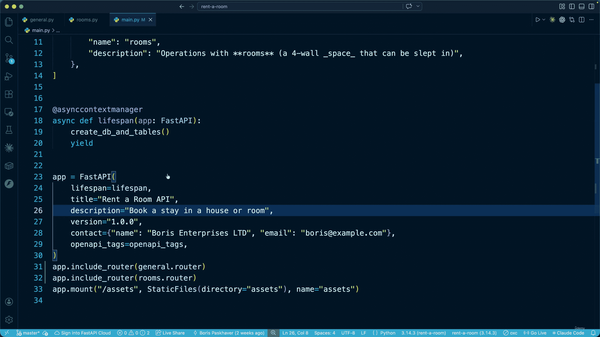
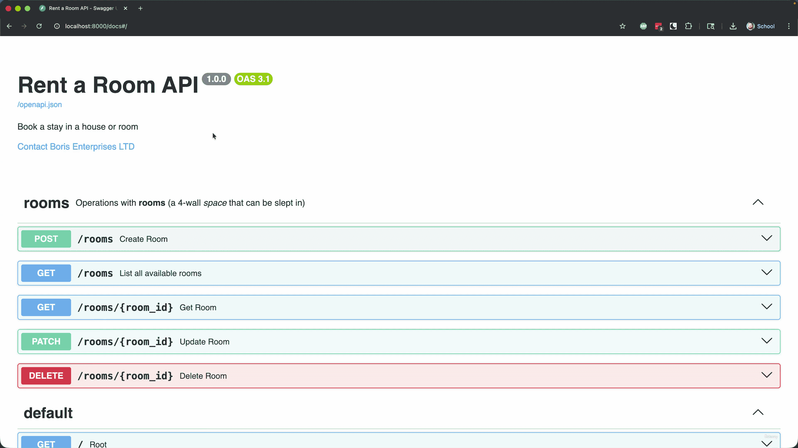

# FastAPI Masterclass：第82-83节：包含APIRouters 🔌

在本节课中，我们将完成FastAPI路由重构的最后一步，也就是把之前拆分好的两个APIRouter（通用路由和房间路由）导入到主应用中，并让FastAPI应用知道它们的存在。我们还会讨论一个常见的坑：当多个模块都叫router时如何避免命名冲突；然后我们会在app对象上调用include_router方法，把这个路由器管理的路径全部注册进来。最后，我们重启服务器并打开`/docs`接口文档验证结果。

为了完成这个目标，我们按下面的步骤来做：

- 在main.py顶部导入app.routers包下的general和rooms模块。
- 在创建app之后，调用include_router方法依次注册general.router和rooms.router。
- 重启服务器，访问/docs验证路由是否都注册成功。

## 一、为什么需要导入整个模块 📦

上一节我们已经在routers目录下创建了general.py和rooms.py这样的模块文件，里面分别定义了各自的APIRouter。不过，这个路由器目前还没有和主应用建立联系。所以，在重构的最后一步，我们要先把它们导入到main.py中。

在main.py的顶部，我们会从app.routers包中引入两个模块：general和rooms。这里app.routers本身就是一个目录（也就是Python包）。我们导入的是整个模块文件，而不是里面的某个变量。为什么要这样操作？因为如果你打开general.py和rooms.py中的任意一个，会发现它们都把那个APIRouter实例命名为router。如果直接写`from app.routers.general import router`，然后再从rooms也导入router，这两个变量一模一样，后面的导入会把前面的覆盖掉，这就是命名冲突。一种解决方法是给它们分别起别名，比如`general_router`、`rooms_router`；但更简单的做法是把整个模块导入进来，然后通过模块名访问内部的变量，比如`general.router`和`rooms.router`。下面是导入代码：

```python
from app.routers import general, rooms
```

注意，到这一步只是完成了导入。如果我们不在下面做任何额外操作，FastAPI应用依然不知道该去哪里找这些路由。因此，我们还需要调用`include_router`方法来注册它们。

## 二、使用 include_router 注册路由 🔗

导入模块之后，命名冲突的问题已经解决了。现在我们要把模块里的router真正注册到FastAPI主应用上。这一部分要使用的是app对象的include_router方法，而这个方法就像它的名字所说的那样：把一个路由器所管理的所有路由“包含”到整个FastAPI应用中去。

在创建完app对象之后，我们就可以直接调用`include_router`。顺序不重要，你可以把它放在创建app之后任意位置，甚至相对于其他挂载操作先后都没有关系。这里我选择放在创建app之后。对于general模块，模块文件里定义了router变量，我们这样写：

```python
app.include_router(general.router)
```

这行代码会注册general路由器中的全部路由。接下来，rooms.py的处理逻辑完全一样。同样还是使用app对象，调用include_router方法，然后从rooms模块中取出router变量来注册：

```python
app.include_router(rooms.router)
```

由于我们是通过模块名引用的router，所以不存在命名冲突。这两行代码执行之后，general和rooms两个文件中定义的路由都会被注册到FastAPI应用中。

## 三、重启服务器并验证 🔄

注册完路由后，我们还需要做一件事：重启服务器。虽然从技术上说，如果你用的是`--reload`热重载，服务器可能已经自动加载了，但这里为了确保是从头开始干净启动，我们还是会手动重启一下。

我们用Ctrl+C停掉当前正在运行的服务器，然后重新执行`fastapi dev`命令（或者你之前使用的启动命令）。这样FastAPI会从头重新读取main.py，并从零开始注册所有路由。这个步骤不是必须的，但为了安全起见，最好做一遍。

重启完成后，回到浏览器，打开`http://localhost:8000/docs`，然后刷新页面。这时候你会看到接口文档已经恢复成我们期望的状态：所有路由都出现了，并且它们被整整齐齐地归类到不同的分组里。因为你之前已经在不同模块中组织了路由，所以现在文档看起来更加清晰，不同路由对应不同的router。你可以放心地点击这些接口进行测试，它们应该和之前一样正常工作。

## 总结 📝





本节课我们一起学习了如何把APIRouter集成到FastAPI主应用中。我们首先在main.py中导入了app.routers包里的general和rooms两个模块，理解了不能直接导入router变量的原因；接着在app对象上调用include_router方法，分别注册了general.router和rooms.router，从而避开了命名冲突；最后重启服务器并访问`/docs`页面来确认所有路由都已经生效。经过这次重构，你的FastAPI项目不再是一个庞大的main.py文件，而是被拆分成多个职责清晰的路由模块，后续增加新接口也会更加方便。
