# FastAPI 大师课（第一部分）：第 83–84 课：配置 APIRouter 的路径前缀与标签 🚀

## FastAPI 大师课（第一部分）：第 83–84 课：本节概述 📌

在本节课中我们将要学习如何用 `APIRouter` 统一配置一组路由的公共路径前缀和 Swagger 文档标签。使用 `APIRouter` 除了能把路由组织得更清楚，还有一个很实用的优势：可以为同一个路由器下的所有路由设置公共参数。这样我们就不用在每个接口上重复写相同的前缀和标签。接下来会先看房间路由的共同点，再演示在 `APIRouter` 声明处配置，随后逐条更新路由，最后介绍在 `include_router` 调用处配置的替代方案。

## FastAPI 大师课（第一部分）：第 83–84 课：为什么需要统一配置 🧩

上一节我们了解了本节课的目标，本节中我们来看看房间路由的共同点。观察所有属于房间路由器的路由，可以发现它们有两个明显共同点。第一个共同点是所有路由都以 `/rooms` 这个公共前缀开头，例如 POST、GET，以及获取单个房间、更新单个房间这类单独路由。第二个共同点是所有路由都使用完全相同的标签 `rooms`，这样生成的 Swagger 文档会把它们放在同一个 `rooms` 分类下面。

以下是这些路由的共同点列表：

- 所有路由都以公共前缀 `/rooms` 开头，包括新增、查询列表以及查询或更新单个房间的路由。

- 所有路由都使用相同标签 `rooms`，用于让 Swagger 文档归入同一个分类。

如果把这些前缀和标签写在每条路由上，代码会重复，后续修改也容易漏掉。我们可以把公共前缀移到 `APIRouter` 的配置中，也可以把标签配置一起移过去。这样做的优势仍然是不需要在每个单独路由里重复这些设置。可以用下面的公式理解路径和标签的拼接方式：

```text
最终路径 = 路由器 prefix + 路由装饰器中声明的 path

最终标签 = 路由器 tags + 路由自身 tags
```

弄清楚共同点之后，下面看看如何把配置集中到 `APIRouter` 声明处。

## FastAPI 大师课（第一部分）：第 83–84 课：在 APIRouter 声明处配置 prefix 和 tags ⚙️

上一节我们找到了房间路由的共同点，本节中我们来看看具体配置方式。向上滚动到声明 `APIRouter` 的位置，在这里提供 `prefix` 参数。这个参数用来指定一个字符串，它会被放到所有挂载到这个路由器上的路由前面。这里把起始前缀写成 `rooms`，于是下面每一条路由都会以 `/rooms` 开头，后面再接各个方法自己声明的路径。

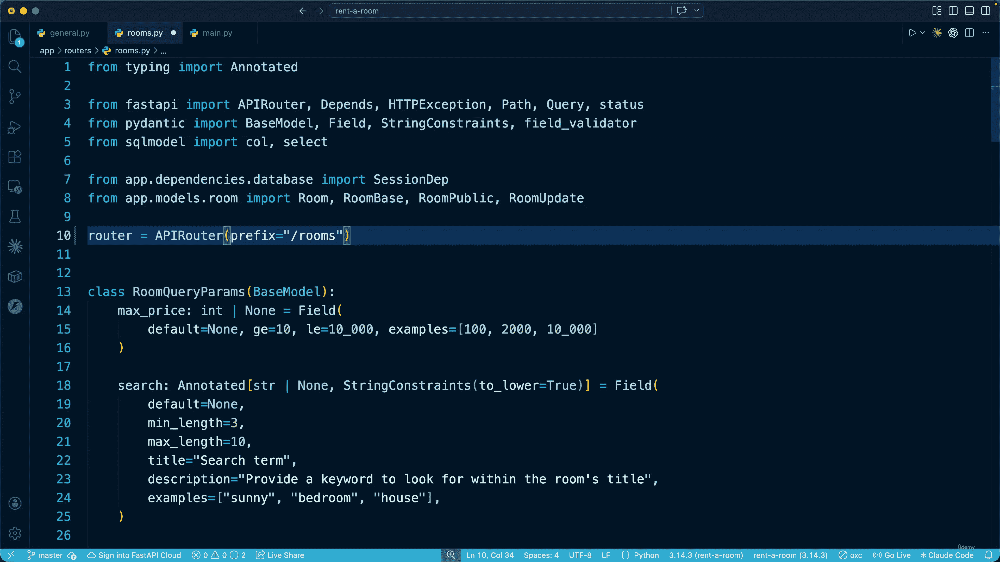

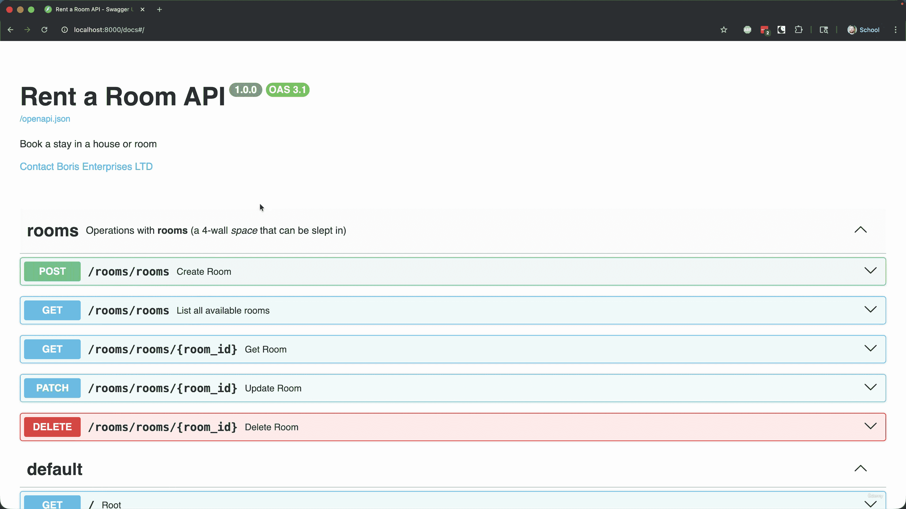

以下是集中配置的代码示例：

```python
from fastapi import APIRouter

router = APIRouter(
    prefix="/rooms",
    tags=["rooms"],
)
```

同时也可以在声明处提供 `tags` 参数，并传入一个包含字符串 `rooms` 的列表。这样标签会自动应用到属于这个路由器的所有路由上，不再需要在每条路由上单独写标签。需要特别注意的是，不要把路由器前缀和下面路由里的 `/rooms` 重复组合，否则会出现 `/rooms/rooms` 这样的重复路径。如果同时保留两处配置并刷新浏览器里的 Swagger 文档，就能看到这个重复现象。

因此必须二选一：要么保留 `APIRouter` 中的前缀配置，要么保留每条路由里的完整路径。本节课选择把配置保留在 `APIRouter` 声明中，这意味着需要更新下面所有路由。明白这个注意事项后，接下来逐条改造房间相关路由。

## FastAPI 大师课（第一部分）：第 83–84 课：逐条更新房间路由 🛠️

上一节我们把前缀和标签集中到了路由器声明处，本节中我们逐条更新下面的路由。因为公共前缀 `/rooms` 已经由路由器提供，路由装饰器里只需要写剩余部分。FastAPI 会把装饰器里的字符串拼接到 `APIRouter` 中配置的前缀后面。以下是各条路由的更新方式列表：

- POST 创建房间路由改为 `@router.post("/")`，它会与 `/rooms` 拼接成 `/rooms/`，同时移除原来的标签设置。

- GET 获取房间列表路由改为 `@router.get("/")`，并移除标签设置。

- 获取单个房间的路由保留路径参数，例如写成 `@router.get("/{room_id}")`，拼接后是 `/rooms/{room_id}`，同时移除标签设置。

- PATCH 更新房间路由写成 `@router.patch("/{room_id}")`，公共前缀加上房间 ID 路径参数，并移除标签设置。

- DELETE 删除房间路由写成 `@router.delete("/{room_id}")`，同样保留房间 ID 路径参数，并移除标签设置。

以下是更新后的路由代码示意：

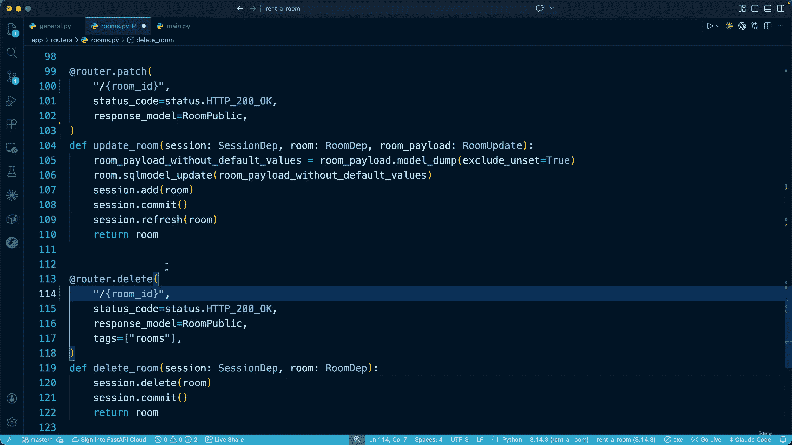

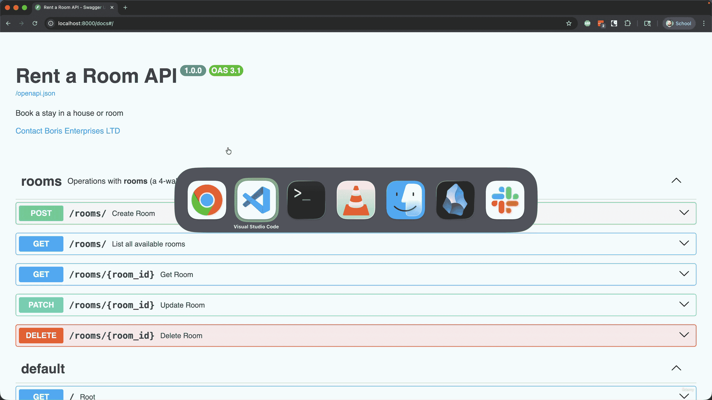

```python
@router.post("/")
def create_room(...):
    ...

@router.get("/")
def get_rooms(...):
    ...

@router.get("/{room_id}")
def get_room(room_id: str, ...):
    ...

@router.patch("/{room_id}")
def update_room(room_id: str, ...):
    ...

@router.delete("/{room_id}")
def delete_room(room_id: str, ...):
    ...
```

保存代码后回到浏览器刷新 Swagger 文档，就能看到路径和分类都符合预期。这样做还有一个长期优势：以后如果给同一个房间路由器新增路由，新路由会自动继承公共前缀和公共标签，不需要再重复配置。集中配置完成后，本节再介绍另一种同样有效的配置位置。

## FastAPI 大师课（第一部分）：第 83–84 课：在 include_router 中配置的替代方案 🔁

上一节我们在 `APIRouter` 声明处完成了配置，本节中我们来看看替代做法。可以把完全相同的设置移动到 `include_router` 方法调用中。例如在 `main.py` 中本来就直接添加房间路由器，这时可以在调用 `include_router` 时提供关键字参数 `prefix="rooms"` 和 `tags=["rooms"]`，得到的结果与之前完全一样。刷新浏览器后也能看到相同效果。

以下是在包含路由器时配置的代码示例：

```python
app.include_router(
    rooms.router,
    prefix="/rooms",
    tags=["rooms"],
)
```

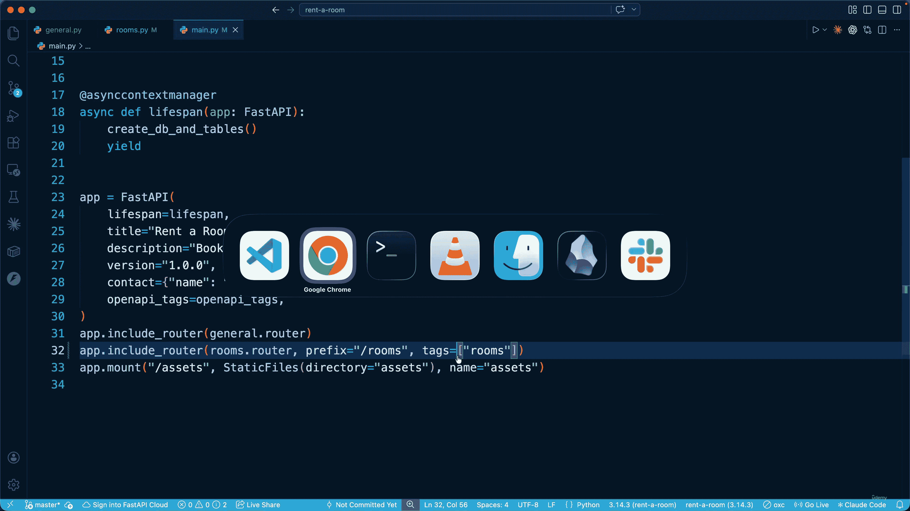

这种写法的优势是路由器与顶层应用或具体使用位置解耦。比如多个 FastAPI 应用想复用同一个路由器，但每个应用需要不同的前缀，就可以在各自包含路由器时分别指定。以下是复用同一路由器并自定义前缀的示例列表：

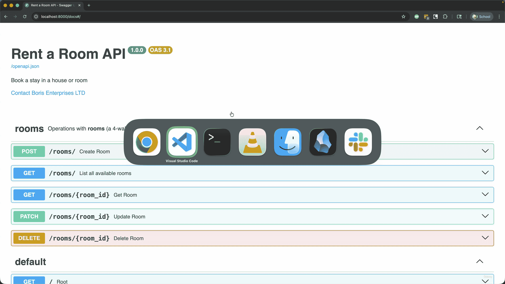

- 应用 A 使用 `prefix="/rooms"`，路径就以 `/rooms` 开头。

- 应用 B 使用 `prefix="/days"`，同一个路由器下的路径就变成以 `/days` 开头。

- 应用 C 使用 `prefix="/api/rooms"`，路径就以 `/api/rooms` 开头。

这样路由器会更加灵活和可复用，因为每个路径开头的实际名称不再写死在路由器所在文件里，而是在包含路由器的地方动态定制。演示完成后把前缀改回 `/rooms`，配置就恢复到本节课主要示例的状态。

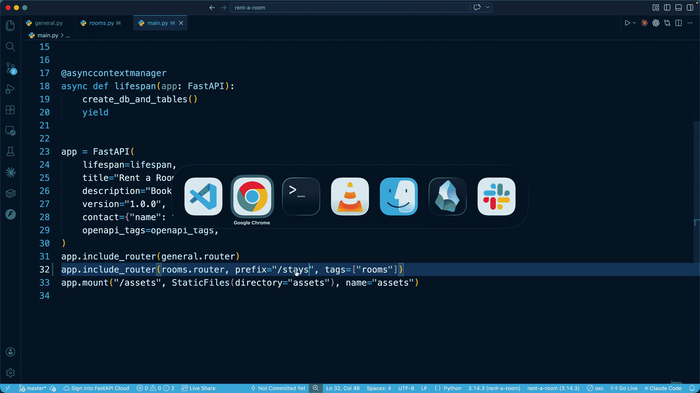

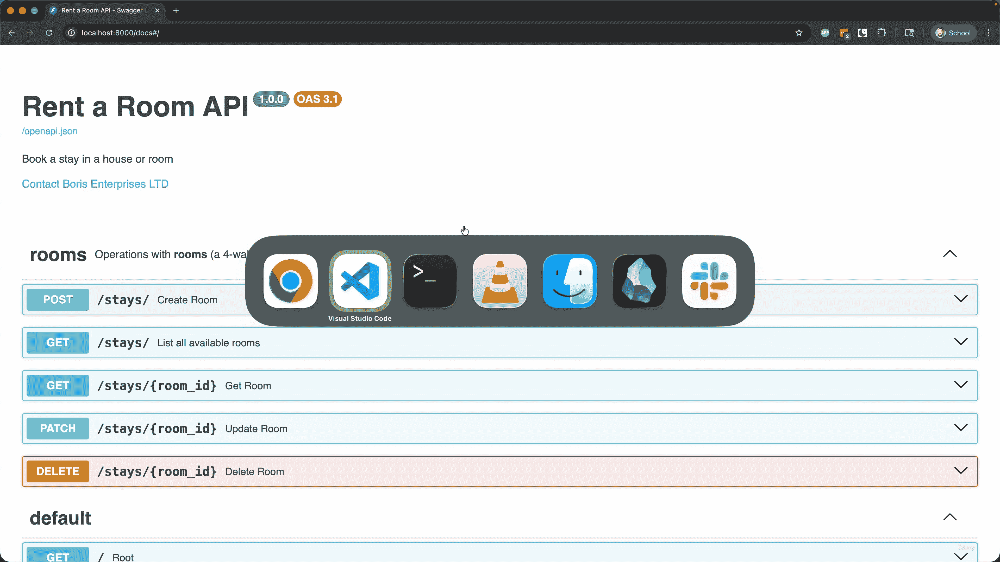

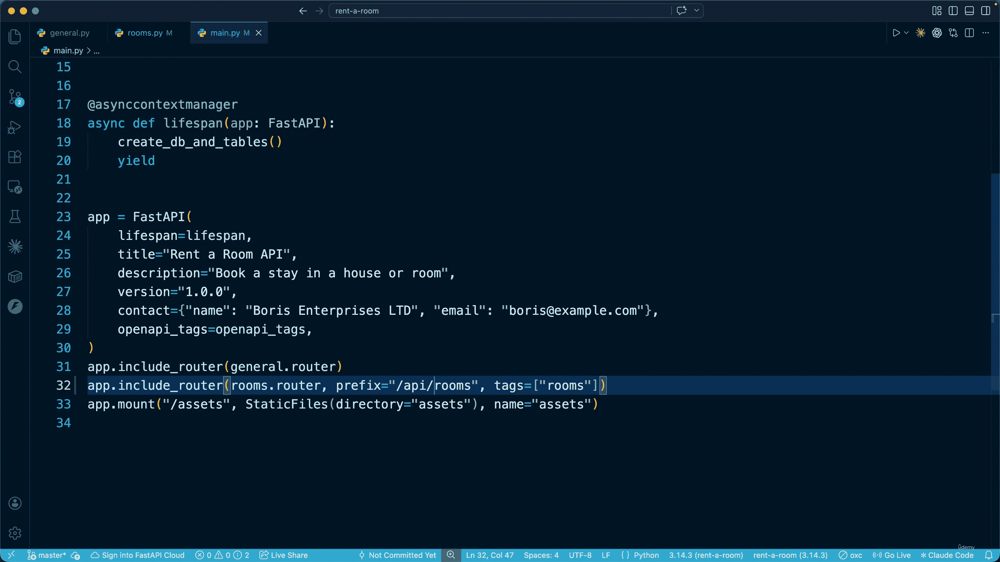

## FastAPI 大师课（第一部分）：第 83–84 课：本节总结 ✅

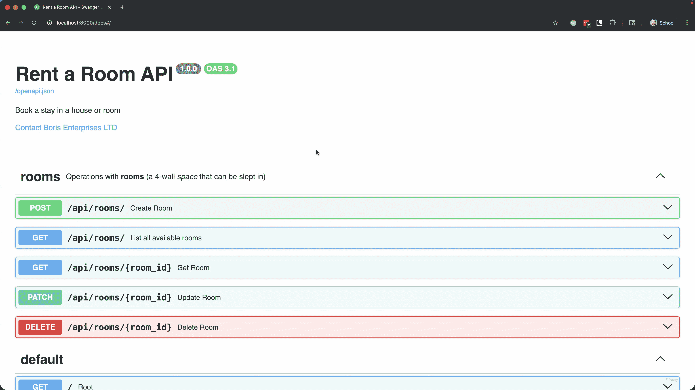

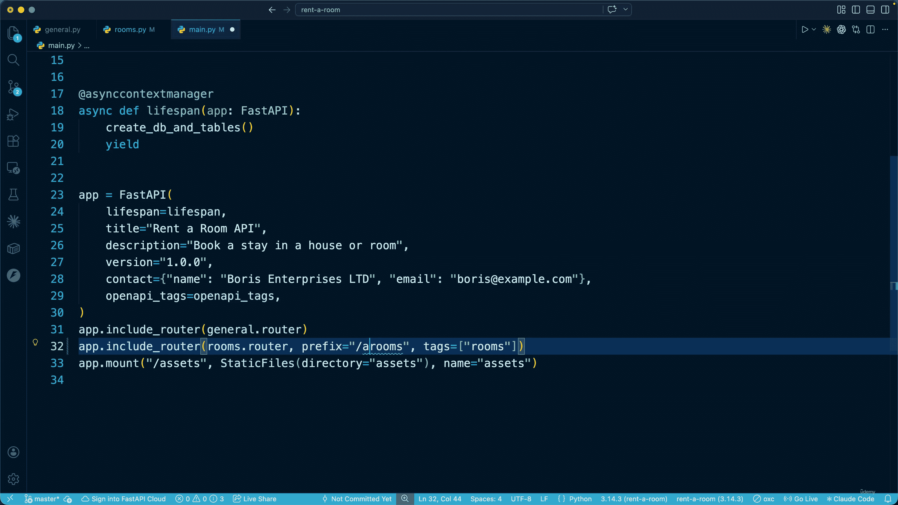

本节课中我们一起学习了 `APIRouter` 的路径前缀和标签配置。我们知道了可以把公共前缀 `/rooms` 和公共标签 `rooms` 集中到 `APIRouter` 声明处，避免在每个路由上重复书写；也知道了 FastAPI 会按照“路由器前缀加路由路径”的方式拼接最终路径，因此要避免出现 `/rooms/rooms` 这种重复。随后我们逐条更新了 POST、GET、PATCH 和 DELETE 路由，并移除了重复标签。最后还介绍了在 `include_router` 调用处配置前缀和标签的替代方案，它能让同一个路由器被多个应用复用时动态定制路径。核心公式仍然是 `最终路径 = 路由器 prefix + 路由装饰器中的 path`，掌握这个关系后，前缀和标签的集中配置就很直观了。

