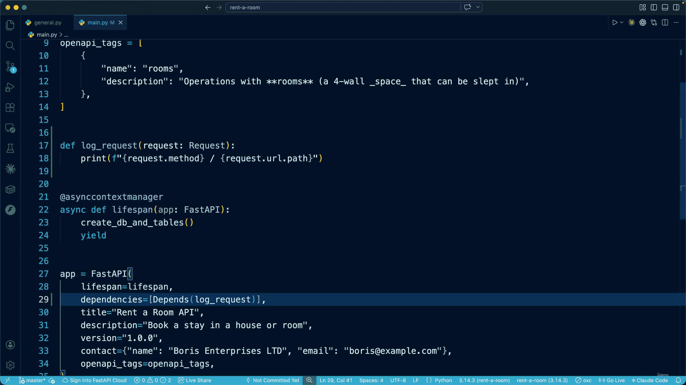
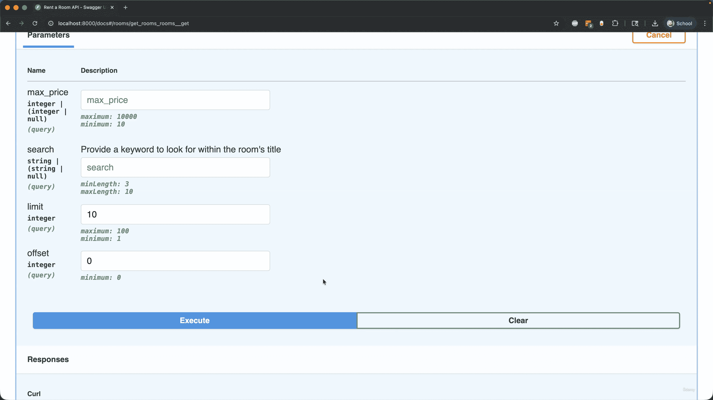
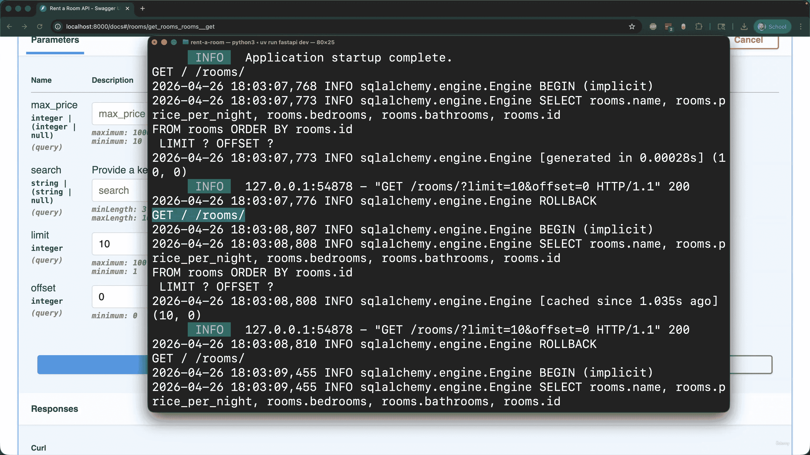

# 🚀 FastAPI 大师课：第84-85节：全局依赖

在本节课中，我们将要学习 FastAPI 中的全局依赖。前面已经看过路由级依赖注入，知道一个路由处理程序可以声明自己需要的依赖，FastAPI 会在路由运行时自动把依赖作为函数参数传进去。本节会进一步解释应用级依赖和路由器级依赖，说明它们适合什么场景、语法怎么写、执行顺序是什么，并通过一个记录请求日志的例子把概念落到代码上。掌握这些内容后，就可以根据业务范围选择把依赖放在应用、路由器还是单个路由上。下面从路由依赖和全局依赖的区别开始。

## 🧭 FastAPI 大师课：第84-85节：从路由依赖到全局依赖

到目前为止，我们已经看到如何在路由层面注入依赖。一个路由处理程序可以声明它需要的任何依赖，例如数据库会话，或者解析查询参数，FastAPI 会在路由运行时自动把这些依赖作为函数参数传进去。上一段回顾了路由级依赖，本节中我们来看看，如果希望一个依赖在每个请求上都运行，也就是应用级依赖，或者范围小一点，希望它只在某一类路由上运行，例如所有 room 路由，应该怎样配置。

答案是，既可以配置 API 路由器，也可以配置 FastAPI 应用本身来接收依赖。配置完成之后，FastAPI 会在应用或路由器包含的内容之前运行那个依赖函数。具体来说，如果用 FastAPI 应用配置依赖，这个函数会在任何路由处理程序之前运行；如果在一个 API 路由器里配置依赖，这个函数会在属于该路由器的任何路由处理程序之前运行。这样，在路由处理程序开始之前执行某段代码的粒度就可大可小，完全由你决定，既可以做成全局的，也可以做成某个路由器范围内的。下面的公式可以帮助理解这种范围差异：

```text
应用级依赖：在任何路由处理程序之前运行
路由器级依赖：在属于该路由器的任何路由处理程序之前运行
路由处理程序级依赖：只在当前路由处理程序之前运行
```

### 🧱 依赖声明语法和混用顺序

上一节说明了全局依赖能作用在应用级和路由器级，本节中我们来看看具体语法。应用级和路由器级依赖的语法是一样的，都是一个特殊参数 `dependencies`。这个参数接收一个列表，列表里放依赖项，每一项都需要用 FastAPI 的 `Depends` 函数包起来。`Depends` 在前面已经见过，它非常关键。用法是调用 `Depends`，并传入一个未调用的 Python 函数；在这种场景下，FastAPI 会在任何路由处理程序运行之前调用这个指定函数一次。同样的语法也可以用在路由器上。教程演示时把同一段依赖配置复制到路由器上，随后删除了临时的路由器示例，这说明应用级和路由器级只是配置位置不同，写法本身保持一致。下面的代码展示了两种配置方式的核心形式：

```python
from fastapi import FastAPI, APIRouter, Depends

app = FastAPI(dependencies=[Depends(某个函数)])

router = APIRouter(dependencies=[Depends(某个函数)])
```

这两种写法可以混用。混用时，更全局的应用依赖会先运行，然后路由器依赖运行，最后路由处理程序依赖运行。这个顺序符合层级逻辑，因为应用依赖被认为更全局，因此更重要，所以先执行；路由器依赖也按同样的逻辑排在应用依赖之后、路由处理程序依赖之前。可以用下面的公式表示：

```text
应用级依赖 -> 路由器级依赖 -> 路由处理程序级依赖
```

还需要注意，依赖不限于一个，你可以提供任意多个依赖。每个依赖都是一个单独的函数，并分别用 `Depends` 函数调用包起来。下面的列表给出多依赖配置时需要记住的要点：

- `dependencies` 接收的是列表，不是单个函数。
- 列表中的每一项都要写成 `Depends(函数名)`。
- 依赖可以有多个，FastAPI 会按配置执行它们。
- 应用级、路由器级、路由处理程序级可以混合使用。

## 🪵 FastAPI 大师课：第84-85节：编写一个全局请求日志依赖

上一节介绍了全局依赖的语法和执行顺序，本节中我们来看一个非常基础的例子，把理论落到代码上。这里把示例缩小到只保留一个依赖调用，并移除路由器示例。目标是声明一个 Python 函数，用来记录每一个服务器请求。这个函数可以非常简单，只输出请求的 HTTP 动词、正在访问的端点，或者日期时间等信息。这类信息通常在服务器日志里已经能看到，但它正好属于那种可能需要在应用级使用依赖的全局场景。其他例子还包括把每个请求的内容写入文件，或者通知另一台服务器有请求进来了。真正适合全局依赖的事情，应该是高层级、全局性、并且你确实关心在任何路由处理程序之前运行某段逻辑的事情。这里只做一个简单的人为示例，但在真实项目中，这种全局范围的需求值得和团队讨论清楚：它是否真的需要在每一个路由处理程序之前运行。下面的列表列出这里提到的几个全局场景：

- 记录每个服务器请求的基本信息。
- 把每个请求的内容写入文件。
- 通知另一台服务器有请求到来。
- 在真实项目中评估是否真的需要全局运行。

在明确场景之后，这里在文件上方定义了一个普通 Python 函数，并关闭了不再需要的文件。函数名叫做 `log_request`，名字可以自己定。如果希望访问请求信息，可以通过 FastAPI 自动提供的 request 对象来访问。函数参数命名为 `request`，并把类型注解为 `Request`，这是一个可以从 FastAPI 导入的特殊类。这里向上滚动，导入 `Request` 类，同时因为前面提到还需要 `Depends`，也顺便把 `Depends` 加入导入。这里的关键不是参数名，而是参数的类型是 `Request`。`Request` 是 FastAPI 中的一个对象，只要这个函数和 `Depends` 组合使用，FastAPI 就会自动实例化它并传入，这一点非常关键，因为 FastAPI 正是通过这种方式知道要提供请求类型。前面的课程讨论过互补的 `Response` 类型，它和 `Request` 很相似，也是 FastAPI 对象，用来表示响应，例如设置 cookie 或指示浏览器设置 cookie；这里的 `Request` 同样是 FastAPI 提供的对象。下面的代码展示了导入和函数定义的基本形态：

```python
from fastapi import FastAPI, Depends, Request

def log_request(request: Request):
    print(f"{request.method} / {request.url.path}")
```

这个 request 对象上会有大量信息。例如 `method` 属性会告诉我们 HTTP 动词，比如 GET 或 POST；request 对象上还可以访问嵌套的 URL 对象，访问它的 `path` 属性就能得到实际路径，也就是某个请求正在命中的实际路由。这个例子很人为，但做法就是把这两部分信息输出成一个字符串到终端。代码中使用 Python 的 `print` 函数，并传入格式化字符串；字符串以小写 `f` 开头，这种语法允许插入动态内容。把 `request.method` 包在花括号里，就能把该属性的值直接插入字符串；再用一个正斜杠分隔，然后插入 `request.url.path` 的值。这个函数本身只是普通 Python 函数，真正把所有东西接起来的关键在下面的 `dependencies` 列表：提供 `Depends`，并传入未调用的函数，在这个例子里就是 `log_request`。这等于告诉 FastAPI，在任何路由处理程序之前自动运行 `log_request` 函数。下面的公式概括了日志依赖的核心逻辑：

```text
Depends(log_request) => 在每个路由处理程序之前运行 log_request 一次
日志内容 = f"{HTTP 动词} / {请求路径}"
```

### 🌐 把依赖接到应用并观察效果

上一节写好了日志函数，本节中我们来看看怎样把它接入应用并验证效果。接线位置就是 FastAPI 应用的 `dependencies` 列表，代码可以写成下面这样：

```python
app = FastAPI(dependencies=[Depends(log_request)])
```

完成配置后，可以切换到浏览器发出示例请求，例如获取 rooms 相关接口。点击 “Try it out”，再点击 “Execute” 按钮，可以多点几次，确保发出几个请求。随后切换到终端，应该能看到 `print` 函数调用产生的日志。日志中会出现类似 `GET / /rooms` 的内容，其中 `GET` 来自 `request.method`，`/rooms` 来自 `request.url.path`。向上滚动还能看到多次输出，这说明名为 `log_request` 的辅助函数，也就是依赖函数，在每个请求之前运行了一次。它会一直运行，因为已经把它做成了全局依赖，具体原因就是把它附加到了 FastAPI 应用实例上。下面的列表总结这个验证过程：

- 在浏览器中打开接口文档并执行 rooms 请求。
- 多次点击执行，制造多个请求。
- 切换到终端查看日志输出。
- 看到 `GET` 和请求路径，说明依赖函数已运行。
- 因为依赖挂在 FastAPI 应用上，所以它对每个请求都生效。



如果希望依赖只在路由器层面运行，让它作用于该路由器内的所有路由，但不一定全局生效，语法完全相同：把 `dependencies` 列表传给 API 路由器的实例化过程即可。再次强调，依赖不限于一个，可以按需要配置任意多个。下面的代码展示路由器级配置：

```python
router = APIRouter(dependencies=[Depends(log_request)])
```

## 🧩 FastAPI 大师课：第84-85节：全局依赖的常见用例



上一节通过日志函数看到了全局依赖的实际运行方式，本节中我们来看看这类依赖常见的用途。全局依赖适合在任何路由处理程序执行之前运行一些通用逻辑。这里提到，常见的全局依赖用例包括日志记录，也就是写入信息或跟踪到达服务器的每个请求；认证，也就是在实际运行路由处理程序之前验证用户是否有权限或授权执行某个请求；限流，也就是通过限制每个用户或每个 IP 地址的请求总量来防止服务器被滥用；以及调用其他 API 来做指标统计，例如跟踪某个端点被访问了多少次。下面的列表汇总这些常见场景：

- 日志记录：记录信息，跟踪每个到达服务器的请求。
- 认证授权：在运行路由处理程序之前验证用户权限或授权。
- 限流：限制每个用户或每个 IP 的请求总量，防止滥用。
- 指标统计：调用其他 API，统计某个端点被访问的次数。

这些只是全局依赖的一部分用法。只要某段逻辑需要在任何路由处理程序执行之前运行，并且具有全局或较高层级的意义，就可以考虑使用这种全局依赖机制。实际项目中需要结合业务判断依赖范围，避免把只适合局部使用的逻辑放到全局。

## 📌 FastAPI 大师课：第84-85节：总结



在本节课中，我们一起学习了 FastAPI 的全局依赖。我们从路由级依赖回顾开始，理解了应用级依赖和路由器级依赖可以把依赖运行范围扩大到所有请求或某个路由器内的所有路由。我们掌握了统一语法：使用 `dependencies` 列表，列表中的每一项写成 `Depends(未调用的函数)`。我们还理解了混用时的执行顺序是应用级依赖、路由器级依赖、路由处理程序级依赖，并且依赖数量不受限制。随后通过 `log_request` 日志函数示例，看到了 `Request` 对象、`request.method`、`request.url.path` 以及 `FastAPI(dependencies=[Depends(log_request)])` 的实际用法，并在终端输出中验证了全局依赖会在每个请求之前运行。最后我们了解了日志、认证、限流和指标统计等常见全局依赖用例。掌握这些内容后，就可以根据业务范围选择把依赖放在应用、路由器还是单个路由上。
