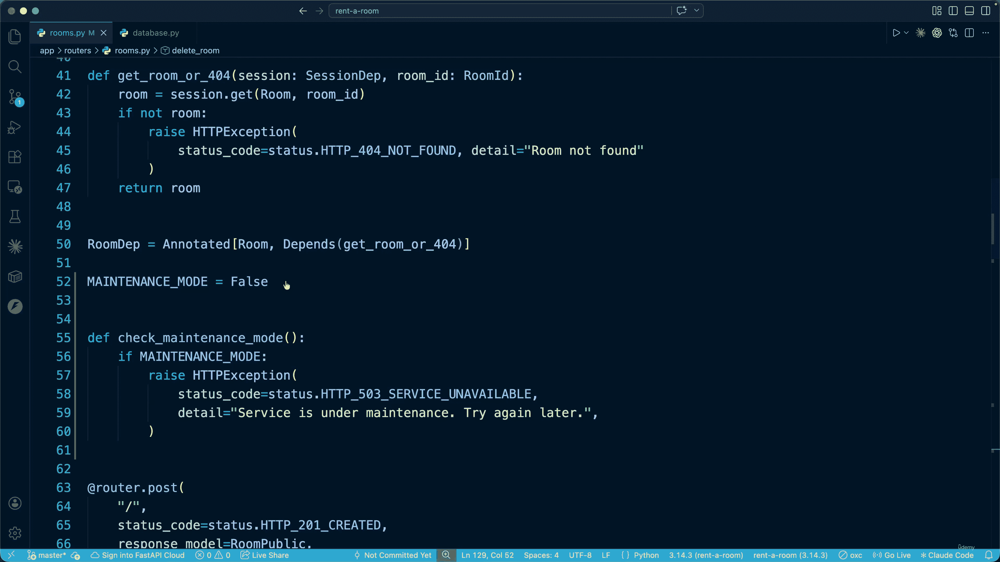
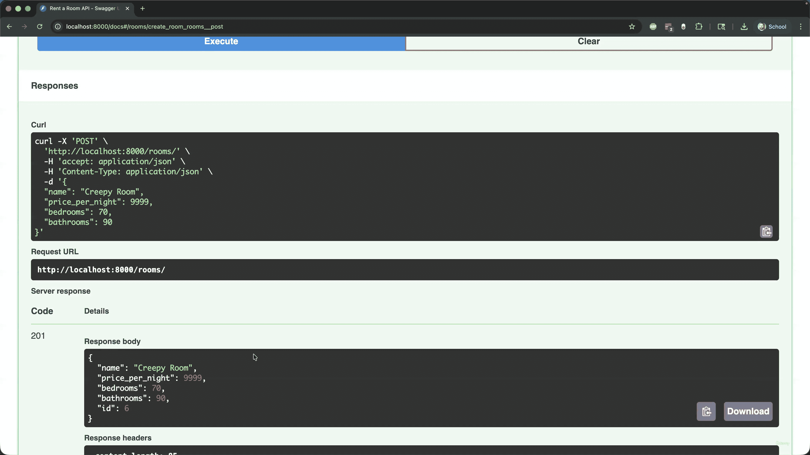
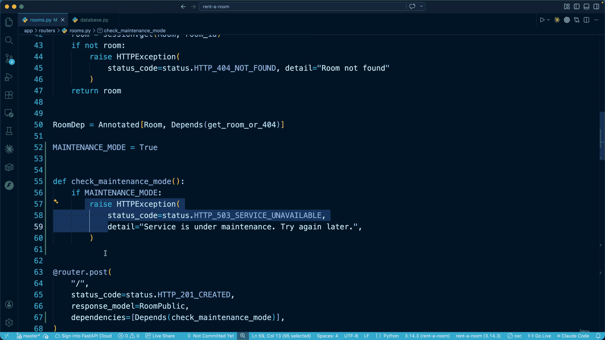
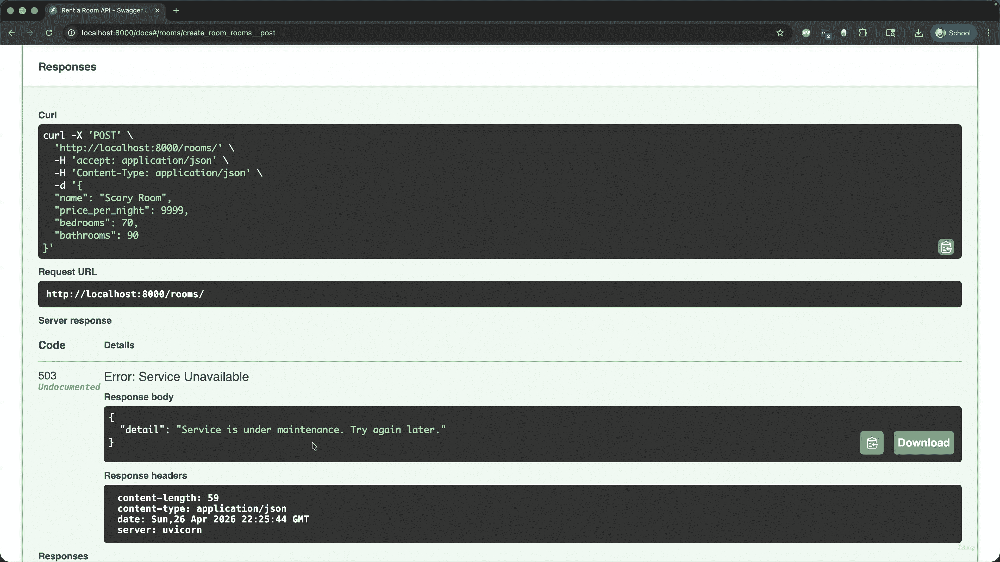
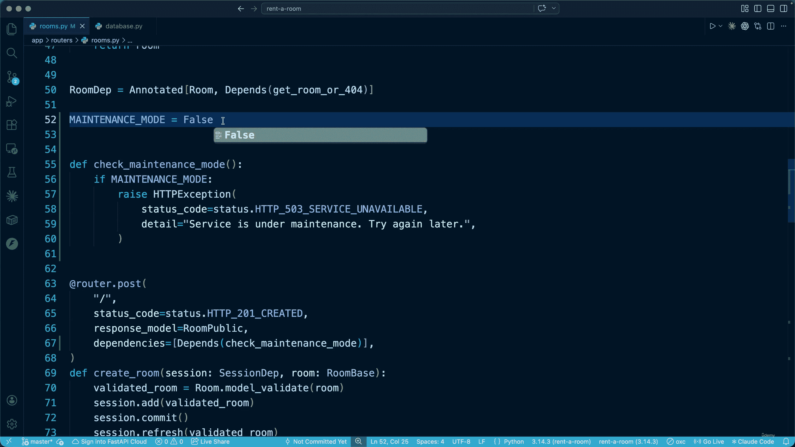

# 🧭 FastAPI 大师课：第85章：路由装饰器方法中的依赖

在本节课中我们将要学习如何只让依赖在部分路由上运行，而不是像上一课那样把依赖挂到整个应用或整个路由器上。我们会先回到上一课的全局依赖，再引出“维护模式”这个实际案例；随后对比两种依赖写法，一种是把依赖作为函数参数，另一种是把依赖放进路由装饰器方法的 `dependencies` 列表；最后在浏览器中验证效果，并总结什么时候该用哪一种写法。对初学者来说，这一课的重点不是记住语法，而是理解“依赖不一定要返回一个值，有时它只是负责在路由处理器执行前做一件副作用性质的事情”。

## 🔁 从全局依赖回到部分路由

上一课我们介绍了在 FastAPI 应用构造器中添加全局依赖，这个依赖会确保某个函数在应用内任何路由处理器之前运行。上一课里的日志请求函数并不会返回任何具体值，它存在的意义只是执行副作用，也就是把一些内容打印到屏幕上。现在我们换一个角度来思考：如果不想让依赖对全部路由生效，而是只想让它对一小部分路由处理器生效，应该怎么做。这里给出一个可能出现这种需求的问题场景：我们可能希望依赖只在路由器中的某些路由处理器上运行，而不是在所有路由上都运行。

为了让场景更具体，假设网站要进入所谓的“维护模式”。简单来说，网站会在有限的一段时间内下线，同时为用户执行升级。假设获取多个房间的 GET 端点，以及获取单个房间的 GET 端点，在维护模式期间仍然可以正常使用。与此同时，任何会修改数据的路由，例如 POST、PATCH、DELETE，在维护模式期间都不可用。我们还希望把所有这些逻辑关联到一个常量上，这样只要改一个地方，就能控制整个维护模式。下面列出维护模式期间哪些端点可用、哪些端点不可用，这样后面的代码就更容易理解。

- GET 多房间端点仍然可用。

- GET 单房间端点仍然可用。

- POST、PATCH、DELETE 这类会修改数据的端点不可用。

- 所有这些判断都关联到应用中的同一个常量。

接下来向上滚动代码，让例子更清楚。假设在应用代码里、房间相关定义下方设置一个常量，名字叫 `maintenance_mode`，一开始把它设为 `False`。当这个常量被设为 `True` 时，注意这只是运行时代码改动，我们希望所有适用的路由都暂时关闭或暂停，也就是阻止它们执行。下面用公式描述这个核心逻辑。

```text
maintenance_mode == True
→ 适用的变更数据路由被拦截
→ 路由处理器不执行
```

## 🛠️ 定义维护模式常量与检查函数

上一节我们确定了维护模式的需求，本节我们来看看如何用依赖函数实现它。这里可以做的一件事，是定义一个依赖，它本身是一个普通函数，负责检查维护模式是否被设为 `True`；如果是，就抛出异常。这样就可以说：我们根本不运行路由处理器，而是在更早的阶段提前抛出异常。这样一来，检查维护模式的复杂度不必复制到每个路由处理器中，而是可以隔离并抽象到一个辅助依赖函数里。函数名字不重要，这里把它叫作 `check_maintenance_mode`。

```python
maintenance_mode = False


def check_maintenance_mode():
    if maintenance_mode is True:
        raise HTTPException(
            status_code=status.HTTP_503_SERVICE_UNAVAILABLE,
            detail="Service is under maintenance. Please try again later."
        )
```

在这个函数里，可以用一个 `if` 语句检查上面定义的 `maintenance_mode` 常量是否等于 `True`，意思是对于那些指定端点，当前正处于维护模式。这里可以抛出已经导入的 `HTTPException` 类。这个异常会自动触发服务器错误响应，基本上会阻止原本要执行的路由处理器继续运行。这里还可以提供状态码，这种场景中常见的一个状态码是 503，也就是服务不可用。因此可以访问 `status` 模块中的 `HTTP_503_SERVICE_UNAVAILABLE`，并为 `detail` 参数提供一段给用户看的友好描述，例如“服务正在维护中，请稍后再试”。这里要确保拼写正确，并让用户稍后重试。

需要再次强调，这个函数本身只是普通 Python 函数，它虽然是依赖，但单独定义时没有任何东西会自动调用它。如果想让它在房间路由器的每个路由处理器上运行，上一课已经看到一种办法：在实例化路由器时提供 `dependencies` 列表，用 `Depends` 包装 `check_maintenance_mode`。但这样会在每个路由之前都运行，而我们已经说明不想让它跑在每个路由之前，只想让它跑在会修改数据的路由之前。因此这种设置必须逐路由配置，原因正是我们不想让它应用到该 API 路由器下的每一个路由。下面列出为什么不在路由器级别直接挂这个依赖的关键原因。

- 路由器级别的依赖会在该路由器下的每个路由前运行。

- 我们只想让维护模式拦截会修改数据的路由。

- GET 读取类路由在维护期间仍然要可用。

- 因此必须逐个路由配置依赖，不能图省事挂在路由器上。

## ✍️ 第一种写法：把依赖作为函数参数

上一节我们定义了检查函数，本节我们来看看第一种挂依赖的写法。现在转到第一个真正修改数据的路由，也就是 POST 路由，应该就在这里。问题变成：怎样让这个依赖在这里运行。我们之前见过一种方式，是把依赖作为函数参数附加到路由处理器上。这里的一个例子就是 `session_dep`，提醒一下，它使用的是 `Annotated` 的完全相同语法，但真正在幕后调用 `get_session` 的是其中的 `Depends`。我们也可以在这里尝试完全相同的办法，例如提供一个叫 `value` 的示例参数，并使用 `Annotated`。

```python
value: Annotated[None, Depends(check_maintenance_mode)]
```

这时就会遇到问题。这里提供方括号，提醒一下，方括号里的第一个值是参数的期望类型。但在当前场景中，`check_maintenance_mode` 存在并不是为了返回一个实际的具体值，我们不需要从这个函数里拿到任何东西。相反，这个函数几乎像一个守卫，我们希望它在路由处理器之前运行，只是为了安全。我们不需要它显式返回什么值，只需要它在 `create_room` 处理器之前运行。让它运行的唯一方式，是在方括号里把 `Depends` 作为第二个值提供，并把 `check_maintenance_mode` 放进去。严格来说，如果一个 Python 函数没有提供显式返回值，它的隐式返回值就是 Python 的 `None` 对象，表示什么都没有，也就是缺失。因此从技术上说，这里的 `value` 类型会是 `None`，因为 `check_maintenance_mode` 返回的正是这个。下面用公式描述这个返回值关系。

```text
check_maintenance_mode() -> None
value: Annotated[None, Depends(check_maintenance_mode)]
```

这有点令人困惑。更进一步，结合这个函数不返回任何对象的例子来看，我们实际上并不需要在 `create_room` 函数体内使用 `value` 参数，也不需要这个函数隐式返回的 `None` 对象出现在这个路由处理器或任何其他会修改数据的路由处理器中。这种语法可能有点难看，因为我们声明了一个参数，仅仅是为了使用 `Depends` 来运行一个不需要返回值的依赖。下面列出这种参数写法在当前场景中的问题，这样就能理解为什么要换一种写法。

- 这个依赖并不返回具体值，它隐式返回 `None`。

- `create_room` 的函数体里根本不需要 `value` 这个参数。

- 其他变更数据的路由处理器也不需要这个 `None` 对象。

- 声明参数只是为了运行依赖，语法不理想。

- 有人会用下划线命名参数，表示这个参数没用；这样确实稍微好一点，也能让 lint 违规消失，但仍然不理想，因为本质上还是声明了一个无用参数。

## 🚦 第二种写法：把依赖放进路由装饰器的 dependencies 列表

上一节我们看到了参数写法的别扭之处，本节我们来看看更适合“只运行、不取值”的写法。在需要依赖在路由处理器执行前运行、但不需要它的返回值、因此不需要函数参数保存返回值的情况下，可以把依赖提供给实际的 POST 方法调用，或者提供给对应的 GET、PATCH 等方法。因此这里不再使用参数列表，而是提供类似的 `dependencies` 参数。这个参数和之前在 FastAPI 应用以及上面的 API 路由器中看到的参数完全相同，但现在我们声明的是需要在这个路由处理器运行之前执行的函数。选择这种语法而不是参数语法的原因，是我们不关心依赖的返回值，只需要它执行。

```python
@router.post(
    "/rooms",
    dependencies=[Depends(check_maintenance_mode)]
)
```

在这个列表里必须非常小心，不能只把函数名传进去，必须把它包装在 `Depends` 中。FastAPI 就是通过这种方式建立关联的。因此这里调用 `Depends`，把 `check_maintenance_mode` 传进去，现在就不再需要那个无用的参数了。我们仍然能获得在路由处理器执行前运行这段逻辑的好处。每当把 `maintenance_mode` 改成 `True` 并部署应用，这个函数都会先运行 `check_maintenance_mode`；如果维护模式为 `True`，就会在路由处理器真正执行之前抛出异常，基本上就是终止、暂停或阻止在维护模式期间访问这个 API 路由。

接下来可以复制这一行，在下面几个路由处理器中使用。按我们的设定，维护模式期间用户可以访问和读取资源，只是不能写入、更新、删除，因此跳过 `get rooms`，也跳过 `get room` 函数；到 PATCH 路由时再次粘贴这一行，让该端点在维护期间关闭；DELETE 也应用完全相同的逻辑。下面列出哪些路由需要挂依赖、哪些路由不需要挂依赖，这样维护模式就只影响修改数据的操作。

- POST 路由挂上 `Depends(check_maintenance_mode)`。

- PATCH 路由挂上 `Depends(check_maintenance_mode)`。

- DELETE 路由挂上 `Depends(check_maintenance_mode)`。

- GET 多房间和 GET 单房间不挂该依赖，维护期间仍然可以读取。

- 这样维护模式只阻止修改数据，不阻止读取数据。

## 🌐 浏览器验证维护模式

上一节我们完成了路由配置，本节我们来看看两种场景在浏览器中的实际表现。假设一开始把 `maintenance_mode` 设为 `False`，那么每个端点都应该完全正常工作。回到浏览器，尝试创建一个新房间，提供一个有效负载，例如把房间叫作 `creepy room`。课程内容确实越来越奇怪了，还可以把每晚价格设成夸张的 `9999` 美元，并设置 70 间卧室和 90 间浴室这种疯狂数据。当前不在维护模式，因此发出 POST 请求时，装饰器方法中列出的依赖确实会运行，但不会进入那个 `if` 语句，因此不会抛出异常，也不会返回 503 状态码，随后常规 POST 请求会完成。下面按顺序列出维护模式关闭时的验证步骤和结果，方便对照。

- 维护模式为 `False`，所有端点完全可用。

- 创建一个新房间，提供有效负载，例如 `creepy room`。

- 设置每晚价格 `9999` 美元、70 间卧室和 90 间浴室，数据可以很夸张。



- 发出 POST 请求时，装饰器中的依赖会运行，但不会进入 `if`。

- 因此不会抛异常，也不会返回 503。

- 常规 POST 请求完成，成功创建房间，返回的房间 `creepy room` 的 ID 是 6。

现在假设确实要关闭服务。回到代码，把 `maintenance_mode` 改成 `True`。这样所有指定了依赖的路由仍然会在执行前运行这个函数，但因为值变成了 `True`，我们会在维护模式中拦截请求并抛出异常，因此路由处理器不再执行。注意，回到浏览器后，现在幕后应该已经自动处于维护模式。如果尝试其他操作，例如创建 `scary room`，并在这里用 `X cube` 作为请求内容，向下滚动后，不应该再得到成功响应。下面按顺序列出维护模式开启时的验证步骤和结果，这样能清楚看到依赖拦截的效果。

- 将 `maintenance_mode` 改为 `True`。



- 指定了依赖的路由仍然会先运行 `check_maintenance_mode`。

- 因为值为 `True`，函数进入 `if`，抛出异常，路由处理器不再执行。

- 浏览器中尝试创建 `scary room`，请求内容使用 `X cube`，向下滚动。



- 不再得到成功响应，而是返回 503 服务不可用。

- `detail` 是检查函数中提供的内容：`Service is under maintenance. Please try again later.`

- 这证明路由处理器调用了依赖函数，也就是在路由处理器开始运行前执行了一段补充逻辑。

> 关键点：依赖函数会在路由处理器开始之前运行，所以它可以在请求真正进入业务逻辑之前提前拦截，并决定是否抛出异常。

## 🧠 依赖作为副作用与参数选择的区别

上一节我们通过浏览器验证了维护模式，本节我们把本课的核心概念收拢一下。这就是这些依赖非常有用的地方：可以隔离共性逻辑，把希望在路由处理器开始前执行的公共逻辑单独抽出来；这种依赖可以在应用级别声明，可以在路由器级别声明，也可以逐个函数到函数地声明。除此之外，本课还学到一点：如果依赖严格来说只是副作用，就不一定非要把依赖声明成实际的函数参数。副作用基本上就是一些只需要运行的代码，我们并不真的关心它的值，只需要那个 `if` 语句执行，并在需要时抛出异常。我们完全不需要从这个依赖中获得任何具体值或对象。下面列出本课关于依赖声明方式的核心结论，便于以后做选择。



- 如果依赖需要返回一个具体值，应该把这个函数作为依赖参数传给路由处理器。

- 如果依赖严格只产生副作用，不需要返回值，可以把依赖放进路由装饰器方法的 `dependencies` 列表。

- `dependencies` 列表可以包含多个依赖，不限于一个。

- 多个依赖会按照传入列表的顺序执行。

- 列表中的每个依赖都要用 `Depends` 包装，并传入未调用的函数对象。

- 这样 FastAPI 才能建立正确的依赖关联，并在路由处理器执行前调用它们。



下课前要确保关闭维护模式，避免以后意外破坏这些端点，因此把 `maintenance_mode` 改回 `False` 并保存。本节课中我们一起学习了如何把依赖挂到单个路由装饰器方法上，如何用副作用依赖实现维护模式，以及如何在参数依赖和装饰器依赖之间做选择；当依赖需要返回值时作为参数传入，当依赖只需要执行副作用时放进 `dependencies` 列表，并记住多个依赖会按列表顺序执行。本课内容到此结束，下一节课再见。

