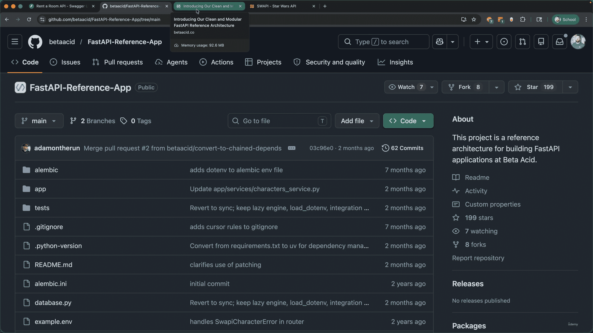
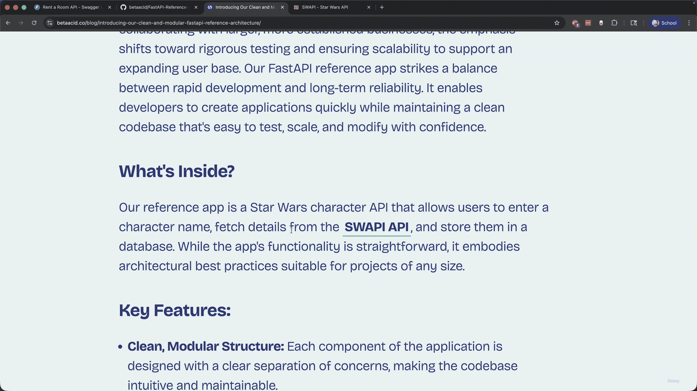
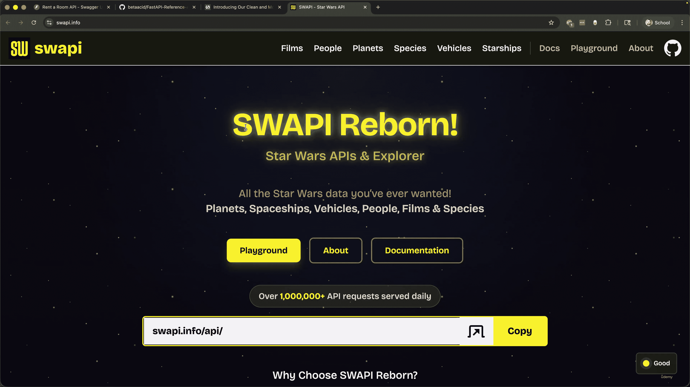
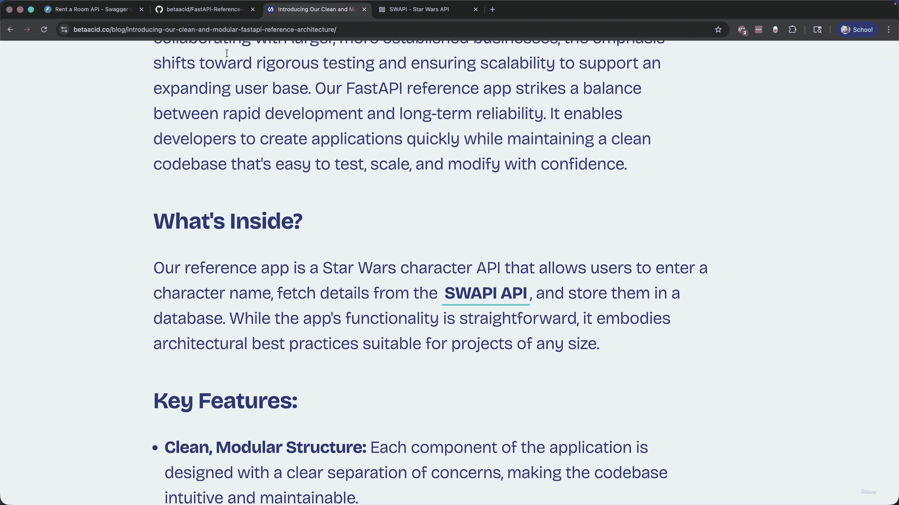
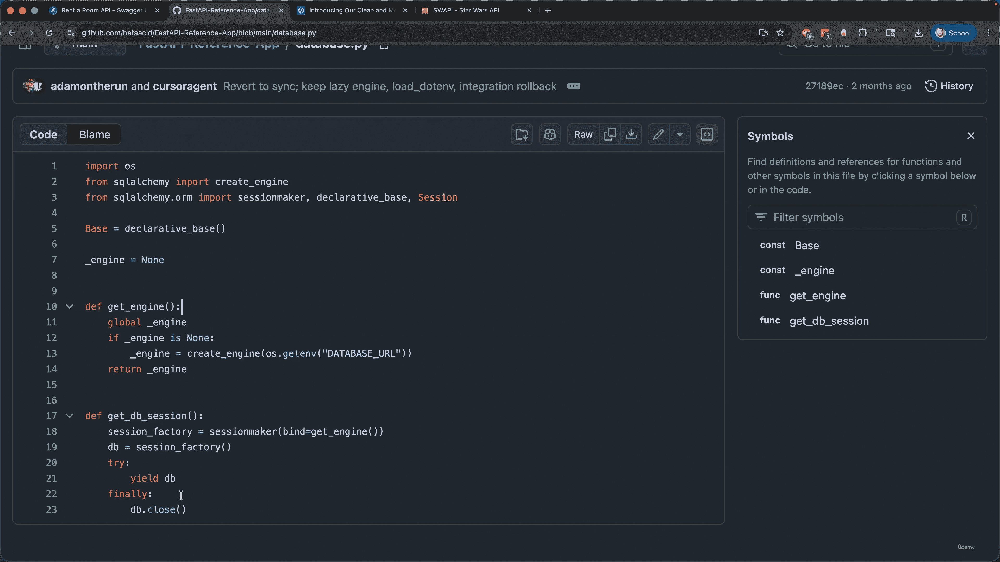

# 🚀 FastAPI Masterclass：p86：按技术层组织代码

在本节课中我们将要学习如何从更宏观的角度组织一个 FastAPI 应用，也就是如何安排文件、文件夹，以及更重要的职责划分。上一节我们已经完成了代码重构，本节会先介绍两个真实世界的 FastAPI 代码库，然后重点分析第一个代码库如何按技术层组织代码。这里的目标不是让你记住每一个细节，而是让你看懂一种可落地的组织结构，并理解它背后的取舍。

## 🧭 FastAPI Masterclass：p86：本节目标与代码库背景

上一节我们完成了重构，本节中我们来看看应用组织方式。接下来两节课会讨论更广泛的应用组织问题：如何用文件和文件夹组织 FastAPI 应用，以及比文件摆放更重要的职责如何分配。展示组织方式的最好方法是看两个真实世界代码库，它们都使用 FastAPI。这样可以看到不同团队如何在同一框架下做出不同选择，也能帮助初学者建立“结构没有唯一答案”的意识。

在进入两个代码库之前，有一些背景值得说明。FastAPI 本身是一个库，有时也被称为微框架，因此它不会强制你接受某一种具体决策。比如 FastAPI 不会把你绑定到某个 ORM，你可以选择任意 ORM。我们选择 SQLModel，原因很简单：它和 FastAPI 由同一个开发团队维护。两个示例项目使用的是 SQLModel 底层的另一个 ORM，即 SQLAlchemy。因此你会看到一些代码不同，这完全正常。即使两个团队都使用 FastAPI，代码库之间也会出现变化，会使用不同的库与核心 FastAPI 库组合。你需要关注共同点，关注更大的架构结论，例如文件夹结构，以及 routers、models、dependencies 这类领域概念放在哪里。这样既能看到相似性，也能看到差异。

还需要注意，FastAPI 本身是持续演进的库，因此你看到的某些语法可能略有不同，不一定和我们代码库完全一致，这完全没问题。以下是本节的几个观察重点，先列出来方便建立框架。

- 关注文件夹结构，而不是纠结每个导入语句。

- 关注 routers、models、dependencies 等概念的位置。





- 关注职责如何拆分，而不是只看代码写法。



- 接受 FastAPI 版本演进带来的语法差异。

## 🌟 FastAPI Masterclass：p86：第一个真实代码库：Beta Acid 参考应用

上一节说明了观察重点，本节中我们来看看第一个代码库。第一个代码库是 Beta Acid 的 FastAPI 参考应用。Beta Acid 是一家位于纽约的软件咨询公司，这个仓库是他们给开发者的模板，用于在客户的新 FastAPI 项目开始时快速起步。配套博客对它的介绍是：这个参考应用是一个 Star Wars 角色 API，允许用户输入角色名，从 SWAPI 获取角色详情。SWAPI 是一个在线的 Star Wars API。他们这样做的原因之一，是让某些路由处理器自己向第三方服务或其他 API 发请求，并展示如何把这类逻辑组织进代码。



这个应用会向 SWAPI 发请求，也允许用户输入角色名，获取详情并把详情存入数据库。应用功能很直接，但它体现了适合任何规模项目的架构最佳实践。这里需要指出，所谓最佳实践本身存在分歧，因此才展示两个遵循完全不同实践或标准的代码库。第一个代码库最大的特点是：它主要按技术特征组织文件夹和文件。比如进入 `app` 目录后，所有文件夹都对应 FastAPI 中的技术概念，例如 models、routers、services。这些是 Python 术语，也是 FastAPI 框架概念。下一课会看到另一种方式：按实际业务功能组织，例如房间、支付方式、用户、预订等。以下是两种组织思路的对比，先建立直观印象。

- 按技术层组织：文件夹名称是 `routers`、`models`、`services`、`schemas` 等。

- 按业务功能组织：文件夹名称是 `rooms`、`payments`、`users`、`bookings` 等。

如果分别建模 Airbnb、LinkedIn、Twitter 三个应用，按技术层组织时，它们很可能使用完全相同的文件夹结构，因为 routers、models 等技术概念在三个领域都会出现。反过来，如果按业务功能组织，LinkedIn、Twitter、Airbnb 的代码库会差别很大，因为功能不同、领域概念不同、业务想法不同。展示两个例子是为了强调：代码组织方式仍有争论，没有绝对唯一答案。代码库和 API 复杂度增长后，管理 200 个甚至更多端点时，很难有单一完美方案，总会有取舍和优缺点。接下来两节课会持续讨论这些取舍。

## 🧱 FastAPI Masterclass：p86：从顶层入口 main.py 看代码库

上一节介绍了参考应用的背景，本节中我们来看看如何从顶层检查这个代码库。和本节课程中的做法类似，这个代码库把大量核心代码放在中央 `app` 文件夹中，并在顶层放一个 `main.py` 文件来启动 FastAPI 应用。进入 `main.py` 后可以看到，它导入 FastAPI 和 `status` 模块。我们不会逐个讲每个导入和每个文件，因为那会花很多时间，但关键模式很明显：它导入两个 routers，这些 routers 位于 `app` 内的 `routers` 目录中。这再次强调，它按技术功能组织代码，所以所有 routers 都放在 `routers` 文件夹中。

`main.py` 中还定义了一组错误类，这些错误都定义在 `app/errors` 中，因此 `errors` 目录同样存放相关的技术概念。继续向下看，可以看到相同模式：实例化 FastAPI 应用；包含两个 routers，从而注册特定路由；然后出现此前没见过的代码，后面课程会讲，这里是在注册自定义错误处理。如果某个路由或端点抛出某个错误，就告诉 FastAPI 返回给客户端的错误 payload 应是什么形状。这基本上就是设置全局错误处理。以下是 `main.py` 中值得记住的观察点，方便初学者抓住主线。

- 顶层 `main.py` 负责启动应用。

- `app/routers` 存放路由层代码。

- `app/errors` 存放错误处理相关代码。

- `include_router` 用于注册路由。

- 自定义错误处理用于统一错误响应形状。

核心概念可以用依赖链和入口结构描述，先看一段简化代码。

```python
# 简化示意
from fastapi import FastAPI
from app.routers import vehicles, characters

app = FastAPI()
app.include_router(vehicles.router)
app.include_router(characters.router)
```

## 🛣️ FastAPI Masterclass：p86：路由层：vehicles router

上一节从入口看到了 routers 的位置，本节中我们深入一个示例 router。先看一个简单的 vehicles router。从代码库顶层进入 `app` 目录，再进入 `routers` 文件夹，打开 `vehicles_router.py`。这里的大部分代码应该能看懂：创建一个新的 `APIRouter`，前缀是 `vehicles`；然后有一个 POST 端点用于创建 vehicle，还有一个 GET 端点用于按 `vehicle_id` 路径参数获取 vehicle。这里再次使用 `response_model` 参数指定返回给客户端的响应对象形状。

核心概念是路由层只负责声明端点和收集输入，可以用下面的简化代码表示。

```python
router = APIRouter(prefix="/vehicles")

@router.post("/", response_model=VehicleRead)
def create_vehicle(input_vehicle: VehicleCreate, service: VehiclesService = Depends()):
    return service.add_new_vehicle(input_vehicle)

@router.get("/{vehicle_id}", response_model=VehicleRead)
def get_vehicle(vehicle_id: int, service: VehiclesService = Depends()):
    return service.get_vehicle_by_id(vehicle_id)
```

这里出现了一个重大差异，也是核心架构模式：服务层架构。这种设计的意图是让路由处理器非常轻量。我们的路由处理器不算特别复杂，因为它们只与一个资源或一张对应数据库表交互，也就是 rooms。但在更复杂的真实领域里，端点复杂度通常会大幅增加。可以想象在 Airbnb 上预订房间时需要做很多事：写入一条数据库记录表示预订，并把房间和某个用户关联；给房东发邮件；给用户发邮件；可能还要记录后续邮件，例如在用户到达前一周提醒房东和客人；安排某种金融交易以扣用户信用卡；更新可用性记录，使该房间在用户预订的日期序列内不再可用。重点在于，这不再只是数据库 CRUD 操作。一个预订房间的路由处理器可能膨胀到几十行甚至几百行，如果一个文件里有多个路由处理器，文件复杂度会迅速上升。

服务层模式会创建一个独立函数或类，称为 service，用来处理大部分复杂度。路由处理器的职责只是从用户那里收集数据，然后把数据委托或传递给 service，真正的大部分代码放在 service 中。这样职责管理更优雅，路由处理器只负责接收数据和返回数据，service 把结果交回来。两个端点都依赖同一个 service，名为 `vehicle_service`，它位于 `services` 目录中。和 routers、schemas、services 一样，文件夹按技术责任命名。以下是路由层与服务层的职责对照，先列出来方便理解。

- 路由处理器：接收请求数据，调用 service，返回结果。

- 服务类：编排业务步骤，处理复杂逻辑。

- 数据库客户端：专门与数据库或 ORM 交互。

- Schema：描述请求和响应的数据形状。

## 🧩 FastAPI Masterclass：p86：Depends 与类依赖

上一节看到路由处理器把工作委托给 service，本节中我们来看看 `Depends` 如何支持类依赖。这里有一个有趣的点：代码使用了 `Depends`，我们之前见过它，但之前只和函数组合使用。事实上，也可以给 `Depends` 传入 Python 类，因为 `Depends` 可以接受任何可调用对象。函数加括号会调用，类加括号会实例化。因此把类传给 `Depend` 时，就是告诉 FastAPI 在路由处理器运行前创建该类实例，并把类实例赋给对应参数。等 `create_vehicle` 路由处理器运行时，`service` 参数就是实例化后的 `VehiclesService` 类实例。实际函数体只是调用 service 上的实例方法 `add_new_vehicle`，或者调用 `get_vehicle_by_id`，并传入路由处理器收集到的数据。这里的 `input_vehicle` 是进入服务器的 payload。路由处理器基本上只是组装数据，然后传给 service。

另一个用例是把路径参数传给对应 service。例如 `vehicle_id` 有类型标注，并且是路径参数，直接传给对应 service，继续保持路由处理器轻量。核心依赖注入可以用下面的公式描述。

```text
路由处理器参数 = Depends(可调用对象)
Depends(类) -> 创建类实例 -> 注入到路由处理器参数
```

以下是 `Depends` 在这个代码库中的几个特点，适合初学者记住。

- `Depends` 可以接收函数。

- `Depends` 也可以接收类。

- 传入类时，FastAPI 会先实例化类。

- 实例化后的对象会作为参数传给路由处理器。

## 📐 FastAPI Masterclass：p86：Schema 层与 Pydantic 模型

上一节说明了 service 如何被注入，本节中我们快速看看示例 schema 对象。进入 `app`，再进入 `schemas`，打开 `star_wars_vehicle_schema.py`，这就是刚才 routers 文件中导入的内容。这里有一组 Pydantic 模型，结构和我们代码库非常相似。它们有一个 base 类定义 `name` 字段，还有各种子类。其中一个子类甚至没有添加任何额外字段，只是继承 Star Wars vehicle base 超类以获得 `name` 字段，这完全没问题。类定义中的 `pass` 关键字表示没有额外内容。即使这些子类在技术上和超类没有区别，有时保留它们也有帮助，因为类名可以提供额外上下文，说明这个模型或形状代表什么。例如 `StarWarsVehicleCreate` 可以理解为进入服务器的 payload，而 `StarWarsVehicleRead` 可能是从数据库读取的 Star Wars vehicle，因此会附带许多额外字段或信息。

这里的 `Optional` 语法来自较旧版本的 Python，在现代 Python 中等价于 `str | None`。可空性原则和课程中一直使用的一样，只是旧语法。这里还看到默认赋值为 `None`，满足可选类型。核心概念可以用下面的代码描述。

```python
class StarWarsVehicleBase(BaseModel):
    name: str

class StarWarsVehicleCreate(StarWarsVehicleBase):
    pass

class StarWarsVehicleRead(StarWarsVehicleBase):
    id: int
    name: str
    optional_field: str | None = None
```

这里展示一个差异：回到顶层 `app` 可以看到，这个应用区分了与数据库对话的实际类，称为 models，以及只表示某种数据形状的类，称为 schemas。换句话说，我们的代码库把 models 和 schemas 放在同一个文件中，而这个代码库把 model 特指为与数据库对话的类，把 schema 特指为没有数据库连接的 Pydantic 模型。在我们的代码库中，`Room` 会是 model，而 `RoomBase` 或 `RoomPublic` 会是 schema。这是进一步的区分。无论如何，这些文件夹仍按技术领域概念组织，即 model 与 schema，而不是按 vehicle 或 character 这样的实际功能组织。以下是 model 与 schema 的区别，先列出来方便记忆。

- Model：直接对应数据库表，负责与数据库对话。

- Schema：只描述数据形状，不连接数据库。

- 路由层通常使用 schema 描述请求和响应。

- 数据库客户端通常使用 model 操作数据库记录。

## 🧰 FastAPI Masterclass：p86：服务类如何依赖数据库客户端

上一节区分了 model 和 schema，本节中我们返回 services。这些 services 被 router 文件中的路由处理器调用，具体依赖的是 `vehicle_service`，也就是传给 `Depends` 的内容，再次证明不需要实际函数，可以传入普通类，FastAPI 的 `Depends` 会实例化它并作为参数传给路由处理器。两个路由分别调用 service 类上的实例方法 `add_new_vehicle` 和 `get_vehicle_by_id`。因此路由处理器不需要担心会迅速膨胀的复杂度，这些复杂度由 service 处理。下一个有趣的设计决策是类构造函数 `__init__` 接受一个 vehicles database client。这里再次依赖 FastAPI 的 `Depends`。这意味着 `VehiclesDatabaseClient` 会在 `VehiclesService` 实例化时被实例化，然后这个类实例会写入 `db_client` 属性。

真正负责与数据库对话的是 `VehiclesDatabaseClient` 类。可以看到 `db_client` 属性，`add_new_vehicle` 方法调用 `db_client` 上的 `insert_new_vehicle` 方法。service 不知道数据库，也不知道正在使用的 ORM，这是有意设计。听起来可能有很多层或很多复杂度，但意图是把所有 ORM 操作隔离到单独类中，这里叫 `vehicles database client`，目的是抽象和复用。例如明天团队决定更换 ORM，这里或路由处理器都不需要改，因为所有 ORM 特定代码或所有与数据库对话的代码都限制在这个类中。以下是这种隔离带来的直接好处，先列出来帮助理解。

- 更换 ORM 时，改动集中在一个数据库客户端类。

- 路由处理器不需要知道数据库细节。

- 服务类只负责编排业务步骤。

- 数据库客户端负责保存和读取数据。

## 🗄️ FastAPI Masterclass：p86：数据库客户端层：隔离 ORM

上一节看到 service 如何依赖数据库客户端，本节中我们进一步看看数据库客户端层。很多混乱代码库会出现不同部分执行相同职责的情况：一个路由处理器直接与数据库对话，另一个路由处理器调用一个与数据库对话的函数，第三个路由处理器调用一个与数据库对话的类。这样没有一致性和可预测性。如果决定更换 ORM，可能需要查看路由器文件、依赖文件等三种不同类型文件，才能找到所有使用位置。这里的意图是完全分离，每个类负责自己的事情。与数据库通信可能复杂且特定，因此被抽象、隔离或隐藏在特定的 `VehiclesDatabaseClient` 类中。事实上这里会有多个数据库客户端类，取决于要保存到数据库的 model 或条目类型。

这里可以看到一组函数用于与外部数据库对话。它们基于外部数据源构建 vehicle，最终收集所有内容，包括调用工具函数 `calculate_vehicle_efficiency`。这个函数位于 `app/domain` 文件夹中，只是做额外处理的工具函数。这里可以看到与 vehicles 和 characters 相关的实际领域特定概念被放在 `domain/vehicles` 中。于是第二种模式开始出现：这里开始讨论实际领域概念，而不是技术概念。关键点是最终与数据库客户端对话，并把组装好的 vehicle 传进去。数据库客户端完全负责保存数据，后面会讲到；在这个场景中数据库客户端负责检索数据。service 类中没有任何内容直接与 ORM 或数据库交互。最后数据库客户端返回给定 model，也就是数据库记录的表现形式。这里使用 Pydantic 模型 `StarWarsVehicleRead`，使用熟悉的 `model_validate` 方法创建模型实例并验证输入，然后返回给 router。

依赖链可以用下面的公式描述。

```text
router -> Depends(VehiclesService) -> Depends(VehiclesDatabaseClient) -> Depends(get_db_session)
```

以下是数据库客户端层的关键职责，先列出来方便复习。

- 接收 service 传来的组装数据。

- 调用 ORM 或数据库会话完成保存。

- 调用 ORM 或数据库会话完成查询。

- 返回 model 或验证后的响应对象。

## 🧬 FastAPI Masterclass：p86：模型层：映射数据库表

上一节看到数据库客户端如何隔离 ORM，本节中我们看看 model 的样子。进入 `app/models/star_wars_vehicle_model.py`。这里再次强调，model 是一个直接对应或与数据库表对话的类。这里使用 SQLAlchemy，它是 SQLModel 底层的 ORM。语法不同，但完成的事情和我们代码库中 `Room` 类完全一样。这里列出所有字段，每个字段映射到对应数据库列：描述数据库列类型；使用 `map_column` 函数表示该字段对应一列；把列类型交给 ORM，以便生成正确的 SQL 建表查询；提供条件，例如主键或 ID、列是否可空、是否不可空等。ORM 完全不同，但可以看到这个代码库和我们的代码库之间的相似性。

核心概念可以用下面的代码描述。

```python
class StarWarsVehicle(Base):
    __tablename__ = "star_wars_vehicles"
    id = mapped_column(Integer, primary_key=True)
    name = mapped_column(String, nullable=False)
```

以下是 model 层需要记住的要点，先列出来方便初学者建立概念。

- Model 对应数据库表。

- 字段对应数据库列。

- 主键、可空性等条件交给 ORM 生成 SQL。

- 数据库客户端使用 model 完成保存和查询。

## 🔌 FastAPI Masterclass：p86：数据库会话依赖 get_db_session

上一节看了 model 映射，本节中我们看看数据库会话如何注入。返回 `clients/database` 中的 `vehicles_database_client`，最后展示 `get_db_session`。它从顶层 `database.py` 文件导入。回到代码库顶层并点击 `database.py`，可以看到非常相似的模式，区别是使用 SQLAlchemy。这里有数据库引擎，它被限定在函数中；然后是 `get_db_session` 函数，它被传给 `Depends`，使数据库客户端类获得数据库会话。这里使用略有不同的 `try/finally` 语法，基本实现与 `with` 关键字上下文管理器相同的结果，确保数据库会话使用完成后关闭。

核心概念可以用下面的代码描述。

```python
def get_db_session():
    session = SessionLocal()
    try:
        yield session
    finally:
        session.close()
```

以下是数据库会话依赖的作用，先列出来方便复习。

- 为数据库客户端提供临时数据库会话。

- 通过 `Depends` 自动注入。

- 使用结束后负责关闭会话。

- 避免会话泄漏和连接管理混乱。

## 🧾 FastAPI Masterclass：p86：整体总结与结构回顾

上一节看了数据库会话，本节中我们对整个代码库做总结。这是一个有趣且更复杂的真实世界代码库例子。顶层 `app` 包含 routers，routers 由路由处理器组成。路由处理器是普通函数，在这个例子中会委托给 service 类，从而保持路由处理器轻量。service 类处理路由应该做什么的职责，但在需要与数据库对话时，会委托给数据库客户端类。数据库客户端类使用 `Depends` 获得数据库会话。不同职责包括接收数据、组织数据、向单独 API 发请求、组装额外数据、转换形状，这些职责不再锁在一个路由处理器中，而是拆分到不同类和不同职责中，主要围绕 service 类。service 类像一个组织容器，每个路由处理器通过 `Depends` 自动获得它的实例。



不需要理解这个模式的每个细节，也不需要掌握所有技术概念。主要结论是清晰的：这是组织代码的一种方式，主要围绕 FastAPI 中的技术构造来命名文件夹，因此会看到 `schemas`、`models`、`routers`、`dependencies` 等文件夹。下一课会看一个互补例子，它以非常不同的方式建模这些想法。本节课中我们一起学习了 FastAPI 应用如何按技术层组织代码：从 `main.py` 启动应用，到 routers 声明端点，再到 service 编排业务，然后由 database client 隔离 ORM 和数据库会话，最后用 model 映射数据库表，用 schema 描述数据形状。核心依赖链可以记成 `router -> service -> database_client -> session`，这就是本节最值得带走的结构图。

