## 🧭 FastAPI Masterclass：88.1：课程概述

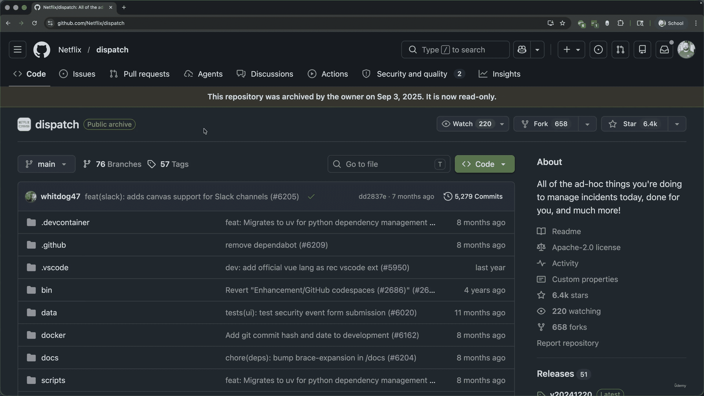

在本节课中，我们将要学习如何按“业务功能”来组织 FastAPI 代码。上一节课我们看了一个来自 Beta Acid 的示例 FastAPI 代码库，它按照技术构件来组织文件夹，例如 `models`、`routers` 等。本节中我们来看看另一个可以互补的代码库，它叫 `dispatch`，来自 Netflix。这个代码库采用了稍微不同的组织方式。

我们再次把两个代码库放在一起比较，目的不是证明谁对谁错，而是说明 FastAPI 代码的组织并没有唯一标准。我们会看它们的主要差异，也会讨论两种方式的优点和缺点。你完全可以按照自己的喜好混搭两种方式。以下是本课大致会覆盖的内容：

- 了解 `dispatch` 代码库的背景和用途。
- 观察它如何按产品功能组织顶层文件夹。
- 查看应用入口、路由嵌套和路由包含关系。
- 深入 `individual` 文件夹，查看 `views.py`、`services.py` 和 `models.py`。
- 比较数据库会话注入、Pydantic 模型和 SQLAlchemy 模型放置方式的差异。
- 讨论按功能组织代码的优缺点，以及如何混合使用。

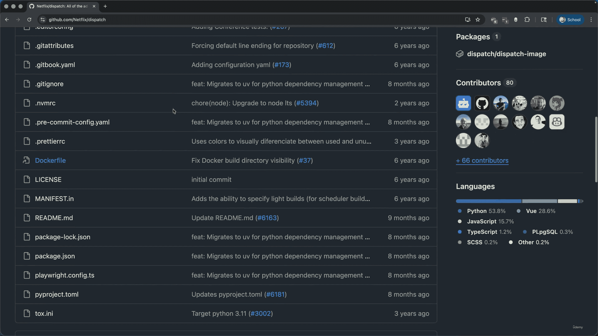

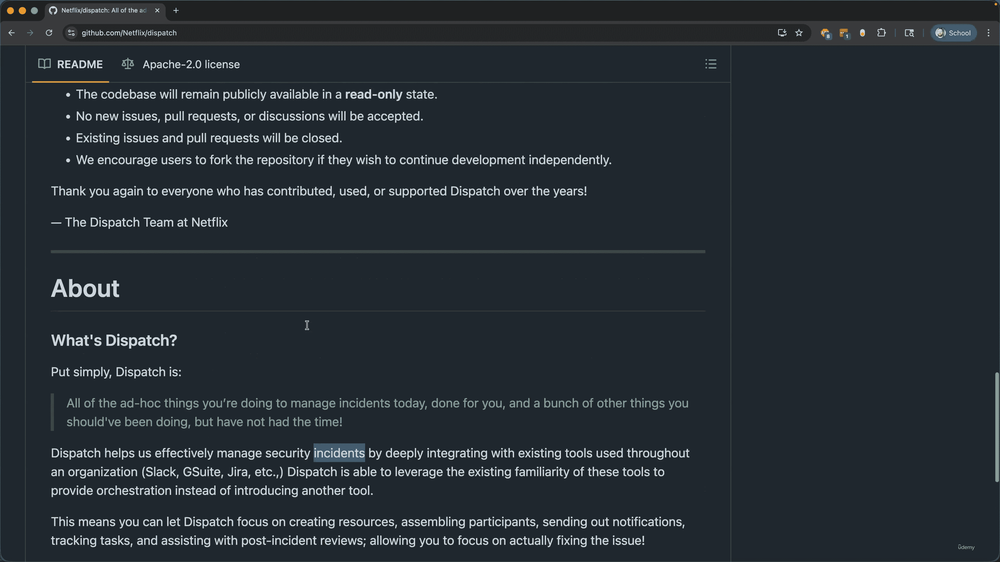

通过以上内容，你会看到一个真实生产代码库如何围绕业务域来安排文件。接下来我们先从 `dispatch` 的背景开始。

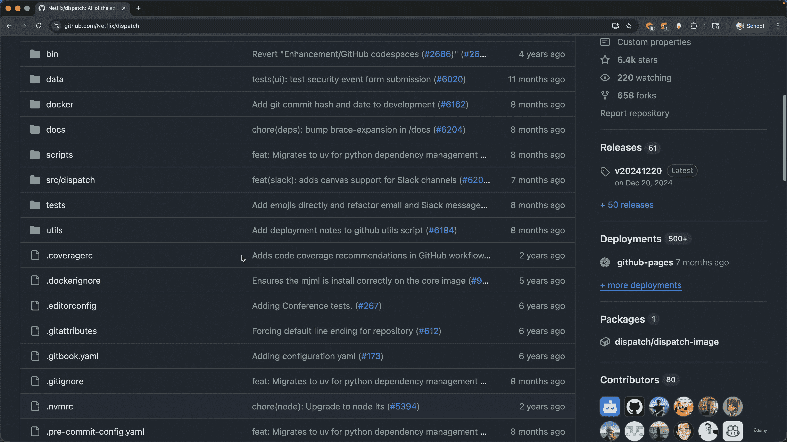

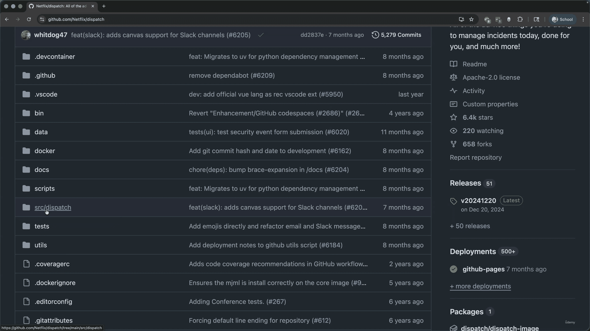

## 🏢 FastAPI Masterclass：88.2：dispatch 代码库的背景

上一节我们提到了代码库组织没有唯一标准，本节中我们来看看 Netflix 的 `dispatch` 代码库是做什么的。快速在 GitHub 仓库中向下滚动，可以先了解它的用途。这个代码库实际上是 Netflix 内部的生产代码库，负责管理安全事件。它深度集成了组织内已有的工具，例如 Slack 和 Google Suite。它基本就是 Netflix 用来管理各种安全事件的内部工具，例如上报事件、把修复任务委派给某位工程师、管理事件状态等。换句话说，这是他们内部的事件跟踪系统。

我们向上滚动可以看到，这个代码库同时包含前端和后端组件。所有 FastAPI 相关代码都可以在 `src/dispatch` 这个目录中找到，`src` 是 source 的缩写。这里还嵌套了一个 `dispatch` 目录。进入这个目录后，你会注意到最大的差异：顶层文件夹是按产品功能来组织的。例如 `case`、`conversation`、`cost_model` 这些概念都特定于事件跟踪系统。如果我们正在构建另一个应用，例如 LinkedIn 或 Airbnb，并且按照完全相同的文件夹结构来建模，那么文件夹名称很可能会根据我们自己的业务需求和业务想法而完全不同。因此，顶层并不是按 FastAPI 技术特性来组织，而是按业务域来组织。例如这里有 `definition`、`document` 等与事件跟踪相关的概念。这个代码库相当全面。

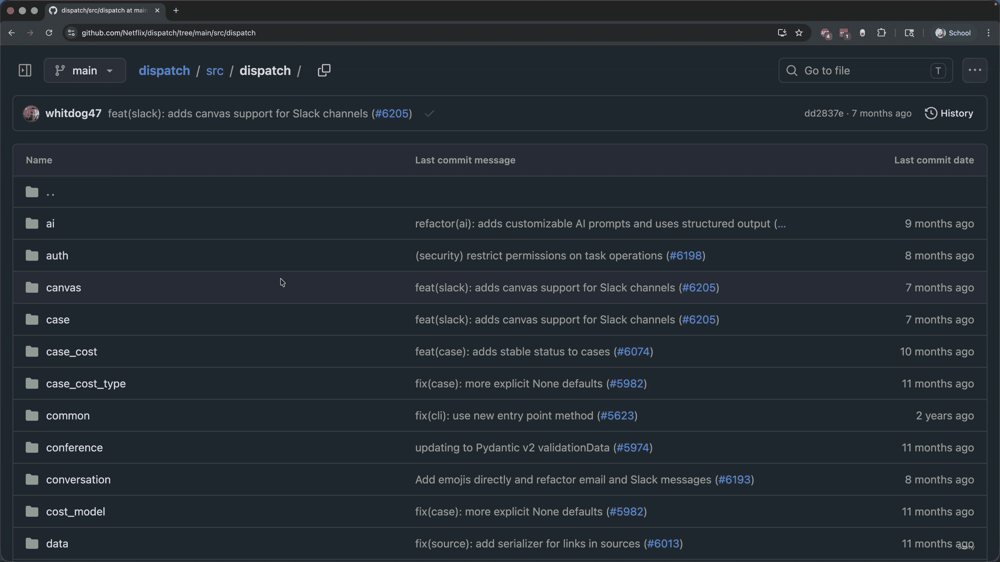

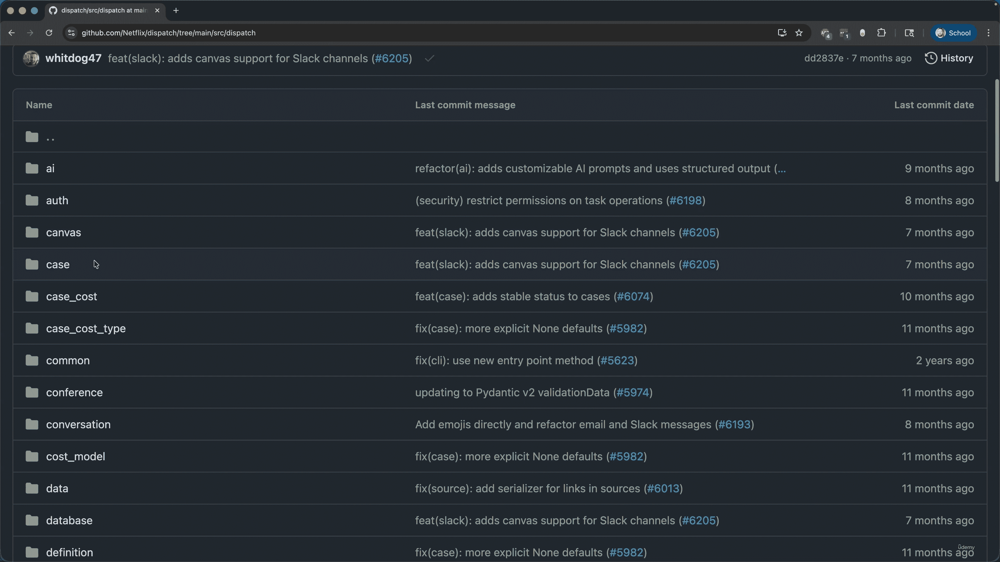

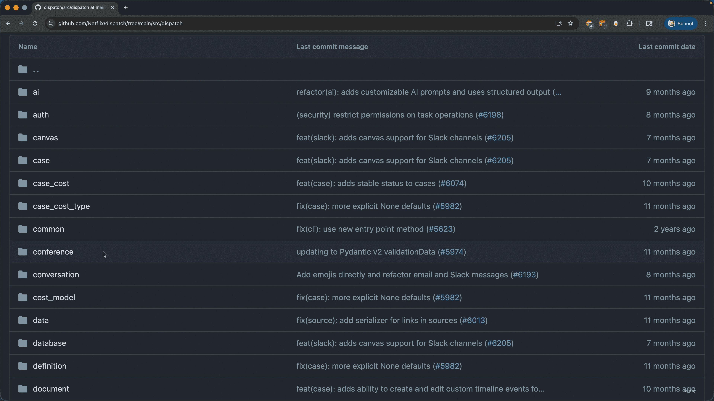

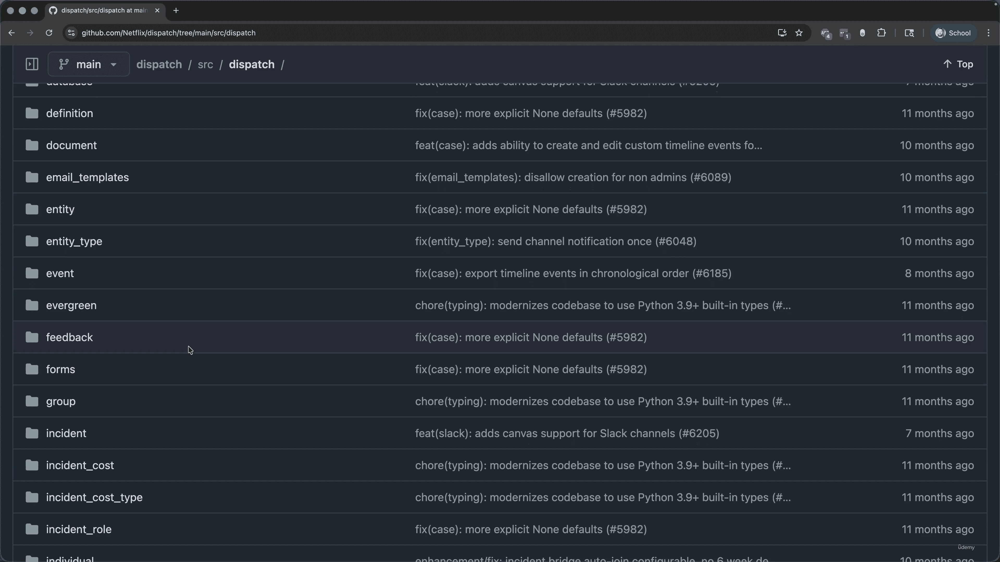

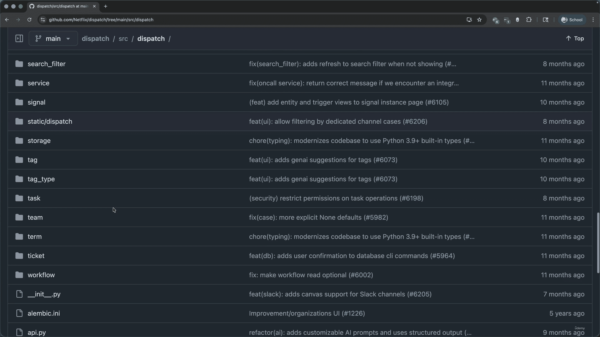

接下来我们继续向下滚动，经过这些组织性文件夹，找到核心的 `main.py`。这里可以看到 FastAPI 应用的实际创建过程。实际上，我相信这个文件里创建的不只是一个应用实例，而是多个实例。这里有很多复杂性。继续向下滚动，可以看到他们在这里实例化 FastAPI 应用，并赋值给 `api` 变量。再往下经过中间件等复杂代码，可以看到最终在文件底部，第 262 行附近，他们调用了熟悉的 `include_router` 方法，并包含了一个 API router。

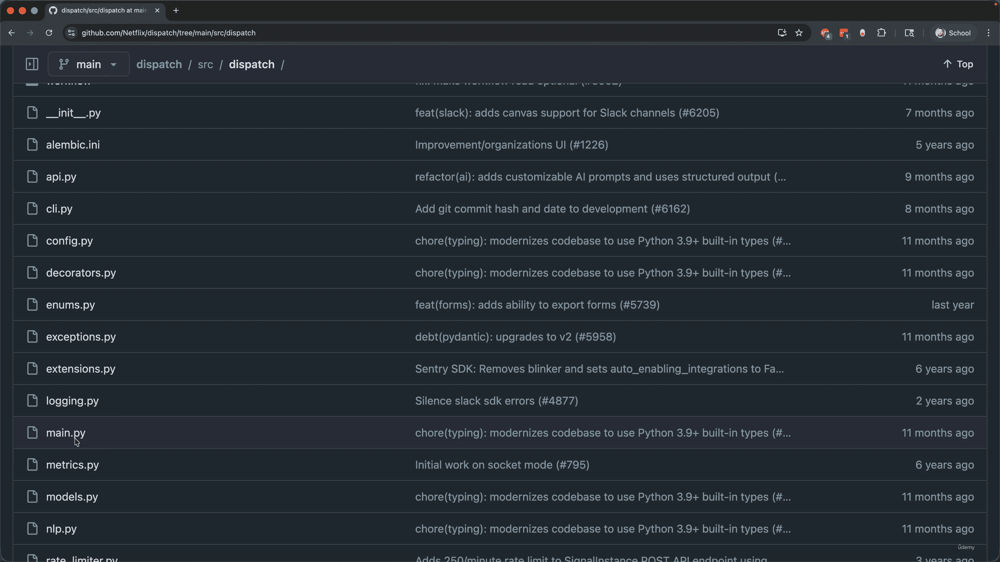

我们之前没有见过这种写法，但一个 router 也可以包含其他 router。记住，router 只是一个组织容器，因此一个组织容器本身可以包含更多组织容器。这里他们只调用了一次 `include_router`，但这个 router 内部实际上包含了很多内容。向上滚动到文件顶部，查看 `api_router` 来自哪里，它来自同一层级的一个互补文件 `api.py`。回到 `dispatch` 文件夹并寻找 `api.py`。我知道 GitHub 上有更快的导航方式，这里只是想展示一般可以如何浏览这种文件夹结构。`api.py` 文件里也会看到一些熟悉的代码：他们从许多不同文件夹导入大量 routers，每个文件夹都代表一个领域概念或领域构件。几乎每个文件夹里都会嵌套一个 `views.py` 文件，例如 `cost_model`、`definition` 或 `document`。每个 `views.py` 都会定义自己的 router，用来支持对应领域概念的 routes。这个文件会导入所有这些 routers。下面可以看到一大堆 `include_router` 调用。顶层 app 对象添加了 API router，而 API router 又包含了所有这些更小的 routers，每个小 router 负责自己的一组 endpoints。

可以用下面的代码关系来理解这种嵌套：

```python
app = FastAPI()

app.include_router(api_router)

api_router.include_router(individual_router)
api_router.include_router(case_router)
api_router.include_router(conversation_router)
```

也就是说，顶层应用并不直接认识所有小 router，而是通过一个总 router 来汇总它们。这样一层套一层，最终把各个业务域的 endpoints 组织起来。接下来我们进入一个具体示例文件夹，看看业务域内部是如何放置文件的。

## 📁 FastAPI Masterclass：88.3：进入 individual 示例文件夹

上一节我们看到了 `main.py` 和 `api.py` 如何通过 router 嵌套来汇总路由，本节中我们来看看一个具体的业务域文件夹。回到 `dispatch` 目录，找一个相对轻量的文件夹，我找到的是 `individual`。这个文件夹比较适合演示按功能组织代码的优势。

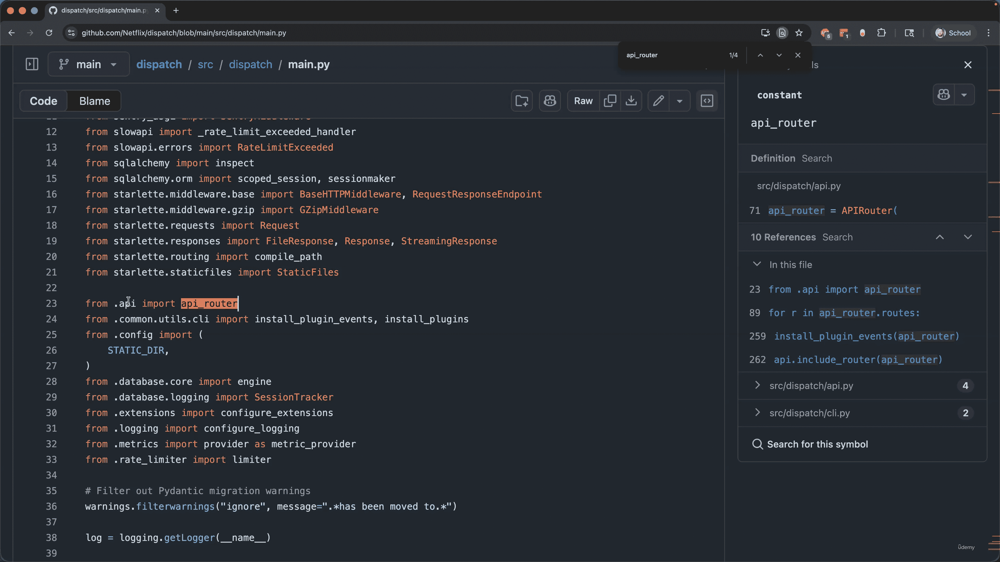

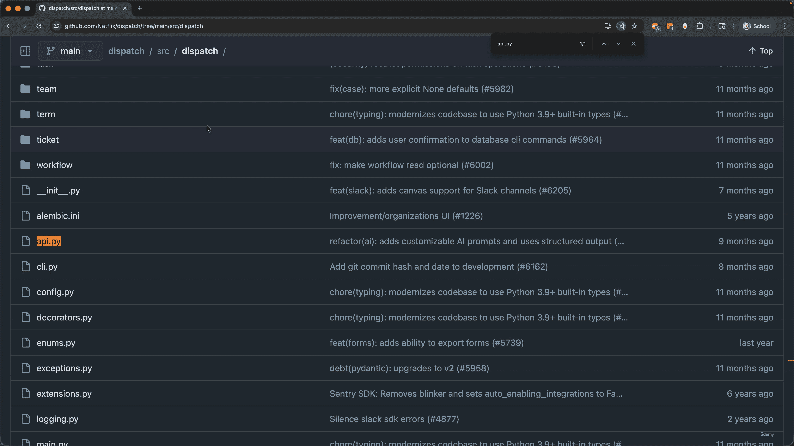

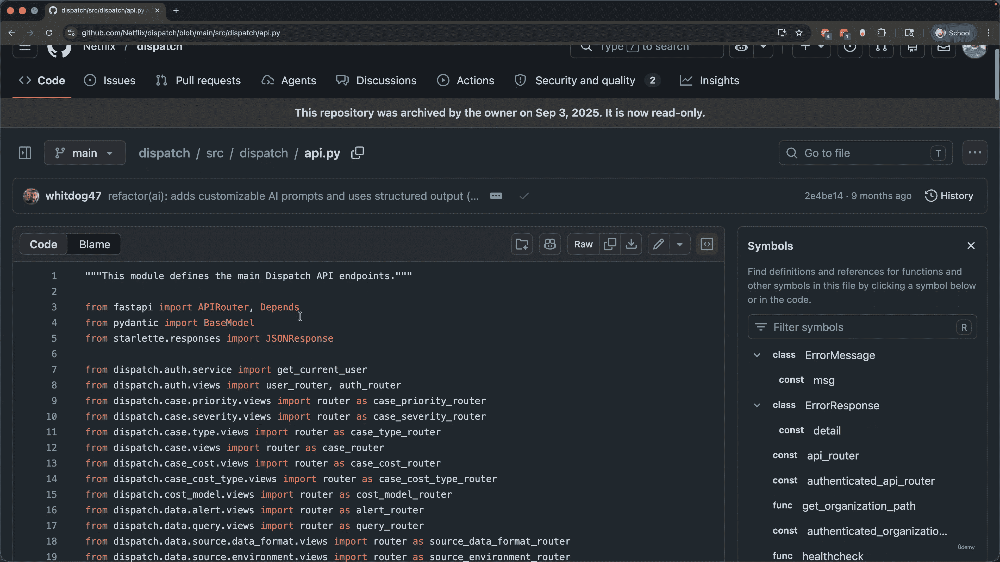

这种组织方式的第一个优势，是尽量把相关的代码文件放在更近的位置。上一节课那种组织方式有一个缺点，也是我们当前代码库中的情况：技术构件会分散在可能很多不同的文件夹中，而且这些文件夹可能位于代码库的不同层级。我们的 routers 在一个位置，models 在另一个位置，dependencies 又在另一个文件夹里，可能在上面或下面。这里当然也仍然有基于领域概念的文件，例如 models 或 services，但它们现在被聚集在像 `individual` 这样的组织性文件夹中，这个文件夹本身就反映了业务域概念。

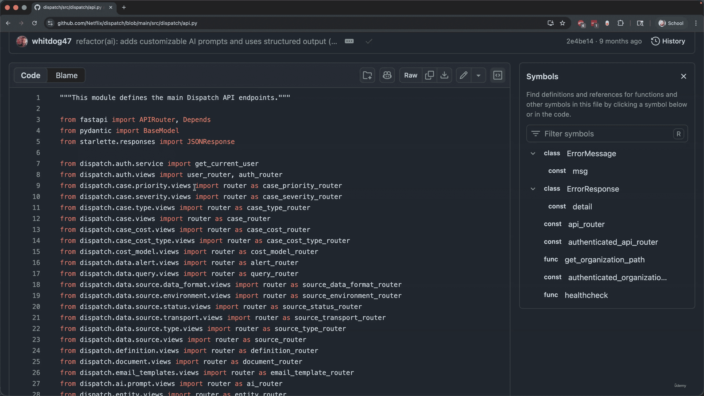

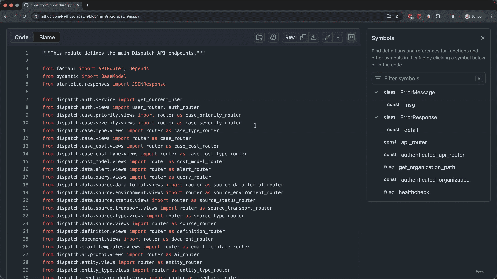

如果某个人需要更新 individual 的信息，例如添加一个新的 endpoint，那么改动很可能只局限在这个文件夹中。这不总是成立，但相比上一节看到的结构，这种可能性更高。这就是这种组织方式的一个优势。

可以用一个简单的公式来描述这种结构：

```text
业务域文件夹 = views.py（路由层） + services.py（业务函数层） + models.py（数据库模型与Schema）
```

下面是一个简化后的目录示意：

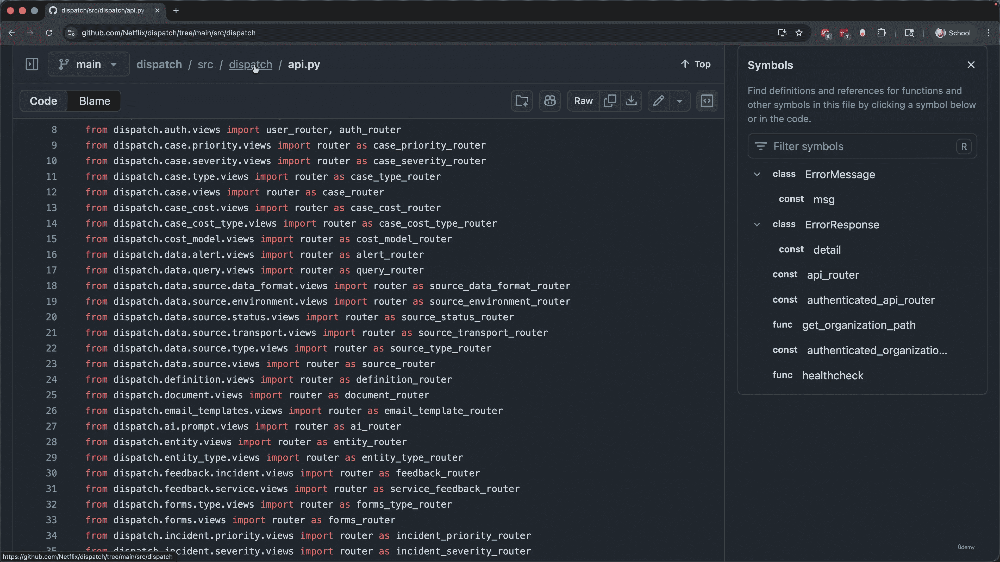

```text
src/dispatch/
  individual/
    views.py
    services.py
    models.py
  case/
  conversation/
  cost_model/
  definition/
  document/
  main.py
  api.py
```

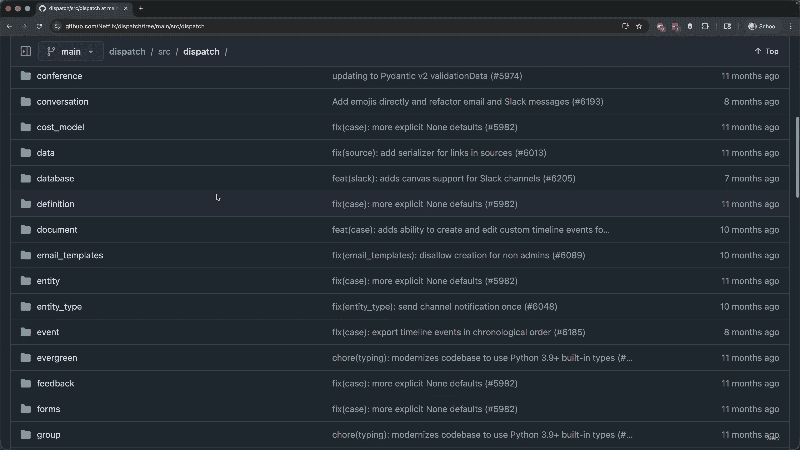

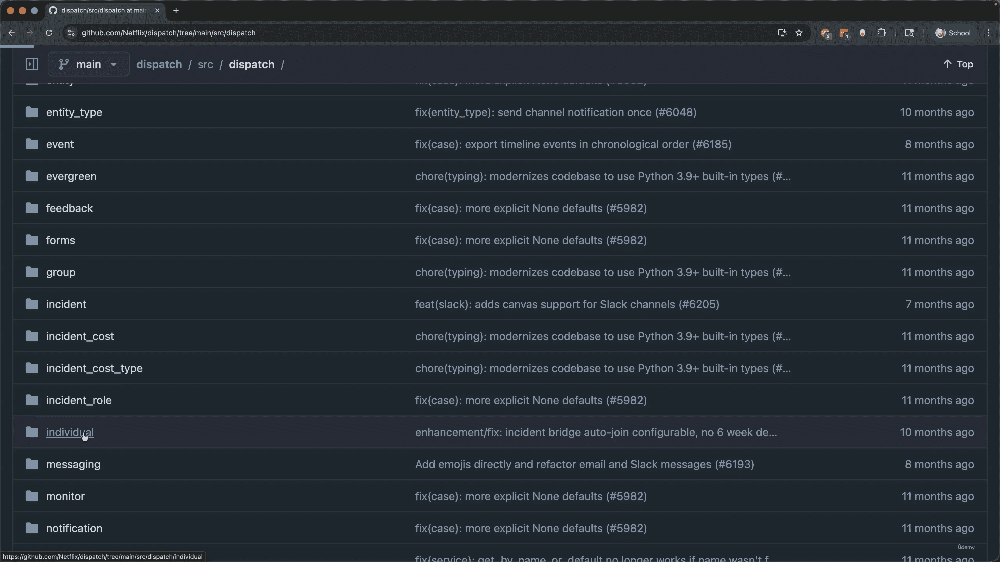

进入 `views.py` 后，可以看到他们为所有 individual 相关 routes 创建了自己的 API router。代码应该比较熟悉：有一组不同的 endpoints 挂在 router 上，分别负责获取单个 individual、获取多个 individuals、创建 individual 等。同样可以看到，他们在这里通过依赖注入获取数据库会话，而这个数据库会话来自另一个文件。这一点和上一节课的方式立刻不同：上一节课里数据库会话被隔离到自己的依赖类中，由 service 类去调用；而这里数据库会话直接在 route handler 内部获取。

相似之处是，他们仍然试图减少 route handler 内部的代码总量，把具体工作委托给辅助函数。上一节课中他们有单独的类，这里则是从同一文件夹内的互补文件 `service.py` 导入函数。`get`、`create`、`update`、`delete` 都是围绕 individual 这个核心概念展开的独立函数，分别负责获取 individual、创建 individual 等。关键点是：route handler 会组装它需要的东西，例如数据库会话、解析路径参数，然后把这些数据作为参数传给互补函数，从而减少 route handler 的责任范围。

同样可以看到，这些 route handler 内部并没有直接与数据库交互。他们通过把 route handler 与 ORM 实现的具体复杂性分离，保持了一定层次的隔离。所有数据库逻辑都远离这个文件，route handler 不需要关心这些逻辑，只需要委托给 `get` 或 `update` 这样的互补辅助函数。

下面是一个简化后的路由层示意：

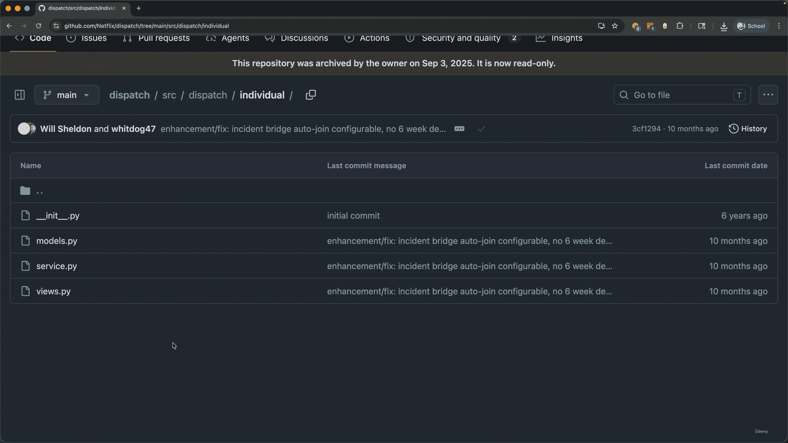

```python
@router.get("/{individual_id}")
def get_individual(
    individual_id: int,
    db_session: Session = Depends(get_db),
):
    return get(db_session=db_session, individual_id=individual_id)
```

上面这段代码的重点不是逐字复现，而是说明 route handler 负责接收请求、获取依赖、解析参数，然后把工作交给 service 函数。接下来我们向上滚动，看看这些 service 函数本身。

## ⚙️ FastAPI Masterclass：88.4：services.py 中的辅助函数

上一节我们介绍了 `views.py` 如何委托工作，本节中我们来看看 `individual/service.py` 中的服务函数。进入 `individual` 的 `service.py` 文件，可以看到这些文件与路由文件是放在一起的。route handler 依赖哪些 service，这些 service 就放在同一个 `individual` 代码库中的文件里，这有助于把相关文件并排放在一起。

这里的辅助函数不是 service 类，但它们服务于类似目的。这些函数接收数据库会话，并且正是这些函数在真正查询数据库。它们再次保持了 route handler 与 ORM 具体实现之间的分离。这里有一个有趣的模式：函数签名以星号 `*` 开头，后面跟所有参数。这个写法的意思是，调用 `get` 函数时必须显式提供所有参数的实际名称，并使用等号赋值。它基本禁止了位置参数，所以不能只按顺序把数据库会话传进去，必须在调用 `get` 的 route handler 中写出 `db_session=`，再传入数据库会话。这样做的原因是为了清晰，让调用方显式提供名称，从而明确这些值分别流入 service 函数的哪个参数。

这里的函数覆盖熟悉的 CRUD 操作：create、read、update、delete。它们都会与数据库对话，概念上比较熟悉。可以用下面的代码来理解这种“强制关键字参数”的写法：

```python
def get(
    *,
    db_session: Session,
    individual_id: int,
):
    ...

# 调用时必须写出参数名
get(db_session=db_session, individual_id=individual_id)
```

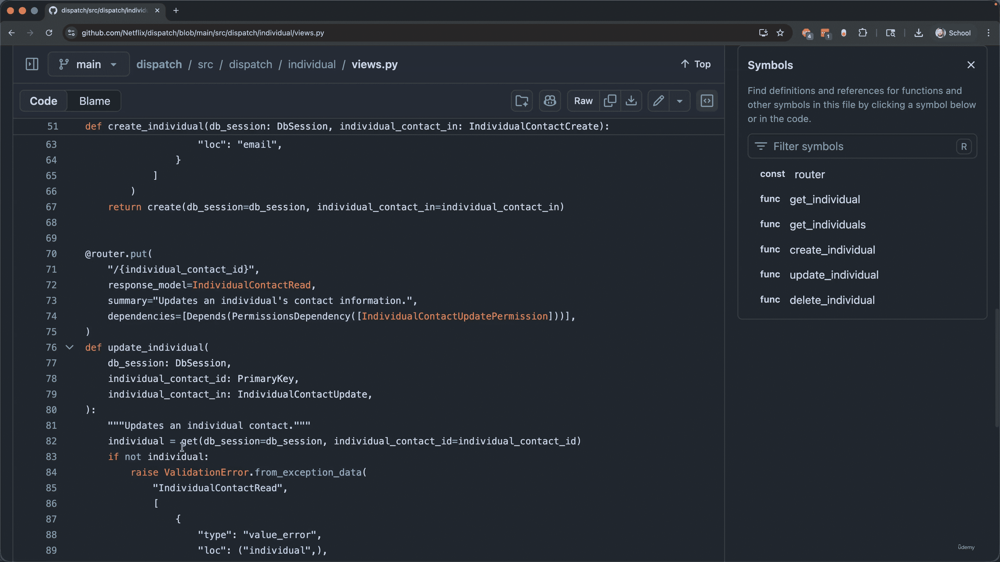

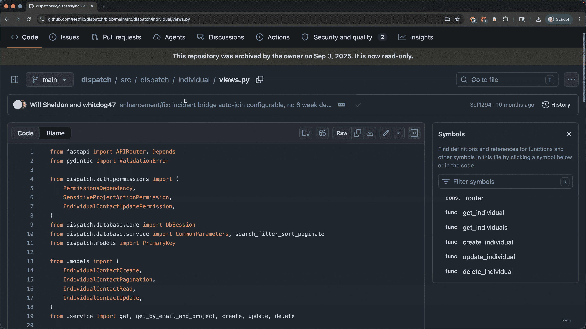

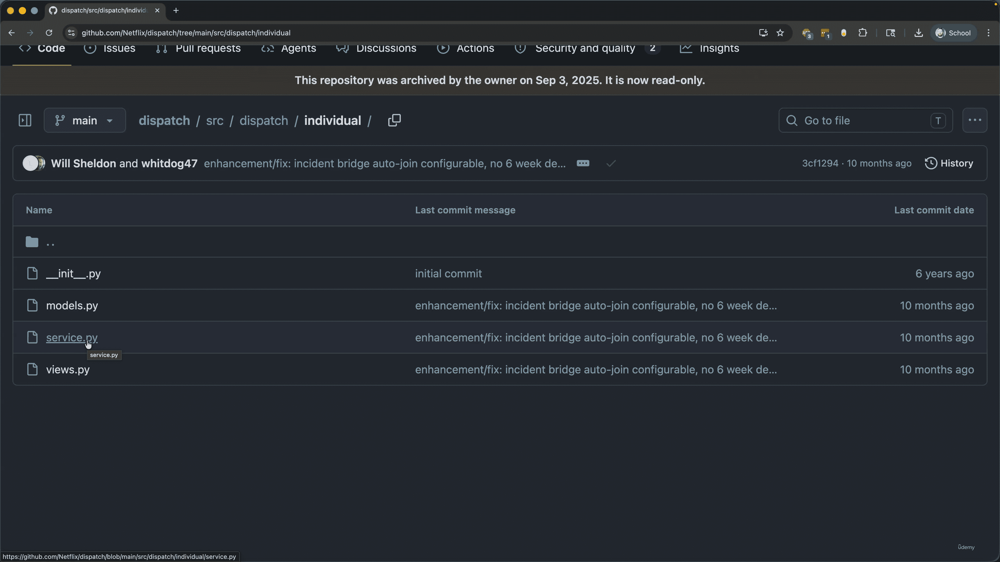

这种写法让函数调用更啰嗦，但可读性更强，尤其当参数较多时，初学者也能一眼看出每个值代表什么。最后我们来看看实际的数据模型放在哪里。

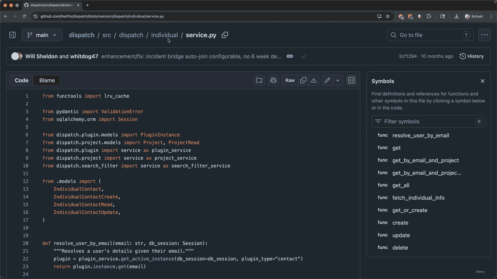

## 🧱 FastAPI Masterclass：88.5：models.py 中的数据模型

上一节我们看了 `services.py` 如何查询数据库，本节中我们来看看 `models.py` 如何放置数据库模型和 Pydantic 模型。可以看到，`models.py` 同样被组织在 `individual` 文件夹内。所有模型都与包含 route handler 和 service 执行函数的 `views.py`、`services.py` 放在一起。

如果回到 `individual` 并查看 `models.py`，会发现他们并没有区分“与数据库对话的模型”和“普通 Pydantic 模型”。他们把两者放在同一个文件里，和我们代码库中的做法一样。这是这个代码库与上一节课代码库的另一个差异。继续向下滚动，可以看到他们使用 SQLAlchemy，这是另一种 ORM。这里是实际的 `IndividualContact` 模型类，它表示与对应表的通信。可以看到属性名称会映射到数据库列。下方是实际的 Pydantic 类，其中一个继承自 `ContactBase`。点击 `ContactBase` 查看来源，它继承自 `DispatchBase`，而 `DispatchBase` 继承自 Pydantic 的 `BaseModel`。因此，`individual/models.py` 中的这些特定类实际上并不与数据库交互，它们混在普通数据库模型类旁边。

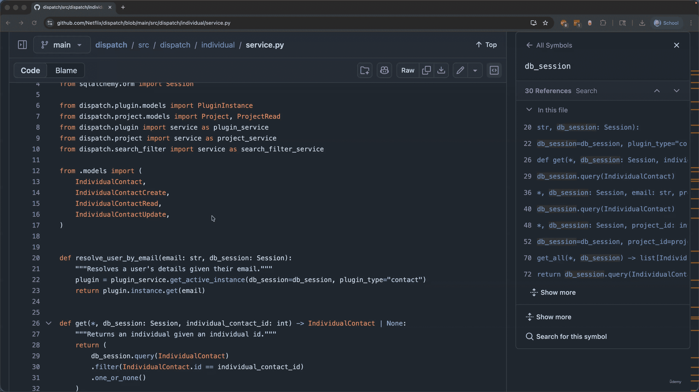

这里可以看到我们熟悉的语法，这就是 Pydantic 模型。Schema 对象表示进入服务器创建 individual 的 payload 形状，或者表示返回给客户端代表 individual 的数据形状。它们都收集在同一个 `models.py` 中。可以用下面的代码概括这种混合放置方式：

```python
# SQLAlchemy 数据库模型
class IndividualContact(Base):
    __tablename__ = "individual_contact"
    id = Column(Integer, primary_key=True)
    name = Column(String)

# Pydantic Schema 模型
class ContactBase(DispatchBase):
    name: str

class ContactCreate(ContactBase):
    ...

class ContactRead(ContactBase):
    id: int
```

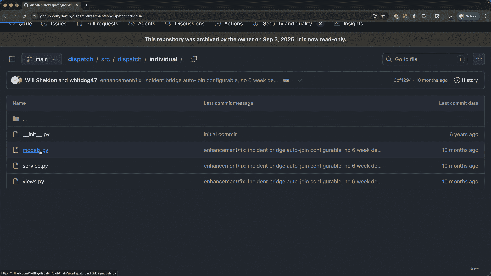

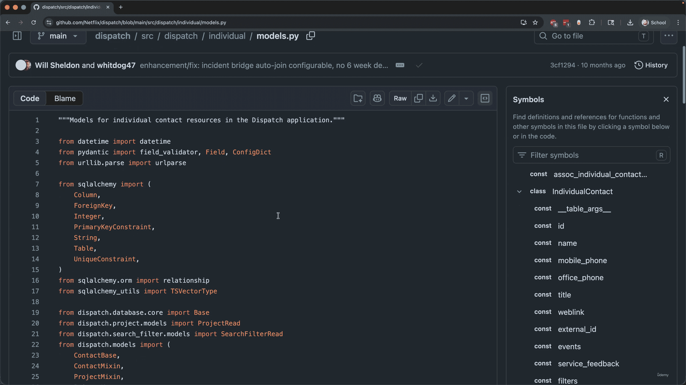

这种做法的好处是，与 `individual` 相关的数据库模型和请求/响应 Schema 都能在同一个业务域文件夹中找到。到这里，我们已经看完了 `dispatch` 的主要组织方式。接下来我们讨论这种方式的优缺点，以及如何和上一节课的方式混搭。

## ⚖️ FastAPI Masterclass：88.6：优缺点与混搭建议

上一节我们看完了 `individual` 文件夹中的路由、服务和模型，本节中我们来谈谈这种按功能组织代码的优缺点。一个优势是，如果你的代码改动是新增一个 endpoint，那么改动很可能只局限在与你正在处理的业务域相关的文件夹中，例如 `individual`。有时你确实需要进入更高层级的文件夹，例如很多嵌套文件夹都依赖数据库会话，因此可能会有某个数据库文件或文件夹负责创建数据库和会话，很多嵌套文件夹都会依赖它。

但从日常开发来看，如果你是在 `individual` 团队或 `case` 团队工作，你的改动很可能被隔离在代码的某个特定区域中。这更容易理解和推理，因为所有代码都是按业务价值、按领域概念来组织的。以下是这种组织方式的优缺点对比：

- 优点：相关文件放在同一个业务域文件夹中，修改某个功能时改动范围更集中。
- 优点：开发者按业务团队工作时，更容易定位自己负责的代码。
- 缺点：公共依赖仍然可能位于高层级文件夹，业务文件夹之间可能共享数据库会话等基础设施。
- 缺点：如果业务域划分不清晰，文件夹边界也可能变得模糊。
- 权衡：有人喜欢按功能组织，有人喜欢按技术构件组织，也有人混搭两种方式。

混搭的方式有很多种。例如，可以先按领域概念建立 `individual` 文件夹，再在这个文件夹内放置 routers、models、views 等文件；也可以先建立顶层 `routers` 文件夹，再在里面按 `individual` 或 `case` 这样的领域概念建立子文件夹。不同团队会有不同变体和排列组合。

我建议你继续构建、继续练习，不断添加更多 endpoints，尤其是那些比较复杂、需要多个模型交互的 endpoints。例如，当一个 endpoint 需要三个不同模型互相交互，需要创建三条记录和三个独立表时，你会遇到依赖关系之间的沟通细节。正是在这个过程中，你会逐渐形成自己对文件夹、文件和整体结构的偏好。希望这些内容有帮助，我们只是展示了 Netflix 和另一个团队的做法。接下来做一个小结。

## 🧾 FastAPI Masterclass：88.7：本课总结

本节课中，我们一起学习了 Netflix `dispatch` 代码库如何按业务功能组织 FastAPI 代码。我们了解到它用于管理安全事件，集成了 Slack 和 Google Suite，是一个内部事件跟踪系统。它的 FastAPI 代码位于 `src/dispatch`，顶层文件夹按 `case`、`conversation`、`cost_model`、`definition`、`document`、`individual` 等业务域组织，而不是按 `models`、`routers` 这类技术构件组织。

我们还查看了 `main.py` 如何创建 FastAPI 应用，并通过 `include_router` 包含一个总 `api_router`；总 `api_router` 又来自 `api.py`，并继续包含各个业务域 `views.py` 中的小 router。随后我们深入 `individual` 文件夹，看到 `views.py` 负责路由和依赖注入，`services.py` 负责数据库查询和 CRUD 辅助函数，`models.py` 同时放置 SQLAlchemy 数据库模型和 Pydantic Schema 模型。我们还讨论了按功能组织代码的优缺点，以及按技术构件组织与按业务域组织之间的权衡。最后建议你继续练习，通过添加复杂 endpoint 来形成自己的代码组织判断。以下是本课要点回顾：

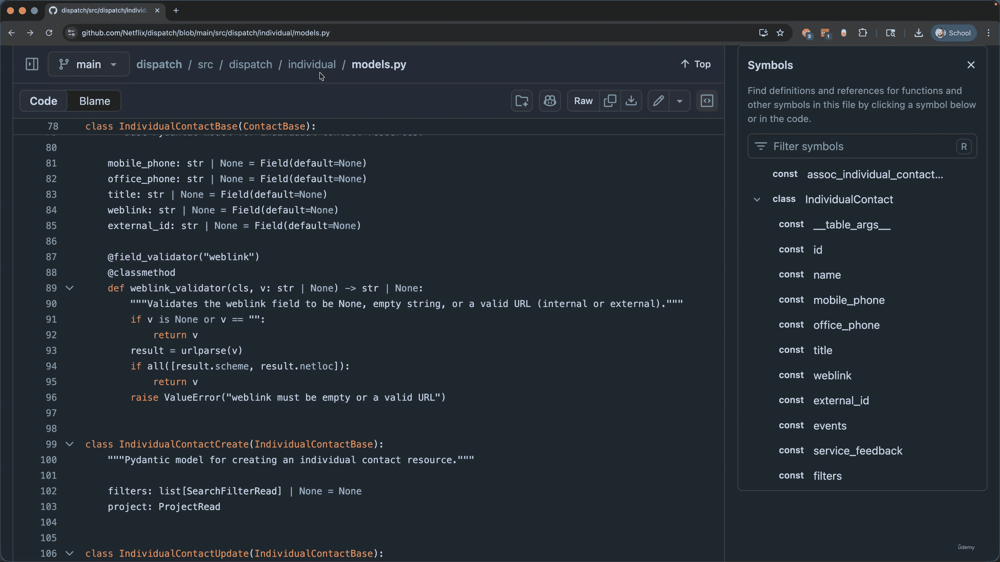

- `dispatch` 按产品功能和业务域组织顶层文件夹。
- FastAPI 应用通过嵌套 router 汇总各个业务域的路由。
- `views.py` 负责路由、依赖注入和参数解析。
- `services.py` 负责数据库查询和 CRUD 辅助函数。
- `models.py` 可以同时放置 ORM 模型和 Pydantic Schema。
- 两种组织方式各有优缺点，可以按团队和项目需求混搭。

