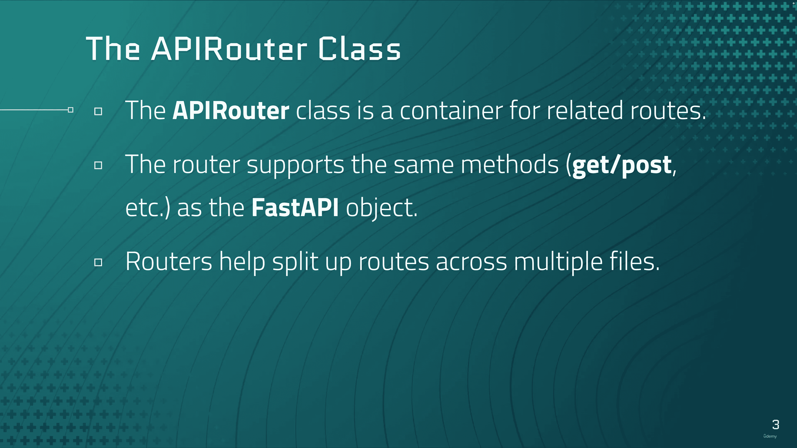
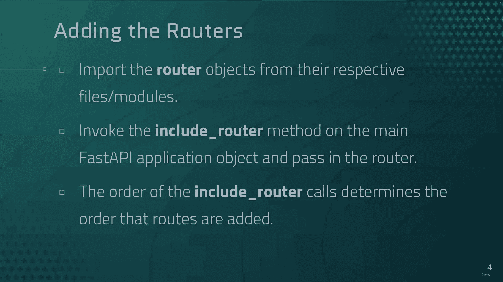
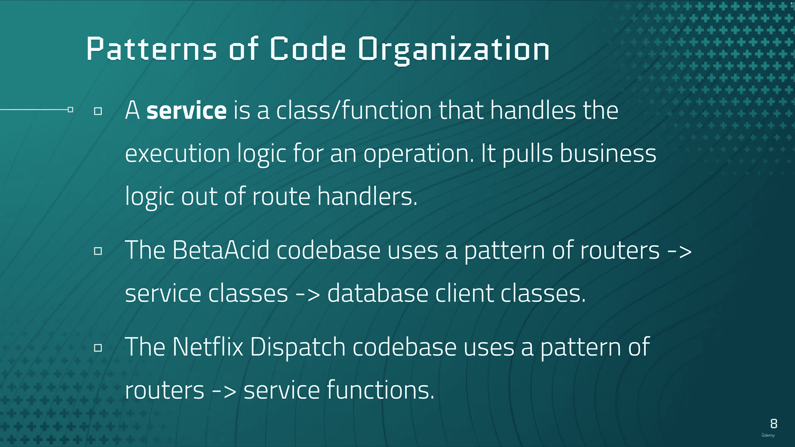

# 🎓 FastAPI Masterclass：第88-89节：章节回顾

## 📌 概述

在本节课中，我们将一起回顾本部分课程所涉及的所有核心内容，重点放在**应用组织（Application Organization）**上。也就是说，当项目变得越来越复杂、接口端点越来越多的时候，我们该如何结构化和组织代码库中的文件与文件夹。这不仅仅是纯粹的代码技巧，更是一种工程上的思维方式。我们会重新梳理Python包、APIRouter、依赖注入以及服务模式等关键知识点，帮助大家把这些内容真正内化。学完本节之后，你应当能够更自信地设计自己的FastAPI项目结构。

让我们从最基础的部分开始，逐步往后推进。首先，我们来快速复习一下Python包这个概念。

## 📦 回顾Python包

在本部分课程最开始的时候，我们首先快速回顾了Python包（Package）。简单来说，Python包本质上就是一个**组织文件夹**，用来把相关代码分门别类地放到一起。其实这个概念并不难以理解，就像你在电脑上创建不同文件夹来存放不同类别的文件一样，Python包就是在代码层面做同样的事情。

具体来说，在任何一个目录中，我们都可以创建一个`__init__.py`文件，这个文件的名字必须是`__init__.py`，而且你需要在前缀部分加上两个下划线，也就是`__init__`，同时后缀部分也要加上两个下划线，最终形成完整的`__init__.py`。创建了这个文件之后，Python就会自动将该目录识别为一个包，我们就可以在导入语句中引用这个包的名称了。这个机制是Python识别包的底层规则，非常重要。

举个例子，如果我们有一个包文件夹，里面包含一个`__init__.py`文件，同时在另一个文件中，我们就可以写出`import package.module`这样的导入语句。其中，`package`是包的名称，`module`是包内的实际Python文件。通过这种方式，代码的模块化程度就会大大提高。在这部分课程中，我们创建了一个新的顶层`app`目录作为包，用来存放我们所有的代码。然后，在这个`app`包内部，我们又创建了三个子文件夹，分别是`dependencies`、`routers`和`models`。我们当时是遵循一种按FastAPI技术构造来组织文件夹的方式，也就是说，根据依赖、路由、模型、模式（schemas）这些技术概念来划分我们的文件夹结构。这样做的好处是，当我们看到某个文件夹的时候，就能立刻知道里面存放的是什么类型的代码。

接下来，我们来看看如何利用APIRouter来组织我们的路由代码，这是FastAPI中一个非常强大的功能。

## 🔀 使用APIRouter组织路由

为了在`main.py`中更好地组织路由，我们创建了多个API路由器。FastAPI中的`APIRouter`类本质上是一个**相关路由的容器**。你可以把它理解为一组相关路由的组织化分组，方便我们将同一个功能模块的路由集中管理。这个路由器与主FastAPI对象非常相似，它支持完全相同的方法，比如`get`、`post`、`put`、`delete`等。也就是说，你在主FastAPI应用中能做的操作，在APIRouter上基本都能做。

这种方式有一个非常明显的优势：我们可以将路由定义分散到不同的文件中，从而把原本堆叠在`main.py`中的大量代码拆分出来，让代码更清晰、更容易维护。然后，在顶层应用对象中，我们使用`include_router`方法将所有这些独立的路由器整合进来，也就把对应的路由都注册到了主应用中。

不过这里必须提醒大家，FastAPI是不会自动解析我们文件夹中的路由器的。这一点非常重要，因为很多人一开始会误以为只要把路由器文件放在某个文件夹中，FastAPI就会自动扫描并加载它们，但事实并非如此。我们必须**显式地配置**路由器的添加。第一步，我们需要从各自的模块中导入`router`对象；第二步，我们需要在主应用对象上调用`include_router`方法，并把路由器作为参数传递进去。只有这样，路由才会真正生效。

在继续讨论路由器的高级用法之前，我们先来谈谈路由顺序的问题，因为这一点非常容易出错。

## ⚠️ 路由顺序的重要性

在这部分课程中，我们没有专门强调过一件事情，但这里需要特别说明：调用`include_router`的顺序很重要，因为它会直接影响路由在最终应用中的注册顺序。这个顺序最终决定了当请求到达时，FastAPI会先匹配哪一条路由。如果处理不当，就可能出现路由覆盖的意外情况。

在课程早期，我们曾经遇到过一个例子：一条带路径参数（path parameter）的路由覆盖了另一条固定路径的路由。你可以回忆一下那个例子，`/rooms/faq`这个固定路由和`/rooms/{room_id}`这个动态路由之间发生了冲突。结果是动态路由把固定路由“赢”走了。之所以会出现这种情况，正是因为路由的声明顺序不同。所以，你必须小心处理路由的顺序，因为路由的匹配顺序取决于代码中的声明顺序。如果某一个路由器中定义了一个端点，而另一个路由器不小心重复了同样的端点，那么就有可能会遇到一些不可预测的行为。

因此，大家在编写路由时需要特别注意以下几点：

- 确保你的端点（endpoint）是互不相同的，不要重复定义。
- 确保你的前缀（prefix）是互不相同的，避免不同路由器之间产生歧义。
- 确保固定路径的路由放在任何包含动态通配符或路径参数这类构造的路由前面。

遵循这些规则，可以让我们避免很多恼人的隐形Bug。

现在，既然我们已经理解了路由顺序的重要性，接下来可以看看APIRouter给我们提供了哪些便捷的配置选项。

## 🛠️ 路由器的高级配置：前缀与标签

使用APIRouter的一个主要优点就是，我们可以为这个路由器所包含的所有路由统一配置一些公共设置。例如，`APIRouter`构造函数接受一个`prefix`参数，用来为每一条路由设置一个固定的路径前缀。在我们的实际例子中，我们不再需要在每个房间相关路由的开头重复写`/rooms`，而只需要在`APIRouter`实例化的时候一次性声明`prefix="/rooms"`。这样一来，我们的路由定义就变得轻量多了，管理起来也更加轻松。

除此之外，我们实际上还可以在调用`include_router`方法、传入路由器的时候指定前缀。这个机制允许不同的应用复用同一组路由集合，但从一个应用到另一个应用时，可以给它们设置不同的前缀。这对于一些需要以模块化方式部署多个应用的场景来说，会非常灵活。

同时，我们还可以自定义`tags`参数，为路由中的所有路由添加一致的标签。这样我们就不需要一条一条路由去重复写标签了。这里要提醒大家，标签很重要，因为Swagger（FastAPI自动生成的文档界面）会使用这些标签来对路由进行分组。所以，如果你现在有10条相关的路由，只需要在包含它们的APIRouter上配置一次`tags`参数，它们就会在Swagger文档中被归类到同一组。这个功能对于生成清晰易懂的API文档来说非常有帮助，同时也能让接口的展示更加井井有条。

除了前缀和标签之外，路由器还可以配置依赖项，这个特性值得我们深入探讨。

## 🔗 在路由器上配置依赖

我们还看到，路由器可以配置依赖项（dependencies）。同样，这里需要小心，因为如果你在路由器的`dependencies`列表中添加了一个依赖，它会自动应用于该路由器所包含的每一条路由。这是一种“一刀切”的批量机制。不过，它的优势也很明显：你可以在任何路由处理器执行之前，运行某种函数，或者实例化某个类。这样你就可以对应用进行分层，比如在应用级别运行某些依赖，在路由器级别对某些特定的路由集合运行依赖，还可以在单个路由处理器级别运行更细粒度的依赖。这种多层级的依赖配置，给了我们很大的灵活性，你可以根据自己的需求任意定制。

事实上，正如我前面提到的，FastAPI构造函数本身也接受一个自己的`dependencies`列表。这些依赖会在应用中任何路由处理器运行之前执行，也就是在全局层面生效。需要注意的是，你必须把这些函数或类包装在FastAPI提供的`Depends`函数中。这个`Depends`函数就是连接依赖与FastAPI的桥梁，通过这种方式，FastAPI才能意识到这个依赖的存在。记住，仅仅声明一个依赖而不做任何包装，是不会起作用的。你必须告诉FastAPI去关注它，方式就是用`Depends`将其包裹，然后要么作为一个函数参数，要么放在`dependencies`参数中，这个参数可以出现在应用对象上、路由器对象上，或者单个的方法装饰器上。FastAPI会在任何给定请求之前运行这个依赖一次，具体运行时机取决于你把它放在了哪一层。

这是一种非常实用的机制，但还有更进一步的用法，那就是把依赖直接配置在单个路由方法的装饰器上。我们接着往下看。

## 🧩 在路由装饰器上配置依赖

除了在应用或路由器级别配置依赖，路由方法本身也接受一个`dependencies`列表。需要注意，这里说的不是实际函数参数，而是`get`方法或`post`方法本身，也就是装饰器上的那个参数。这个语法的好处是，我们不需要将依赖声明为一个未使用的函数参数。这可能听起来有点抽象，但实际场景中很常见。如果你的依赖是在执行某种副作用（side effect），所谓副作用，就是指某段代码需要运行，但它不需要为函数产生任何值供函数使用。我们当时举的例子是维护模式（maintenance mode）。

在这种情况下，如果你把这个依赖声明为函数参数，该依赖会正常执行，但执行完之后你手上就会多出来一个毫无用处的参数。当然，我们可以总是给它赋一个下划线`_`，来告诉Python这个参数不会用到，但这样写依然不太美观，因为下划线参数可能会让未来的开发者感到困惑，他们可能会想：这个参数是干什么的？为什么会存在？为了避免这种困惑，推荐的策略就是把`dependencies`列表添加到实际的装饰器方法上。这样一来，FastAPI仍然会运行这个依赖，但我们并不需要它的返回值或产出值。我们只是希望它能在开始运行路由处理器之前，先执行这段代码。这样既干净又明确。

此外，正如我们在`check_maintenance_mode`这个函数中看到的那样，我们还可以在依赖中实现一些复杂的逻辑。举个例子，我们可以在依赖中提前拦截请求，并且返回一个不同的状态码。在我们的维护模式例子中，我们抛出了一个503异常，因为我们的服务当时处于维护模式下。也就是说，这个依赖实际上可以完全中止请求的执行，甚至不需要等到请求到达路由处理器。这就意味着，使用依赖你不仅仅局限于创建某个对象或者建立某个连接，你完全可以运行分支和逻辑代码，让它们都在路由处理器之前执行。而且，这段逻辑还可以被多个路由处理器复用来共享。

现在，我们已经了解了依赖的灵活性，接下来再看一个更高层面的代码组织模式，那就是服务模式。

## 🧱 服务模式与代码组织

在课程的最后，我们讨论了多种代码组织的模式。我们提到了“服务（services）”这个概念。服务可以被定义为一个普通的Python类或函数，它负责处理某个操作的执行逻辑或业务逻辑。这里的设计意图非常明确：让路由处理器变得更轻量。路由处理器只需要专注于核心的、与HTTP请求有关的事情，比如维持一个数据库会话，或者从URL中提取路径参数。而请求的实际业务逻辑，也就是那些真正重要的计算和处理，则被移动到服务类或服务函数中。这样做的好处是，路由层变得非常薄，不容易堆积复杂代码，维护成本大大降低。

我们在两个不同的代码库中都看到了相同的模式。例如，在betaas代码库中，设计是这样的：路由（router）会委托给服务类（service class），服务类又会将大量的数据库操作委托给一些补充的数据库客户端类（database client classes）。这样做的意图，是希望在应用与ORM（对象关系映射）的具体细节之间建立一个隔离层。这样一来，无论路由还是服务类，都不需要去关心ORM的具体实现细节、ORM的API是怎么样查询、创建或删除数据的。用这种方式，我们在路由和服务类中保持的几乎都是纯Python代码，所以ORM就变得更容易替换，因为ORM的使用范围被限定在了数据库客户端类里面。在betaas这个例子中，我们注意到他们的文件夹组织方式是基于技术性的FastAPI构造（比如routers、models）来进行的。

与之互补的另一个代码库，是Netflix dispatch代码库。它使用了一种略有不同、但也比较相似的模式。在这个代码库中，路由会委托给服务函数（service functions），他们没有额外增加一个类或函数来管理数据库连接。不过，核心意图是相同的：路由不需要和ORM直接交流。路由只是组装好数据库会话，然后调用正确的服务函数（比如get、create或update），把会话和数据传递进去。这样，服务函数就可以专注于自己的职责，整个流程非常清晰。

采用这两种方法中的任何一种，还有一个额外的好处：我们可以隔离测试这些函数或类，也就是这些服务。因为它们的存在形式是普通的Python构造，所以在单元测试中，我们可以直接调用那个函数并传给它依赖，或者直接实例化那个类并把构造参数传进去。我们完全不需要搭建一个完整的FastAPI应用，也不需要去访问路由，就可以对这些服务进行测试。这样一来，我们又把责任进行了拆分：FastAPI和路由负责管理核心的请求-响应周期，而普通的Python类或函数负责管理其余的业务逻辑。此外，在Netflix dispatch代码库中，他们还根据业务概念来组织文件夹，比如case或individual这样的领域概念。这种组织方式使得代码更改很有可能会落在某个分段目录中。如果某个人被分配去处理这个特定业务概念，那么他的所有代码更改很可能只限于同一文件夹中的一组文件，而不会像betaas设计那样，把改动分散到不同层级的不同文件夹中。相比之下，betaas设计更接近我们在自己的应用中所采用的风格。

我们讨论了很多关于这些模式的缺点和权衡点，有时选择哪种方式其实取决于个人偏好，也取决于你的团队主张什么样的风格。所以，我建议大家去实际查看这两个代码库，点击进去看看代码写出来的感觉，思考一下这种组织方式是否对你有意义。希望这能成为一次阅读他人代码的好的练习，也能够帮助你思考如何在真实的Python代码库中组织现实世界的复杂性。

## 🎯 总结

本节课我们一起回顾了本部分课程中关于应用组织的核心知识。我们首先学习了Python包的基本概念，了解了`__init__.py`文件的作用，以及如何通过包来对文件夹进行组织。然后，我们深入探讨了APIRouter的核心用法，包括如何创建路由器、如何通过`include_router`挂载路由，以及路由顺序的重要性。我们还介绍了如何利用`prefix`和`tags`参数来统一配置一组路由，让代码更简洁、文档更清晰。在依赖注入方面，我们分别讨论了在应用级别、路由器级别和单个路由装饰器上配置依赖的不同方式，并通过维护模式的例子展示了依赖中执行复杂逻辑和提前中断请求的能力。最后，我们总结了服务模式的两种常见变体，并分析了它们各自在代码组织上的优缺点，也强调了这种分层设计对于测试和维护方面的好处。希望通过本节课的梳理，你对如何组织FastAPI项目有了更系统的认识。我们下一节再见。
