# 🚀 FastAPI 大师课：第89-90节：异步代码

## 📖 FastAPI 大师课：第89-90节：本节概述

在本节课中我们将要学习 Python 中的异步代码，也就是 async code。异步代码可以让服务器运行得更快一些，更重要的是，它可以让服务器运行得更有效率。本节课会从最基础的概念开始，一步一步走过这些内容：先解释为什么有些操作大部分时间都在等待，再说明同步操作和阻塞是什么意思，然后看多线程方案为什么只是增加工人但没有彻底解决等待问题，接着引入异步事件循环，最后说明如何把 FastAPI 的同步路由处理程序迁移为异步代码，以及 `await` 的使用规则。整节课的目标是让初学者理解这些概念，为后续重构 rent a room 应用做好准备。

## ⏳ FastAPI 大师课：第89-90节：为什么有些操作会等待

上一节概述提到，异步代码的目标是提高效率。本节先看一个基础问题：为什么有些操作会花很多时间。无论你是在写 Web 服务器程序，还是写其他计算机程序，总有一些操作 compared to others 会花更多时间完成。常见操作包括查询数据库、发起 API 请求、写入文件。这类操作通常叫作 I/O bound，I/O 是 input/output 的缩写。它的含义是：这些操作并不是计算特别昂贵，不需要 CPU 大量思考或大量处理，它们主要是在等待数据输入并发送到某个地方，或者等待数据输出并从另一个来源接收。这个来源可以是数据库，可以是另一个网站，也可以是文件系统。写文件到计算机本身可能并不昂贵，但程序必须等待这个操作完成。并且这些操作的完成时间不可预测：可能数据库很慢，可能目标服务器过载，也可能写入 5MB 文件比写入五分之一大小的文件更久。

这里可以用一个简单公式描述这类操作的时间构成：

\[
\text{I/O 绑定操作耗时} \approx \text{少量 CPU 时间} + \text{较长的等待时间}
\]

换句话说，I/O 绑定操作的关键不是 CPU 算得多，而是程序要等多久。还需要注意，人类对时间的感知和计算机对时间的感知完全不同。比如一个计算机操作耗时 200 毫秒，另一个耗时 400 毫秒，人类无法感知这个差别，因为不到半秒，感觉上是瞬时的。但计算机等待 400 毫秒完成，是等待 200 毫秒的两倍，而计算机在这段差别时间里可能执行数千个额外操作。因此，当操作大部分时间都在等待时，我们就在损失计算能力，因为这段时间本来可以用于其他工作，却被程序用来等待。理解了 I/O 操作为什么耗时，我们接着看同步操作和阻塞。

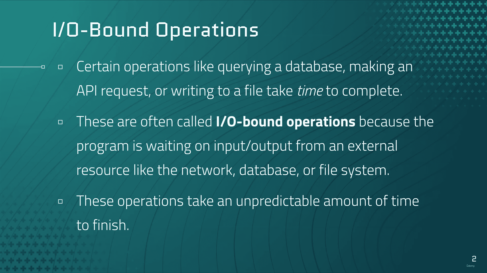

## 🔄 FastAPI 大师课：第89-90节：同步操作与阻塞

上一节说明了 I/O 操作的大部分时间花在等待上。本节来看同步操作。同步操作必须等当前操作完成，才能推进到下一个操作或任务。一个简单的例子是普通 Python 函数的执行：Python 会一行接一行运行，所以第 2 行不能在第 1 行完成之前运行。可以把每一行执行都看作一个操作或任务，这里只是用“操作”和“任务”来描述某个需要发生的动作。一个需要花时间执行的操作或代码行，会阻塞或阻止剩余代码的执行，直到它完成。如果函数中的第 1 行耗时 400 毫秒，第 2 行就必须等第 1 行完成。block 这个词和现实世界含义一致，就是阻止某物获得访问，例如门阻止入侵者进入房子。第 1 行阻塞的意思是第 2 行无法推进，另一个函数中的第 1 行也无法执行，直到原来第 1 行的全部代码完成。这些会阻塞、必须等完成才能推进的操作，就叫同步操作。可以用下面代码示意：

```python
def sync_demo():
    line_1()  # 例如耗时 400ms
    line_2()  # 必须等待 line_1 完成
```

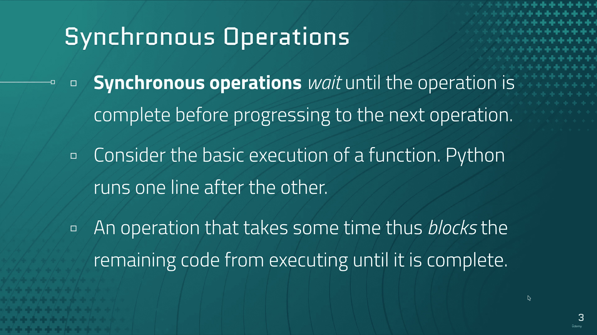

也可以用公式表示同步执行顺序：

\[
\text{同步执行：任务}_1 \rightarrow \text{等待任务}_1\text{完成} \rightarrow \text{任务}_2
\]

理解了同步阻塞之后，我们自然会问：当一个程序需要同时处理多个任务时，应该怎么办。

## 🧵 FastAPI 大师课：第89-90节：并发请求与多线程方案

上一节说明了同步操作会阻塞后续代码。本节来看多个任务同时到来时的处理方案。程序需要同时或并发处理多个任务，服务器最明显的例子就是同时处理多个请求。假设 FastAPI 端点同时收到 100 个客户端发来的 100 个请求，如何高效解决这个问题？当前路由处理程序中的代码都是同步的。比如使用数据库代码 `session.get` 或 `session.commit` 时，这一行是同步的，也就是阻塞的，数据库请求完成前不能继续下一行。如果同时收到 100 个请求，而一次只能处理一个路由处理程序，那么遇到同步执行，例如和数据库通信，就会被阻塞，这并不理想。

一个解决方案是创建多线程。线程可以理解为计算机中的一个工人或一个工作单元。现实世界最接近的类比是公司员工：工作多时，公司会雇佣更多员工，每个员工分担一部分工作。FastAPI 服务器可以创建多个线程，同时处理多个不同请求。这个方案有效，因为创建了更多工人，但它并不完美，因为仍然没有解决阻塞这个主要问题。比如你有 5 批洗衣要洗，一次只能洗一批。你放入一批洗衣，然后阻塞，也就是等待 45 分钟直到洗完。要完成 5 批洗衣，你可以雇佣第二和第三名员工去启动第二批或第三批，但洗衣机启动后，他们也会阻塞，也要等待 45 分钟。类似地，一个线程、一个工作单元在等待某个 I/O 操作完成时，仍然会阻塞下一行代码。这些操作仍然是同步的，仍然是阻塞的，只是多个线程共存。

此外，线程还有额外复杂性：线程有开销，需要内存，也需要操作系统管理。雇佣更多员工更好，但雇佣更多员工后，这些员工遇到同步或阻塞操作就只是等待，显然不理想。我们希望解决这个问题的方式不是只雇佣更多人，也不是只创建更多线程；等价地说，优化方式是让每个工人或每个线程在等待时继续做工作。等待 45 分钟洗衣完成时，不管你有 1 个员工还是 500 个员工，你希望这 1 个员工或这 500 个员工在原始任务 pending、等待完成时去做其他工作。可以认为线程增加了力量，因为你有更多工作单元处理多个请求；但你仍未把资源利用到极致。效率不只是速度，还看你在给定时间里做了多少事。如果每个线程都在等慢 I/O，假设收到 100 个请求，有 100 个线程，每个都在等 I/O，等待比如 300 毫秒，这段时间线程上没有工作，最终也会遇到类似瓶颈：可用工作线程耗尽，新请求只能等待。总结来说，创建更多线程没有错，但只是增加力量，并没有提高每个线程的效率。可以用下面公式概括这个局限：

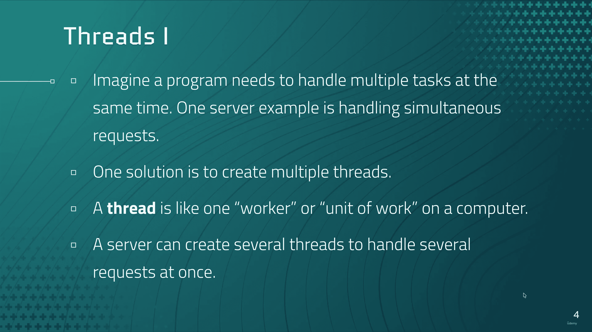

\[
\text{多线程方案} = \text{更多工作单元} + \text{每个工作单元仍可能阻塞}
\]

理解了多线程的局限，我们进入异步代码和事件循环。

## ⚡ FastAPI 大师课：第89-90节：异步代码与事件循环

上一节看到多线程只是增加工人，没有解决等待。本节看异步编程。异步编程中，我们可以启动某种 I/O 绑定操作，例如和数据库通信或发起网络请求，然后在它等待、pending 完成时，让 Python 去做其他工作。回到洗衣类比，不一定非要雇佣更多员工；更关键的是，员工等待洗衣完成时去做别的事。当前我们还没有 async 代码，所有路由处理程序都在执行同步数据库操作，而数据库操作只是阻塞操作中的一类。路由处理程序调用 `session.get` 或 `session.commit` 时，处理该请求的线程会阻塞，直到数据库响应。这个线程不会做任何事，只是坐在那里等待。使用异步编程后，我们可以让它在等待期间做其他事。

Python 原生实现了 async 事件循环，可以协调多个 async 任务。基本含义是：当一个 async 任务遇到 I/O 操作时，Python 会让另一个任务运行，同时原来的 I/O 操作继续完成。例如在同一个线程、同一个工人上，一个请求访问数据库并需要等待 300 毫秒响应，这个线程可以转去开始处理另一个请求，服务器可以发出对应第二个客户端请求的另一个数据库请求，也许还可以发出第三个请求。async Python 事件循环会自动在这些任务之间来回切换。好处是复杂性被抽象掉了：我们不需要担心 Python 或 FastAPI 如何在不同异步任务之间切换，只需要把它们标记为异步，库和语言会处理切换的复杂性，确保每个线程高效运行，不花太多时间等待 I/O 完成。换句话说，它会让线程保持忙碌。可以用伪代码示意：

```python
async def task_a():
    await io_operation_a()  # 等待时切换到 task_b

async def task_b():
    await io_operation_b()
```

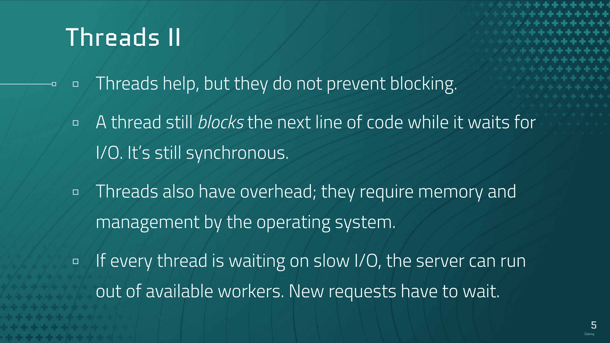

事件循环的切换过程可以用公式表示：

\[
\text{async 事件循环：任务A等待I/O} \rightarrow \text{运行任务B} \rightarrow \text{任务A完成后恢复}
\]

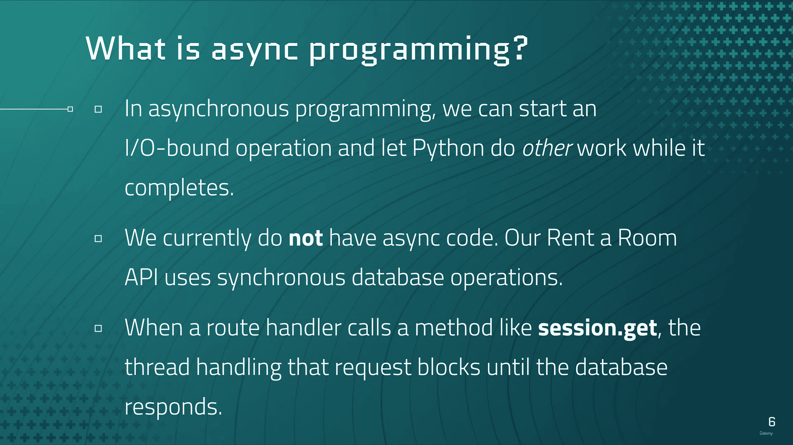

理解了事件循环的作用，我们来看如何把 FastAPI 的同步代码迁移为异步代码。

## 🛠️ FastAPI 大师课：第89-90节：迁移同步FastAPI代码

上一节说明了 async 事件循环如何在等待时切换任务。本节来看迁移问题：如何把同步 FastAPI 代码改成异步代码。实际上没有想象中复杂。第一件事是把路由处理程序声明为 async，这只需要在函数定义的 `def` 关键字前加上一个 `async` 关键字。重要的一点是：声明 async 函数时，意图是让函数体执行某种异步操作，也就是 awaitable 操作，一种需要 `await` 的操作，一种需要花时间完成的操作。如果函数体没有任何阻塞代码或 I/O，那么声明为同步还是异步都无所谓，不会带来更多效率，因为函数体里本来就没有低效操作。把路由处理程序声明为 async 后，当它遇到 awaitable 操作时，会暂停，把控制权交给其他可以运行的任务，让 async 事件循环去处理另一个请求或另一个 I/O 操作。我们不需要担心它如何管理这些细节，只需要知道它会高效管理原本可能花在等待上的时间。优势是服务器可以处理更多并发 I/O 请求，而不必为每个请求专门分配一个线程。这并不是说线程和异步代码互相竞争，二者会携手工作：线程给你更多力量，而 async 代码让每个线程能做更多事，因为线程不会在等待或阻塞时闲着。

以下是迁移时需要牢记的判断规则：

- 路由处理程序有库支持的 awaitable 异步操作：使用 `async def`，并在操作前使用 `await`。
- 路由处理程序只有阻塞代码，且库不支持异步：保持 `def`，不要加 `async`，否则可能让代码更糟。
- 路由处理程序完全没有 I/O 或阻塞代码：`def` 和 `async def` 都可以，复杂代码中才有技术差异，通常不影响结果。

迁移示意代码如下：

```python
@app.get("/rooms")
async def get_rooms():
    rows = await database.fetch_all(query)
    return rows
```

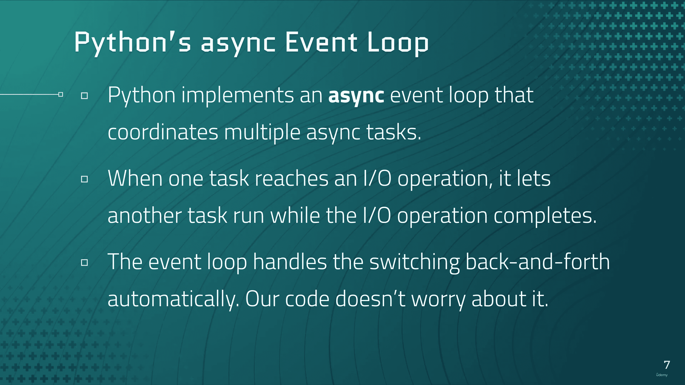

判断规则可以用一个简单公式概括：

\[
\text{async def} + \text{await} = \text{仅当函数体内有awaitable操作}
\]

下面我们专门看 awaitable 操作的使用规则。

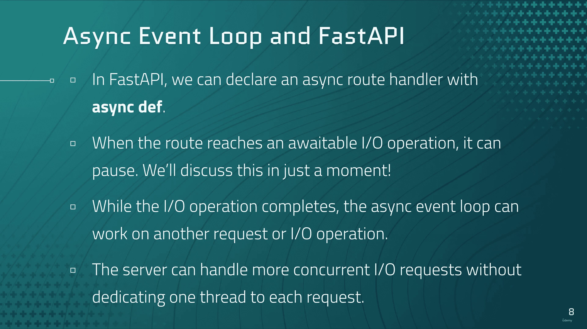

## 🔍 FastAPI 大师课：第89-90节：awaitable操作的使用规则

上一节迁移规则提到 awaitable 操作。本节展开说明。某些 Python 包会实现 awaitable 函数或方法。只能在已经用 `async` 注解的函数内使用这些函数或方法，并且这些函数或方法调用前要加 `await` 关键字。不能在 async 函数外使用 `await`；`await` 关键字和底层方法实现给事件循环一个暂停位置，等 I/O 操作完成，让事件循环运行其他任务，然后恢复。不能随便在任意 Python 函数或方法前加 `await`，它必须由库专门支持并实现。需要查看给定库的文档，确认文档中展示了使用 async/await 的示例。不能只加这个关键字就获得性能收益。Python 的这个特性相对现代，不是 Python 生态中的所有包都支持 awaitable 操作。重复一遍：`await` 只能在声明为 async 的函数体中使用，而且只能用于 awaitable 函数和方法。不是所有包都会提供 awaitable 函数和方法。VS Code 类型检查器会在你试图对无效的非 awaitable 函数使用 `await` 时发出警告。以下是使用 `await` 必须满足的条件：

- 代码位于 `async def` 函数体内。
- 被 `await` 的对象是库实现的 awaitable 函数或方法。
- 查过库文档，确认该库支持异步用法。

可以用公式描述合法用法：

\[
\text{合法 await} = \text{async def 函数体} + \text{库支持的 awaitable 对象}
\]

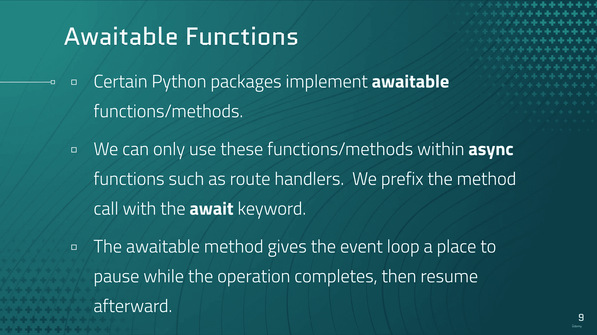

正反例示意：

```python
async def good_example():
    result = await library.async_query()  # 合法：库支持 awaitable

def bad_example():
    result = await library.async_query()  # 非法：不在 async def 中
```

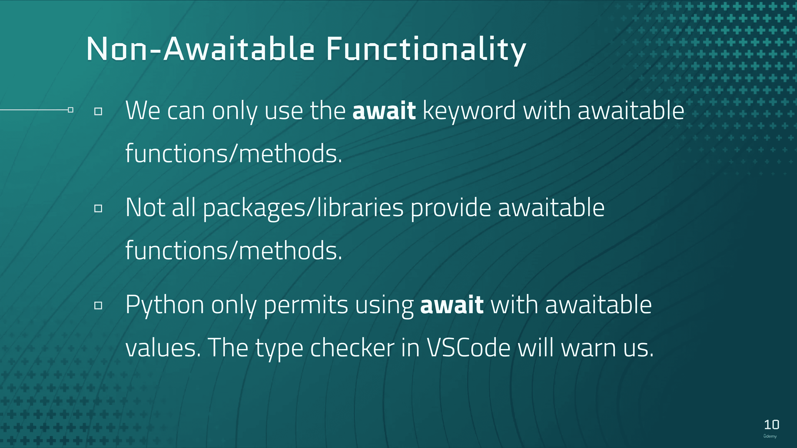

理解了这些规则后，我们来看实际 FastAPI 应用中的改造预览和关键结论。

## 🧭 FastAPI 大师课：第89-90节：租房间应用改造预览与关键结论

上一节说明了 awaitable 使用规则。本节预览实际 FastAPI rent a room 应用中的改造。这里有不少复杂性，后续重构代码时会复习这些想法。如果路由处理程序有 awaitable 操作，例如和数据库通信，我们会用 `async` 关键字把该函数改成 async 函数，放在 `def` 前面，然后用 `await` 等待该操作。这还需要一些额外更新，例如更新 `database.py` 中的数据库代码，启用与数据库的异步通信。关键结论是：只有当你使用的库支持某种 awaitable 代码时，才使用 async 函数。如果没有这种机会，如果你使用的是旧包，只有阻塞代码，不要把你的普通函数或普通路由处理程序改成 async 函数，因为那会让事情更糟。只有路由处理程序体内有 awaitable 异步支持功能时，才使用 `async` 关键字。总结第二点：如果路由处理程序有阻塞代码，且不支持 awaitable 异步操作，就保持该函数、该路由处理程序为同步函数，使用 `def`，不要在前面加 `async`。如果路由处理程序完全没有 I/O 或阻塞代码，函数可以是同步的，也可以是异步的；复杂代码中可能有一些技术差异需要研究，但通常无所谓，因为没有可等待的东西，也就没有可等待的低效操作。关键结论是：有 awaitable 代码时要 async；有阻塞代码且不支持 async 时，不要把阻塞的非 awaitable I/O 代码放进 async 函数。很多初学者会犯一个错误：认为只要在 `def` 前加 `async`，并在 Python 函数和方法前加 `await` 就完成了。这不仅错误，还可能完全无法工作；要拥有带 `await` 的 async 函数，必须有 awaitable 操作的技术支持。并且，把阻塞代码放进 async 函数，可能让代码更糟、更低效。

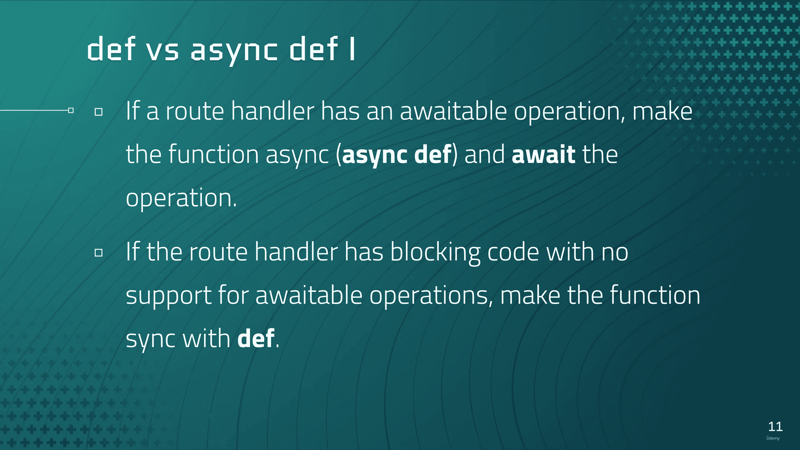

以下是关键判断清单：

- 有可等待异步支持：使用 `async def` 和 `await`。
- 有阻塞代码但不支持异步：保持 `def`，不要把阻塞代码塞进 `async def`。
- 没有 I/O 或阻塞代码：`def` 或 `async def` 都可以，通常无需纠结。

希望这些高层思路已经清楚：我们想利用原本花在等待上的时间去做其他事，这就是异步代码的核心。不是在等待 45 分钟洗衣完成时干等，而是让洗衣机运行，同时去学习 FastAPI 或锻炼。代码中的目标也是如此。下节课会开始重构。

## ✅ FastAPI 大师课：第89-90节：本节总结

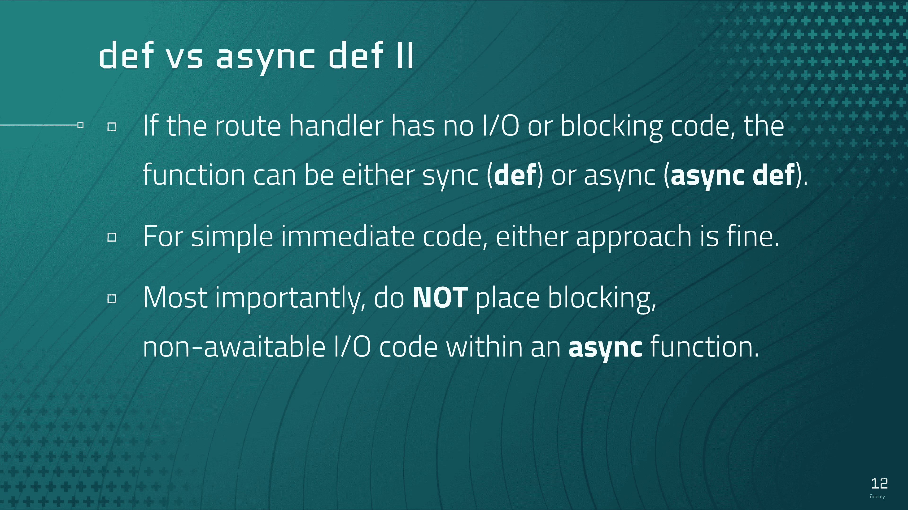

本节课中我们一起学习了异步代码。我们知道了 I/O 绑定操作的大部分时间花在等待输入输出上，而不是大量 CPU 计算；同步操作会阻塞后续代码，必须等当前操作完成才能继续；多线程方案相当于雇佣更多工人，能增加处理力量，但每个线程仍可能在等待 I/O 时阻塞，并没有提高单线程效率；async 事件循环让一个任务等待 I/O 时切换到另一个任务，从而利用原本等待的时间；迁移 FastAPI 代码时，只有在函数体内有库支持的 awaitable 操作时，才使用 `async def` 加 `await`，如果只有阻塞代码且不支持异步，就保持 `def`，如果完全没有 I/O 或阻塞代码，同步异步都可以。下一节课我们会把这些概念应用到实际代码重构中。

