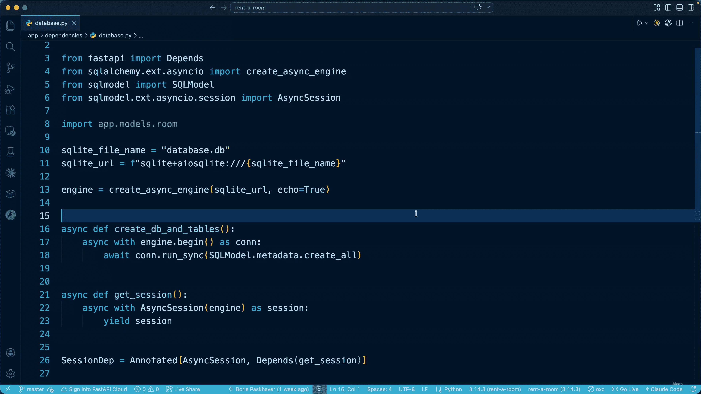
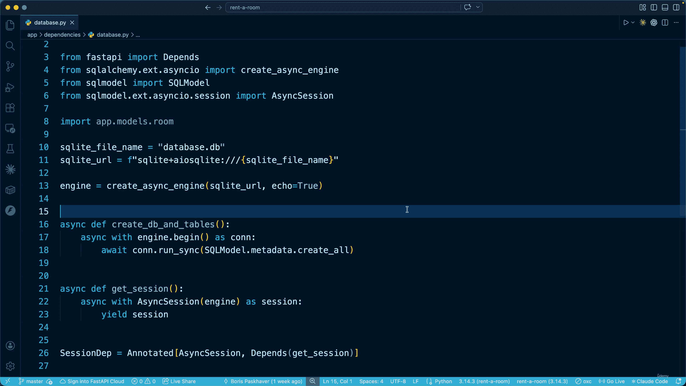
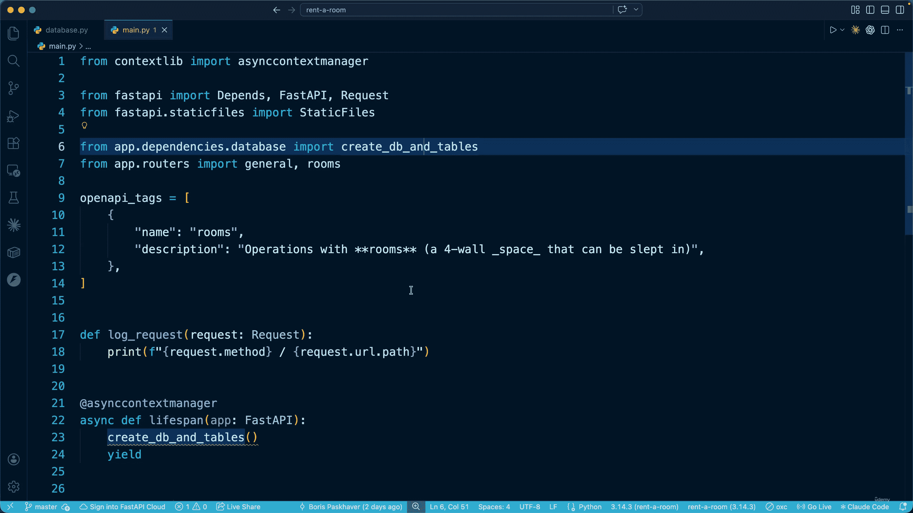
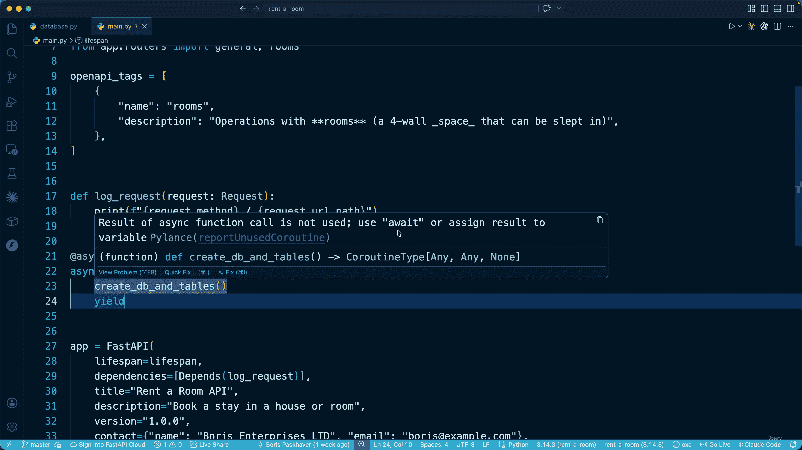
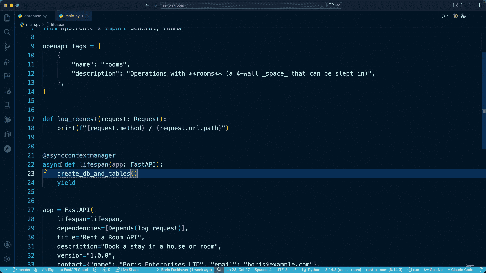
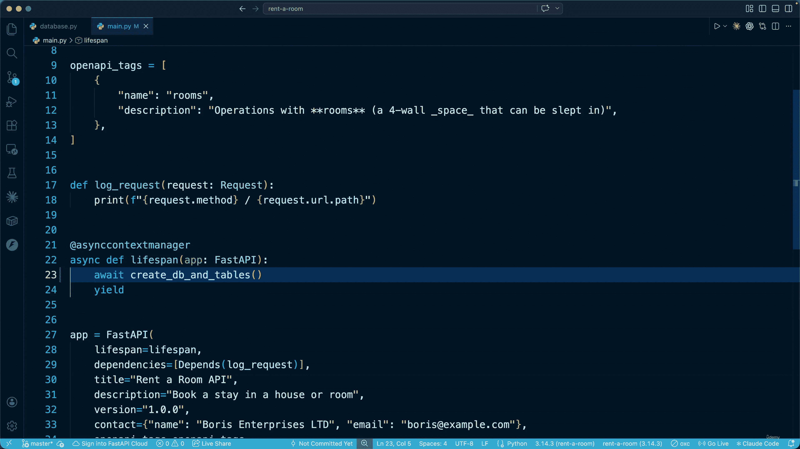

# 🚀 FastAPI 大师课：第91-92节：把 Lifespan 函数改成异步

## 📖 FastAPI 大师课：第91-92节：本节概述

这是一节快速课程。现在数据库已经完全异步。在更新路由处理器之前，下一步要更新的是 main 文件里的 lifespan 函数。在本节课中我们将要学习如何把 FastAPI 的 lifespan 函数改成异步写法。我们会先打开 main 文件并找到 lifespan 函数，理解它在应用启动前负责创建数据库和配套表；然后说明唯一需要改动的地方，是在创建表的调用前加上 `await`；最后把同样的异步语法延伸到路由处理器。上一节已经完成数据库异步化，本节继续把启动流程补齐，让整个应用在启动阶段也符合异步编程方式。

## 🧩 FastAPI 大师课：第91-92节：定位 lifespan 函数

上一节我们完成了数据库异步化，本节中我们来看看 main 文件里的 lifespan 函数。打开 main 文件。提醒一下，lifespan 就是这里的这个函数，FastAPI 会在真正启动服务器之前运行它。真正启动服务器是在 `yield` 这里完成的，因此这里的目的，是确保在应用真正启动之前创建数据库和配套表。上一节我们已经把这个函数改成异步，所以你会注意到这里提示要使用 `await`，或者把结果赋给一个变量。我们已经在一个异步函数里面。这其实是本课程前面第一次看到 `async` 关键字，当时只是粗略带过，但要点是 FastAPI 的 lifespan 参数期望一个异步函数，所以需要这样声明。可以用下面的代码来理解这个结构。

```python
from contextlib import asynccontextmanager
from fastapi import FastAPI

@asynccontextmanager
async def lifespan(app: FastAPI):
    # 启动前：创建数据库和配套表
    await create_database_and_tables()
    yield
```

这里可以把核心概念记成公式：`async def lifespan(...): await 异步启动操作(); yield`。其中 `yield` 之前是启动前要做的事，`yield` 这里代表应用真正启动。

## ⚡ FastAPI 大师课：第91-92节：在创建表前加 await

上一节我们确认了 lifespan 函数已经是异步函数，本节中我们来看看现在唯一要做的改动。现在唯一要做的改动，确实就是在创建表的调用前加上 `await` 关键字。这个写法就是接下来要遵循的完全相同的语法。用大白话说，异步函数里调用一个需要等待的异步操作时，就在它前面加 `await`，表示等它完成再继续。核心公式是：`await 可等待对象`。下面是改动示意。

```python
# 修改前（示意）
create_database_and_tables()

# 修改后
await create_database_and_tables()
```

这里要注意，`await` 只能放在异步函数里面，而 lifespan 已经是 `async def`，所以这样写成立。下面是这部分要记住的几个关键动作。

- 保留 lifespan 函数的 `async` 声明。

- 在创建数据库和表的调用前加上 `await`。

- 理解 `yield` 前是启动前逻辑，`yield` 处才真正启动应用。

- 后续路由处理器也采用同样的异步语法。

这些动作合在一起，就完成了 lifespan 的异步更新。lifespan 参数设置好之后，启动流程就符合数据库完全异步后的写法。

## 🧠 FastAPI 大师课：第91-92节：路由处理器采用相同语法

在 lifespan 设置好之后，下一步就是路由处理器。顺便说，在路由处理器里面，我们会在 `def` 关键字前面加上 `async`。然后通常会在函数体里执行某种可等待的异步操作，就像这里做的一样。也就是说，路由处理器的写法会从普通函数变成异步函数，函数体里的数据库操作等就通过 `await` 来等待。核心代码如下。





```python
@app.get("/items")
async def read_items():
    result = await some_async_database_operation()
    return result
```



这背后有一个简单规则：`async def` 用来声明异步函数，`await` 用来等待异步操作完成。公式可以写成：`async def 函数(): await 异步操作()`。



> 记忆要点：`async` 放在 `def` 前面，`await` 放在需要等待的异步调用前面。



现在 lifespan 参数已经设置好了，下一节就可以去更新路由处理器本身。

## ✅ FastAPI 大师课：第91-92节：本节课总结

本节课中我们一起学习了在数据库完全异步之后，如何把 FastAPI 的 lifespan 函数改成异步写法。我们先定位了 main 文件中的 lifespan 函数，理解它在真正启动服务器之前运行，而真正启动服务器由 `yield` 完成；随后确认启动前的目标是在应用启动前创建数据库和配套表。上一节已经把这个函数声明为异步，本节唯一要做的改动是在创建表的调用前加上 `await`。我们还把同样的语法延伸到路由处理器：在 `def` 前加 `async`，在函数体里用 `await` 等待异步操作。现在 lifespan 参数已经设置好了，下一节就可以去更新路由处理器本身。下面是本节课的要点回顾。

- 数据库完全异步后，lifespan 函数也要更新。

- lifespan 在 FastAPI 启动服务器前运行，`yield` 处真正启动应用。

- 启动前要创建数据库和配套表。

- 在创建表的调用前加 `await`。

- 路由处理器同样用 `async def`，并在函数体里 `await` 异步操作。

- 下一节更新路由处理器。



完成这些改动后，启动流程和后续路由处理器就能使用同一套异步写法，整个应用的异步链路也会更完整。
