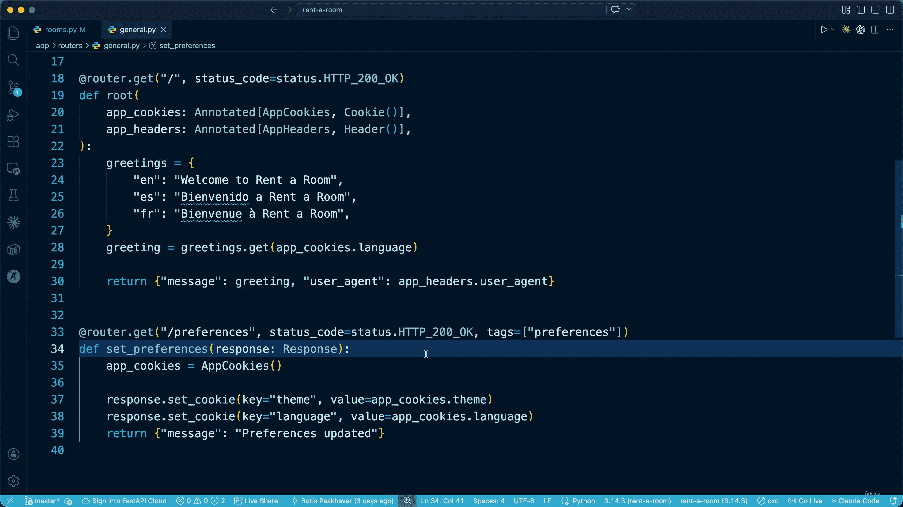
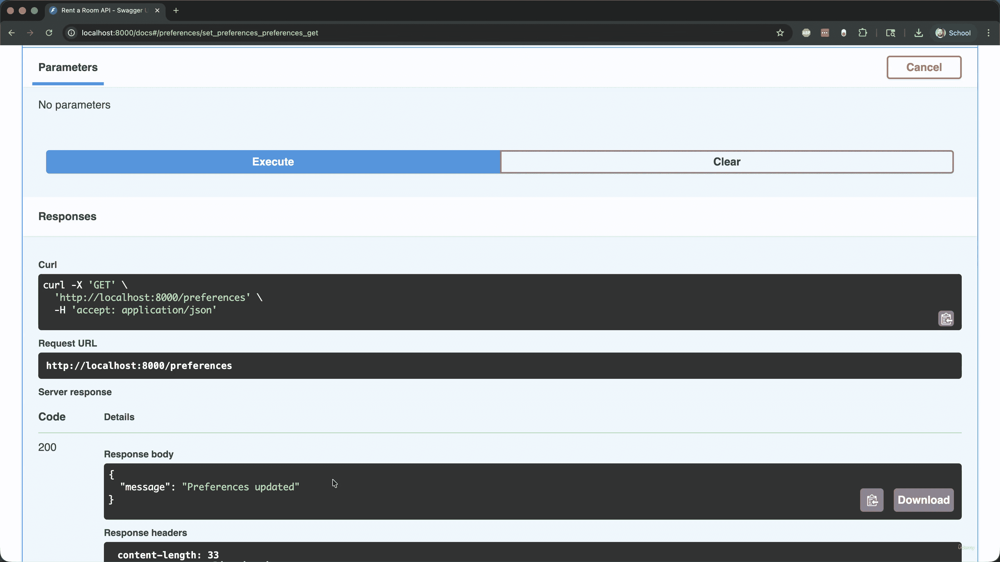

# 🚀 FastAPI 大师课：第92-93节：将路由更新为异步

## 📖 本节概述

在本节课中我们将要学习如何把数据库引擎和数据库会话切换成异步版本之后，继续把 FastAPI 中的所有路由处理函数更新为 `async/await` 写法。我们会先解释哪些数据库方法需要 `await`，哪些方法不需要 `await`，然后更新依赖函数以及创建、查询、更新、删除等路由。接着我们会重点说明异步会话下 `lazy loading` 会发生什么变化，为什么要在提交后显式调用 `refresh`。最后我们会到浏览器中测试这些接口，并说明同步路由和异步路由可以在同一个 FastAPI 应用里共存。

## 🧱 从同步会话切换到异步会话

上一节我们已经准备好了异步数据库引擎和异步会话，本节我们来看看路由层如何配合它们。只要数据库访问从同步变成异步，路由处理函数就应该使用新的 `async/await` 语法，核心形式如下。

```python
async def route_handler(...):
    await session.commit()
    await session.refresh(obj)
```

这里有一个额外的好处：由于上一节已经把所有相关代码改成异步版本，类型检查器会在我们仍然调用 `commit`、`refresh` 这类方法却没有加 `await` 时给出提示。原来的同步会话中，这些方法会阻塞线程；现在它们变成异步方法，不会一直阻塞，但仍然需要 `await` 关键字，因为 `await` 所在的位置正是异步事件循环可以暂停当前任务、转去做其他事情的时间点。

原来的第72行如果会阻塞，就会阻止线程在等待期间执行其他任务。现在第72行是异步的，即使请求数据库保存数据只花费几毫秒，异步事件循环也可以利用这段时间做别的事情。`refresh` 方法也是同样的道理，它同样需要 `await`。接下来我们就会更新这些路由处理函数，不过要小心一点：类型检查器并不是完美的，所以我们需要理解每个方法为什么需要或不需要 `await`。

## 🔍 先更新依赖函数 get_room_or_404

在逐个修改路由之前，我们先看一个依赖函数。向上滚动可以看到 `get_room_or_404`，它里面的 `session.get` 方法也应该是异步的，因为它正在从数据库读取数据，而读取数据库属于 IO 操作。IO 操作需要一些时间，这段时间正好是异步事件循环执行其他任务的机会。

因此这里同样要应用 `async/await` 语法。具体分为两个部分：第一，在 `def` 关键字前面加上 `async`；第二，在所有可等待操作前面加上 `await`，也就是可以暂停并等待 IO 完成的位置。这里要在 `session.get` 前面加上 `await`，类似下面这样。

```python
async def get_room_or_404(room_id: int, session: AsyncSession):
    room = await session.get(Room, room_id)
    if room is None:
        raise HTTPException(status_code=404, detail="Room not found")
    return room
```

完成这个依赖函数之后，我们就可以继续处理路由处理函数了。文件中有些路由没有阻塞操作，也没有 IO 操作，所以它们并不一定需要修改。我们可以先保持原样，等到真正涉及数据库访问的路由时再逐个更新。

## 🛠️ 逐个更新路由处理函数

先看第一个需要修改的路由，也就是创建房间的 `POST` 路由。这里要做完全相同的更新：在 `def` 前面加上 `async`，在 `commit` 和 `refresh` 前面加上 `await`。需要注意，不能在普通函数里直接使用 `await`，因为 `await` 只能出现在 `async` 函数中；如果只加了 `await` 却没有加 `async`，类型检查器会提示“`await` 只允许在异步函数中使用”。这两个关键字是配套使用的，类型检查器也会帮助我们发现问题。

```python
@router.post("/rooms")
async def create_room(...):
    session.add(room)
    await session.commit()
    await session.refresh(room)
    return room
```

这里有一个常见问题：为什么 `add` 方法不需要 `await`？答案是这个方法本身没有阻塞行为，也没有真正的 IO 操作。真正向数据库保存数据、可能耗费时间的是 `commit` 方法；`refresh` 方法也会再次向数据库发起 IO 请求，用来获取记录并更新对应的 SQLModel 实例。`add` 方法只是把传入的对象，例如已经验证过的房间对象，放进待提交的变更队列中，它基本上是一个瞬时操作，和创建 Python 字符串或者向列表追加元素没有本质区别，不依赖外部资源，也不需要等待某个操作完成。

真正需要 `await` 的是异步会话对象上那些执行 IO 的方法。每当这些方法被 `await` 时，如果另一个请求进入服务器，即使当前等待只有 200 毫秒或 300 毫秒，Python 服务器、FastAPI 和异步事件循环也可以转去处理另一个请求，或者回来处理之前请求已经取回的数据库结果，然后再完成当前路由。这样多个任务就可以来回切换，这些代码行不会阻塞另一个任务的执行，而是可以并发存在。

接下来是查询所有房间的 `GET` 路由。这里同样要加上 `async`，因为后面至少有一次数据库查询。这个路由中执行 ORM 语句的方法会把 ORM 语句翻译成对应的 SQL 查询。我们不能直接在 `session.execute(...).all()` 这种链式调用上随意加 `await`，因为 Python 会搞不清 `.all()` 的调用关系，此时前面的表达式已经代表一个可等待的异步操作。一个简单的解决办法是先把执行结果赋值给变量，然后在下一行调用 `return rooms.all()`，这样可等待操作就被隔离到单独一行，代码就清晰了。

```python
@router.get("/rooms")
async def get_rooms(...):
    rooms = await session.execute(select(Room))
    return rooms.all()
```

再往下是获取单个房间的路由。严格来说，这个路由本身没有异步操作，也没有阻塞操作，因为当这个路由处理函数执行时，房间依赖函数已经运行完毕，并且已经从数据库取回了房间。那个依赖函数正是本节课最先改成异步的函数。不过为了和文件中的其他路由保持一致，我们可以把这个路由也写成 `async`。这并不是坏主意，只要函数体里没有同步阻塞代码，它写成同步或异步都可以。这里函数体只是返回房间对象，所以两种写法都没有问题。为了统一风格，我们把它保持为 `async`。

接下来是 `PATCH` 路由，它同样要和数据库交互，所以也要加上 `async`。这个路由中第118行到第120行附近的操作基本上都是瞬时操作，不依赖数据库或文件系统等外部资源，没有真正的等待。只有 `commit` 和 `refresh` 方法本身是可等待的，因此要在这两个方法前面加上 `await`。这样就能解决缺少 `await` 的问题。

删除路由也是同样的原则。我们需要在 `def` 前面加上 `async`，并在 `commit` 和 `refresh` 前面加上 `await`。到这里，增删改查这些涉及数据库的路由都已经改成异步写法，接下来我们看看异步会话带来的一个重要注意事项。

## ⚠️ 异步会话下的 lazy loading 注意事项

使用异步会话时有一个重要限制：我们会失去 `lazy loading` 的能力。所谓 `lazy loading`，可以理解为 SQLModel 或 SQLAlchemy 在背后自动帮我们重新查询数据。回到以前的同步会话场景，假设我们把修改加入待提交队列，然后保存到数据库。在同步世界里，调用完保存之后，如果我们访问房间对象的某个属性，例如 `name`，SQLModel 和 SQLAlchemy 实际会做一件事：在 `commit` 调用之后，把这些属性标记为“过期”，因为数据库已经发生了变化，它认为对象上的属性值可能已经过时。

例如，保存或更新房间时，数据库表里的房间名称可能被转成小写。当前这个房间对象只是根据已取回记录创建的 Python 对象，保存之后，对象里的数据可能和数据库里的记录不一致。因此，在提交并修改数据库之后，如果我们尝试访问对象上的已有属性，SQLModel 和 SQLAlchemy 会担心数据过期，于是自动重新查询数据库记录，再向房间表发起一次请求。这个过程是自动且隐式完成的，所以叫 `lazy loading`，也就是没有显式调用也会加载数据。在异步世界里，它为了确保对象字段保存的是数据库中的最新数据，也会尝试这样做。

问题在于，我们现在身处异步环境，而 `lazy loading` 这个隐藏在幕后的隐式查询实际上是一个异步操作。也就是说，如果在异步会话中像以前那样直接访问房间对象的属性，就可能遇到技术问题。关键结论是：如果你提交了数据库变更，想避免 `lazy loading`，又想访问已有对象的属性或字段，就必须显式使用 `refresh` 方法。我们本来也在调用 `refresh`，但现在它变成了明确必需的一步，因为我们要显式要求 SQLModel 去获取房间记录，而不是等到访问属性时在幕后自动加载。

```python
await session.commit()
await session.refresh(room)
print(room.name)
```

这样一来，访问 `room.name` 时就不会再触发额外的 `lazy loading`。否则，这个隐式加载会变成异步操作，可能破坏异步会话原本的工作流程。核心要点是：如果你提交了修改，然后想访问 SQLModel 或 SQLAlchemy 对象上的属性，就要先显式调用 `refresh`，确保拿到最新数据，并避免同步方式重新加载数据。理解这一点之后，就可以删除示例代码，准备到浏览器中测试。



## 🌐 通用路由与同步/异步共存

在进入浏览器测试之前，我们还可以打开另一个通用路由文件。这里不会做实际修改，只是用来说明这两个路由中没有 IO 操作，也没有阻塞操作。它们只是在创建 Python 字典、通过键访问值，以及读取 cookie，这些操作基本上都是瞬时的，不依赖数据库、外部 API 或文件系统，也不会花费不可预测的时间。因此这些路由可以保持同步，也可以改成异步，两种方式没有明显优劣，我们保持原样即可。

需要记住的是：如果路由中存在可等待操作，例如会话对象的 `get` 方法，那么这个路由就必须写成 `async`。最糟糕的情况是把路由写成 `async`，但函数体里却依赖同步阻塞代码。当前这些通用路由没有同步阻塞代码，所有操作都是瞬时的，所以可以保持不变。完成这些检查后，我们就可以到浏览器中测试所有端点。

## 🧪 在浏览器中测试所有端点

我们先从创建房间的 `POST` 路由开始，展开接口并点击试用。创建一个新房间，名称可以叫“dingy basement”，价格设为每晚50美元，一间卧室、一间浴室。现在这段代码会使用异步非阻塞方式访问数据库。问题在于，本地测试很难真正看到异步带来的好处，因为我们需要模拟在等待数据库的短暂时间里，另一个请求甚至50个请求同时到达服务器；在异步代码下，同一个线程可以在等待数据库结果时暂停，然后去处理其他事情。本地不容易模拟多个请求同时到达，但无论如何，异步代码已经构建完成，服务器现在有能力提高效率，在等待数据库读取或创建房间时去做其他事情。

向下滚动可以看到，我们成功创建了一个 ID 为7的新房间，这证明异步引擎、异步数据库会话和异步路由都按预期工作。接下来快速测试其他路由。进入查询所有房间的接口并执行，向下滚动可以看到成功结果，还能看到刚创建的房间“dingy basement”，ID 为7。然后尝试通过单个房间接口获取这个房间，例如获取 ID 为7的房间。如果你的记录数量或数据不同，也没有关系；这些端点要么创建数据，要么读取数据，都依赖异步数据库操作，能够正常工作就说明我们的修改是有效的。

再往下测试 `PATCH` 路由，仍然修改 ID 为7的房间，把浴室数量改成0，这个改动放在“dingy basement”里很有趣。执行后可以看到同一条记录被成功更新。这个 `PATCH` 请求中，第一次请求是异步地从数据库获取已有房间，第二次请求是异步地更新记录，所以在请求执行过程中有两个时刻可以让异步事件循环转去做其他事情。

接着测试删除路由，尝试删除 ID 为7的房间。所有功能都应该正常，这也是一个复习所有端点的好机会，可以确认每个接口都返回了正确结果。最后进入通用路由中的 `preferences` 接口并执行。这个接口是普通的同步路由，没有阻塞操作，所以同步或异步都可以，它正常工作说明在一个普通 FastAPI 应用中，同步路由和异步路由可以同时存在。这是一种常见模式，并不是只能二选一。有时如果使用的库只提供阻塞代码，还不支持可等待方法，也可能不得不用同步路由。很多代码库会同时使用两种方式，但我们必须识别函数需要什么，在合适的位置添加 `async/await`，同时避免在异步函数中放入同步阻塞代码。

## 📝 本节总结

本节课中我们一起学习了如何把 FastAPI 路由从同步写法更新为异步写法。以下是本节需要记住的关键点。

- 数据库引擎和会话变成异步后，涉及数据库 IO 的路由应使用 `async def`。
- `commit`、`refresh`、`session.get`、`session.execute` 等涉及 IO 的方法需要 `await`。
- `add` 只是把对象放入变更队列，是瞬时操作，不需要 `await`。
- 在异步会话中，提交后访问对象属性前应显式调用 `await session.refresh(obj)`，避免隐式 `lazy loading` 带来的异步问题。
- 没有 IO 和阻塞操作的路由可以保持同步，同步路由和异步路由可以在同一个应用中共存。
- 不要在异步路由中放入同步阻塞代码，否则会失去异步带来的并发能力。



到这里，本节课的内容就完成了。下一节课我们继续学习新的内容。
