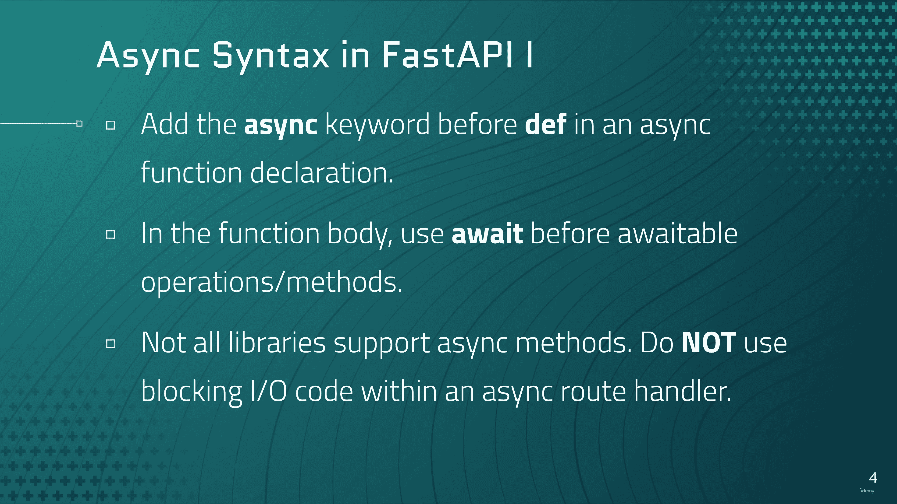
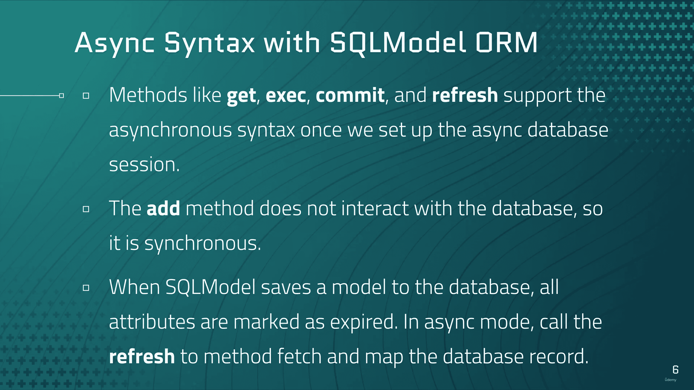

# 🚀 FastAPI 大师课：P93-94：章节回顾


恭喜你完成又一个课程章节。像往常一样，我们先花一点时间回顾本节学到的内容。本节第一份幻灯片其实对这些概念做了更深入的讲解，这里会快速梳理异步相关概念。在本节课中，我们将要学习同步代码与异步代码的区别、异步数据库和异步会话的配置、异步路由处理函数的写法，以及提交后模型过期数据与 `refresh` 的关系。下面从同步代码和异步代码开始。


## 🔁 FastAPI 大师课：P93-94：同步代码与异步代码


同步代码主要会在当前线程上阻塞后续执行，直到某个任务完成。这里的“任务”可以理解为某种操作或待办事项，通常是一些 IO 操作，而且耗时不可预测。下面列出常见的不可预测 IO 操作，方便你建立直观认识。


- 与数据库通信。
- 向另一个 API 发起网络请求。
- 从文件系统读取数据或向文件系统写入数据。


这些操作之所以说不可预测，是因为它们可能花费动态变化的时间。异步代码通常更有优势，因为它可以在第一个任务等待 IO 时，把执行权转移给另一个任务，让程序先去做别的事情。用公式表示就是：


\[
\text{同步：线程} \rightarrow \text{任务 A 阻塞等待 IO} \rightarrow \text{任务 A 继续}
\]


\[
\text{异步：线程} \rightarrow \text{任务 A 等待 IO} \rightarrow \text{任务 B 执行} \rightarrow \text{任务 A 继续}
\]


这种模式非常适合非计算密集型任务。此时第一个任务本质上只是在等待完成，或者等待某件事情发生。我们不想浪费这段时间，而是希望线程或 CPU 在这段时间里做有生产力的事情。在 FastAPI 中，这可以表现为服务器同时响应第二个请求。所有这些复杂逻辑背后由 Python 内置的异步事件循环优雅管理，它负责把控制权从一个任务转移到另一个任务。我们只需要把各个任务标记为可等待对象，你可以把它理解为在函数体中提供可暂停的执行时刻。这不是说代码会故意暂停，而是说当 IO 操作完成期间，异步事件循环可以接管并做别的事情来填补时间。这个时间可能短到只有一秒甚至更短，对人类来说几乎无法感知，但服务器可以在 IO 操作完成的超短时间跨度内完成很多工作。因此，异步代码可以让服务器更快。不过这不一定是保证的，因为可能没有请求进来，或者某个路由处理函数里的操作并不 IO 密集。但如果你确实有大量 IO，异步代码可以让服务器更快，因为同一线程可以更长时间保持忙碌，某个动作或任务不会在同一时刻阻塞其他任务的执行。


上一节我们梳理了同步与异步的基本区别，本节中我们来看看如何让数据库支持异步。


## 🗄️ FastAPI 大师课：P93-94：异步数据库与异步会话


为了让数据库支持异步代码，我们使用了 AIO SQL 库，它是 async IO 的缩写。这个库为 SQL 数据库启用了异步支持，也是我们选择的数据库方案。其他数据库，例如更接近生产环境的 PostgreSQL 和 MySQL，也都有自己的异步驱动和库。我们定制数据库连接的方式，是向新的 `create_async_engine` 函数传入一个字符串。下面用代码展示连接字符串和异步引擎的创建方式。


```python
from sqlalchemy.ext.asyncio import create_async_engine, AsyncSession

engine = create_async_engine(
    "sqlite+aiosqlite:///./database.db"
)
```


在这个字符串中，我们需要指定数据库，还要指定具体驱动，例如 `aiosqlite`，真正启用异步操作的就是这个驱动。在数据库配置文件里，我们更新了数据库设置：创建异步引擎，创建异步会话，并创建异步 `get_session` 依赖。下面列出这几个组成部分，方便你对照重构。


- 异步引擎：通过 `create_async_engine` 创建。
- 异步会话：本质上是支持可等待方法的会话对象。
- 异步 `get_session` 依赖：产出异步会话，而不是普通会话。普通会话的方法在路由处理函数中使用时会阻塞。


声明异步数据库之后，下一步就是把路由处理函数也改成异步。


## 🛣️ FastAPI 大师课：P93-94：异步路由处理函数


我们在任何异步函数或路由处理函数定义的 `def` 前面加上 `async` 关键字。然后在函数体里，在各种可等待操作或方法前使用 `await`。在我们的具体场景中，这些操作是数据库操作，因为它们会花费一定 IO 时间。类似地，向另一个服务器发起请求、从文件系统读取数据等操作，也可以采用同样的方法：选择一个支持可等待操作的库。这样，所有这些操作都可以由 Python 的异步事件循环同时管理。下面用代码展示异步路由的基本写法。





```python
@app.get("/rooms")
async def get_rooms(session: AsyncSession = Depends(get_session)):
    result = await session.execute(select(Room))
    return result.scalars().all()
```


需要特别注意的是，Python 生态中并不是所有库都支持异步方法和异步功能。因此读文档时要小心，要找到使用示例，确认它确实支持 `async` 关键字。不要在异步路由中使用普通的阻塞同步 IO 代码。否则你会在异步操作中间引入阻塞代码，反而让异步事件循环更难管理这些异步操作。我们前面讨论了异步函数，可以在任何可等待操作前使用 `await`，但也可以把异步函数和普通同步函数混在一起使用。在 FastAPI 中这是完全正常的模式，具体取决于函数体在做什么。下面列出选择同步或异步时的判断思路，帮助你保持代码库一致。


- 如果路由包含 IO 或阻塞代码，而且不支持异步，那么使用普通同步函数定义完全可以。语法和本课程前面章节完全一样，没有问题。
- 同步路由甚至可能扩展到更多请求，因为即使不使用异步代码，Python 和 FastAPI 也可以使用更多线程，也就是雇佣更多工作线程来处理额外请求。
- 不过异步能带来非阻塞的好处，所以通常是你应该逐步转向的模式。
- 如果路由不运行任何 IO 代码或阻塞代码，那么选择异步还是同步其实无所谓。它不会用普通阻塞同步代码阻塞异步事件循环。
- 关键是选择一个一致的模式，并在整个代码库中贯穿使用。


在重构过程中，我们把 rooms 路由中的所有路由处理函数都更新为使用 `async` 关键字。然后我们继续更新所有可等待操作，在它们前面加上 `await`。具体来说，`get`、`exec`、`commit`、`refresh` 这些 ORM 方法会访问数据库，因此有等待时间。下面用代码展示这些方法加 `await` 的典型形式。


```python
result = await session.execute(select(Room))
await session.commit()
await session.refresh(room)
```


这些方法都需要在调用前加上 `await`，而这只可能因为我们现在使用的是新的异步会话对象，而不是普通的同步会话对象。我们还注意到，`add` 方法没有发生任何变化。这是因为它实际上并不与数据库交互。它是普通的同步方法，但更重要的是，它是非阻塞的。下面解释 `add` 方法为什么不需要 `await`。


- `add` 方法只是接收会话，并把某种最终的数据库操作排入队列，例如通过把 SQLModel 实例转换成对应的 SQL 查询来保存记录。
- 这里没有实际等待或暂停发生。我们并不是在等待数据库，只是把更改加入队列，这些更改最终会进入数据库。
- 我们可以使用类型检查器知道哪些方法可等待，从而知道哪些方法需要 `await` 关键字。幸运的是，代码编辑器会帮助我们识别错误，特别是库的异步 API 与同步 API 使用上的错误。


上一节我们完成了异步路由重构，本节中我们来看看提交后模型数据过期的问题，以及为什么必须调用 `refresh`。


## ♻️ FastAPI 大师课：P93-94：模型过期数据与 refresh


我们还讨论了模型上的过期数据或陈旧数据问题，具体来说是模型实例上的过期数据。当 SQLModel 把模型保存到数据库时，每当我们调用 `commit` 方法，它会把属性标记为过期。原因是数据库中的数据可能与我们发送的数据不同。即使我们发送同一份载荷，数据库也可能执行额外转换，例如转为小写、移除某些字符或空白。因此模型实例中可能存在陈旧数据。下面列出调用 `refresh` 的原因和注意事项。


- 调用 `refresh` 方法可以从数据库那一行获取保证最新的数据。
- 在之前的同步示例中，如果访问某个模型实例上的属性，会话会在幕后再发起一次同步请求到数据库，获取最新数据。每当我们访问属性时，这种幕后行为会自动发生。
- 现在的问题是我们不想引入这类同步数据获取，因为我们生活在异步环境中。
- 我们处在异步函数中，正在等待 `get`、`commit`、`refresh` 等操作，引入同步代码可能带来麻烦和问题。
- 实际上，如果尝试这样做，会得到 `500 Internal Server Error`。


因此，如果你在调用 `commit` 之后要访问模型实例上的任何属性，现在就更加必须调用 `refresh` 方法，确保不会执行意外的懒加载，从而强制同步获取数据库数据。现在所有操作都必须是异步的，因为我们生活在这个新领域，这是 Python 中另一种做事方式。我们获得异步代码的优势，因此希望保持所有代码异步。所以必须显式手动调用 `refresh`。通常我们本来就应该这样做，但现在必须确保在访问模型实例任何属性之前完成这一步。


## ✅ FastAPI 大师课：P93-94：本节总结




本节中我们一起学习了同步代码与异步代码的区别、异步数据库和异步会话的配置、异步路由处理函数的写法，以及提交后模型过期数据与 `refresh` 的关系。异步代码让代码库更高效，具备额外容量处理多个请求。现在只要某个线程在第一个任务等待 IO 时还有能力做其他任务，它就不会被阻塞。借助 Python 的异步事件循环，线程可以去做别的事情，然后再回来完成原来的任务。到这里一切都在良好状态，下一节再见。

