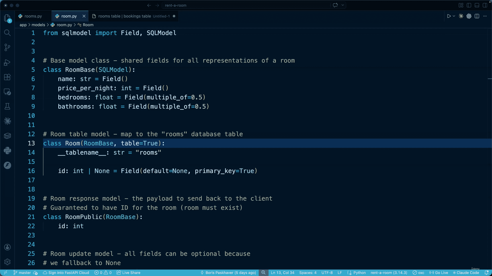
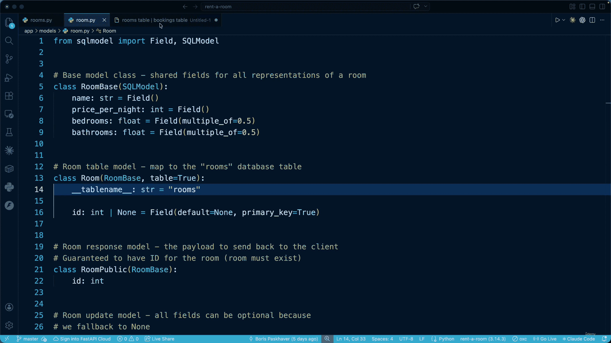
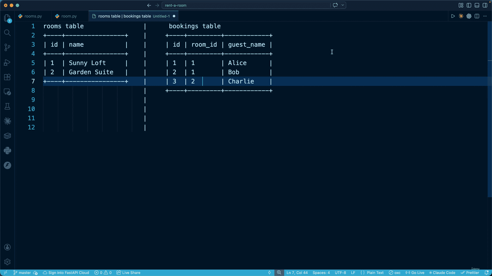

# 🗄️ Udemy - FastAPI Masterclass part1：p94 95：数据库关系入门


在本节课中，我们将学习数据库关系这个主题。欢迎来到课程的下一部分。在本节中，课程会介绍数据库关系。接下来要构建的新功能是 rent a room API 中的预订概念，也就是 booking。所谓 booking，就是用户实际预订一个房间一段时间，用来满足住宿需求。为了支持这个功能，我们会引入多个新模型，并让这些模型映射到数据库中的多张新表。换句话说，模型负责在 Python 代码里表达业务对象，表负责在数据库里保存数据，两者需要一一对应起来。


**🧭 课程背景与本节目标**

上一段我们说明了 booking 功能的目标，接下来看看它会带来哪些模型和关系。为了支持预订功能，我们会引入多个新模型，并把它们映射到多张新表。例如，我们会引入一个用户模型，也就是 user model，用来表示用户这个概念。一个用户可能包含姓名和邮箱地址这类信息。类似地，我们会引入一个新的预订模型，也就是 booking model，用来保存某一次具体住宿的信息。这个 booking 会和一个 user 关联，也会和一个对应的 room 关联。这里说到的关联，指的就是模型之间的连接关系。一个模型知道它和另一个模型之间存在关系，这就叫关联。例如，booking 模型会记录用户，也会记录这个用户预订的房间。因此，booking 模型存在的主要作用，就是把另外两个模型连接在一起。本节会介绍多种不同的关联或关系，包括一对一、一对多、多对多这些结构，也会介绍数据库层面的概念，例如级联和预加载。

以下是本节会涉及的关系类型和数据库特性列表：



- 一对一关系（one-to-one）：一个模型对应另一个模型的一条记录。

- 一对多关系（one-to-many）：一个模型可以对应另一个模型的多条记录。

- 多对多关系（many-to-many）：两个模型之间可以互相对应多条记录。

- 级联（cascades）：数据库操作在关联记录之间产生连锁效果。

- 预加载（eager loading）：查询一条记录时，把关联数据一起加载出来。


在了解本节目标之后，我们来看看当前项目代码。查看当前项目代码时，可以看到在 `app/models.py` 中有一个 `Room` 类。这个类是一个 SQLModel，并且设置了 `table=True`。它也是当前唯一映射到数据库表的模型，对应的表是 `rooms`。因此，当前数据库里只有一张表。在真实世界里，一个类似 Airbnb 应用中的房间，会通过关联连接到很多其他业务概念，例如预订、客人、评论、消息、支付等。以下是房间在真实业务中可能关联的对象列表：

- 预订（bookings）

- 客人（guests）

- 评论（reviews）

- 消息（messages）

- 支付（payments）

- 以及其他更多业务对象


这些业务对象会存放在关系型数据库中的各自独立表里，例如 SQL 数据库或 PostgreSQL。问题在于，我们如何在数据库表之间建立连接，同时也在 Python 代码的模型之间建立连接。例如，如果一个 booking 同时属于一个 room 和一个 user，那么怎样在代码中表达这种关系，使得从数据库查询一个 booking 时，也能带出对应的下单用户以及这个 booking 对应的房间。这些表之间的连接和关联，就叫数据库关系。数据库关系可以把一组彼此独立的表，变成一个对真实业务有用的、互相连接的数据模型。上一段我们看到了当前项目只有一张表，接下来就来看看建立关系的关键工具：外键。


**🔑 外键：把多张表连接起来的胶水**

在关系型数据库中，数据存放在表里，建立关系的方式是使用外键。外键就是表中的一个列，它引用另一张表的主键。外键的作用像胶水，把不同表中的记录连接起来。可以用一个公式来描述这种指向关系：



```text
bookings.room_id  ->  rooms.id
```

这里有一张快速草图，讲师会在另一个标签页中打开它。在草图左侧，可以想象一个简化版的 room 表。每个 room 都会有一个 ID，还会有一个 name。真实数据库里还会有 bedrooms 和 bathrooms 这类列，不过它们在这里并不重要。在草图右侧，是之后要创建的 bookings 表。每当有客人完成预订，例如这里的客人 Alice，我们需要把她预订的房间关联回 room 表中对应的那一行记录。我们通过外键来完成这个关联。在 booking 表中，有一个叫 `room_id` 的列，这个列里的值就是外键。这些值是另一张表中主键的标识符。在这个例子里，另一张表就是 rooms 表。例如，booking 表中的某条记录里写着 `room_id=1`，这就告诉我们，这个预订对应的是 ID 为 1 的房间，也就是名字为 Sunnyloft 的房间，以及这个房间保存在数据库里的其他特征。

为什么数据库要采用这种方式。原因在于，如果不采用这种方式，那么每次创建 booking 并保存信息时，都要把房间的名称、价格、卧室数量、浴室数量这些信息复制粘贴一遍。这样做是冗余的，因为这些信息和房间表里的信息完全相同。所以更好的做法是只保存一个标识符，也就是外键，用它关联回 room 表中对应的那条记录。现在假设有另一个客人 Charlie 完成预订，我们只要知道 Charlie 预订的是 ID 为 2 的房间，就能通过 `room_id=2` 找到对应的房间记录。再次说明，`room_id` 就是外键列。它叫外键，是因为 key 表示标识符，而 foreign 表示这个标识符存在于另一张表中。这些值例如 1、2，是 room 表中主键 ID 列的标识符。它们之所以是外键，是因为它们指向另一张表，而不是指向自己所在的 bookings 表。

外键并不只限于一个列。同一张表里可以有多个外键列。例如，可以想象这里还有第三张表，也就是 users 表。users 表可能有用户 ID、名字、邮箱和密码。我们同样可以在 booking 表中增加第二个外键列 `user_id`，让它指向 users 表中的某条记录。这样 booking 就能记录预订了哪个房间，也能记录是哪个用户完成了这次预订。核心代码可以表示成下面这样：

```python
class User(SQLModel, table=True):
    id: int | None = Field(default=None, primary_key=True)
    first_name: str
    email: str
    password: str


class Booking(SQLModel, table=True):
    id: int | None = Field(default=None, primary_key=True)
    room_id: int = Field(foreign_key="rooms.id")
    user_id: int = Field(foreign_key="users.id")
```

通过这种方式，我们就可以在多张表之间建立关联或连接。类似地，在实际运行的代码里，我们也会在 SQLModel 模型之间建立同样的关联或关系。上一段我们弄清楚了外键如何连接表，接下来把本节涉及的概念收拢一下，方便初学者形成整体印象。


**📌 本课总结**

在理解外键的作用之后，本节也接近尾声。本节课中，我们一起学习了数据库关系的基础内容。可以归纳为下面几个要点：

- 数据库关系用来描述表与表之间、模型与模型之间的连接。

- booking 表示用户预订房间一段时间，它会连接 user 和 room。

- 外键是表中的一个列，用来引用另一张表的主键。

- 外键可以避免重复保存房间信息，只保存一个标识符即可关联回对应记录。

- 一张表可以有多个外键列，例如 booking 同时保存 `room_id` 和 `user_id`。

- 本节还会继续介绍一对一、一对多、多对多，以及级联和预加载这些数据库概念。




这些内容就是数据库关系的入门基础。希望这些解释容易理解，下一节课再见。

