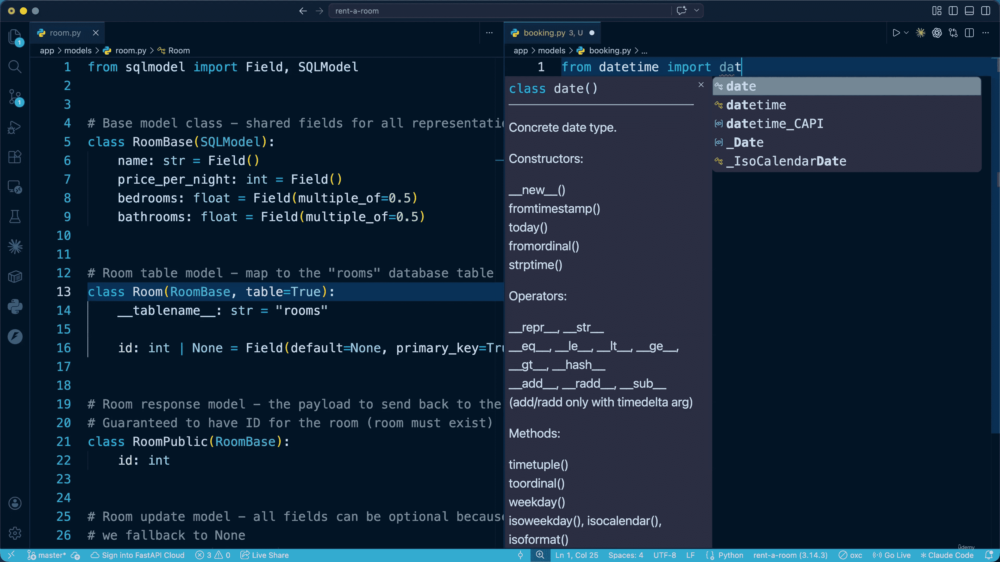
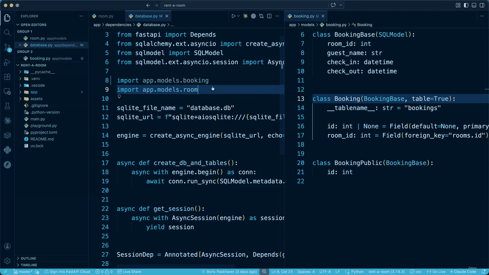
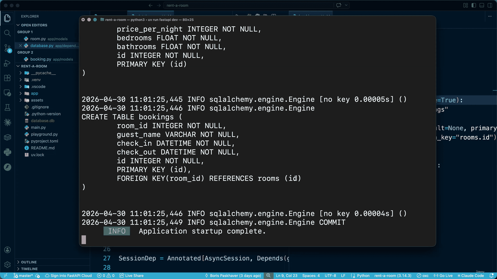
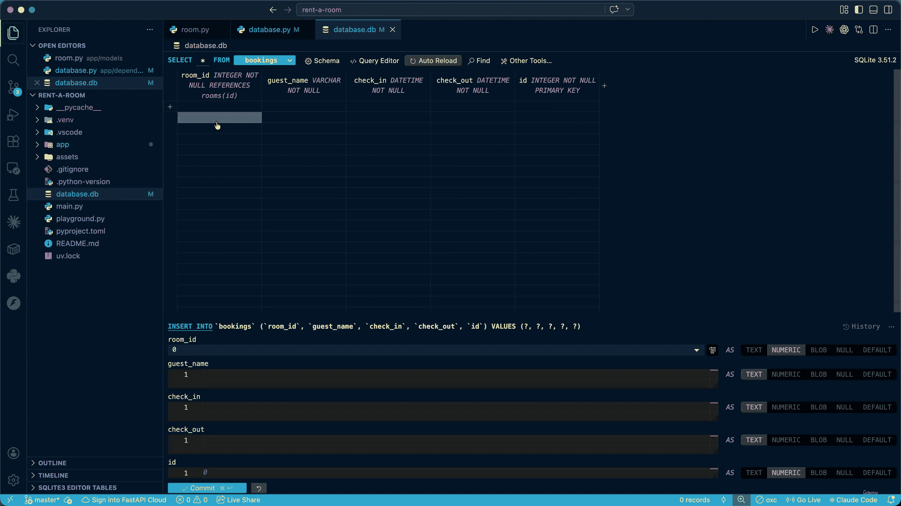

# 🏨 FastAPI 大师课：p95：创建预订模型

在本节课中我们将要学习如何创建一套用于表示预订的模型集合。预订可以理解为客人在租赁或房间服务中某个给定房间里的一次入住，并且这个预订以后还要与用户建立连接；用户模型会在稍后添加。本节会沿用room.py的建模思路，先建立用于数据验证的基础SQLModel类，再建立一个真正映射到数据库bookings表的表模型，最后补上响应模型和启动时的模型注册。这样安排的目的，是让数据验证、数据库映射和响应输出各自负责一部分工作。下面从预订的业务含义和整体建模方法开始。

## 🧭 FastAPI 大师课：p95.1：预订的业务含义与建模思路

上一节概述说明了预订是给定房间的一次入住。本节中我们来看看如何把这个业务概念拆成几个模型。创建一个预订意味着客人在某个房间住一段时间，这个预订以后还会关联到一个用户。为了保持代码一致，我们会使用models目录中的room.py作为参考，采用非常相似的做法。具体来说，会有一组基础SQLModel类，这些类只用于验证；还会有一个类真正表示数据库里bookings表的映射。这样分开的好处是，基础模型不接触数据库，表模型才处理主键、外键、表名等数据库细节。

下面是这个建模思路中的几个核心对应关系，先给出公式，便于把概念放在一起看。

\[
BookingBase \subset SQLModel \quad \text{且没有 table=True，只做数据验证}
\]

\[
Booking(BookingBase,\ table=True) \leftrightarrow \text{数据库中的 bookings 表}
\]

\[
BookingPublic(BookingBase) \to \text{返回给客户端的响应形状}
\]

这些关系说明，预订模型不是一个大类包办所有事情，而是按用途拆开。基础类负责字段约束，表模型负责数据库映射，响应模型负责输出。理解这个分工后，就可以开始新建文件并编写代码。

## 🧱 FastAPI 大师课：p95.2：新建 booking.py 并准备导入

上一节我们介绍了模型分工，本节中我们来看看文件层面的准备。在app/models目录中新建一个文件，命名为booking.py；文件名保持单数形式。然后把这个文件与room.py并排打开，这样可以在编写新代码时参考room.py的结构。和room.py一样，先从sqlmodel导入几个构造，包括Field类和SQLModel类。这里有一个关键认知：SQLModel在底层只是Pydantic BaseModel的子类；在没有给子类继承加上table=True之前，它基本上就是一个普通的Pydantic基础模型，也就是数据验证模型。

下面列出本节需要用到的导入和准备动作，先做简要说明，再按步骤执行。

- 在app/models目录创建文件名保持单数的booking.py。

- 将booking.py与room.py并排打开，参考room.py的写法。



- 从sqlmodel导入Field类和SQLModel类。

- 记住在添加table=True之前，模型只承担Pydantic验证职责。

完成这些准备后，文件里还没有任何数据库表映射。接下来先写一个顶层基础类，把多个预订模型共用的字段放进去。

## 🧩 FastAPI 大师课：p95.3：编写 BookingBase 公共验证模型

上一节准备好了文件和导入，本节开始声明预订模型层级中的超类。与room_base的做法非常相似，声明一个名为BookingBase的类，并让它继承SQLModel。这个类用来存放许多其他模型会共同拥有和共享的属性，后面的子类会继承它。它位于模型层级的顶部，是超类；同时它现在没有table=True，所以它仍然只是普通的Pydantic验证模型。这个模型可以表示创建预订时POST请求载荷的数据形状，也就是客户端发往POST请求的数据长什么样。

为了更直观，下面是BookingBase的核心结构。这里先写字段类型，外键细节留给表模型处理。

```python
from datetime import datetime
from sqlmodel import SQLModel, Field

class BookingBase(SQLModel):
    room_id: int
    guest_name: str
    check_in: datetime
    check_out: datetime
```

这个类里的四个字段分别对应房间标识、客人姓名、入住时间和退房时间。下面逐项说明这些字段的含义和当前处理方式。

- room_id表示预订对应的房间标识，当前先声明为整数。

- guest_name表示发起预订的客人姓名，当前使用字符串。

- check_in表示入住时间，使用Python原生datetime类。

- check_out表示退房时间，同样使用datetime类。

先看room_id。它是关键组件，因为这个标识要映射回room表中的一个房间。现在先把它声明为整数；稍后声明真正代表数据库表模型的子类时，会覆盖这个字段，更明确地声明它是指向rooms表的外键连接。再看guest_name。每个预订都会有一个客人姓名，现在先存这个姓名；当前不关注用户模型，用户模型以后再加。每个预订还需要入住时间和退房时间，所以需要从datetime模块导入datetime类；这个类的对象表示一个时间点，同时包含日期和时间。JSON本身没有日期或时间对象的概念，因此客户端发送载荷时，实际上会发送保存日期时间表示的字符串。Pydantic会自动把字符串转换或强制转换为对应的datetime对象；后续通过ORM调用数据库时，ORM会创建datetime列，现代数据库如Postgres和SQL都支持datetime列。现在还没有连接实际的数据库或表，所以这里只是普通验证模型。退房时间也声明为datetime。当前不存储任何时区信息，目的是保持简单；真实生产环境的Airbnb克隆可能需要处理时区，因为不同用户可能位于世界不同地区，但本课程暂时使用naive datetime，也就是不带任何时区的datetime。用户可以提供入住和退房时间字符串，Pydantic会把它转换为等价的datetime对象；如果字符串转换失败，Pydantic会在到达路由处理函数之前抛出异常。基础验证模型完成后，就可以建立真正映射数据库表的模型。

## 🗄️ FastAPI 大师课：p95.4：创建 Booking 表模型与表名

上一节我们完成了只做验证的BookingBase，本节中我们来看看如何让它连接到数据库表。在下面声明一个名为Booking的类，并让它继承上面的BookingBase。此时还没有任何数据库特定内容；先定义一个SQLModel类，它会继承上面类的全部属性，然后可以添加新属性或覆盖已有属性。当前这些代码严格来说仍然是Pydantic和Python层面的定义。添加table=True后，情况发生变化；这是SQLModel的核心组件。SQLModel会理解这个类、这个模型与一个对应的数据库表是一对一映射；启动应用时，如果表不存在，就会在数据库中创建它。

下面的代码展示了Booking表模型的基本骨架，包含表名、主键和后续要覆盖的外键字段。

```python
class Booking(BookingBase, table=True):
    __tablename__ = "bookings"

    id: int | None = Field(default=None, primary_key=True)
    room_id: int = Field(foreign_key="rooms.id")
```

先说明表名。默认情况下，SQLModel和SQLAlchemy会选择单数表名booking；数据库表通常保存多条记录，所以更希望表名使用复数。与room.py的做法类似，使用双下划线写法声明__tablename__，类型标注为字符串，并指定不同的表名为复数bookings。接着声明id属性。现在Booking类会拥有BookingBase里的四个字段，再加上一个id字段。一个Booking实例既可能表示写入数据库之前的预订记录，也可能表示写入数据库之后的记录；因此要同时容纳两种情况：写入后id是数字，写入前id可能还不存在。于是id主键的类型写成整数或None。这里沿用room.py的语法，使用Field类；当从客户端载荷实例化Booking且没有id值时，默认回退为None。非常重要的是，使用SQLModel提供的primary_key参数，声明id列是新bookings表的主键；主键列用来标识每一行。

这些内容是对课程前面概念的复习。接下来是关键的新组件：外键。Booking类会从上面的BookingBase继承room_id属性，但数据库并不知道room_id要作为外键。当前Booking类会创建bookings表，表中有一个room_id整数列，用来存整数；但它不知道这些整数要映射回rooms表，也不知道它们要作为外键连接到rooms表的id列。目前这只是一个普通整数列。因此要在Booking类中重新声明room_id并覆盖它。为什么在Booking类而不是在BookingBase中做这件事？因为Booking才是处理数据库表的模型；BookingBase是普通Pydantic模型、基础模型或普通SQLModel，不具备数据库知识。主键声明、外键声明这类数据库特定操作，要限制在Booking这个表模型里。

下面是外键字段的完整写法。字符串先写目标表rooms，然后写一个点，再写目标列id。

```python
room_id: int = Field(foreign_key="rooms.id")
```

这行代码表达的含义是：bookings表中会有一个room_id列，列中的值是整数；更重要的是，这些整数是外键，指向rooms表中的id列。这样数据库在获取某条预订记录时，就知道可以通过这个连接或桥接关系，根据room_id找到对应的room记录，也就知道这个预订对应哪个房间。需要说明的是，现在建立的是数据库层面的连接；稍后还需要在Python代码中做一些额外接线，才能把关系在代码层建立起来。Booking表模型到这里就足够了，但还需要一个返回给客户端的响应模型。

## 📤 FastAPI 大师课：p95.5：编写 BookingPublic 响应模型

上一节完成了数据库表模型，本节中我们来看看响应载荷的形状。与前面的做法类似，在下面再添加第三个类，名为BookingPublic。这个类表示发送回客户端时的载荷响应形状；它假设预订已经创建，或者客户端正在请求单条预订并希望看到全部信息。在这个场景里可以保证id一定存在，所以它表示预订持久化到数据库之后的状态。这里再次继承BookingBase，而不是继承Booking。不要把继承关系指向代表数据库表连接的类；表模型应该独立存在，但可以继承基础验证类。因为继承的是BookingBase，所以会继承全部字段；这就是响应载荷的形状。在此基础上再添加id字段，此时id始终是整数并且一定存在。

下面的代码展示了响应模型与表模型的继承关系，核心区别在于响应模型不接触数据库。

```python
class BookingPublic(BookingBase):
    id: int
```

到这里，预订相关的模型类已经比较完整。不过，还需要确保应用启动时能成功创建bookings表；这需要处理模型注册问题。

## 🔌 FastAPI 大师课：p95.6：在 database.py 中注册模型并重建数据库

上一节完成了响应模型，本节中我们来看看如何让建表逻辑认识Booking。打开database.py可以看到，这里会从包含某个SQLModel的文件或模块导入模型；这样做是为了在函数定义之前注册这些模型。原因是每当导入一个SQLModel时，SQLModel会在内部注册表中记录它知道的所有模型。就像这里导入room模块一样，不需要实际使用某个类或文件，只需要保证Python解释器在定义这个函数之前解析了它。类似地，定义一个导入语句，从app目录下的models目录或包中导入booking文件；这样所有类，尤其是Booking类，就会在这个函数运行之前完成注册和确认。

下面是本节涉及的关键动作和验证步骤，先概括，再逐步说明。

- 在database.py中导入booking模块，让Booking表模型注册到SQLModel内部注册表。

- 导入发生在create_db_and_tables函数定义和运行之前。

- 删除旧的database.db文件，简化SQLite下的表结构变更。

- 重启FastAPI服务，观察启动时执行的建表SQL。

这是一个相对复杂的变化，因为不仅引入了新表，新表还与原来的rooms表有连接。真实生产环境会使用迁移工具对数据库做增量修改；SQLite的一个优势是可以简单删除数据库并从头重建。为了保持简单，现在删除代码库顶部的database.db文件：右键点击并选择删除。重启服务器后，SQLModel会发现没有数据库；在FastAPI启动时配置运行的lifespan函数中，会执行create_db_and_tables；此时它已经知道bookings表、rooms表以及两者之间的关联，于是会在新数据库中创建两个空表。

## ✅ FastAPI 大师课：p95.7：启动验证与数据库侧结果



上一节完成了模型注册和数据库重建，本节中我们来看看启动后的实际结果。关闭服务器时使用Ctrl+C，然后运行FastAPI开发服务命令启动。启动输出中应该能看到SQL代码：先创建rooms表，下面再创建bookings表。这些SQL是ORM在应用启动时发出的。注意关键的一行：room_id外键是整数，并且不可为空，也就是值必须始终存在；原因是没有对应的房间ID就不能创建预订。有时外键可以是可选的，如果业务上不是必需；但在本课程的业务域里，有预订就必须有对应房间，所以这一列必须始终有合法整数值，不能为NULL。这里也展示了SQL如何建立连接：room_id外键引用rooms表的id列。这样两张表之间就建立了映射、连接、关联、桥接或关系，这些都是同义说法。关系数据库正是通过这种方式，在不同业务概念之间建立连接。

下面是启动验证中需要检查的要点，先列出来便于对照。

- 启动SQL中先出现rooms表，再出现bookings表。

- bookings表中的room_id是非空整数外键。

- room_id外键引用rooms表的id列。

- 关系数据库据此知道两张表之间的连接。

查看database.db时，由于删除了旧数据库，目前没有任何记录；原来的rooms表完全为空。在数据库工具的下拉列表中可以看到所有表，右侧的可视化图也会显示表之间的连接，因为SQL知道它们存在关系。点击对应的bookings表，仍然没有数据和记录，但可以看到room_id列会引用rooms表的id列，这就是外键。数据库侧一切正常，后续课程可以继续回到模型部分。

## 🧾 FastAPI 大师课：p95.8：本节总结





本节课中我们一起学习了如何创建预订模型集合。我们先把预订理解为给定房间的一次入住，并确定它会稍后关联用户；然后参考room.py建立BookingBase作为只做验证的公共模型，声明room_id、guest_name、check_in和check_out；接着建立Booking表模型，使用__tablename__指定复数表名bookings，声明可为空的主键id，并用Field(foreign_key="rooms.id")覆盖room_id，让它成为指向rooms表id列的外键；随后建立BookingPublic响应模型，继承BookingBase并保证id为整数；最后在database.py中导入booking模块完成模型注册，删除旧SQLite数据库并重启服务，验证启动SQL成功创建rooms和bookings两张表以及它们之间的外键关系。整体来看，验证模型、表模型和响应模型各自负责一部分职责，数据库层面的连接已经建立，后续课程可以继续完善代码层的关联和更多模型。
